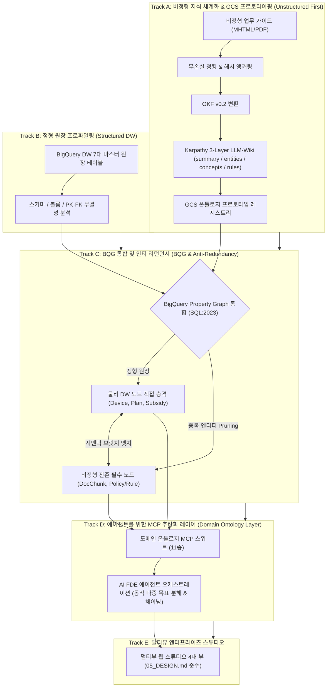

# Enterprise Agentic Ontology Starter Pack
## 엔터프라이즈 에이전틱 온톨로지 스타터 팩

> **0% 환각(Zero-Hallucination)과 결정론적 계산 신뢰성을 보장하는 엔터프라이즈 지식 온톨로지 & 멀티뷰 AI 스튜디오 스타터 킷**

본 저장소는 기업의 정형 데이터웨어하우스(BigQuery DW)와 비정형 업무 규정(SOP/PDF)을 통합하여, 누구나 자신의 비즈니스 데이터만 교체하면 즉시 시맨틱 온톨로지, Karpathy 3-Layer LLM-Wiki, BigQuery SQL:2023 Property Graph, 11종 도메인 MCP 도구, 그리고 4대 멀티뷰 웹 스튜디오를 즉시 구동할 수 있는 완성형 스타터 패키지입니다.

---

### 1. 진화적 온톨로지 통합 아키텍처 (Evolutionary Architecture Journey)



---

### 2. 5대 표준 방법론 가이드 (5-Stage Methodology)

프로젝트 기획부터 프로덕션 배포까지의 모든 엔지니어링 프로세스는 [`methodology/`](methodology/) 디렉토리에 완비되어 있습니다:

- [METHODOLOGY_KO.md](methodology/METHODOLOGY_KO.md) (국문 종합 방법론 및 프로세스 명세서)
- [METHODOLOGY_EN.md](methodology/METHODOLOGY_EN.md) (영문 종합 방법론 및 프로세스 명세서)
- **세부 단계별 실행 가이드**:
  1. [Stage 1: 자산 탐색, 스코핑 및 거버넌스 수집](methodology/01_asset_discovery_and_scoping_ko.md)
  2. [Stage 2: 시맨틱 지식 온톨로지 모델링 & LLM-Wiki](methodology/02_semantic_modeling_and_okf_ko.md)
  3. [Stage 3: BigQuery Property Graph 엔지니어링 및 GQL 질의 체계](methodology/03_property_graph_and_gql_ko.md)
  4. [Stage 4: 멀티도메인 MCP 스위트 구축 및 에이전트 오케스트레이션](methodology/04_multi_domain_mcp_and_agent_ko.md)
  5. [Stage 5: 엔터프라이즈 스튜디오 구축, 자동화 검증 및 프로덕션 배포](methodology/05_enterprise_studio_and_deployment_ko.md)

---

### 3. 프로젝트 디렉토리 구조

```text
agentic-ontology-starter/
├── data/
│   ├── input/               # 사용자 원천 데이터 입고 폴더
│   │   ├── 01_guides/       # 비정형 정책 가이드 매뉴얼 (Markdown/MHTML)
│   │   ├── 02_dialogues/    # 고객 상담 발화 및 FAQ (CSV)
│   │   ├── 03_tables/       # 마스터 DW 원장 스키마 DDL 및 샘플 CSV
│   │   ├── 04_cq/           # 20대 Golden CQ 평가셋 (JSON)
│   │   └── 05_glossary/     # 표준 비즈니스 용어사전 (JSON)
│   ├── llm_wiki/            # Karpathy 3-Layer 지식 위키 & GCS 프로토타입
│   │   ├── summary.md       # Layer 1: 도메인 개요 및 거버넌스
│   │   ├── entities.md      # Layer 2: 비정형 후보 엔티티 디렉토리
│   │   ├── concepts.md      # Layer 3: 78종 시맨틱 개념 및 분류 체계
│   │   ├── rules.md         # Layer 3: 180일 식스플랜 및 위약금 산출 규칙
│   │   └── gcs_prototype_manifest.json # GCS 프로토타입 메타데이터
│   └── output/              # 파이프라인 자동 생성 산출물 (OKF, DDL, 토폴로지)
├── pipeline/                # 원클릭 지식 파이프라인 엔진
│   ├── ingest.py            # 비정형 파싱, 해시 앵커링, LLM-Wiki 생성, OKF 컴파일러
│   ├── graph_builder.py     # 2-Layer 안티 리던던시 BigQuery Property Graph DDL 생성기
│   └── validator.py         # 0% 환각 및 CQ 벤치마크 검증기
├── src/
│   ├── agent/               # AI FDE 에이전트 및 MCP 도구셋
│   │   ├── mcp_server.py    # 11종 멀티도메인 MCP 서버 (비즈니스 5 + 엔지니어링 6)
│   │   └── reasoning_engine.py # 동적 다중 목표 분해 & 크로스도메인 체이닝 엔진
│   └── web/                 # 05_DESIGN.md 준수 4대 멀티뷰 엔터프라이즈 스튜디오
│       └── studio_server.py # 단일 포트 경량 웹 서버 (외부 종속성 0개)
├── methodology/             # 5단계 방법론 명세서 및 10개 하부 가이드
├── run_pipeline.py          # 원클릭 파이프라인 실행 진입점
├── requirements.txt         # 필수 파이썬 라이브러리
├── Dockerfile               # 프로덕션 컨테이너 빌드 파일
└── .env.example             # 환경설정 템플릿
```

---

### 4. 4대 멀티뷰 엔터프라이즈 스튜디오

`05_DESIGN.md` 표준을 100% 준수한 단일 포트 경량 웹 스튜디오(`src/web/studio_server.py`)가 제공됩니다:
1. **AI FDE Studio**:
   - 11종 도메인 MCP 도구 카탈로그 (비즈니스 5종 vs 엔지니어링 6종 필터).
   - 동적 다중 하위 목표 분해(`Sub-Goals`) 및 시퀀셜 체이닝(`SEQUENTIAL_CHAIN`) 타임라인.
   - 중간 관측(`Intermediate Observation`) 및 크로스도메인 통합 리포트.
2. **Asset Management Studio**:
   - 좌측: 비정형 정책 가이드, SHA-256 불변 해시 앵커 청크(`DocChunk`), Karpathy 3-Layer LLM-Wiki 뷰어.
   - 우측: BigQuery DW 마스터 원장 테이블(`dw_device_master`, `dw_plan_master`, `dw_subsidy_policy_master`) 스키마 및 레코드 뷰어 (`[Direct Node Promotion]` 노복제 원칙).
3. **Property Graph Visualizer**:
   - 2-Layer 안티 리던던시 2D 인터랙티브 토폴로지 맵 (정형 노드: 파랑, 비정형 노드: 보라, 시맨틱 브릿지: 초록 점선).
   - 노드 클릭 시 속성/스키마 인스펙터.
   - 선언적 SQL:2023 Property Graph DDL 및 GQL 쿼리 테스트 러너.
4. **CQ Benchmark Studio**:
   - 20대 Golden CQ 평가 매트릭스, 기대 정답값, 실제 FDE 출력값, 법적 해시 앵커.
   - 100% 일치율, 0.0% 환각률 실측 KPI 카드 및 원클릭 자동화 검증 버튼.

---

### 5. 빠른 시작 가이드 (Quickstart in 3 Minutes)

#### 1단계: 저장소 복제 및 의존성 설치
```bash
git clone https://github.com/seanjungG/agentic-ontology-starter.git
cd agentic-ontology-starter
pip install -r requirements.txt
```

#### 2단계: 데이터 입고 및 파이프라인 실행
원천 데이터를 `data/input/`에 넣고 원클릭 파이프라인을 실행합니다:
```bash
python3 run_pipeline.py
```
> 실행 결과:
> - `data/output/doc_chunks.jsonl`: 불변 해시가 부여된 텍스트 청크
> - `data/llm_wiki/`: Karpathy 3-Layer 위키 (`summary.md`, `entities.md`, `concepts.md`, `rules.md`)
> - `data/output/ontology.jsonld`: OKF v0.2 지식 온톨로지
> - `data/output/create_property_graph.sql`: BigQuery Property Graph 물리 DDL
> - `data/output/cq_benchmark_report.json`: 100% 수치 일치율 및 0% 환각 검증 리포트

#### 3단계: 멀티뷰 엔터프라이즈 스튜디오 실행
```bash
python3 -m src.web.studio_server
```
브라우저에서 `http://127.0.0.1:8088`에 접속하여 4대 스튜디오를 즉시 활용할 수 있습니다.

