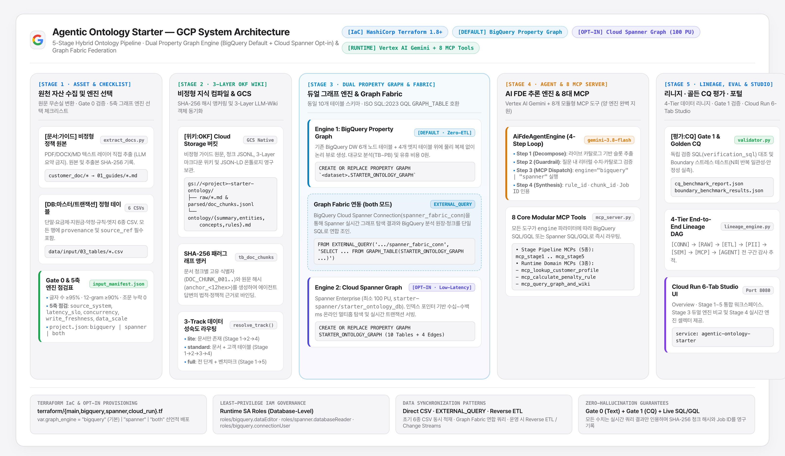

# Agentic Ontology Starter

정형 데이터(BigQuery DW / Cloud Spanner)와 비정형 정책 문서(업무 가이드·약관·SOP)를 **3-Layer 위키(OKF v0.2)**와 **듀얼 Property Graph 엔진(BigQuery Property Graph 기본 + Cloud Spanner Graph 선택 + Graph Fabric 연동)**으로 결합하고, **8종 MCP 도구**와 **Vertex AI Gemini 에이전트(`gemini-3.8-flash`)**로 검증·서빙하는 **5-Stage 에이전틱 온톨로지 교육 · 테스트 · 부트스트랩용 레퍼런스 스타터 팩**입니다.

---

## 목차 (Table of Contents)

1. [프로젝트 개요 (Project Overview)](#1-프로젝트-개요-project-overview)
2. [부트스트랩 방법 (How to Bootstrap — AI 에이전트 & 터미널)](#2-부트스트랩-방법-how-to-bootstrap--ai-에이전트--터미널)
   - [2.1 AI 코딩 툴(Antigravity · Cursor · Claude Code) 호출 방식](#21-ai-코딩-툴antigravity--cursor--claude-code-호출-방식)
   - [2.2 단계별 수행 요청 프롬프트 (Step 1: 환경 셋팅 → Step 2: 데이터 인입 → Step 3: 온톨로지 구축)](#22-단계별-수행-요청-프롬프트-step-1-환경-셋팅--step-2-데이터-인입--step-3-온톨로지-구축)
   - [2.3 데이터 상황별 시나리오 선택 & 원샷 프로토타이핑 명령](#23-데이터-상황별-시나리오-선택--원샷-프로토타이핑-명령)
   - [2.4 터미널 수동 실행 가이드 (CLI Quickstart & Terraform)](#24-터미널-수동-실행-가이드-cli-quickstart--terraform)
3. [데이터 설명 (Data Architecture & Provenance Governance)](#3-데이터-설명-data-architecture--provenance-governance)
   - [3.1 입력 데이터 4대 계층 및 출처(`provenance`) 원칙](#31-입력-데이터-4대-계층-및-출처provenance-원칙)
   - [3.2 10개 물리 테이블 & 3-Layer OKF 위키 구성](#32-10개-물리-테이블--3-layer-okf-위키-구성)
4. [프로세스 (5-Stage Pipeline & 5축 그래프 엔진 선택 체크리스트)](#4-프로세스-5-stage-pipeline--5축-그래프-엔진-선택-체크리스트)
   - [4.1 5축 그래프 엔진 선택 체크리스트 (BigQuery 기본 vs. Cloud Spanner 선택 vs. Both 연동)](#41-5축-그래프-엔진-선택-체크리스트-bigquery-기본-vs-cloud-spanner-선택-vs-both-연동)
   - [4.2 8단계 엔지니어링 흐름 & 5-Stage · 스튜디오 · 방법론 · 한/영 노트북 통합 지도](#42-8단계-엔지니어링-흐름--5-stage--스튜디오--방법론--한영-노트북-통합-지도)
5. [GCP 시스템 아키텍처 (GCP System Architecture)](#5-gcp-시스템-아키텍처-gcp-system-architecture)
   - [5.1 아키텍처 다이어그램](#51-아키텍처-다이어그램)
   - [5.2 듀얼 엔진 & Graph Fabric (`EXTERNAL_QUERY` / Reverse ETL / Change Streams) 연동 구조](#52-듀얼-엔진--graph-fabric-external_query--reverse-etl--change-streams-연동-구조)
6. [디렉터리 구조 (Directory Structure)](#6-디렉터리-구조-directory-structure)
7. [License](#7-license)

---

## 1. 프로젝트 개요 (Project Overview)

**Agentic Ontology Starter**는 기업 내 산재한 비정형 정책 문서(PDF·DOCX·MD·TXT)와 정형 마스터/트랜잭션 원장(CSV·BigQuery·Spanner)을 단일 지식 체계로 엮어, 환각(Hallucination) 없는 계산과 출처 인용(`rule_id`, `chunk_id`, `SHA-256 hash_anchor`, `Job ID`)을 수행하는 엔터프라이즈 AI 에이전트 참조 아키텍처입니다.

- **핵심 설계 원칙**:
  1. **원문 보존 변환 (Gate 0)**: 고객 원본 문서(`customer_doc/`)를 LLM 요약 없이 파서로 직접 추출하고 글자 수 비율(≥95%), 12-gram 보존율(≥95%), 조문 번호 누락 0건을 검증합니다.
  2. **데이터 성숙도 기반 3-Track 자동 분기 (`resolve_track()`)**: 문서만 있으면 `lite`(Stage 1→2→4), 문서+고객 테이블이 있으면 `standard`(Stage 1→2→3→4), 전체 벤치마크까지 포함하면 `full`(Stage 1→5)로 자동 라우팅합니다.
  3. **듀얼 Property Graph 엔진 & Graph Fabric**: **BigQuery Property Graph(ISO SQL:2023 GQL)**를 기본(Default, Zero-ETL)으로 사용하며, 초저지연 온라인 트랜잭션 서빙이 필요한 경우 **Cloud Spanner Graph(ISO GQL)** 또는 **`both` 모드(BigQuery `EXTERNAL_QUERY` 기반 Graph Fabric 연합 조인)**를 선택할 수 있습니다.
  4. **고객 프로젝트 격리 (`projects/<id>/`)**: 루트 샘플 데이터를 수정하지 않고 `python3 new_project.py <id>`로 독립 프로젝트를 생성하여 멀티 도메인을 안전하게 운영합니다.
- **라이브 스튜디오 (Cloud Run)**: [https://agentic-ontology-starter-lwrlf7yogq-du.a.run.app](https://agentic-ontology-starter-lwrlf7yogq-du.a.run.app)
- **핵심 문서 및 자산 허브**:
  - [**마스터 제품·아키텍처 헌장 (`01_prod.md`)**](./01_prod.md) · [**상황별 빠른 프로토타이핑 플레이북 (`PROTOTYPING_PLAYBOOK.md`)**](./PROTOTYPING_PLAYBOOK.md) · [**UI 디자인 표준 (`DESIGN.md`)**](./DESIGN.md)
  - **툴별 에이전트 가드레일**: [**Antigravity (`GEMINI.md`)**](./GEMINI.md) · [**Cursor (`.cursorrules`)**](./.cursorrules) · [**Claude Code (`CLAUDE.md` / `AGENTS.md`)**](./CLAUDE.md)
  - [**4대 산업군 8종 비식별 레퍼런스 템플릿 (`industry_cases/README.md`)**](./industry_cases/README.md) — 제조 · 금융 · 리테일 · 통신 스키마/규칙/CQ 샘플
  - **방법론 마스터 가이드**: [한국어 (`METHODOLOGY_KO.md`)](./methodology/ko/METHODOLOGY_KO.md) · [English (`METHODOLOGY_EN.md`)](./methodology/en/METHODOLOGY_EN.md)
  - **교육용 슬라이드 덱 (18슬라이드 · 국/영문)**: [슬라이드 허브 (`slides/README.md`)](./slides/README.md) · [국문 `.pptx`](./slides/ko/agentic_ontology_methodology_training_ko.pptx) · [English `.pptx`](./slides/en/agentic_ontology_methodology_training_en.pptx) · [국문 웹 뷰어 (`.html`)](./slides/ko/agentic_ontology_methodology_slides_ko.html) · [English Web Viewer (`.html`)](./slides/en/agentic_ontology_methodology_slides_en.html)
  - **실행형 Jupyter 노트북 (12종 · `ko/` 6종 + `en/` 6종)**: [노트북 허브 (`notebooks/README.md`)](./notebooks/README.md) · [전체 흐름 초기 노트북 (`ko/`)](./notebooks/ko/stage0_overview_walkthrough_ko.ipynb) · [English Overview Notebook (`en/`)](./notebooks/en/stage0_overview_walkthrough_en.ipynb)

---

## 2. 부트스트랩 방법 (How to Bootstrap — AI 에이전트 & 터미널)

이 스타터팩을 클론하여 새로운 프로젝트를 시작할 때, 에이전트가 임의로 디렉터리 구조를 바꾸거나 Mock SQLite·다크 테마 화면을 새로 작성하지 않도록 루트에 **[`01_prod.md`](./01_prod.md), [`GEMINI.md`](./GEMINI.md), [`CLAUDE.md`](./CLAUDE.md), [`.cursorrules`](./.cursorrules), [`PROTOTYPING_PLAYBOOK.md`](./PROTOTYPING_PLAYBOOK.md)**가 내장되어 있습니다.

### 2.1 AI 코딩 툴(Antigravity · Cursor · Claude Code) 호출 방식

| 코딩 툴 | 자동 로드되는 규칙 파일 | 명령 시 권장 컨텍스트 멘션 & 슬래시 커맨드 | 특징 및 팁 |
| :--- | :--- | :--- | :--- |
| **Antigravity (Jetski)** | `GEMINI.md`, `01_prod.md` | 프롬프트 첫 줄에 `@01_prod.md @GEMINI.md @PROTOTYPING_PLAYBOOK.md` 멘션 후 끝에 **`/goal`** (자율 완결 실행) 또는 **`/grill-me`** (사전 설계 인터뷰) 부착 | `00_dashboard.md`에 단계별(WP1~WPn) 진행 현황을 기록하며, 권한/인증 블로커 발생 시 `backlog.md`에 분리 기록 |
| **Cursor** | `.cursorrules` | Composer(`Cmd+I` / `Ctrl+I`) 또는 Chat에서 `@01_prod.md @PROTOTYPING_PLAYBOOK.md @DESIGN.md`를 태그하여 지시 | `.cursorrules`가 6-Tab 라이트 테마 UI(`studio_server.py`)와 5-File Swap 규칙을 강제함 |
| **Claude Code** | `CLAUDE.md`, `AGENTS.md` | 터미널에서 `claude` 실행 후 `"01_prod.md와 PROTOTYPING_PLAYBOOK.md를 읽고 Step 1부터 순서대로 수행해줘"`라고 지시 | `CLAUDE.md`를 자동 인식하여 Mock DB 생성 없이 실제 BigQuery·Spanner·GCS·Vertex AI 파이프라인을 실행함 |

### 2.2 단계별 수행 요청 프롬프트 (Step 1: 환경 셋팅 → Step 2: 데이터 인입 → Step 3: 온톨로지 구축)

#### [Step 1 명령] GCP 환경 셋팅 및 리소스 프로비저닝 요청
```text
@01_prod.md @GEMINI.md @PROTOTYPING_PLAYBOOK.md 를 읽고 Step 1 환경 셋팅을 수행해줘.
1. 내 GCP 환경 정보는 다음과 같아:
   - GCP_PROJECT_ID: "[내-GCP-프로젝트-ID]"
   - GCP_LOCATION: "asia-northeast3"
   - BQ_DATASET_ID: "[내-BigQuery-데이터셋명, 예: my_ontology_dw]"
   - GCS_BUCKET_NAME: "[내-GCS-버킷명]"
   - GRAPH_ENGINE: "bigquery" (기본값, 온라인 서빙 필요 시 "spanner" 또는 "both")
   - VERTEX_GEMINI_MODEL: "gemini-3.8-flash"
2. 현재 gcloud / ADC 인증 상태와 BigQuery 데이터셋·GCS 버킷(및 선택 시 Spanner) 접근 권한을 먼저 점검해줘.
3. 기본 샘플 데이터로 python3 pipeline/ingest.py 와 python3 pipeline/graph_builder.py 가 정상 동작하는지 스모크 테스트해줘. /goal
```

#### [Step 2 명령] 내 도메인 데이터 인입 (Stage 1 Asset & Stage 2 3-Layer Wiki 구축) 요청
```text
@01_prod.md @GEMINI.md @PROTOTYPING_PLAYBOOK.md 를 준수해서 내 도메인 데이터를 인입(Stage 1 ~ Stage 2)해줘.
코어 프레임워크는 절대 재작성하지 말고, AGENTS.md의 고객 데이터 원칙을 지켜줘:
1. 도메인 개요: [예: 사내 구매/계약 승인 규정 / 스마트팩토리 설비 보전 SOP / 금융 대출 심사 규정]
2. 입력 데이터 (projects/<id>/):
   - 고객 원본 문서(customer_doc/): [내가 넣은 파일 목록]. python3 pipeline/extract_docs.py --project <id> 로 원문 그대로 변환하고 요약하거나 다시 쓰지 마.
   - 고객 테이블(data/input/03_tables/): [내가 넣은 CSV 목록, 없으면 "없음"]. project.json tables에 등록하고 행마다 provenance와 source_ref를 채워줘. 없으면 만들지 말고 lite로 진행해줘.
   - 5축 그래프 엔진 선택 체크리스트(graph_engine_checklist)를 project.json에 기록해줘.
3. python3 run_pipeline.py --project <id> 를 실행해서 Gate 0 결과, 트랙 및 그래프 엔진 결정 이유, 적재 행 수를 보고해줘. /goal
```

#### [Step 3 명령] 온톨로지 Property Graph 구축 · MCP 에이전트 연결 · 6-Tab 스튜디오 구동 요청
```text
@01_prod.md @GEMINI.md @PROTOTYPING_PLAYBOOK.md @DESIGN.md 를 준수해서 Stage 3 ~ Stage 5 온톨로지 그래프와 에이전트 구축을 마무리해줘.
1. [Stage 3 그래프 구축]: pipeline/graph_builder.py 에서 노드 테이블과 브릿지 엣지 테이블을 연결하도록 CREATE OR REPLACE PROPERTY GRAPH DDL을 업데이트하고, python3 pipeline/graph_builder.py 를 실행해 BigQuery Property Graph(및 설정 시 Cloud Spanner Graph)를 생성해줘.
2. [Stage 4 MCP & 에이전트 연결]: src/agent/mcp_server.py 의 Stage MCP 5종 인터페이스는 그대로 유지하고, Runtime MCP 3종과 src/agent/reasoning_engine.py 의 카탈로그 슬롯 파싱을 우리 도메인 테이블에 맞게 연결해줘.
3. [Stage 5 검증 & 스튜디오 프로필]: pipeline/validator.py 의 Golden CQ 검증 SQL을 맞추고 실행한 뒤, config/portal_profile.json 을 업데이트해서 python3 -m src.web.studio_server 8080 으로 6-Tab 스튜디오가 정상 구동되는지 검증해줘. /goal
```

### 2.3 데이터 상황별 시나리오 선택 & 원샷 프로토타이핑 명령

| 시나리오 | 보유 데이터 및 목표 | 설정 트랙 / 엔진 (`project.json`) | 실행 Stage | 교체 대상 (`5-File Swap`) |
| :--- | :--- | :---: | :---: | :--- |
| **Scenario A · 문서 전용 퀵스타트** | 고객 테이블 없이 **원본 문서(PDF·DOCX·MD·TXT)**만으로 원문 청크 + 3-Layer 위키 + 청크 인용 에이전트 Q&A 구축 | `lite` (`track: auto`) | `Stage 1 → 2 → 4` | `customer_doc/*`, `04_cq/*` (citation CQ), `portal_profile.json` |
| **Scenario B · DW + 문서 하이브리드** *(기본 권장)* | **마스터/트랜잭션 CSV(DW 테이블) + 정책 문서**를 결합해 **BigQuery Property Graph(`ISO GQL`) 다중 홉 추론** 수행 | `standard` (`graph_engine: "bigquery"`) | `Stage 1 → 2 → 3 → 4` | `data/input/*`, `project.json`, `ingest.py` + `graph_builder.py`, `mcp_server.py`, `portal_profile.json` |
| **Scenario C · 저지연 온라인 그래프 & Graph Fabric 확장** | Scenario B + 실시간 서빙용 **Cloud Spanner Graph(100 PU)** 및 **BigQuery `EXTERNAL_QUERY` 연합 조인(`both` 모드)** 동시 구성 | `standard` / `full` (`graph_engine: "spanner"` or `"both"`) | `Stage 1 → 2 → 3 → 4` | Scenario B + `terraform/terraform.tfvars` (`graph_engine = "both"`), `pipeline/graph_builder.py` |
| **Scenario D · 감사 리니지 & 배포 게이트** | **엔드투엔드 리니지 시각화 + Golden CQ 5건 + 경계값 50회 라이브 평가 게이트** 통과 및 Cloud Run 배포 | `full` | `Stage 1 → 2 → 3 → 4 → 5` | Scenario B/C + `data/input/04_cq/*`, `pipeline/validator.py`, `terraform/terraform.tfvars` |

### 2.4 터미널 수동 실행 가이드 (CLI Quickstart & Terraform)

```bash
# 1. GCP 인증 및 환경 변수 설정
gcloud auth login
gcloud auth application-default login
export GCP_PROJECT_ID="seanjung-poc"
export GCP_LOCATION="asia-northeast3"
export BQ_DATASET_ID="starter_ontology_dw"
export GCS_BUCKET_NAME="seanjung-poc-starter-ontology"
export SPANNER_INSTANCE_ID="starter-spanner"
export SPANNER_DATABASE_ID="starter_ontology_db"
export VERTEX_GEMINI_MODEL="gemini-3.8-flash"

# 2. 엔드투엔드 파이프라인 실행 (Stage 1 ~ Stage 5)
python3 pipeline/extract_docs.py       # Stage 1: 원본 문서 원문 추출, Gate 0 검증, 5축 체크리스트 기록
python3 pipeline/ingest.py             # Stage 1~2: 3-Layer 위키 컴파일, BigQuery & Spanner 10개 테이블 적재, GCS 업로드
python3 pipeline/graph_builder.py      # Stage 3: BigQuery/Spanner Property Graph 생성, p50/p95 벤치마크 및 EXTERNAL_QUERY 검증
python3 pipeline/validator.py          # Stage 5: Golden CQ 5건 및 경계값 10건×5회 라이브 평가

# 3. 6-Tab 통합 웹 스튜디오 로컬 실행 (http://127.0.0.1:8080)
PORT=8080 python3 -m src.web.studio_server

# 4. 새 고객/도메인 프로젝트 격리 생성
python3 new_project.py acme-claims --name "Acme Claims" --customer "Acme" --domain "Claims review" --graph-engine bigquery
python3 run_pipeline.py --project acme-claims

# 5. Terraform(IaC) 기반 GCP 리소스 및 Cloud Run 선언적 배포
python3 terraform/apply_terraform.py
```

---

## 3. 데이터 설명 (Data Architecture & Provenance Governance)

### 3.1 입력 데이터 4대 계층 및 출처(`provenance`) 원칙

본 스타터팩은 데이터의 출처 투명성을 보장하고 환각이나 임의 합성을 원천 차단하기 위해 입력 자산을 4개 디렉터리로 분리 관리합니다.

| 구분 | 경로 | 역할 및 거버넌스 규칙 |
| :--- | :--- | :--- |
| **1. 고객 원본 문서** | `customer_doc/` | 고객이 전달한 PDF, DOCX, MD, TXT 원본 보관 (읽기 전용). `extract_docs.py`가 LLM 없이 텍스트 레이어를 직접 추출하여 `data/input/01_guides/*.md`에 저장하고 **Gate 0**(글자 수 비율 ≥95%, 12-gram ≥95%, 조문 누락 0건)를 검증합니다. |
| **2. 정형 테이블 (6종)** | `data/input/03_tables/*.csv` | 마스터·트랜잭션·규칙·엣지 테이블 CSV. **모든 CSV는 `provenance`(`CUSTOMER_PROVIDED` \| `EXTRACTED` \| `SYNTHETIC_DEMO`)와 `source_ref` 컬럼을 필수로 포함**해야 하며, 누락 시 `ingest.py`가 적재를 거부합니다. |
| **3. 3-Layer OKF 위키** | `data/llm_wiki/*.md` | `01_guides/*.md`를 문단 단위로 청킹(`DOC_CHUNK_001~005`, `SHA-256 hash_anchor`)한 뒤 컴파일한 Layer 1(`summary.md`), Layer 2(`entities.md`), Layer 3(`concepts.md`, `rules.md`) 및 `data/output/ontology.jsonld`. |
| **4. 검증 질문셋 (CQ)** | `data/input/04_cq/*.json` | `golden_competency_questions.json`(검증 SQL 또는 인용 구절과 1:1 바인딩된 핵심 질문 5종) 및 `boundary_cases.json`(결여 슬롯·특례·별칭·경계값 10종). |

### 3.2 10개 물리 테이블 & 3-Layer OKF 위키 구성

BigQuery(`starter_ontology_dw`)와 Cloud Spanner(`starter-spanner/starter_ontology_db`) 양쪽 모두 동일한 10개 물리 테이블(6개 노드 테이블 + 4개 엣지 테이블)과 1개 Property Graph(`STARTER_ONTOLOGY_GRAPH`) 스키마로 동기화됩니다.

| 테이블 구분 | 물리 테이블명 | 그래프 역할 (Label) | PK | 설명 |
| :--- | :--- | :--- | :--- | :--- |
| **Node (DW)** | `tb_customer_contract` | `CustomerContractNode` | `contract_id` | 비식별 고객(`CUST_DEMO_*`) 약정·개통 경과일·세그먼트 원장 (6행) |
| **Node (DW)** | `tb_device_master` | `DeviceNode` | `device_id` | 단말기 모델·출고가·제조사 마스터 원장 (4행) |
| **Node (DW)** | `tb_plan_master` | `PlanNode` | `plan_id` | 모바일 요금제·월정액·기준선 티어 마스터 원장 (6행) |
| **Node (DW)** | `tb_subsidy_policy` | `SubsidyNode` | `policy_id` | 단말×요금제별 공시·추가지원금 및 의무유지일수(180일) 정책 (5행) |
| **Node (Wiki)** | `tb_domain_rules` | `DomainRuleNode` | `rule_id` | 비정형 약관/가이드에서 추출된 도메인 규칙 (`RULE_SIX_PLAN_180D` 등 4행) |
| **Node (Wiki)** | `tb_doc_chunks` | `DocChunkNode` | `chunk_id` | SHA-256 해시 앵커(`anchor_<12hex>`)가 부여된 원문 문단 청크 (5행) |
| **Edge** | `edge_contract_device` | `USES_DEVICE` | `(contract_id, device_id)` | 고객 약정 → 사용 단말기 연결 엣지 |
| **Edge** | `edge_contract_plan` | `SUBSCRIBES_PLAN` | `(contract_id, plan_id)` | 고객 약정 → 가입 요금제 연결 엣지 |
| **Edge** | `edge_subsidy_binding` | `HAS_SUBSIDY_POLICY` | `policy_id` | 단말기 → 요금제 지원금 정책 결합 엣지 |
| **Edge** | `edge_rule_applies_to_plan` | `APPLIES_TO_PLAN` | `edge_id` | 도메인 규칙 → 요금제 적용 및 원문 청크(`source_chunk_id`) 근거 연결 엣지 |

---

## 4. 프로세스 (5-Stage Pipeline & 5축 그래프 엔진 선택 체크리스트)

### 4.1 5축 그래프 엔진 선택 체크리스트 (BigQuery 기본 vs. Cloud Spanner 선택 vs. Both 연동)

Stage 1에서 프로젝트 설정(`config/project.json`의 `graph_engine` 및 `graph_engine_checklist`)을 통해 워크로드 특성에 맞는 물리 그래프 엔진을 결정합니다. **별도 지정이 없을 때의 기본값(Default)은 Zero-ETL 기반의 `bigquery`입니다.**

| 점검 축 (`graph_engine_checklist`) | **`bigquery` (기본 · BigQuery Property Graph)** | **`spanner` (선택 · Cloud Spanner Graph)** | **`both` (듀얼 엔진 & Graph Fabric 연합)** |
| :--- | :--- | :--- | :--- |
| **1. 원천 데이터 위치 (`source_system`)** | 정형 마스터·이력 데이터가 이미 **BigQuery DW**에 적재되어 있는 경우 | 원천 원장이 **Cloud Spanner** 또는 온라인 트랜잭션 DB(OLTP)에 있는 경우 | 운영 원장(Spanner)과 분석/텍스트 청크(BigQuery)를 모두 활용하거나 성능을 실측 비교할 때 |
| **2. 응답 지연 목표 (`latency_slo`)** | 에이전트/배치 분석 기준 **수백 ms ~ 수 초(1~3s)** 허용 | 고객 대면 앱·콜센터·실시간 인터락 등 **수십~수백 ms (`p95 < 300ms`)** 초저지연 필수 | 온라인 멀티홉 탐색은 Spanner(`p50 ~120ms`), 대규모 집계는 BigQuery(`p50 ~550ms`)로 역할 분담 |
| **3. 동시 처리량 (`concurrency`)** | 분석가·내부 AI 에이전트 중심의 **중·저빈도 동시 질의** (BigQuery 슬롯 스케일링) | **수백~수천 QPS** 이상의 고빈도 온라인 포인트 룩업 및 3~5홉 탐색 | 온라인 API 트래픽(Spanner)과 대량 배치 평가(BigQuery) 워크로드 분리 |
| **4. 쓰기·갱신 주기 (`write_freshness`)** | **일/시간 단위 배치 적재** 또는 CDC 스트리밍 (Zero-ETL 논리 뷰 즉시 반영) | **실시간 ACID 트랜잭션(ms 단위)** 즉시 반영 및 강한 일관성(External Consistency) 요구 | 실시간 트랜잭션 변경분을 BigQuery 분석 원장과 연합 조회 |
| **5. 데이터 규모 및 비용 (`data_scale`)** | **TB ~ PB급** 대규모 이력 스캔 · **유휴 시 컴퓨트 비용 0원** | 고밀도 멀티홉 탐색(인덱스 포인터 기반) · **상시 프로비저닝 비용 발생 (최소 100 PU)** | 최소 Spanner(100 PU) + BigQuery Connection(`EXTERNAL_QUERY`) 결합 |

### 4.2 8단계 엔지니어링 흐름 & 5-Stage · 스튜디오 · 방법론 · 한/영 노트북 통합 지도

| 8단계 엔지니어링 흐름 | 정본 Stage | 핵심 구현 및 중간 데이터/그래프 확인 | 라이브 스튜디오 탭 | 방법론 가이드 (KO / EN) | 실습 노트북 (`ko/` / `en/`) |
| :--- | :---: | :--- | :---: | :---: | :---: |
| **0. 전체 흐름 초기 화면**<br>*(End-to-End Tour)* | **0. Overview** | 8단계 파이프라인 흐름도, 5축 엔진 선택 요약, 10개 테이블 스키마 블루프린트, Stage 1~5 MCP 실행, 시맨틱/물리 그래프 토폴로지, 3-Hop GQL & 에이전트 추론 | [`0. Overview`](https://agentic-ontology-starter-lwrlf7yogq-du.a.run.app/?tab=overview) | [KO](./methodology/ko/METHODOLOGY_KO.md) · [EN](./methodology/en/METHODOLOGY_EN.md) | [KO](./notebooks/ko/stage0_overview_walkthrough_ko.ipynb) · [EN](./notebooks/en/stage0_overview_walkthrough_en.ipynb) |
| **1. 준비 (Prepare)**<br>**2. 분석 (Analyze)** | **Stage 1** | 원시 CSV/MD 인벤토리, Gate 0 검증, **5축 그래프 엔진 선택 체크리스트**, `mcp_stage1_asset_discovery` 비식별화 검증, Golden CQ 5종 SQL 검증 | [`Stage 1. Asset`](https://agentic-ontology-starter-lwrlf7yogq-du.a.run.app/?tab=stage1) | [KO](./methodology/ko/01_stage1_asset_and_cq_ko.md) · [EN](./methodology/en/01_stage1_asset_and_cq_en.md) | [KO](./notebooks/ko/stage1_asset_and_cq_ko.ipynb) · [EN](./notebooks/en/stage1_asset_and_cq_en.ipynb) |
| **3. 파싱 (Parse)**<br>**4. 통합 (Integrate)** | **Stage 2** | `pipeline/ingest.py` 정규식 청킹 & SHA-256 해시 앵커 대조, 3-Layer Wiki(`summary`, `entities`, `concepts`, `rules`) 컴파일, BigQuery & Spanner 10개 테이블 적재 | [`Stage 2. Wiki & Semantic Graph`](https://agentic-ontology-starter-lwrlf7yogq-du.a.run.app/?tab=stage2) | [KO](./methodology/ko/02_stage2_wiki_and_semantic_graph_ko.md) · [EN](./methodology/en/02_stage2_wiki_and_semantic_graph_en.md) | [KO](./notebooks/ko/stage2_wiki_and_semantic_graph_ko.ipynb) · [EN](./notebooks/en/stage2_wiki_and_semantic_graph_en.ipynb) |
| **5. 구축 (Build Graph)** | **Stage 3** | 6 Node × 4 Edge 메타모델 설계도, **BigQuery Property Graph & Cloud Spanner Graph DDL 합성/배포**, **양대 엔진 N-run p50/p95 지연 시간 실측 비교**, **BigQuery `EXTERNAL_QUERY` Graph Fabric 연합 조인** | [`Stage 3. Property Graph`](https://agentic-ontology-starter-lwrlf7yogq-du.a.run.app/?tab=stage3) | [KO](./methodology/ko/03_stage3_property_graph_ko.md) · [EN](./methodology/en/03_stage3_property_graph_en.md) | [KO](./notebooks/ko/stage3_property_graph_bigquery_spanner_ko.ipynb) · [EN](./notebooks/en/stage3_property_graph_bigquery_spanner_en.ipynb) |
| **6. 에이전트 구축 (Agent)**<br>**7. 답변 (Answer)** | **Stage 4** | 2-Pass 에이전트 & **8종 MCP 도구(`engine="bigquery" \| "spanner"` 양대 엔진 지원)**, 카탈로그 슬롯 파싱, 런타임 양대 엔진 GQL/SQL 실행, Golden CQ & 경계 답변 | [`Stage 4. Agent & MCP`](https://agentic-ontology-starter-lwrlf7yogq-du.a.run.app/?tab=stage4) | [KO](./methodology/ko/04_stage4_agent_and_mcp_ko.md) · [EN](./methodology/en/04_stage4_agent_and_mcp_en.md) | [KO](./notebooks/ko/stage4_agent_and_mcp_execution_ko.ipynb) · [EN](./notebooks/en/stage4_agent_and_mcp_execution_en.ipynb) |
| **8. 검증 (Verify & Gate)** | **Stage 5** | `config/lineage_spec.json` 기반 리니지 DAG(원천 문서·GCS·BigQuery 테이블·BigQuery/Spanner 그래프·위키·에이전트·평가, 볼륨은 BQ 행 수·GCS 객체 수·그래프 테이블 수 실측), `pipeline/validator.py` CQ 재검증(인용·사실·LLM 루브릭), Boundary 50회 평가 & Gate 1~5 | [`Stage 5. Lineage & Eval`](https://agentic-ontology-starter-lwrlf7yogq-du.a.run.app/?tab=stage5) | [KO](./methodology/ko/05_stage5_lineage_and_eval_ko.md) · [EN](./methodology/en/05_stage5_lineage_and_eval_en.md) | [KO](./notebooks/ko/stage5_lineage_and_evaluation_ko.ipynb) · [EN](./notebooks/en/stage5_lineage_and_evaluation_en.ipynb) |

---

## 5. GCP 시스템 아키텍처 (GCP System Architecture)

### 5.1 아키텍처 다이어그램

> 이미지를 클릭하면 원본 인터랙티브 HTML 아키텍처 다이어그램([`docs/architecture/gcp_system_architecture.html`](./docs/architecture/gcp_system_architecture.html))을 확인할 수 있습니다.

[](./docs/architecture/gcp_system_architecture.html)

### 5.2 듀얼 엔진 & Graph Fabric (`EXTERNAL_QUERY` / Reverse ETL / Change Streams) 연동 구조

1. **초기 부트스트랩 동시 적재 (`pipeline/ingest.py`)**:
   - `graph_engine`이 `"bigquery"`이면 BigQuery(`starter_ontology_dw`)에, `"spanner"`이면 Cloud Spanner(`starter-spanner/starter_ontology_db`)에, `"both"`이면 **양쪽 엔진 모두에 동일한 10개 테이블(`provenance`, `source_ref` 포함)을 적재**합니다.
2. **Graph Fabric 연합 쿼리 (`EXTERNAL_QUERY` over `spanner_fabric_conn`)**:
   - `"both"` 모드에서는 Terraform(`terraform/spanner.tf`)이 생성한 BigQuery Cloud Spanner Connection(`projects/<project>/locations/asia-northeast3/connections/spanner_fabric_conn`)을 통해, **Spanner Graph의 초저지연 멀티홉 탐색 결과(`GRAPH_TABLE(STARTER_ONTOLOGY_GRAPH ...)`)와 BigQuery의 문서 청크/분석 원장(`tb_doc_chunks`)을 데이터 복제 없이 단일 SQL로 연합 조인(Federated Join)**합니다.
3. **엔터프라이즈 운영 동기화 패턴 (Production Sync Patterns)**:
   - **BigQuery → Spanner (Reverse ETL)**: 대규모 DW 배치 집계 결과를 온라인 서빙 그래프로 내보낼 때는 BigQuery `EXPORT DATA` 또는 Dataflow `BigQueryToSpanner` 파이프라인을 사용합니다.
   - **Spanner → BigQuery (Change Streams)**: 온라인 트랜잭션 원장의 실시간 변경분을 분석용 BigQuery DW로 동기화할 때는 **Spanner Change Streams → Dataflow → BigQuery** CDC 파이프라인을 구성합니다.
4. **최소 권한 IAM 거버넌스 (`terraform/`)**:
   - Cloud Run 런타임 서비스 계정(`924723860007-compute@developer.gserviceaccount.com`)에는 데이터베이스 레벨의 `roles/spanner.databaseReader`, `roles/bigquery.connectionUser`, 프로젝트 레벨의 `roles/bigquery.dataEditor`, `roles/bigquery.jobUser`, `roles/aiplatform.user`만 최소 권한으로 부여합니다.

---

## 6. 디렉터리 구조 (Directory Structure)

```text
agentic-ontology-starter/
├── LICENSE                          # Non-commercial dual license (CC BY-NC-ND 4.0 & PolyForm NC 1.0)
├── 01_prod.md                       # 마스터 제품·아키텍처 헌장 (AI 에이전트 & 엔지니어 최상위 기준)
├── PROTOTYPING_PLAYBOOK.md          # 상황별 빠른 프로토타이핑 레시피 & 에이전트 프롬프트
├── GEMINI.md / CLAUDE.md / AGENTS.md / .cursorrules # Antigravity · Cursor · Claude Code 자동 로드 가드레일
├── DESIGN.md                        # Apple/Google Enterprise 라이트 테마 UI 디자인 표준
├── new_project.py                   # 고객·데이터 영역별 프로젝트 생성 (--graph-engine bigquery|spanner|both)
├── run_pipeline.py                  # Stage 1~5 파이프라인 일괄 실행 (--project <id>)
├── config/
│   ├── project.json                 # 기본 샘플 프로젝트 메타 (graph_engine="both", 5축 체크리스트 포함)
│   ├── lineage_spec.json            # Stage 5 리니지 DAG 스펙 (카테고리·노드·엣지)
│   ├── starter_config.json          # 3-Track 설정, 그래프 엔진, MCP 8종 정의
│   └── portal_profile.json          # 스튜디오 프로필 및 산업군 쇼케이스
├── data/
│   ├── input/                       # Stage 1 입력: 01_guides(2), 03_tables(CSV 6 · provenance 필수), 04_cq, 05_glossary
│   ├── llm_wiki/                    # Stage 2 산출물: 3-Layer OKF 위키 (summary.md, entities.md, concepts.md, rules.md)
│   └── output/                      # Stage 2~5 산출물: input_manifest.json, BQ/Spanner Graph DDL, graph_topology.json, 평가 리포트
├── docs/
│   └── architecture/                # GCP 시스템 아키텍처 다이어그램 원본 (gcp_system_architecture.html & .png)
├── projects/_template/              # 프로젝트 폴더 템플릿 (projects/<id>/는 .gitignore 대상)
├── industry_cases/                  # 4대 산업군(제조·금융·리테일·통신) 8종 비식별 참조 아키텍처 및 데이터 템플릿
├── methodology/                     # 5-Stage 방법론 마스터(KO/EN) 및 Stage 1~5 한/영 상세 가이드
├── notebooks/                       # 8단계 흐름 기반 한/영 실습 노트북 12종(ko/ 6종, en/ 6종) + nb_helpers.py
├── pipeline/
│   ├── extract_docs.py              # Stage 1 고객 원본 문서 원문 변환, Gate 0 검증, 5축 체크리스트 기록
│   ├── ingest.py                    # Stage 1~2 데이터 파싱·위키 컴파일·BigQuery/Spanner/GCS 적재 파이프라인
│   ├── extract_wiki.py              # Stage 2 문서 청크 기반 Entity(Node)·Concept(Edge) 인용 검증 추출
│   ├── graph_builder.py             # Stage 3 BigQuery/Spanner Property Graph DDL 합성·배포·벤치마크·EXTERNAL_QUERY 검증
│   └── validator.py                 # Stage 5 Golden CQ(sql/citation) 검증 및 경계값 10건×5회 반복 평가 엔진
├── src/
│   ├── gcp_client.py                # BigQuery REST/GQL, Cloud Spanner REST/GQL(Keep-Alive), GCS, Vertex AI Gemini 클라이언트
│   ├── project_context.py           # 프로젝트 해석 및 프로젝트별 MCP·에이전트 엔진
│   ├── lineage/lineage_engine.py    # Stage 5 리니지 DAG 엔진 (BigQuery __TABLES__ 실측 행 수)
│   ├── agent/mcp_server.py          # Stage MCP 5종 + Runtime MCP 3종 (총 8종 · BigQuery & Spanner 양대 엔진 지원)
│   ├── agent/reasoning_engine.py    # 2-패스 Gemini 목표 분해 · MCP 호출 · 근거 합성 에이전트 엔진
│   └── web/studio_server.py         # 6-Tab Agentic Ontology Studio 웹 서버
├── terraform/                       # BigQuery, GCS, Cloud Spanner(Opt-in 100 PU + BQ Connection), IAM, Cloud Run 선언적 IaC
└── Dockerfile                       # Cloud Run 컨테이너 이미지 정의
```

---

## 7. License

This repository is distributed under a non-commercial dual license:

- **Methodology, Documentation & Notebooks (`methodology/`, `notebooks/`, `industry_cases/`, `*.md`)**: [Creative Commons Attribution-NonCommercial-NoDerivatives 4.0 International (CC BY-NC-ND 4.0)](https://creativecommons.org/licenses/by-nc-nd/4.0/).
- **Source Code & Pipelines (`src/`, `pipeline/`, `terraform/`, `config/`, `*.py`, `*.sql`, `*.tf`)**: [PolyForm Noncommercial License 1.0.0](https://polyformproject.org/licenses/noncommercial/1.0.0/).

For commercial licensing, enterprise delivery, or collaboration inquiries, please contact `seanjung@google.com`. Full legal terms are available in [`LICENSE`](./LICENSE).
