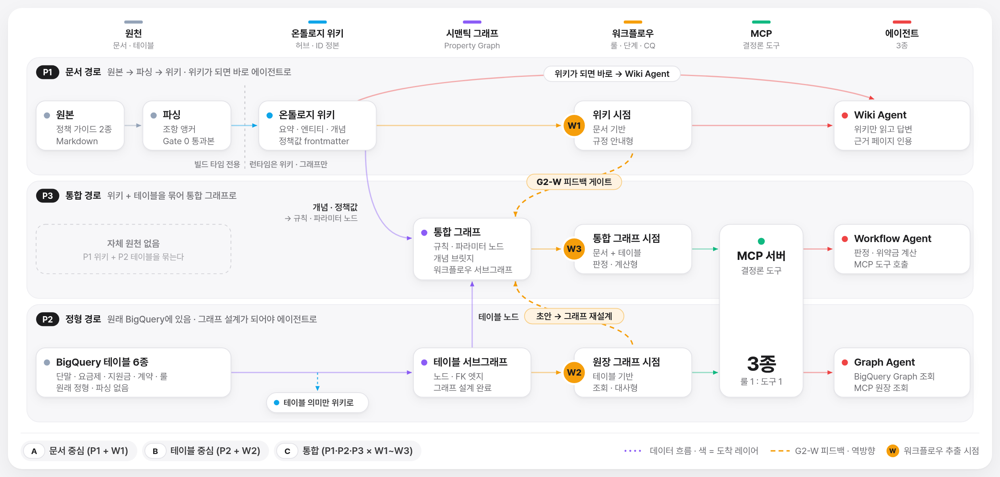
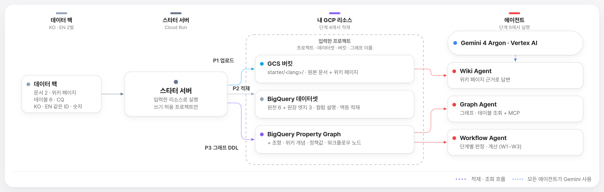

# Agentic Ontology Starter

> 정책 문서와 원장 테이블을 **OKF 위키**와 **BigQuery Property Graph**로 만들고, 내 GCP 리소스 위에서 **Wiki · Graph · Workflow 에이전트**를 실행 · 평가해 보는 스타터 팩입니다.
> 데이터는 합성 데이터 팩(가상 통신사의 단말 지원금 규정 · 원장)이며 **한국어 · 영어 2벌**(같은 ID · 같은 숫자)로 들어 있습니다. 서버는 Python 3.11 표준 라이브러리만 씁니다.

| 구분 | 주소 | 설명 |
| :--- | :--- | :--- |
| **스타터 데모** | [agentic-ontology-starter ↗](https://agentic-ontology-starter-115847445822.asia-northeast3.run.app/) | 6단계 마법사: 유형 · 목적 → 흐름 → GCP 리소스 확인 → 데이터 적재 → 에이전트 → 평가 |
| **노트북 랩** | [agentic-ontology-starter-notebook ↗](https://agentic-ontology-starter-notebook-dasz7pvvua-du.a.run.app/) | 같은 방법론을 셀 단위로 직접 실행하는 실습 화면 |
| **Platform Core MCP** | `https://aos-builder-core-mcp-115847445822.asia-northeast3.run.app/mcp` | 도구 38종(빌드 10 + 데이터 플레인 28) · JSON-RPC `tools/list` · `tools/call` |
| **Reference #1** | [LG U+ Enterprise Studio ↗](https://agentic-ontology-studio-lguplus-924723860007.asia-northeast3.run.app/) | LG U+ 단말지원금 · 위약금 12-Tab 엔터프라이즈 기준 스튜디오 |
| **Reference #2** | [LG H&H Enterprise Studio ↗](https://hnh-agentic-ontology-studio-384182013777.asia-northeast3.run.app/) | LG생활건강 화장품 표시 · 광고 컴플라이언스 12-Tab 스튜디오 |

---

## 1. 데모 화면 — 6단계



| 단계 | 하는 일 | 실제로 호출하는 것 |
| :---: | :--- | :--- |
| **1. 유형 · 목적** | 데이터 유형(문서만 P1 · 테이블만 P2 · 문서 + 테이블 P3) × 목적(규정 안내 W1 · 원장 조회 W2 · 판정 · 계산 W3)을 고르면 구성(Flow A · B · C), 실행할 에이전트, 만들어질 리소스가 정해집니다 | `/api/catalog` (서버 안 데이터 팩) |
| **2. 흐름 확인** | 위 흐름도에서 선택한 구성의 범위가 강조되고, 3~6단계에서 어떤 서비스 · 리소스 · Core MCP 도구가 쓰이는지 목록으로 보여 줍니다 | — |
| **3. GCP 리소스** | 프로젝트 · 리전 · 데이터셋 · 버킷 · 그래프 이름 · (선택) Spanner · 모델을 입력하고 실제로 확인합니다: 버킷 · 데이터셋 권한, BigQuery Graph 예약, Gemini 응답, Core MCP 연결. 실패하면 부족한 역할과 해결 명령을 보여 줍니다 | Core MCP `iam_test_permissions` · `storage_list_objects` · `bigquery_get_dataset_info` · `bigquery_check_reservation` · `tools/list`, Vertex AI |
| **4. 데이터 적재** | 입력한 리소스에 실제로 적재합니다(문서 · 위키 → GCS `starter/<lang>/`, 테이블 → BigQuery, Property Graph DDL). 단계마다 Core MCP 도구 · 대상 · 건수 · ms를 실행 기록으로 남기고, 다시 실행해도 결과가 같습니다(덮어쓰기 · `WRITE_TRUNCATE` · `CREATE OR REPLACE`) | Core MCP `mcp_builder_parse_documents_gate0` · `mcp_builder_compile_okf_wiki_stage2` · `storage_upload_object` · `bigquery_create_dataset` · `bigquery_load_table` · `mcp_builder_synthesize_bqg_stage4` · `bigquery_execute_sql` |
| **5. 에이전트 실행** | 구성에 포함된 에이전트와 대화합니다. 답변마다 근거 패널에 위키 페이지 · SQL/GQL · 결과 행 · 도구 호출 · 시간 · 토큰이 나옵니다 | Core MCP `storage_read_object` · `bigquery_execute_sql`, Vertex AI `gemini-4-argon` |
| **6. 평가** | 기준 CQ(Competency Question)를 다시 묻고 기대 숫자 · 핵심어 일치로 채점합니다(LLM 채점 없음, 통과 1 · 부분 0.5 · 실패 0) | 5단계와 같음 |

입력값과 결과는 브라우저(`localStorage`)에만 저장되고, 3단계에서 입력한 리소스가 이후 모든 요청에 함께 전달됩니다. 서버 전역 설정은 바뀌지 않으므로 여러 사람이 서로 다른 프로젝트로 동시에 쓸 수 있습니다. 주소 `#step-1` … `#step-6`, `?lang=en`, `?recipe=A|B|C`로 바로 열 수 있습니다.

### Flow A · B · C

| 구성 | 1단계 선택 | 에이전트 | 4단계에서 만들어지는 것 | 6단계 기준 CQ |
| :---: | :--- | :--- | :--- | :---: |
| **A · 문서 중심** | P1 문서만 × W1 규정 안내 | Wiki Agent | GCS `starter/<lang>/` — 원본 문서 2 · OKF 위키 페이지 3 · `manifest.json` | 7 |
| **B · 테이블 중심** | P2 테이블만 × W2 원장 조회 | Graph Agent | BigQuery 테이블 9(원천 6 + 원장 엣지 3) · `STARTER_LEDGER_GRAPH` | 4 |
| **C · 통합** | P3 문서 + 테이블 × W3 판정 · 계산 (위 둘을 뺀 나머지 조합도 C) | Wiki · Graph · Workflow Agent | GCS 문서 2 · 위키 4 · manifest + BigQuery 테이블 17 · `STARTER_ONTOLOGY_GRAPH` | 11 |

- Flow B와 C는 그래프 이름이 달라 서로 덮어쓰지 않습니다.
- Workflow Agent는 판정 전에 **G2-W**(위키 `rules.md`의 정책값이 원장 · 그래프 값과 같은지)를 확인하고, 답변에 W3 단계별 실행 결과를 붙입니다.

---

## 2. 아키텍처



```text
브라우저 (src/web/static/app.js)
  └─ 스타터 서버 (src/web/studio_server.py · 표준 라이브러리 HTTP · JSON / NDJSON 스트림)
       ├─ Platform Core MCP  ── GCS · BigQuery · Spanner · IAM · 예약 · 빌드 도구 (JSON-RPC tools/call)
       │     요청 헤더 X-AOS-Access-Token = 스타터 서버의 OAuth 토큰
       └─ Vertex AI gemini-4-argon (직접 호출 · 에이전트 답변 thinking LOW · 빌드 · 추출 HIGH)
```

- **GCS · BigQuery · Spanner · IAM 호출은 모두 Core MCP를 거칩니다.** 스타터 서버가 직접 부르는 GCP API는 Vertex AI(Gemini) 하나뿐입니다.
- **Core MCP는 Zero-Privilege입니다.** Core MCP 자신의 서비스 계정에는 데이터 권한이 없고, 데이터 도구는 호출자가 `X-AOS-Access-Token` 헤더로 넘긴 토큰으로만 실행됩니다. 토큰이 없으면 `401 AUTH_REQUIRED`입니다. 따라서 실제 권한은 **스타터 서버를 실행하는 주체**(Cloud Run 런타임 서비스 계정, 로컬에서는 `gcloud` 로그인 계정)가 가진 IAM 역할로 결정됩니다.
- Core MCP 일시 오류(502 · 503 · 504)는 재시도합니다. `AOS_CORE_MCP_FALLBACK=strict`(기본)이면 Core MCP에 닿지 못할 때 직접 API로 우회하지 않고 오류를 그대로 보여 줍니다.
- **쓰기 보호**: 4단계 적재는 `STARTER_WRITE_PROJECTS`에 있는 프로젝트에만 실행됩니다(기본값 = `GCP_PROJECT_ID`). 다른 프로젝트는 3단계 확인과 조회만 됩니다.
- **BigQuery Graph는 Enterprise(또는 Enterprise Plus) 예약이 필요합니다.** 예약이 없는 프로젝트에서는 Property Graph DDL · GQL이 `HTTP 412`로 실패합니다. 3단계 확인이 이를 미리 알려 주고 예약 생성 명령을 보여 줍니다.

---

## 3. KO / EN 데이터 세트

| 데이터 | 위치 | 비고 |
| :--- | :--- | :--- |
| 정책 문서 2종 | `data/input/01_guides/{ko,en}/` | `DOC_CHUNK_00x` 조항 앵커 |
| OKF 위키 4페이지 | `data/llm_wiki/{ko,en}/` | `rules.md` frontmatter = 정책값 단일 출처 |
| 테이블 17종 | `data/input/03_tables/` + `table_specs.json` | 라벨 컬럼은 `*_ko` / `*_en`, 컬럼 설명 KO · EN |
| 기준 CQ · 경계 질문 | `data/input/04_cq/{ko,en}/` | 기대 숫자 · 핵심어 |
| 용어집 · 워크플로우 | `data/input/05_glossary/{ko,en}/` · `data/input/06_workflows/` | W1~W3 단계 · 규칙 바인딩 |

- EN 화면은 영어 세트로 적재 · 질의 · 채점하고, 에이전트 지시문 · 답변 · 근거 라벨도 영어입니다. ID · 키 · 숫자는 KO와 같아서 같은 질문에는 같은 숫자가 정답입니다(테스트로 확인).
- GCS는 언어별 경로(`starter/ko/`, `starter/en/`)에 따로 올리고, BigQuery 테이블은 두 언어가 같이 씁니다(라벨 컬럼이 언어별로 따로 있음). Wiki Agent를 영어로 쓰려면 영어 화면에서 4단계를 한 번 실행하세요.

---

## 4. 코드 구조

```text
agentic-ontology-starter/
├── src/
│   ├── web/studio_server.py      HTTP 서버 · 정적 파일 · API (/api/settings · catalog · verify · load · agent · eval)
│   ├── web/static/               마법사 화면: index.html · app.js · app.css · i18n.json(KO·EN) · flows.js · aolflow.js/.css
│   ├── config.py                 요청 단위 리소스 설정(StarterConfig) · 쓰기 허용 프로젝트 · 버전
│   ├── recipes.py                1단계 선택 → Flow A/B/C · 적재 계획 · 단계 계획 · IAM 표
│   ├── datapack.py               KO/EN 데이터 팩 로더 · 그래프 DDL 생성
│   ├── loader.py                 3단계 확인(verify) · 4단계 적재(run_load) — Core MCP 도구 호출
│   ├── evaluation.py             6단계 기준 CQ 채점
│   ├── gcp_client.py             Core MCP 클라이언트(토큰 전달 · 재시도) · Vertex AI 호출 · 런타임 설정
│   ├── agent/agents.py           5단계 Wiki · Graph · Workflow Agent (G2-W 확인 포함)
│   ├── agent/mcp_server.py       도메인 MCP 도구 3종 — Graph · Workflow Agent가 사용 (SQL은 Core MCP로 실행)
│   ├── agent/reasoning_engine.py Graph · Workflow Agent 추론 엔진 (Gemini 파라미터 추출 → 도구 → 답변)
│   ├── agent/i18n_en.py          영어 모드 보조 (mcp_server · reasoning_engine가 사용)
│   ├── resource_connector.py     이전 포털의 리소스 도우미 — 현재는 공개 URL 등 일부 상수만 사용 (레거시)
│   └── lineage/                  리니지 엔진 — Stage 5 노트북 전용 (데모 화면은 사용 안 함)
├── data/                         KO/EN 데이터 팩 (위 3절) · data/output/ = 노트북 참고 산출물 + Spanner DDL
├── config/                       엔진 · 노트북 설정 (starter_config.json · lineage_spec.json · eval_rubric.json)
├── notebooks/                    Colab 노트북 12종 (아래 6절)
├── docs/images/                  README 그림 (KO · EN)
├── tests/                        pytest
├── DESIGN.md                     화면 디자인 규격 (토큰 · 흐름도 문법 · KO/EN 규칙)
├── Dockerfile · .env.example
└── LICENSE
```

---

## 5. 빠른 시작

### 5.1 로컬

```bash
git clone https://github.com/seanjungG/agentic-ontology-starter.git
cd agentic-ontology-starter

gcloud auth login                 # 로컬에서는 gcloud 계정 토큰을 Core MCP에 넘깁니다
cp .env.example .env              # 내 프로젝트 · 데이터셋 · 버킷으로 수정
set -a && source .env && set +a

python3 -m src.web.studio_server  # http://localhost:8080 (PORT로 변경)
```

`gcloud` 계정에는 아래 5.3의 역할이 필요합니다. 버킷은 미리 만들어 두고, 데이터셋은 없으면 4단계에서 만듭니다.

### 5.2 Cloud Run

```bash
gcloud run deploy agentic-ontology-starter \
  --source . --region asia-northeast3 \
  --service-account starter-runtime@MY_PROJECT.iam.gserviceaccount.com \
  --set-env-vars GCP_PROJECT_ID=MY_PROJECT,BQ_DATASET_ID=starter_ontology_dw,BQ_LOCATION=asia-northeast3,GCS_WIKI_BUCKET=MY_BUCKET,STARTER_WRITE_PROJECTS=MY_PROJECT,CORE_MCP_URL=https://aos-builder-core-mcp-115847445822.asia-northeast3.run.app/mcp
```

`Dockerfile`이 `VERTEX_GEMINI_MODEL=gemini-4-argon`, `VERTEX_LOCATION=global`, `VERTEX_THINKING_LEVEL=LOW`, `VERTEX_BUILD_THINKING_LEVEL=HIGH`를 넣습니다. Cloud Run에서는 런타임 서비스 계정 토큰(메타데이터 서버)을 Core MCP에 넘깁니다. 공개로 열 때(`--allow-unauthenticated`)는 쓰기 대상이 `STARTER_WRITE_PROJECTS`로 제한된다는 점을 확인하세요.

### 5.3 실행 주체에 필요한 IAM 역할

| 단계 | 역할 | 범위 | 이유 |
| :---: | :--- | :--- | :--- |
| 3 | `roles/aiplatform.user` | 프로젝트 | Gemini 확인 · 에이전트 답변 |
| 3 | `roles/bigquery.metadataViewer` | 프로젝트 또는 데이터셋 | 데이터셋 · 그래프 확인 |
| 3 | `roles/bigquery.resourceViewer` (선택) | 프로젝트 | Enterprise 예약 할당 확인 |
| 4 | `roles/storage.objectAdmin` | 버킷 | 문서 · 위키 업로드 (`starter/<lang>/`) |
| 4 | `roles/bigquery.dataEditor` | 프로젝트(데이터셋 생성 시) 또는 데이터셋 | 데이터셋 · 테이블 · 그래프 생성과 적재 |
| 4 | `roles/bigquery.jobUser` | 프로젝트 | 적재 · DDL · 쿼리 작업 |
| 4 | `roles/spanner.databaseUser` + `databaseAdmin` (선택) | Spanner DB | Spanner 그래프 갱신을 켤 때만 |
| 5·6 | `roles/bigquery.dataViewer` · `roles/storage.objectViewer` | 데이터셋 · 버킷 | 에이전트 조회 (4단계 역할에 포함) |

Core MCP 서비스 자체에는 데이터 역할을 주지 않습니다(호출자 토큰으로 실행). Core MCP를 인증 필요 서비스로 배포했다면 호출 주체에 `roles/run.invoker`도 필요합니다.

BigQuery Graph 예약(없으면 HTTP 412) 예시:

```bash
bq mk --reservation --project_id=MY_PROJECT --location=asia-northeast3 --edition=ENTERPRISE \
  --slots=0 --autoscale_max_slots=50 starter-graph-enterprise
bq mk --reservation_assignment --reservation_id=MY_PROJECT:asia-northeast3.starter-graph-enterprise \
  --job_type=QUERY --assignee_type=PROJECT --assignee_id=MY_PROJECT
```

### 5.4 환경 변수

| 변수 | 기본값 | 설명 |
| :--- | :--- | :--- |
| `GCP_PROJECT_ID` | — | 기본 프로젝트 (3단계 입력의 기본값) |
| `BQ_DATASET_ID` · `BQ_LOCATION` | `starter_ontology_dw` · `asia-northeast3` | 기본 데이터셋 · 리전 |
| `GCS_WIKI_BUCKET` (또는 `GCS_BUCKET_NAME`) | — | 기본 버킷 |
| `SPANNER_INSTANCE_ID` · `SPANNER_DATABASE_ID` | `starter-spanner` · `starter_ontology_db` | 선택 기능(Spanner 그래프 갱신) |
| `VERTEX_GEMINI_MODEL` · `VERTEX_LOCATION` | `gemini-4-argon` · `global` | Gemini 모델 |
| `VERTEX_THINKING_LEVEL` · `VERTEX_BUILD_THINKING_LEVEL` | `LOW` · `HIGH` | 대화 / 빌드 · 추출 thinking 수준 |
| `CORE_MCP_URL` | Core MCP `/mcp` 주소 | Platform Core MCP 엔드포인트 (요청으로는 바꿀 수 없음) |
| `AOS_CORE_MCP_FALLBACK` | `strict` | `direct`로 두면 Core MCP 장애 시 직접 API로 우회 (개발용) |
| `STARTER_WRITE_PROJECTS` | `GCP_PROJECT_ID` | 적재를 허용할 프로젝트 목록 (쉼표 구분, `*` = 모두) |
| `PORT` | `8080` | HTTP 포트 |

---

## 6. Colab 노트북 (12종)

데모 화면이 **무엇을 · 어떤 순서로** 하는지 보여 준다면, 노트북은 같은 방법론을 **코드 수준**으로 따라갑니다. 자세한 안내: [`notebooks/README.md`](notebooks/README.md)

| 단계 | 내용 | 한국어 | English |
| :---: | :--- | :--- | :--- |
| Stage 0 | 전체 흐름 워크스루 | [ko](notebooks/ko/stage0_overview_walkthrough_ko.ipynb) | [en](notebooks/en/stage0_overview_walkthrough_en.ipynb) |
| Stage 1 | 입력 자산 · 테이블 프로파일링 · Golden CQ | [ko](notebooks/ko/stage1_asset_and_cq_ko.ipynb) | [en](notebooks/en/stage1_asset_and_cq_en.ipynb) |
| Stage 2 | 조항 앵커 · 3-Layer 위키 · 룰 바인딩 | [ko](notebooks/ko/stage2_wiki_and_semantic_graph_ko.ipynb) | [en](notebooks/en/stage2_wiki_and_semantic_graph_en.ipynb) |
| Stage 3 | Property Graph DDL · GQL | [ko](notebooks/ko/stage3_property_graph_bigquery_spanner_ko.ipynb) | [en](notebooks/en/stage3_property_graph_bigquery_spanner_en.ipynb) |
| Stage 4 | 도메인 MCP 도구 · 에이전트 | [ko](notebooks/ko/stage4_agent_and_mcp_execution_ko.ipynb) | [en](notebooks/en/stage4_agent_and_mcp_execution_en.ipynb) |
| Stage 5 | 리니지 · 평가 | [ko](notebooks/ko/stage5_lineage_and_evaluation_ko.ipynb) | [en](notebooks/en/stage5_lineage_and_evaluation_en.ipynb) |

---

## 7. 테스트

```bash
python3 -m pip install pytest      # 테스트에만 필요
python3 -m pytest tests -q
```

정적 파일 서빙과 경로 탈출 차단, KO/EN 문구 키 · 자리표시자 동등성(EN 한글 0), KO/EN 데이터 팩 동등성(같은 ID · 숫자), 구성 · 적재 계획, API 요청 검증(설정 오류는 GCP 호출 전에 400)을 확인합니다. GCP 호출이 없는 테스트만 들어 있습니다. 실제 적재 · 에이전트 확인은 데모 화면 3~6단계로 합니다.

---

## English summary

**Agentic Ontology Starter** turns policy documents and ledger tables into an **OKF wiki** and a **BigQuery Property Graph**, then runs and scores **Wiki, Graph and Workflow agents** on your own GCP resources. The data pack is synthetic (a fictional telecom's handset subsidy rules and ledgers) and ships in a **Korean and an English set** with the same ids and numbers. The server uses only the Python 3.11 standard library.

- **Demo (6-step wizard)**: https://agentic-ontology-starter-115847445822.asia-northeast3.run.app/ — 1 type & purpose → 2 flow → 3 verify GCP resources (real permission, reservation, Gemini and Core MCP checks) → 4 load data (GCS `starter/<lang>/`, BigQuery tables, property graph; streamed log of every Core MCP call) → 5 chat with the agents (evidence panel: wiki pages, SQL/GQL, rows, tool calls, timing) → 6 golden-CQ evaluation (numbers and key terms, no LLM judge).
- **Recipes**: Flow A = P1 documents × W1 policy guidance → Wiki Agent, 7 CQs · Flow B = P2 tables × W2 ledger lookup → Graph Agent, 4 CQs · Flow C = P3 documents + tables × W3 decide & calculate (and every other combination) → all three agents incl. the G2-W policy-value check, 11 CQs.
- **Architecture**: every GCS, BigQuery, Spanner and IAM call goes through the **Platform Core MCP** (`/mcp`, 38 tools = 10 build + 28 data-plane). The Core MCP is **zero-privilege**: data tools run only with the caller's OAuth token sent in `X-AOS-Access-Token` (no token → `401 AUTH_REQUIRED`), so permissions are those of the identity running the starter server. Only Vertex AI (`gemini-4-argon`) is called directly. Loads are limited to `STARTER_WRITE_PROJECTS`. BigQuery Graph needs an Enterprise reservation (HTTP 412 otherwise).
- **Quick start**: `gcloud auth login`, `cp .env.example .env`, edit, `set -a && source .env && set +a`, `python3 -m src.web.studio_server`. Cloud Run: `gcloud run deploy agentic-ontology-starter --source . --region asia-northeast3 --service-account … --set-env-vars GCP_PROJECT_ID=…,GCS_WIKI_BUCKET=…,STARTER_WRITE_PROJECTS=…,CORE_MCP_URL=…`. Required roles per step are listed in 5.3.
- **Notebooks**: 6 Colab notebooks in Korean and English walk through the same method at code level — see [`notebooks/README.md`](notebooks/README.md). **Tests**: `python3 -m pytest tests -q`.

## License

Methodology and documents: CC BY-NC-ND 4.0 · Source code: PolyForm Noncommercial License 1.0.0 — see [`LICENSE`](LICENSE). Commercial use requires prior written permission.
