# Agentic Ontology Starter (AOS v2.2 — Resource-Connected Starter Edition)

[-Live_on_Cloud_Run-2563eb?style=for-the-badge)](https://agentic-ontology-starter-924723860007.asia-northeast3.run.app/)
[-12--Tab_Full_Platform-4f46e5?style=for-the-badge)](https://agentic-ontology-studio-lguplus-mcp-924723860007.asia-northeast3.run.app/)
[-12--Tab_Full_Platform-0d9488?style=for-the-badge)](https://agentic-ontology-studio-hnh-mcp-924723860007.asia-northeast3.run.app/)
[-059669?style=for-the-badge)](#4-unified-stage-05-map-explanation--demo--process--resource--code--notebooks)

> **Non-Commercial License Notice**
> Copyright (c) 2026 **Sean Jung** (`seanjung@google.com`). All Rights Reserved.
> Methodology & Documentation are licensed under **CC BY-NC-ND 4.0**; Source Code & Notebooks are licensed under **PolyForm Noncommercial License 1.0.0**. Commercial use requires prior written permission from `seanjung@google.com`.

---

## 1. 핵심 컨셉: MCP 빌더는 추상화하고, Ready-to-Use 온톨로지 리소스에 즉시 연결 (Resource-Connected Starter)

엔터프라이즈 온톨로지를 처음부터 구축하려면 무거운 파서, 시맨틱 그래프 컴파일러, DDL 합성기 등 복잡한 내부 빌더 인프라가 필요합니다.
**Agentic Ontology Starter (v2.2)**는 **기준점 스튜디오(LG U+ 12-Tab / LG H&H 12-Tab Full Platform)**의 무거운 내부 MCP 빌더 파이프라인을 **플랫폼 계층으로 완전 추상화(Excluded & Abstracted)**하고, 개발자·FDE가 **이미 준비된(Ready-to-Use) Google Cloud 온톨로지 리소스 4종**에 즉시 연결하여 **도메인 비즈니스 도구(3종)와 AI FDE 추론 에이전트**만 간결하게 커스터마이징할 수 있도록 설계된 **Resource-Connected Starter Kit**입니다.

```mermaid
flowchart LR
  subgraph FULL["🏛️ Enterprise Reference Standard (12-Tab Full Platform · Abstracted)"]
    direction TB
    F1["Heavy Document / PDF Parser & Gate 0 Engine"]
    F2["OKF 3-Layer Wiki & JSON-LD Semantic Compiler"]
    F3["Zero-ETL Property Graph & Spanner Graph Provisioner"]
    F4["12-Tab Governance Studio & Closed-Loop Harness"]
  end

  subgraph GCP["☁️ Ready-to-Use GCP Ontology Resources (seanjung-poc)"]
    direction TB
    R1[("BigQuery DW Ledgers\nstarter_ontology_dw (10 Tables)")]
    R2[("GCS 3-Layer OKF Wiki & Rules\ngs://seanjung-poc-starter-ontology/ontology/\nsummary · entities · concepts · rules\nbusiness_rules.json · business_workflows.json")]
    R3[("Dual Property Graph\nBQ: STARTER_ONTOLOGY_GRAPH (SQL:2023)\nSpanner: starter-spanner (ISO GQL)")]
    R4[("Evaluation & Lineage Tables\ntb_golden_cq_results (5/5 PASS)\n6-Layer Lineage (19 Nodes / 24 Edges)")]
  end

  subgraph STARTER["🚀 Agentic Ontology Starter (6-Tab Portal · Exposed & Customizable)"]
    direction TB
    S1["1. Resource Connector\nsrc/resource_connector.py\nsrc/gcp_client.py"]
    S2["2. Domain Business Tools (3 Tools)\nsrc/agent/mcp_server.py\n• mcp_lookup_customer_profile\n• mcp_calculate_penalty_rule\n• mcp_query_graph_and_wiki"]
    S3["3. AI FDE Reasoning Engine (Gate G2-W)\nsrc/agent/reasoning_engine.py"]
    S4["4. 6-Tab Starter Portal & 12 Notebooks\nsrc/web/studio_server.py\nnotebooks/{ko,en}/stage0..5_*.ipynb"]
  end

  FULL ==>|"Compiles & Publishes"| GCP
  GCP ==>|"Direct Zero-Config Connection"| S1
  S1 --> S2 --> S3 --> S4
```



---

## 2. 라이브 데모 포털 & 기준점 스튜디오 허브 (Live Demo & Reference Studio Hub)

스타터 포털 상단 글로벌 내비게이션 바와 `0. Overview` 탭에서 **스타터 포털(6-Tab)**과 **엔터프라이즈 기준점 스튜디오 2종(12-Tab)**을 실시간으로 교차 비교하고 실행할 수 있습니다.

| 구분 | 스튜디오 명칭 | 라이브 데모 URL | 구성 및 역할 |
| :--- | :--- | :--- | :--- |
| **🚀 Starter Portal (6-Tab)** | **Agentic Ontology Starter v2.2** | [**https://agentic-ontology-starter-924723860007.asia-northeast3.run.app/**](https://agentic-ontology-starter-924723860007.asia-northeast3.run.app/) | **Resource-Connected Starter** — 준비된 BigQuery · Property Graph · GCS 3-Layer 위키 · Spanner 리소스에 직결된 6-Tab 실습/커스터마이징 포털 |
| **🏛️ Reference #1 (12-Tab)** | **LG U+ 공시지원금 & 결합 온톨로지 스튜디오** | [**https://agentic-ontology-studio-lguplus-mcp-924723860007.asia-northeast3.run.app/**](https://agentic-ontology-studio-lguplus-mcp-924723860007.asia-northeast3.run.app/) | **통신 도메인 엔터프라이즈 기준점** — 12-Tab 거버넌스 워크스페이스 · 6-Layer 표준 아키텍처 · P1/P2/P3 · W1~W3 · Gate G2-W 원본 레퍼런스 |
| **🏛️ Reference #2 (12-Tab)** | **LG생활건강 화장품 표시광고 실증 스튜디오** | [**https://agentic-ontology-studio-hnh-mcp-924723860007.asia-northeast3.run.app/**](https://agentic-ontology-studio-hnh-mcp-924723860007.asia-northeast3.run.app/) | **규제·컴플라이언스 도메인 기준점** — 식약처 가이드라인 + 207개 시험문서 + 임상 DB 멀티트랙 실증 레퍼런스 |

---

## 3. 표준 온톨로지 프로세스: 6-Layer 아키텍처 × 5-Stage 11-Step × Gate G2-W

스타터 팩은 기준점 스튜디오의 **6-Layer 엔터프라이즈 온톨로지 표준 프로세스**와 **실행형 비즈니스 온톨로지(P1/P2/P3 × W1/W2/W3 × Gate G2-W)**를 100% 동일하게 준수합니다.

### 3-1. 6-Layer 엔터프라이즈 데이터 리니지 계층 (`config/lineage_spec.json`)
1. **Layer 1 — Source Connection (`CONNECTION`)**: 정형 마스터 원장(4종) 및 비정형 정책 가이드(2종) 원천 연결
2. **Layer 2 — Raw & De-identified Assets (`RAW_TABLE`)**: PII 비식별화(`CUST_DEMO_*`) 완료 BigQuery 마스터 테이블 4종 및 원문 해시 앵커 청크(`tb_doc_chunks`)
3. **Layer 3 — Knowledge & Edge Transform (`TRANSFORM`)**: 3-Layer OKF 위키(`summary/entities/concepts/rules.md`), 비즈니스 규칙(`tb_domain_rules`), 그래프 엣지 브릿지 테이블(4종)
4. **Layer 4 — Semantic & Property Graph (`SEMANTIC_GRAPH`)**: BigQuery SQL:2023 `STARTER_ONTOLOGY_GRAPH` 및 Cloud Spanner Graph(`starter-spanner`)
5. **Layer 5 — Domain Business Tools (`MCP_TOOL`)**: 비즈니스 로직을 캡슐화한 커스터마이징 대상 도메인 도구 3종
6. **Layer 6 — AI FDE Runtime & Evaluation (`AGENT_EVAL`)**: 하위 목표 분해 · `Gate G2-W` 런타임 감사 · Golden CQ 5건 / Workflow CQ 5건 / Boundary 50회 검증

### 3-2. 3-Persona (`P1/P2/P3`) × 3-Workflow (`W1/W2/W3`) × `Gate G2-W`
* **P1 (데이터 오너 / 스튜어드)**: 정형 원장 4종 스키마·PK/FK 정합성 및 비식별화(`CUST_DEMO_*`) 관리
* **P2 (정책·규제 오너)**: 공시지원금 180일 의무유지(`RULE_SIX_PLAN_180D`), 시니어 특례 면제(`RULE_WELFARE_EXEMPT`), 24개월 TCO(`RULE_TCO_24M`) 정책 조항 및 예외 워크플로 정의
* **P3 (AI FDE / 도메인 개발자)**: Ready-to-Use 리소스에 도메인 비즈니스 도구 3종 연결 및 골든/바운더리 CQ 검증
* **비즈니스 워크플로 3종 (`data/llm_wiki/business_workflows.json`)**:
  * **`W1` (`WF_SUBSIDY_PURCHASE_CHECK`)**: 단말 개통 지원금 산정 및 실구매가 확정 워크플로 (`RULE_ADD_SUBSIDY_15PCT`)
  * **`W2` (`WF_PLAN_CHANGE_PENALTY_AUDIT`)**: 180일 이내 요금제 변경 시 시니어 복지 면제 선검증 후 일할 위약금 산출 워크플로 (`RULE_WELFARE_EXEMPT` ➔ `RULE_SIX_PLAN_180D`)
  * **`W3` (`WF_CONTRACT_24M_TCO_ADVISORY`)**: 24개월 공시지원금 vs 선택약정 25% 요금할인 TCO 비교 자문 워크플로 (`RULE_TCO_24M`)
* **`Gate G2-W` (런타임 실행 게이트)**: 에이전트가 답변을 반환하기 직전 **(1) 수치의 SQL 결정론 산출 여부**, **(2) 예외 규칙(`SENIOR_EXEMPT`) 선행 분기 여부**, **(3) 원문 `DOC_CHUNK_*` SHA-256 해시 앵커 인용 여부**를 감사하여 환각을 원천 차단합니다.

---

## 4. Unified Stage 0~5 Map: 설명 ↔ 데모 화면 ↔ 프로세스 ↔ 연결 리소스 ↔ 노출 코드 ↔ 노트북 (1:1 매핑)

GitHub 문서 설명, 라이브 데모 포털 탭, 온톨로지 표준 프로세스, GCP 실물 리소스, 노출된 커스터마이징 코드, 그리고 한/영 실습 노트북(12종)이 **Stage 0~5 전 구간에서 1:1로 직결**되어 있습니다.

| Stage | 데모 포털 화면 탭 | 표준 프로세스 (`Step` / `P·W·Gate`) | 연결된 Ready-to-Use GCP 리소스 (`seanjung-poc`) | 노출된 스타터 코드 (4 Core Files) | 방법론 가이드 (KO / EN) | 실습 노트북 (KO / EN 12종) |
| :--- | :--- | :--- | :--- | :--- | :--- | :--- |
| **Stage 0** | [**`0. Overview`**](https://agentic-ontology-starter-924723860007.asia-northeast3.run.app/?tab=overview) | **Architecture & Track Selection**<br>Track 1(Lite) / Track 2(Hybrid) / Track 3(Full) · 기준점 허브 | `config/starter_config.json`<br>`config/portal_profile.json` | [`src/resource_connector.py`](src/resource_connector.py)<br>[`src/gcp_client.py`](src/gcp_client.py) | [KO](methodology/ko/00_overview_and_4tracks_ko.md) · [EN](methodology/en/00_overview_and_4tracks_en.md) | [**`stage0_overview_walkthrough_ko.ipynb`**](notebooks/ko/stage0_overview_walkthrough_ko.ipynb)<br>[**`stage0_overview_walkthrough_en.ipynb`**](notebooks/en/stage0_overview_walkthrough_en.ipynb) |
| **Stage 1** | [**`Stage 1. Asset`**](https://agentic-ontology-starter-924723860007.asia-northeast3.run.app/?tab=stage1) | **Step 1-1 ~ 1-3 (`P1`·`P2` · Gate 0)**<br>비식별화 마스터 원장(4종) · 정책 청크(5건) · Golden CQ(5건) | **BigQuery DW (`starter_ontology_dw`)**<br>`tb_customer_contract` (6), `tb_device_master` (4), `tb_plan_master` (6), `tb_subsidy_policy` (5), `tb_doc_chunks` (5) | [`src/resource_connector.py`](src/resource_connector.py) (`stage1_resource_check`)<br>[`src/gcp_client.py`](src/gcp_client.py) | [KO](methodology/ko/01_stage1_asset_and_cq_ko.md) · [EN](methodology/en/01_stage1_asset_and_cq_en.md) | [**`stage1_asset_and_cq_ko.ipynb`**](notebooks/ko/stage1_asset_and_cq_ko.ipynb)<br>[**`stage1_asset_and_cq_en.ipynb`**](notebooks/en/stage1_asset_and_cq_en.ipynb) |
| **Stage 2** | [**`Stage 2. Wiki & Semantic`**](https://agentic-ontology-starter-924723860007.asia-northeast3.run.app/?tab=stage2) | **Step 2-1 ~ 2-3 (`P2` · `W1~W3`)**<br>3-Layer OKF 위키 · 비즈니스 규칙(4종) · 워크플로(3종) | **GCS (`gs://seanjung-poc-starter-ontology/ontology/`)**<br>`summary/entities/concepts/rules.md`, `business_rules.json`, `business_workflows.json`, BQ `tb_domain_rules` (4) | [`src/resource_connector.py`](src/resource_connector.py) (`stage2_resource_check`)<br>[`data/llm_wiki/`](data/llm_wiki/) | [KO](methodology/ko/02_stage2_wiki_and_semantic_graph_ko.md) · [EN](methodology/en/02_stage2_wiki_and_semantic_graph_en.md) | [**`stage2_wiki_and_semantic_graph_ko.ipynb`**](notebooks/ko/stage2_wiki_and_semantic_graph_ko.ipynb)<br>[**`stage2_wiki_and_semantic_graph_en.ipynb`**](notebooks/en/stage2_wiki_and_semantic_graph_en.ipynb) |
| **Stage 3** | [**`Stage 3. Property Graph`**](https://agentic-ontology-starter-924723860007.asia-northeast3.run.app/?tab=stage3) | **Step 3-1 ~ 3-2 (`P1`·`P3`)**<br>Zero-ETL SQL:2023 `GRAPH_TABLE` & Spanner ISO GQL 멀티홉 탐색 | **BigQuery Graph & Spanner Graph**<br>`seanjung-poc.starter_ontology_dw.STARTER_ONTOLOGY_GRAPH`<br>`starter-spanner/starter_ontology_db/STARTER_ONTOLOGY_GRAPH` | [`src/gcp_client.py`](src/gcp_client.py) (`run_gql_MultiHop`)<br>[`src/resource_connector.py`](src/resource_connector.py) (`stage3_resource_check`) | [KO](methodology/ko/03_stage3_property_graph_ko.md) · [EN](methodology/en/03_stage3_property_graph_en.md) | [**`stage3_property_graph_bigquery_spanner_ko.ipynb`**](notebooks/ko/stage3_property_graph_bigquery_spanner_ko.ipynb)<br>[**`stage3_property_graph_bigquery_spanner_en.ipynb`**](notebooks/en/stage3_property_graph_bigquery_spanner_en.ipynb) |
| **Stage 4** | [**`Stage 4. Agent & Tools`**](https://agentic-ontology-starter-924723860007.asia-northeast3.run.app/?tab=stage4) | **Step 4-1 ~ 4-2 (`P3` · `Gate G2-W`)**<br>도메인 비즈니스 도구 3종 체이닝 & AI FDE 결정론적 추론 | **Vertex AI `gemini-3.8-flash` + 3 Domain Tools**<br>`mcp_lookup_customer_profile`<br>`mcp_calculate_penalty_rule`<br>`mcp_query_graph_and_wiki` | [**`src/agent/mcp_server.py`**](src/agent/mcp_server.py)<br>[**`src/agent/reasoning_engine.py`**](src/agent/reasoning_engine.py) | [KO](methodology/ko/04_stage4_agent_and_mcp_ko.md) · [EN](methodology/en/04_stage4_agent_and_mcp_en.md) | [**`stage4_agent_and_mcp_execution_ko.ipynb`**](notebooks/ko/stage4_agent_and_mcp_execution_ko.ipynb)<br>[**`stage4_agent_and_mcp_execution_en.ipynb`**](notebooks/en/stage4_agent_and_mcp_execution_en.ipynb) |
| **Stage 5** | [**`Stage 5. Lineage & Eval`**](https://agentic-ontology-starter-924723860007.asia-northeast3.run.app/?tab=stage5) | **Step 5-1 ~ 5-2 (Closed-Loop Eval)**<br>6-Layer 리니지 DAG · Golden CQ(5) · WF-CQ(5) · Boundary(50) | **BigQuery Eval & Lineage Spec**<br>`tb_golden_cq_results` (5/5 PASS)<br>`config/lineage_spec.json` (19 Nodes / 24 Edges) | [`src/lineage_service.py`](src/lineage_service.py)<br>[`pipeline/validator.py`](pipeline/validator.py) | [KO](methodology/ko/05_stage5_lineage_and_eval_ko.md) · [EN](methodology/en/05_stage5_lineage_and_eval_en.md) | [**`stage5_lineage_and_evaluation_ko.ipynb`**](notebooks/ko/stage5_lineage_and_evaluation_ko.ipynb)<br>[**`stage5_lineage_and_evaluation_en.ipynb`**](notebooks/en/stage5_lineage_and_evaluation_en.ipynb) |

---

## 5. 코드 노출 경계 (Code Exposure Boundary): 무엇을 숨기고 무엇을 노출하는가?

스타터 팩은 사용자가 **온톨로지 빌더 내부 구현에 매몰되지 않고 비즈니스 도구와 에이전트 로직에 즉시 집중**할 수 있도록 코드 노출 범위를 명확히 분리합니다.

### 5-1. 추상화/제외된 플랫폼 빌더 영역 (Excluded & Abstracted into Ready-to-Use GCP Resources)
* ❌ **Internal Stage Builder MCP Server (`mcp_builder_*` / `mcp_stage1..5`)**: 스타터의 런타임 도구 카탈로그(`get_tool_catalog()`)에서 완전히 제외되었습니다.
* ❌ **대용량 PDF/HWP/HTML 파서 및 LLM 멀티턴 위키/그래프 컴파일러**: 이미 컴파일되어 BigQuery(`starter_ontology_dw`), GCS(`gs://seanjung-poc-starter-ontology/ontology/`), Spanner(`starter-spanner`)에 적재된 **Ready-to-Use 리소스**로 제공됩니다.

### 5-2. 스타터에 노출된 핵심 커스터마이징 코드 4종 (Exposed & Customizable in Starter)

| 번호 | 노출된 핵심 파일 | 역할 및 커스터마이징 포인트 | 연결된 GCP 리소스 |
| :---: | :--- | :--- | :--- |
| **1** | [**`src/resource_connector.py`**](src/resource_connector.py) | **리소스 직결 커넥터 (`OntologyResourceConnector`)** — Stage 1~5별 준비된 BigQuery 테이블, GCS 3-Layer 위키, 비즈니스 규칙/워크플로, Property Graph 상태를 원클릭으로 확인 (`verify_ready_resources()`) | `seanjung-poc.starter_ontology_dw` · `gs://seanjung-poc-starter-ontology/ontology/` |
| **2** | [**`src/gcp_client.py`**](src/gcp_client.py) | **GCP 라이브 클라이언트 (`EnterpriseOntologyBenchmarker`)** — BigQuery SQL / SQL:2023 `GRAPH_TABLE` / Cloud Spanner GQL / GCS / Vertex AI `gemini-3.8-flash` 직접 호출 래퍼 | BigQuery · Cloud Spanner · GCS · Vertex AI |
| **3** | [**`src/agent/mcp_server.py`**](src/agent/mcp_server.py) | **도메인 비즈니스 도구 3종 (`DomainMcpServer`)** — 내 도메인의 테이블과 비즈니스 산식에 맞게 SQL/GQL 쿼리만 수정하면 즉시 동작하는 3대 핵심 도구:<br>1. `mcp_lookup_customer_profile` (고객 약정 · 단말 출고가 · 지원금 원장 조회)<br>2. `mcp_calculate_penalty_rule` (180일 일할 위약금 · 시니어 면제 · 24개월 TCO 결정론 산식)<br>3. `mcp_query_graph_and_wiki` (`STARTER_ONTOLOGY_GRAPH` 멀티홉 탐색 + `DOC_CHUNK_*` 해시 앵커 조인) | `tb_customer_contract`, `tb_device_master`, `tb_plan_master`, `tb_subsidy_policy`, `tb_domain_rules`, `STARTER_ONTOLOGY_GRAPH` |
| **4** | [**`src/agent/reasoning_engine.py`**](src/agent/reasoning_engine.py) | **AI FDE 추론 엔진 (`AgenticReasoningEngine`)** — 사용자 질의를 하위 목표로 분해(Step 1)하고 도메인 비즈니스 도구 3종을 체이닝(Step 2)한 뒤 `Gate G2-W` 감사와 원문 해시 앵커를 결합하여 최종 답변 합성(Step 3) | Vertex AI `gemini-3.8-flash` + `DomainMcpServer` |

```python
# Quick Example: Ready-to-Use 리소스 점검 및 도메인 비즈니스 도구 즉시 호출
from src.resource_connector import OntologyResourceConnector
from src.agent.mcp_server import DomainMcpServer

# 1) 준비된 GCP 온톨로지 리소스(Stage 1~5) 연결 상태 즉시 확인
connector = OntologyResourceConnector()
status = connector.verify_ready_resources()
print("Overall Status:", status["overall_status"])  # READY

# 2) 커스터마이징 가능한 3대 도메인 비즈니스 도구 카탈로그 확인 및 실행
server = DomainMcpServer()
print([t["name"] for t in server.get_tool_catalog()])
# ['mcp_lookup_customer_profile', 'mcp_calculate_penalty_rule', 'mcp_query_graph_and_wiki']

res = server.execute_tool("mcp_calculate_penalty_rule", {
    "customer_id": "CUST_DEMO_001",
    "target_plan_name": "5G Light",
    "elapsed_days": 120,
})
print(res["calculations"][0]["penalty_krw"], res["calculations"][0]["grounded_chunk_id"])
# 106667  DOC_CHUNK_001
```

---

## 6. 3분 빠른 시작 가이드 (Quickstart)

### Step 1. 환경 준비 및 GCP 인증
```bash
git clone https://github.com/seanjungG/agentic-ontology-starter.git
cd agentic-ontology-starter
pip install -r requirements.txt
gcloud auth application-default login
```

### Step 2. 연결된 GCP 리소스 일괄 점검 & Golden CQ 검증 (`run_pipeline.py`)
```bash
# Stage 1~5 연결 리소스(BigQuery DW, GCS 3-Layer Wiki, Property Graph, Domain Tools, Eval) 즉시 점검
python3 run_pipeline.py --track full
```

### Step 3. 6-Tab 스타터 포털 로컬 실행 (`studio_server.py`)
```bash
python3 -m src.web.studio_server 8080
# 브라우저에서 http://localhost:8080 접속
```

### Step 4. 내 도메인 프로젝트로 확장하기 (`new_project.py` 또는 UI 워크벤치)
* 포털 우측 상단 **`+ 신규 프로젝트`** 버튼을 클릭하거나 아래 CLI로 자체 CSV 테이블과 정책 문서를 사용하는 신규 프로젝트를 생성할 수 있습니다:
```bash
python3 new_project.py --id my_domain --name "내 도메인 온톨로지" --track full --graph-engine bigquery
```

---

## 7. 저장소 디렉터리 구조 (Repository Structure)

```text
agentic-ontology-starter/
├── README.md                          # [통합 허브] 컨셉 · 데모 · 프로세스 · 코드 경계 · 노트북 1:1 매핑
├── 01_prod.md                         # 제품 헌장 & 엔터프라이즈 기준점 대비 스타터 명세
├── PROTOTYPING_PLAYBOOK.md            # P1/P2/P3 × W1~W3 × Gate G2-W 실전 플레이북
├── config/
│   ├── starter_config.json            # GCP 리소스 연결 설정 (BigQuery, GCS, Spanner, Vertex AI)
│   ├── portal_profile.json            # 6-Tab 스타터 포털 UI 메타데이터 (v2.2)
│   └── lineage_spec.json              # 6-Layer 엔터프라이즈 데이터 리니지 DAG 명세 (19 Nodes / 24 Edges)
├── src/                               # ★ 노출된 핵심 커스터마이징 코드 (Exposed Starter Code)
│   ├── resource_connector.py          # [핵심 #1] Ready-to-Use GCP 리소스 직결 커넥터 (Stage 1~5 점검)
│   ├── gcp_client.py                  # [핵심 #2] BigQuery SQL/GQL · Spanner GQL · GCS · Gemini 클라이언트
│   ├── lineage_service.py             # 6-Layer 데이터 리니지 그래프 서비스
│   ├── project_workbench.py           # 멀티 프로젝트 & Gemini 스텝별 워크벤치
│   ├── agent/
│   │   ├── mcp_server.py              # [핵심 #3] 커스터마이징 대상 도메인 비즈니스 도구 3종
│   │   └── reasoning_engine.py        # [핵심 #4] AI FDE 하위 목표 분해 · 도구 체이닝 · Gate G2-W 엔진
│   └── web/
│       └── studio_server.py           # 6-Tab 스타터 포털 웹 서버 (기준점 허브 + 코드 경계 + Stage 1~5)
├── data/
│   ├── input/                         # 비식별화 샘플 마스터 원장(4종) · 정책 가이드(2종) · Golden/Boundary CQ
│   ├── llm_wiki/                      # 3-Layer OKF 위키(4종) · business_rules.json · business_workflows.json
│   └── output/                        # Property Graph DDL · 토폴로지 · Golden/Boundary 실측 리포트
├── methodology/                       # Stage 0~5 방법론 상세 가이드 (한국어 6종 / 영어 6종)
├── notebooks/                         # Stage 0~5 실습 Jupyter 노트북 (한국어 6종 / 영어 6종 = 총 12종)
│   ├── ko/                            # stage0..5_*_ko.ipynb (OntologyResourceConnector + 도메인 도구 3종 실습)
│   └── en/                            # stage0..5_*_en.ipynb (English edition)
├── industry_cases/                    # 4대 산업군 8대 엔터프라이즈 온톨로지 아키텍처 템플릿
└── tests/
    └── test_data_fidelity.py          # 리소스 연결 · 도메인 도구 3종 · Golden CQ 정합성 자동 검증 테스트
```
