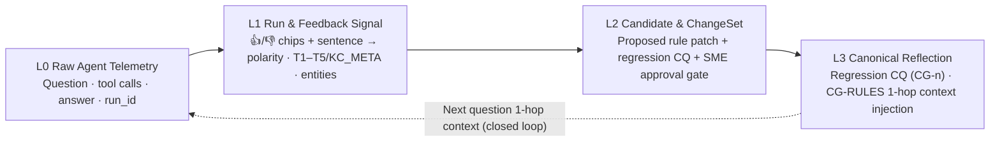

# Agentic Ontology Starter

**[🇺🇸 English](README.md)** · **[🇰🇷 한국어 (Korean)](README.ko.md)** · **[✨ 3-Asset Live Demo Showcase ↗](https://agentic-ontology-starter-notebook-dasz7pvvua-du.a.run.app/showcase)**

> **With just this Studio and this repository**, you can build an enterprise ontology agent on **your own data and your own Google Cloud project** — an **OKF Wiki**, **Spanner Graph** (default Semantic Graph), **Wiki / Graph / Hybrid Agents**, **Competency Question (CQ) Evaluation**, and a closed-loop **4-Layer Context Graph** — and take the result away as a **CLI, MCP call log, single-file agent, and portable code bundle**.
>
> The core methodology know-how (scoping, CQ drafting, wiki compilation + W1–W9 gates, graph design, agent reasoning, grading, and Context Graph) lives inside stateless **Platform Core MCP (`aos_core_*`) tools** (`v1.12.0`, 57 tools). This open repository contains **which tools are called, in which order, with which parameters** — zero external Python dependencies (`Python 3.11` standard library only).

> **Role of the Starter Pack — "Start effortlessly and experience it first-hand."**
> Open a pre-built **100/100** workspace in 1 click → run the **3 interactive Notebook Labs** as an instant guest (no sign-in required) → build on **your own data & GCP project** and export as code.

---

## Instant Live Experience — Zero Setup (30 Seconds)

All web surfaces default to **English** with an instant **`EN | KO`** toggle in the top bar.

| Experience | Direct Link | What You Experience |
| :--- | :--- | :--- |
| ✨ **3-Asset Demo Showcase Hub** | [`/showcase` ↗](https://agentic-ontology-starter-notebook-dasz7pvvua-du.a.run.app/showcase) | Single launchpad connecting all three live Accelerate '27 showcase assets: Interactive Notebook Lab, Production LG U+ Studio, and this Public Starter Pack |
| 📓 **Notebook Lab 1 · Ontology** (~10 min) | [`#ov` Overview Map ↗](https://agentic-ontology-starter-notebook-dasz7pvvua-du.a.run.app/#ov) | **Instant guest access** (optional Google sign-in): `#n1` CQs → `#n2` OKF Wiki + coverage pass → `#n3` Graph design · Spanner Graph load · GQL check → `#n4` Knowledge Catalog · GQL Agent → `#n5` Head-to-head Wiki vs. GQL Agent evaluation |
| 📓 **Notebook Lab 2 · Workflow** (~6 min) | [`#w0` Overview Map ↗](https://agentic-ontology-starter-notebook-dasz7pvvua-du.a.run.app/#w0) | `#w1` Extract rules & workflows → `#w2` Extend Spanner Graph → `#w3` Interactive Workflow Agent → `#w4` Evaluate → `#w5` Change request · Admin approval · Apply · Before/After diff · Rollback |
| 📓 **Notebook Lab 3 · Context Graph** (~6 min) | [`#c0` Overview Map ↗](https://agentic-ontology-starter-notebook-dasz7pvvua-du.a.run.app/#c0) | `#c1` BigQuery Property Graph setup → `#c2` Log agent runs → `#c3` GQL audit → `#c4` 👍/👎 & sentence feedback → tacit candidates → `#c5` SME approve · apply to KC · re-ask → `#c6` Loop dashboard · KG snapshots · data explorer |
| 🏛️ **Starter Studio (`v6.14.0`)** | [Open Starter Studio ↗](https://agentic-ontology-starter-dasz7pvvua-du.a.run.app/) | Full flow (`⓪ Understand`) → **Try with sample** (demo identity · sample pack) → build on your data → CLI & code bundle hand-off |
| ⚡ **Pre-Built 100/100 Workspace** | [3-Agent Q&A & Feedback ↗](https://agentic-ontology-starter-dasz7pvvua-du.a.run.app/?bucket=seanjung-agentic-starter-ontology&ws=ws-20261105-5525c8#/studio/agents) · [Context Graph Demo ↗](https://agentic-ontology-starter-dasz7pvvua-du.a.run.app/?bucket=seanjung-agentic-starter-ontology&ws=ws-20261105-5525c8#/studio/cg) | Zero build wait on finished workspace `ws-20261105-5525c8` (eval score **100**): query Wiki / Graph / Hybrid agents and run the 1-click 3-agent Context Graph closed-loop demo |
| 🏢 **Production-Domain Studio (LG U+)** | [Open LG U+ Studio ↗](https://agentic-ontology-studio-lguplus-lwrlf7yogq-du.a.run.app/) | 13-tab unified enterprise ontology reference platform (Telecom subsidy domain, English default with `EN | KO` toggle) |
| 🧭 **Reference Wizard** | [`/wizard` ↗](https://agentic-ontology-starter-dasz7pvvua-du.a.run.app/wizard#step-1) | Curated 6-step reference flow (Flow A / B / C, baseline 100) for side-by-side comparison |
| 🔌 **Platform Core MCP (`v1.12.0`)** | `https://aos-builder-core-mcp-dasz7pvvua-du.a.run.app/mcp` | **57 tools** = Builder 10 + Data Plane 28 + Core / Intake 12 + Drive 2 + **Context Graph 5** (`aos_core_cg_*`) · JSON-RPC `tools/list` & `tools/call` |

> **Notebook Lab session lifecycle**: Enter immediately as a guest (or sign in optionally with Google). Every session provisions an isolated GCS bucket and Spanner database automatically and cleans up idle resources after 3 hours. Use **▶ Run all** in the sidebar to execute an entire lab end to end; if your laptop sleeps or the page reloads, it automatically resumes from the next unfinished cell.

---

### Onboarding Journey: Start → Experience → Apply

| Stage | Time | What You Do | Quick Links |
| :---: | :---: | :--- | :--- |
| **① Start** | 1 min | Open the pre-built 100/100 workspace with zero setup — ask Wiki / Graph / Hybrid agents, submit free-text feedback, and watch it land in the Context Graph | [Agents](https://agentic-ontology-starter-dasz7pvvua-du.a.run.app/?bucket=seanjung-agentic-starter-ontology&ws=ws-20261105-5525c8#/studio/agents) · [Context Graph](https://agentic-ontology-starter-dasz7pvvua-du.a.run.app/?bucket=seanjung-agentic-starter-ontology&ws=ws-20261105-5525c8#/studio/cg) |
| **② Experience** | 6–10 min / lab | Run Notebook Labs 1, 2, and 3 cell by cell or with **▶ Run all** to master OKF Wiki, Spanner Graph, Workflow Agents, and the Context Graph closed loop | [Lab 1](https://agentic-ontology-starter-notebook-dasz7pvvua-du.a.run.app/#ov) · [Lab 2](https://agentic-ontology-starter-notebook-dasz7pvvua-du.a.run.app/#w0) · [Lab 3](https://agentic-ontology-starter-notebook-dasz7pvvua-du.a.run.app/#c0) |
| **③ Apply** | 6–10 min build | Bring your own PDFs / Office docs / CSVs / BigQuery tables into Starter Studio, build in your own GCP project, and export the CLI + single-file agent (`aos_agent_standalone.py`) + MCP bundle | [Studio](https://agentic-ontology-starter-dasz7pvvua-du.a.run.app/) · [§4 Quick Start](#4-quick-start) · [§6 Hand-off Bundle](#6-code--mcp-hand-off-bundle) |

#### ③ Apply Map — Notebook Cell ↔ Studio Screen ↔ Core MCP Tool ↔ GCP Artifact

This mirrors the **③ Apply** map on the Studio `⓪ Understand` screen so every stage you learn in the Notebook Lab maps 1:1 to Studio, Core MCP, and this repository.

| Stage | Experience in Notebook Lab | Apply in Starter Studio | Core MCP Tool | Artifact in Your GCP |
| :--- | :--- | :--- | :--- | :--- |
| **Competency Questions (CQs)** | Lab 1 `#n1` draft & lock evaluation set | Build `S2` CQs · edit CQs in **Evaluate** | `aos_core_draft_cqs` | `gs://<bucket>/aos/<ws>/cqs.json` |
| **OKF Wiki** | Lab 1 `#n2` parse · compile wiki · coverage repair · Wiki Agent | Build `S3` wiki · **Wiki** tab (view · edit · gates W1–W9) | `aos_builder_parse_documents_gate0` · `aos_core_compile_wiki` | `gs://<bucket>/aos/<ws>/wiki/` |
| **Semantic Graph** | Lab 1 `#n3` design → DDL → Spanner load → GQL verify | Build `S4` graph · **Graph** tab (schema · node/edge allocation · GQL console) | `aos_core_design_graph` · `spanner_update_ddl` · `spanner_commit` | **Spanner Graph** (default) · BigQuery staging tables |
| **Agents & Evaluation** | Lab 1 `#n4` Knowledge Catalog · GQL Agent · `#n5` head-to-head eval | Build `S5` eval · **Agents** tab (Wiki · Graph · Hybrid) | `aos_core_agent_step` · `aos_core_judge` | `gs://<bucket>/aos/<ws>/runs/` · score report |
| **Workflow & Approved Changes** | Lab 2 `#w1`–`#w5` rules · workflows · Workflow Agent · approval & rollback | Experience in Notebook Lab first (Studio roadmap) | Notebook session Spanner Graph | Session Spanner DB (`T_ChangeRequest` · `T_ChangeAudit`) |
| **Context Graph Loop** | Lab 3 `#c1`–`#c6` telemetry · GQL audit · feedback · approve · re-ask | **Context Graph** tab · inline feedback bar · SME review · ChangeSet | `aos_core_cg_parse_feedback` · `submit_feedback` · `feedback_flow` · `review_candidate` · `changeset` | `gs://<bucket>/aos/<ws>/context_graph/graph.json` |

#### Five Operating Principles from Running the Notebook Lab

1. **Spanner Graph is the default Semantic Graph engine**; **BigQuery Property Graph** powers Lab 3's Context Graph (audit & action lineage) and remains selectable as an option (requires a BigQuery Enterprise reservation in a new project).
2. **Policy constants live in a single canonical page** inside the OKF Wiki (`G2-W1`); graph nodes, workflow rules, and agents reference that single source of truth.
3. **Deleted upstream resources invalidate downstream artifacts** — prerequisite steps verify real GCS / Spanner / BigQuery existence before executing.
4. **Data mutations and knowledge updates apply only after explicit human approval**, with before/after comparison and rollback audit trails (Lab 2 `#w5`, Lab 3 `#c5`, Studio SME gate).
5. **Long runs survive interruptions** — instant guest access (optional Google sign-in), durable cell checkpoints, and automatic idle cleanup (3 h for Notebook sessions, 7 days for Studio demo workspaces).

Design reference: [`DESIGN.md`](DESIGN.md)

---

## 1. Studio Flow — 5 Setup & Build Steps + Studio + Deploy & Hand-off

```text
⓪ Understand      End-to-end map: Inputs → Ingest & CQs → OKF Wiki → Property Graph → Agents → Eval (P1 Doc · P3 Unified · P2 Table)
① Flow & Services Presets + objective + question type (W1/W2/W3) + Flow (A Doc · B Table · C Unified · D Convert-first) + GCP service catalog
② GCP & Identity  Target (Starter Sandbox vs. My GCP Project) → template preview (stages · APIs · IAM · setup script) + live permission check
③ Data            Upload (.md .txt .csv + .pdf .docx .pptx .xlsx .html, up to 12 MB) · GCS · Google Drive · BigQuery · Sample pack + fidelity report
④ Document Types  Auto-detect (rules + optional Gemini assist) · confirm low-confidence docs · save wiki strategy (direct · typed · reconvert)
⑤ Build (S0–S5)   S0 Prepare → S1 Ingest & Profile → S2 CQs → S3 OKF Wiki → S4 Spanner Graph → S5 Eval (re-run any stage) → Test Agent → Deploy
Studio            Overview · Assets · Wiki (edit + gates) · Graph (schema · data allocation · GQL/SQL console · rebuild) · Search · Agents · Eval · Context Graph
Deploy            Readiness check (eval threshold · CQs · wiki gates · graph · own project) · Cloud Run / MCP client commands · Cloud Shell
Hand-off          CLI reproduce commands · MCP call log (tools + args + curl) · MCP client config · single-file agent · downloadable zip bundle
Admin (/admin)    Google Sign-In allowlist portal → 57-tool Core MCP catalog, architecture map, BigQuery account metering, live ring buffer
```

| Stage | What It Does | Core MCP Calls |
| :---: | :--- | :--- |
| **S0 Prepare** | Check bucket permissions · create dataset (7-day expiry on demo identity) · check Spanner Graph target DB · write `workspace.json` | `iam_test_permissions` · `bigquery_get_dataset_info` · `bigquery_create_dataset` · `spanner_get_instance` · `spanner_get_database` · `storage_upload_object` |
| **S1 Ingest & Profile** | Read docs · load CSVs to BigQuery (parallel) · profile existing BigQuery tables in place · Gate 0 · PK/FK scoping | `storage_read_object` · `bigquery_load_table` · `bigquery_get_table_info` · `bigquery_execute_sql` · `aos_builder_parse_documents_gate0` · **`aos_core_scope`** |
| **S2 CQs** | Draft competency questions + reference answers + core facts aligned with the business objective | **`aos_core_draft_cqs`** |
| **S3 OKF Wiki** | Compile 3-layer wiki (Summary · Entity · Concept) + single-source policy constants + `applies_to` + quality gates W1–W9 + coverage repair → GCS | **`aos_core_compile_wiki`** · `storage_upload_object` |
| **S4 Semantic Graph** | Design → stage node/edge tables in BigQuery → create **Spanner** tables + `CREATE OR REPLACE PROPERTY GRAPH` → copy rows → verify GQL (auto-translated to Spanner syntax; visible fallback to BigQuery Graph if Spanner is unavailable) | **`aos_core_design_graph`** · `bigquery_execute_sql` · `spanner_update_ddl` · `spanner_commit` · `spanner_execute_sql` |
| **S5 Evaluate** | Route every CQ through its target agent and grade (exact core facts + Gemini judge: `1 / 0.5 / 0`) | **`aos_core_agent_step`** · data-plane tools · **`aos_core_judge`** |

### 1.1 Closed-Loop 4-Layer Context Graph & Sentence Feedback

Every answer card in the **Agents** tab (Wiki · Graph · Hybrid) includes a calm sentence feedback bar (free text is primary; 👍/👎 and reason chips are optional tags). Submitting feedback parses polarity, tacit knowledge type (`T1` execution boundary · `T2` formula/threshold · `T3` exception policy · `T4` acronym/synonym · `T5` golden response format · `KC_META`), entities, and a regression CQ via deterministic parser `src/aos/sentence_feedback.py` and links directly into **Studio › Context Graph** (`#/studio/cg`).



| Step | Input → Output | Endpoint / Module |
| :--- | :--- | :--- |
| ① Ask / Answer | `{agent, question}` → NDJSON `result` with `cg_run_id`, `agent_surface`, and L0 telemetry events | `POST /api/v5/agent` |
| ② Submit Feedback | `{run_id?, agent, question, answer, sentence?, rating?, reason_code?}` (synthesizes a Run if no `run_id` exists — zero loss) | `POST /api/v5/cg/feedback` |
| ③ Parse Intent | `{feedback_mode, raw_sentence, parsed_intent{polarity, tacit_type, reason_code, extracted_entities, proposed_rule_statement, regression_cq}}` | `sentence_feedback.py` |
| ④ Synthesize Candidate | `{candidate_id, proposed_patch{op, target, statement}, regression_cq, status PENDING}` | `context_graph.py` |
| ⑤ SME Review | `{candidate_id, decision approve|reject, note}` → `{approval, changeset{ops, cq_id, status APPLIED}}` + appends `CG-<n>` to Evaluation CQs | `POST /api/v5/cg/review` |
| ⑥ Re-Ask & Compare | `{agent, question, apply_cg: true}` → injects approved `CG-RULES` page and compares **Before vs. After** | `POST /api/v5/agent` |

```bash
# REST examples
curl -s -X POST "$STARTER/api/v5/cg/feedback" -H 'Content-Type: application/json' -d '{"ws": {"bucket": "B", "ws_id": "WS"},
  "identity": {"mode": "token", "token": "'"$(gcloud auth print-access-token)"'"}, "agent": "wiki", "question": "...", "answer": "...",
  "sentence": "Check the 18-month tenure waiver exception rule (T3) before computing early-termination penalties."}'
curl -s -X POST "$STARTER/api/v5/cg/graph"  -H 'Content-Type: application/json' -d '{"ws": {...}, "identity": {...}}' | jq .counts
curl -s -X POST "$STARTER/api/v5/cg/review" -H 'Content-Type: application/json' -d '{"ws": {...}, "identity": {...}, "candidate_id": "cand-...", "decision": "approve"}'

# CLI examples
python3 -m src.cli cg --bucket B --ws WS feedback --agent wiki --question "..." --answer "..." --sentence "..."
python3 -m src.cli cg --bucket B --ws WS graph | rules | review --candidate cand-... --decision approve
python3 -m src.cli ask --bucket B --ws WS --agent wiki --apply-cg "Your question"
```

---

## 2. Three-Layer Security & Boundary Model

```text
Browser / CLI / Your Code
  └─ Open Starter (this repository: UI · orchestration order · CLI · workspace schema)
       ├─ Platform Core MCP v1.12.0 ─ aos_core_* (stateless prompts · rules · W1–W9 gates · CG)  ← Protected
       │                            └ data plane storage_* · bigquery_* · spanner_* · iam_* · drive_* (caller token only)
       └─ Vertex AI Gemini (default: gemini-4-argon, location global, billed to caller's project)
  All outputs & data stay in your GCP project (GCS workspace · BigQuery staging · Spanner Graph)
```

- **Zero-Privilege Core MCP**: The Core MCP runtime service account holds **zero IAM data roles**. Every GCP call and Vertex AI request runs strictly under the caller's token (`X-AOS-Access-Token`).
- **Identity Modes in Step 2**:
  - **Demo (`runtime`)**: Starter sandbox service account; writes restricted strictly to `STARTER_WRITE_PROJECTS` with 7-day automatic expiry.
  - **My Token (`token`)**: Paste an ephemeral `gcloud auth print-access-token` (or `--impersonate-service-account=SA`) token — kept in the browser tab only and never stored or logged by the server.
  - **SA Delegation (`impersonate`)**: Server-side short-lived token minting for self-hosted deployments matching `STARTER_IMPERSONATE_ALLOW`.
- **Unified Admin Portal (`/admin`)**: Fail-closed until configured. Production uses **Google Sign-In (Identity Platform RS256 ID token verification + strict `STARTER_ADMIN_EMAILS` allowlist + 12-hour sliding `HttpOnly` cookie)** to expose the 57-tool Core MCP catalog, BigQuery account-level metering (PII-minimized SHA-256 hashes + masked IDs), and live ring-buffer telemetry.

---

## 3. Notebooks — Live Interactive Lab + 12 Offline Reference Walkthroughs

- **Start here (Live)**: Open the [Interactive 3-Lab Notebook Lab ↗](https://agentic-ontology-starter-notebook-dasz7pvvua-du.a.run.app/#ov) as an instant guest — no setup, real Gemini + isolated per-session Spanner Graph & BigQuery Graph.
- **Offline code-level reference**: [`notebooks/`](notebooks/README.md) ships 12 static `.ipynb` files (6 in English under `notebooks/en/`, 6 in Korean under `notebooks/ko/`) covering Stages 0–5 line by line.

---

## 4. Quick Start

### 4.1 Live Cloud Run Studio (Zero Install)
1. **Instant exploration**: Open [Finished Workspace `ws-20261105-5525c8` ↗](https://agentic-ontology-starter-dasz7pvvua-du.a.run.app/?bucket=seanjung-agentic-starter-ontology&ws=ws-20261105-5525c8#/studio/overview).
2. **Try sample build**: Open [Starter Studio ↗](https://agentic-ontology-starter-dasz7pvvua-du.a.run.app/) → **Try it with the sample** → **Run all**.
3. **Build on your own data**: Click **Start with my data** → pick Flow & services → enter your project/bucket/token → **Check environment** → upload docs or connect GCS/Drive/BigQuery → run **S0–S5** → export from **Code · MCP hand-off**.

### 4.2 Run Locally (Python 3.11 stdlib only)
```bash
git clone https://github.com/seanjungG/agentic-ontology-starter.git && cd agentic-ontology-starter
gcloud auth login
cp .env.example .env   # Set GCP_PROJECT_ID, GCS_WIKI_BUCKET, STARTER_WRITE_PROJECTS, CORE_MCP_URL
set -a && source .env && set +a
python3 -m src.web.studio_server        # http://localhost:8080 (English default, EN | KO toggle)
```

### 4.3 Headless CLI
```bash
python3 -m src.cli check --project MY_PROJECT --bucket MY_BUCKET --region asia-northeast3
python3 -m src.cli new --spec spec.json [--impersonate aos-starter@MY_PROJECT.iam.gserviceaccount.com]
python3 -m src.cli build --bucket MY_BUCKET --ws ws-... [--stages ingest,cqs,wiki,graph,eval]
python3 -m src.cli ask   --bucket MY_BUCKET --ws ws-... --agent hybrid "Your question"
python3 -m src.cli eval  --bucket MY_BUCKET --ws ws-...
python3 -m src.cli calls --bucket MY_BUCKET --ws ws-... --stage graph
python3 -m src.cli purge-spanner --project MY_PROJECT --dry-run
```

### 4.4 Deploy to Your Cloud Run
```bash
gcloud run deploy agentic-ontology-starter --source . --region asia-northeast3 \
  --service-account aos-starter@MY_PROJECT.iam.gserviceaccount.com --timeout 600 \
  --set-env-vars GCP_PROJECT_ID=MY_PROJECT,BQ_LOCATION=asia-northeast3,GCS_WIKI_BUCKET=MY_BUCKET,STARTER_WRITE_PROJECTS=MY_PROJECT,CORE_MCP_URL=https://aos-builder-core-mcp-dasz7pvvua-du.a.run.app/mcp
```

---

## 5. Workspace Layout & Graph Engine

```text
gs://<bucket>/aos/<ws_id>/
  workspace.json · raw/ · parsed/{docs,tables}.json · cqs.json
  wiki/{01_summary,02_entities,03_concepts}/*.md · wiki/{pages,index,gates}.json
  graph/plan.json · graph/statements.sql · context_graph/graph.json · runs/latest.json · mcp_calls.jsonl
BigQuery <project>.<dataset (default aos_<ws>)>
  Source tables · N_<Label> node staging · E_<LABEL>_<From>_<To> edge staging
Spanner <instance>/<db (default starter_graph_db)>
  ws<yyyymmdd>_<hex>_N_<Label> · ws<yyyymmdd>_<hex>_E_... tables · <GRAPH>_<yyyymmdd>_<hex> Property Graph
```

- **Default engine = Spanner Graph** (`AOS_GRAPH_ENGINE=spanner`). Agent GQL is rewritten to Spanner syntax automatically, while source-table-only SQL runs on BigQuery.
- **Fallback & retention**: If Spanner is unavailable, S4 visibly falls back to BigQuery Property Graph. Demo-identity Spanner objects auto-expire after 7 days (`AOS_SPANNER_TTL_DAYS`, or `python3 -m src.cli purge-spanner`).

---

## 6. Code · MCP Hand-off Bundle

| File in Bundle (`zip`) | Purpose |
| :--- | :--- |
| `workspace.json` · `.env` | Re-run this exact workspace locally or in CI with this repository |
| `setup_gcp.sh` | Idempotent GCP setup script (APIs · GCS bucket · dedicated SA · minimal IAM · Spanner Graph · token helper) |
| `run_build.sh` · `ask.sh` | Reproduce the build and query/evaluate via CLI |
| `mcp_calls.jsonl` | Exact sequence of Core MCP tool calls (tool name · redacted args · status · ms) |
| `mcp_config.gemini-cli.json` | Register Core MCP as a tool server in Gemini CLI or any MCP client (`AOS_ACCESS_TOKEN`) |
| `aos_agent_standalone.py` | Self-contained single-file Python agent querying this workspace via Core MCP with zero repository dependency |

---

## 7. Repository Structure

```text
src/
├── web/studio_server.py       Stdlib HTTP server · /api/v5/* · /wizard · /admin
├── web/v5_routes.py           Studio v5/v6 API endpoints (intake · build · agents · eval · Context Graph)
├── web/admin_metering.py      Fail-closed Google SSO guard · Core MCP portal proxy · BigQuery metering API
├── web/static/                studio.html · studio.js · studio.css · studio_i18n.json (EN·KO) · flows_v5.js (+ /wizard)
├── aos/ws.py                  Workspace schema · GCS persistence · redacted MCP call logger
├── aos/sources.py             Upload · GCS · BigQuery · Drive · sample pack · CSV schema inference
├── aos/pipeline.py            Build stages S0–S5
├── aos/spanner_graph.py       Spanner Graph DDL · row loading · GQL translation · routing · TTL cleanup
├── aos/graph_allocation.py    Graph tab data allocation map (sources → nodes · properties · edges)
├── aos/agent.py               Wiki · Graph · Hybrid agent loop (aos_core_agent_step + CG-RULES injection)
├── aos/context_graph.py       4-Layer Context Graph store (L0 · L1 · L2 · SME · ChangeSet)
├── aos/sentence_feedback.py   Deterministic free-text feedback parser (EN/KO)
├── aos/studio.py              Presets · env checks · setup script · wiki/graph edit · search · bundle export
├── identity.py                Per-request identity resolver (runtime · token · impersonate)
├── cli.py                     Headless CLI (check · new · build · ask · eval · cg · calls · purge-spanner)
└── (reference wizard)         config · recipes · datapack · loader · evaluation · agent/
data/ · config/ · notebooks/(12 offline walkthroughs, EN + KO) · tests/ · DESIGN.md
```

---

## 8. Key Environment Variables

| Variable | Default | Description |
| :--- | :--- | :--- |
| `GCP_PROJECT_ID` · `BQ_LOCATION` · `GCS_WIKI_BUCKET` | — · `asia-northeast3` · — | Default GCP target resources (Step 2 defaults) |
| `VERTEX_GEMINI_MODEL` · `VERTEX_LOCATION` | `gemini-4-argon` · `global` | Gemini model and Vertex AI location |
| `CORE_MCP_URL` | `https://aos-builder-core-mcp-dasz7pvvua-du.a.run.app/mcp` | Platform Core MCP endpoint (cannot be overridden by requests) |
| `STARTER_WRITE_PROJECTS` | `GCP_PROJECT_ID` | Projects the demo identity may write to (`*` = any; ignored for user tokens) |
| `STARTER_IMPERSONATE_ALLOW` | (empty = disabled) | Allowed SA glob pattern for server-side SA delegation |
| `AOS_GRAPH_ENGINE` · `AOS_SPANNER_DATABASE` · `AOS_SPANNER_TTL_DAYS` | `spanner` · `starter_graph_db` · `7` | Default graph engine · shared Spanner DB · demo retention days (`0` = off) |
| `STARTER_ADMIN_AUTH_MODE` · `STARTER_ADMIN_EMAILS` | `google` (when configured) | Optional `/admin` Google SSO portal protection (fail-closed until configured) |
| `PORT` | `8080` | HTTP listen port |

---

## 9. Offline Verification Tests

```bash
python3 -m pip install pytest && python3 -m pytest tests -q
```

Covers the v5/v6 Studio shell, English-default & `EN/KO` i18n parity (zero Hangul in English), public safety checks, workspace & env validation, CSV inference, SQL/GQL read-only guards, identity pre-flight errors, sentence feedback parser, Context Graph store/routes, Spanner Graph translation, Admin Google SSO RS256 verification, and reference wizard tests — all **100% offline with zero GCP calls** (`python3 -m unittest discover -s tests` also works).

---

## License

Methodology and documentation: **CC BY-NC-ND 4.0** · Source code: **PolyForm Noncommercial License 1.0.0** — see [`LICENSE`](LICENSE). Commercial use requires prior written permission.
