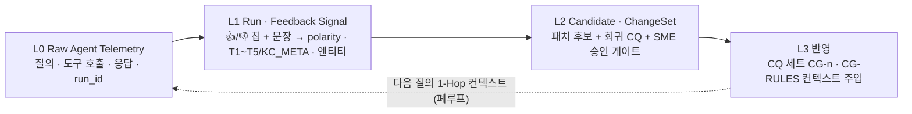

# Agentic Ontology Starter

> **이 스튜디오 + 이 깃헙만 있으면** 내 데이터 · 내 GCP로 엔터프라이즈 온톨로지 에이전트(OKF 위키 · **Spanner Graph**(기본 Semantic Graph) · Wiki/Graph/Hybrid 에이전트 · CQ 평가)를 만들고, 같은 결과를 다시 만드는 **CLI · MCP 호출 파라미터 · 코드 번들**로 가져가는 스타터 팩입니다.
> 방법론의 핵심 노하우(위키 컴파일 · 그래프 설계 · 에이전트 추론 · 채점)는 **Platform Core MCP 도구** 안에만 있고, 이 저장소는 그 도구를 **어떤 순서로 · 어떤 파라미터로** 부르는지를 담습니다. 서버는 Python 3.11 표준 라이브러리만 씁니다.

> **스타터팩의 역할은 "쉽게 시작하고 직접 경험하는 것"입니다.** 설치 없이 완성된 워크스페이스를 1클릭으로 열어 보고 → 노트북으로 원리를 익히고 → 내 데이터 · 내 GCP로 만들어 코드로 가져가세요.

## 🚀 30초 만에 시작하고 직접 경험하기 (Instant Live Experience — Zero Setup)

| 구분 | 바로가기 | 무엇을 경험하나 |
| :--- | :--- | :--- |
| 🏛️ **스타터 스튜디오** | [메인 스튜디오 ↗](https://agentic-ontology-starter-dasz7pvvua-du.a.run.app/) | `⓪ 이해` 전체 흐름 → **샘플로 바로 체험**(데모 신원 · 샘플 팩) → 내 데이터로 구축 → 코드 인계 |
| ⚡ **완성 워크스페이스 1클릭** | [3-에이전트 질의 · 문장 피드백 ↗](https://agentic-ontology-starter-dasz7pvvua-du.a.run.app/?bucket=seanjung-agentic-starter-ontology&ws=ws-20261105-5525c8#/studio/agents) | 구축 대기 0초 · 평가 **100점** 워크스페이스 `ws-20261105-5525c8`에서 Wiki · Graph · Hybrid 에이전트에 바로 질문하고 답변마다 문장 피드백 |
| ⚡ **완성 워크스페이스 1클릭** | [4-Layer Context Graph · 3-에이전트 시연 ↗](https://agentic-ontology-starter-dasz7pvvua-du.a.run.app/?bucket=seanjung-agentic-starter-ontology&ws=ws-20261105-5525c8#/studio/cg) | 피드백 → 암묵지 후보 → SME 승인 → ChangeSet 폐루프를 1클릭 시연 |
| 🧭 **레퍼런스 마법사** | [`/wizard` ↗](https://agentic-ontology-starter-dasz7pvvua-du.a.run.app/wizard#step-1) | 큐레이션된 샘플 결과(Flow A/B/C, 기준 100점) — 비교용 |
| 📓 **노트북 Lab 1 · 온톨로지** (약 10분) | [`#ov` 전체 도식 ↗](https://agentic-ontology-starter-notebook-dasz7pvvua-du.a.run.app/#ov) | `#n1` CQ → `#n2` OKF 위키 + 커버리지 보완 → `#n3` 그래프 설계 · Spanner 적재 · GQL 확인 → `#n4` Knowledge Catalog · GQL Agent → `#n5` 두 에이전트 평가 |
| 📓 **노트북 Lab 2 · 워크플로우** (약 6분) | [`#w0` 전체 도식 ↗](https://agentic-ontology-starter-notebook-dasz7pvvua-du.a.run.app/#w0) | `#w1` 룰 · 워크플로우 추출 → `#w2` Spanner Graph 확장 → `#w3` Workflow Agent 대화 → `#w4` 평가 → `#w5` 변경 요청 · 어드민 승인 · 반영 · 전/후 비교 · 원복 |
| 📓 **노트북 Lab 3 · Context Graph** (약 6분) | [`#c0` 전체 도식 ↗](https://agentic-ontology-starter-notebook-dasz7pvvua-du.a.run.app/#c0) | `#c1` BigQuery Graph 준비 → `#c2` 답변 기록 → `#c3` GQL 감사 → `#c4` 👍/👎 · 정정 → 암묵지 후보 → `#c5` 승인 · KC 반영 · 재질의 → `#c6` 루프 대시보드 · KG 스냅샷 · 적재 데이터 탐색 |
| 🔌 **Platform Core MCP** | `https://aos-builder-core-mcp-dasz7pvvua-du.a.run.app/mcp` | `1.11.0` · 도구 **57종** = 빌드 10 + 데이터 플레인 28 + 코어 · 인테이크 12 + Drive 2 + **Context Graph 5** (`aos_core_cg_*`) · JSON-RPC `tools/list` · `tools/call` |

> 노트북 랩은 Google 계정 로그인 후 세션마다 내 GCS 버킷 · Spanner DB가 만들어지고(미사용 3시간 뒤 자동 삭제), 사이드바 **▶ 전체 자동 수행**으로 Lab을 끝까지 돌릴 수 있습니다. 중간에 PC가 잠들거나 로그인이 만료돼도 다시 로그인하면 끝난 셀은 건너뛰고 이어서 진행합니다. 스튜디오의 완성 워크스페이스는 읽기 체험용 공유 샘플입니다.

### 시작 → 경험 → 적용 (Onboarding Journey)

| 단계 | 시간 | 하는 일 | 바로가기 |
| :---: | :---: | :--- | :--- |
| **① 시작** | 1분 | 설치 · 빌드 없이 완성 워크스페이스에서 3-에이전트 질의 → 문장 피드백 → Context Graph 반영을 바로 경험 | [에이전트](https://agentic-ontology-starter-dasz7pvvua-du.a.run.app/?bucket=seanjung-agentic-starter-ontology&ws=ws-20261105-5525c8#/studio/agents) · [Context Graph](https://agentic-ontology-starter-dasz7pvvua-du.a.run.app/?bucket=seanjung-agentic-starter-ontology&ws=ws-20261105-5525c8#/studio/cg) |
| **② 경험** | Lab당 6~10분 | 노트북 Lab 1 · 2 · 3을 셀 단위 또는 **▶ 전체 자동 수행**으로 실행하며 OKF 위키 · Spanner Graph · Workflow Agent · Context Graph의 작동 원리를 체득 | [Lab 1](https://agentic-ontology-starter-notebook-dasz7pvvua-du.a.run.app/#ov) · [Lab 2](https://agentic-ontology-starter-notebook-dasz7pvvua-du.a.run.app/#w0) · [Lab 3](https://agentic-ontology-starter-notebook-dasz7pvvua-du.a.run.app/#c0) |
| **③ 적용** | 구축 6~10분 | 노트북에서 익힌 같은 단계를 스튜디오에서 내 문서 · 테이블(PDF · DOCX · CSV · BigQuery)로 구축하고 CLI · 단일 파일 에이전트(`aos_agent_standalone.py`) · MCP 번들로 내 프로젝트에 이식 | [스튜디오](https://agentic-ontology-starter-dasz7pvvua-du.a.run.app/) · [§4 빠른 시작](#4-빠른-시작) · [§6 인계 번들](#6-코드--mcp-인계-번들) |

#### ③ 적용 맵 — 노트북 셀 · 스튜디오 화면 · Core MCP 도구 · 결과물

스튜디오 `⓪ 이해` 화면의 **③ 적용** 표와 같은 내용입니다. 같은 이름의 단계가 네 곳에서 이어지므로, 노트북에서 본 결과를 스튜디오와 이 저장소의 코드에서 그대로 찾을 수 있습니다.

| 단계 | 노트북에서 경험 | 스튜디오에서 적용 | Core MCP | 결과물 |
| :--- | :--- | :--- | :--- | :--- |
| 질문 정의 (CQ) | Lab 1 `#n1` CQ 만들기 · 평가 세트 확정 | 구축 S2 CQ · 평가 탭에서 CQ 편집 | `aos_core_draft_cqs` | `gs://<버킷>/aos/<ws>/cqs.json` |
| OKF 위키 | Lab 1 `#n2` 파싱 · 위키 컴파일 · 커버리지 보완 · Wiki Agent | 구축 S3 위키 · 위키 탭(보기 · 편집 · 게이트 W1~W9) | `aos_builder_parse_documents_gate0` · `aos_core_compile_wiki` | `gs://<버킷>/aos/<ws>/wiki/` |
| Semantic Graph | Lab 1 `#n3` 설계 → DDL → Spanner 적재 → GQL 확인 | 구축 S4 그래프 · 그래프 탭(스키마 · 노드/엣지 할당 · GQL 콘솔) | `aos_core_design_graph` · `spanner_update_ddl` · `spanner_commit` | Spanner Graph(기본) · BigQuery 스테이징 테이블 |
| 에이전트 · 평가 | Lab 1 `#n4` KC · GQL Agent · `#n5` 두 에이전트 평가 | 구축 S5 평가 · 에이전트 탭(Wiki · Graph · Hybrid) | `aos_core_agent_step` · `aos_core_judge` | `gs://<버킷>/aos/<ws>/runs/` · 평가 점수 |
| 워크플로우 · 승인 변경 | Lab 2 `#w1`~`#w5` 룰 · 워크플로우 · Workflow Agent · 변경 승인 | 노트북에서 먼저 경험 (스튜디오는 다음 단계) | 노트북 세션 Spanner Graph | 세션 Spanner DB (`T_ChangeRequest` · `T_ChangeAudit`) |
| Context Graph 루프 | Lab 3 `#c1`~`#c6` 기록 · 감사 · 피드백 · 승인 · 재질의 | Context Graph 탭 · 답변마다 문장 피드백 · SME 승인 · ChangeSet | `aos_core_cg_parse_feedback` · `submit_feedback` · `feedback_flow` · `review_candidate` · `changeset` | `gs://<버킷>/aos/<ws>/context_graph/graph.json` |

#### 노트북을 운영하며 정리한 원칙

1. **Semantic Graph 기본 엔진은 Spanner Graph**, BigQuery Graph는 Context Graph(감사 · 결정 이력) 수집용입니다. 새 프로젝트에서 BigQuery Graph를 쓰려면 Enterprise 예약(오토스케일, 기준 0 슬롯)이 필요합니다.
2. **정책 수치는 위키 한 곳에만** 두고 그래프 · 룰 · 에이전트는 그 값을 참조합니다(단일 출처).
3. **리소스가 지워지면 그 위에 만든 결과도 무효**입니다. 선행 단계는 버킷 · DB · 데이터셋이 실제로 있는지 확인한 뒤 다시 실행합니다.
4. **데이터 변경 · 지식 반영은 사람 승인 후에만** 적용하고 전/후 비교와 원복 기록을 남깁니다(Lab 2 `#w5`, Lab 3 `#c5`, 스튜디오 SME 승인).
5. **긴 실행은 끊겨도 이어지게** — 진행 상태 저장 · 로그인 자동 연장 · 미사용 리소스 자동 정리(노트북 세션 3시간, 스튜디오 데모 신원 7일).

설계 문서: [`docs/20261019_v1_starter_v5_redesign.md`](docs/20261019_v1_starter_v5_redesign.md)

---

## 1. 흐름 — 5단계 구성 + 스튜디오 + 배포 · 인계

> **v6 (GOAL-243)**: 플로우 · 서비스 카탈로그로 **템플릿 구성**(스타터 샌드박스 또는 내 GCP 프로젝트) → 데이터는 **로컬 업로드 · GCS · Google Drive**, PDF · DOCX · PPTX · XLSX · HTML은 **Markdown 변환 + 변환율 측정** → **문서 유형 자동 판별 + 사용자 확인**(그대로 / 유형별 프롬프팅 / 재변환) → 위키 → **에이전트 바로 테스트** → **배포 단계**(준비도 점검 · 명령). 노하우는 모두 Core MCP(`aos_core_catalog · compose_template · convert_document · classify_documents · deploy_plan`, `drive_*`)에 있고, 구버전 Core MCP면 화면에 `MCP_UPDATE_NEEDED` 안내가 뜹니다(기존 흐름은 그대로 동작).

```text
⓪ 이해      전체 흐름도: 입력 → 수집 · CQ → OKF 위키 → Property Graph → 에이전트 → 평가 (P1 문서 · P3 통합 · P2 테이블)
① 상황·목적  프리셋 + 업무 목적 + 질문 유형 W1/W2/W3 + 플로우(A 문서 · B 테이블 · C 통합 · D 변환 우선) · GCP 서비스 카탈로그
② GCP·권한   템플릿 대상(스타터 샌드박스 · 내 프로젝트) → 템플릿 미리보기(단계 · 서비스 · API · IAM · 스크립트) + 신원 · 리소스 실제 점검
③ 데이터     업로드(.md .txt .csv + .pdf .docx .pptx .xlsx .html, 12MB) · GCS · Google Drive · BigQuery · 샘플 — 변환 결과표(방식 · 변환율 · 페이지 · 미리보기 · PDF)
④ 문서 유형  자동 판별(규칙 + 선택 Gemini) · 확신 낮으면 질문 · 전략(direct · typed · reconvert) 저장 → S3에 유형별 지침 반영
⑤ 구축       S0 준비 → S1 수집 · 프로파일 → S2 CQ → S3 OKF 위키 → S4 Spanner Graph(기본) → S5 평가 (단계별 재실행) → 에이전트 테스트 → 배포 단계
스튜디오     개요 · 자산 · 위키(보기 · 편집 · 게이트) · 그래프(스키마 · GQL/SQL 콘솔 · 설계 편집 → 재구축) · 검색 · 에이전트 실험(+ 답변별 문장형 피드백) · 평가(CQ 편집) · Context Graph
배포        준비도 점검(평가 기준 · CQ · 게이트 · 그래프 · 내 프로젝트 여부) · Cloud Run / MCP 클라이언트 단계별 명령 · Cloud Shell
인계        CLI 재현 명령 · MCP 호출 로그(도구 + 파라미터, curl) · MCP 클라이언트 설정 · 단일 파일 에이전트 · 번들(zip)
```

| 단계 | 하는 일 | Core MCP 호출 |
| :---: | :--- | :--- |
| S0 준비 | 버킷 권한 · 데이터셋 생성(데모 신원이면 테이블 7일 만료) · Spanner Graph 대상 DB 점검 · `workspace.json` | `iam_test_permissions` · `bigquery_get_dataset_info` · `bigquery_create_dataset` · `spanner_get_instance` · `spanner_get_database` · `storage_upload_object` |
| S1 수집 · 프로파일 | 문서 읽기 · CSV → BigQuery(병렬) · BigQuery 테이블 프로파일(복사 없음) · Gate 0 · PK/FK 스코핑 | `storage_read_object` · `bigquery_load_table` · `bigquery_get_table_info` · `bigquery_execute_sql` · `aos_builder_parse_documents_gate0` · **`aos_core_scope`** |
| S2 CQ | 목적 기반 역량 질문 + 기준 답 + 핵심 사실 | **`aos_core_draft_cqs`** |
| S3 OKF 위키 | 요약 · 엔티티 · 개념 + 정책 상수(단일 출처) + applies_to + 게이트 W1~W9(본문 줄 수 상한 없음 · W8 섹션 · W9 숫자 커버리지 + 보완 패스) → GCS | **`aos_core_compile_wiki`** · `storage_upload_object` |
| S4 Semantic Graph | 설계 → 노드 · 엣지 테이블(BigQuery 스테이징) → **Spanner** 테이블 + `CREATE OR REPLACE PROPERTY GRAPH` → 행 복사 → 검증 GQL(Spanner 문법 자동 변환) · Spanner 불가 시 BigQuery Graph로 **화면에 표시되는** 폴백 | **`aos_core_design_graph`** · `bigquery_execute_sql` · `spanner_update_ddl` · `spanner_commit` · `spanner_execute_sql` |
| S5 평가 | 모든 CQ를 담당 에이전트로 다시 묻고 채점 | **`aos_core_agent_step`** · 데이터 도구 · **`aos_core_judge`** |

실측(2026-10-19, `gemini-4-argon` MEDIUM): 샘플 팩 KO 구축 약 7분 · 평가 **100 (8/8)** · 업로드한 보험 청구 심사 데이터(문서 1 + CSV 3) 구축 약 6.5분 · 평가 **100 (8/8)**, Property Graph 검증 GQL 전부 통과. Spanner Graph 기본값(v6.5.0 이후) 실측은 아래 "그래프 엔진" 참고.

### 1.1 Context Graph · 문장형 피드백 (v6.8.0, GOAL-285)

에이전트 탭의 **모든 답변 아래**(Wiki · Graph · Hybrid)에 차분한 문장 피드백 바가 있습니다. 텍스트 입력이 기본이고 👍/👎 · 사유 칩은 선택 태그입니다(문장만 · 버튼만 · 둘 다 가능). 보내면 결정적 파서 `src/aos/sentence_feedback.py`의 `parse_sentence_feedback_to_cg_signal()`가 극성 · 암묵지 유형(T1 실행 경계 · T2 산식/임계치 · T3 예외 정책 · T4 약어/동의어 · T5 골든 답변 프레임 · KC_META) · 사유 코드 · 엔티티 · 회귀 CQ로 구조화하고, 토스트의 **🔗 Context Graph에서 반영 흐름 보기 (Run #… → Candidate #…)** 링크로 새 탭 **스튜디오 › 컨텍스트 그래프**(`#/studio/cg`)로 바로 이동합니다.



| 단계 | 입력 → 출력 | 위치 |
| :--- | :--- | :--- |
| ① 질의/응답 | `{agent, question}` → NDJSON `result` 에 `cg_run_id` · `agent_surface` (`wiki_agent` · `bqg_agent` · `hybrid_agent`) + L0 이벤트 기록 | `POST /api/v5/agent` |
| ② 피드백 | `{run_id?, agent, question, answer, sentence?, rating?, reason_code?}` (run_id 없거나 모르면 질의/응답 스냅샷으로 **Run 합성 — 유실 0%**) | `POST /api/v5/cg/feedback` |
| ③ 구조화 | `{feedback_mode SENTENCE·THUMBS_CHIP·HYBRID, raw_sentence, parsed_intent{polarity, tacit_type, reason_code, extracted_entities, proposed_rule_statement, regression_cq}}` | `sentence_feedback.py` |
| ④ 후보 | `{candidate_id, proposed_patch{op, target, statement}, regression_cq, status PENDING}` (단순 👍만이면 후보 없음) | `context_graph.py` |
| ⑤ SME 승인 | `{candidate_id, decision approve·reject, note}` → `{approval, changeset{ops, cq_id, status APPLIED}}` · 승인 시 평가 CQ 세트에 `CG-<n>`(origin `context_graph`) 추가 | `POST /api/v5/cg/review` |
| ⑥ 반영 · 비교 | `{agent, question, apply_cg: true}` → 승인 규칙을 합성 위키 페이지 `CG-RULES`로 주입해 재질의 → Before vs After | `POST /api/v5/agent` · 탭의 **재질의 비교** |

- 저장: 워크스페이스마다 `gs://<bucket>/aos/<ws_id>/context_graph/graph.json` 한 파일(L0 events · L1 runs · feedback · L2 candidates · approvals · changesets, 목록별 상한). 서버는 상태가 없고 워크스페이스 단위 잠금으로 읽기-수정-쓰기합니다. 기록 실패는 답변을 막지 않고 `cg_error`로만 알려 줍니다(non-404 읽기 오류일 때는 덮어쓰지 않음).
- 탭 구성: 4-Layer 도식 · **⚡ 3-에이전트 실시간 피드백 반영 시연**(첫 CQ를 3개 에이전트에 묻고 예시 문장 피드백 → Wiki 후보 SME 승인까지 7단계 강조) · 그래프 뷰어(Run → 💬/👍/👎 → 후보 → SME → ChangeSet) · L0/L1/L2 인스펙터 · SME 검토 · 문장 피드백 입력 · 데이터 흐름 ①~⑥ 입출력 JSON(실제 기록) · 실제 적재 데이터 표(L0 · L1 · L2 · ChangeSet · T1~T5 카탈로그 · JSON 원본) · 사용 예시 3종.
- 사용 예시 — 문장만: *"공시지원금 위약금 계산 시 18개월 이상 유지 고객은 잔여 할부금 면제 예외 규칙(T3)을 먼저 확인해야 함"* → `RULE_ADDITION` · `T3 예외 정책` · `ADD_EXCEPTION_POLICY` 후보 + 회귀 CQ.

```bash
# REST (신원 · 워크스페이스 참조 포함)
curl -s -X POST $STARTER/api/v5/cg/feedback -H 'Content-Type: application/json' -d '{"ws": {"bucket": "B", "ws_id": "WS"},
  "identity": {"mode": "token", "token": "'"$(gcloud auth print-access-token)"'"}, "agent": "wiki", "question": "...", "answer": "...",
  "sentence": "18개월 이상 유지 고객은 잔여 할부금 면제 예외 규칙을 먼저 확인해야 함"}'
curl -s -X POST $STARTER/api/v5/cg/graph  -H 'Content-Type: application/json' -d '{"ws": {...}, "identity": {...}}' | jq .counts
curl -s -X POST $STARTER/api/v5/cg/review -H 'Content-Type: application/json' -d '{"ws": {...}, "identity": {...}, "candidate_id": "cand-…", "decision": "approve"}'
# CLI
python3 -m src.cli cg --bucket B --ws WS feedback --agent wiki --question "..." --answer "..." --sentence "..."
python3 -m src.cli cg --bucket B --ws WS graph | rules | review --candidate cand-… --decision approve
python3 -m src.cli ask --bucket B --ws WS --agent wiki --apply-cg "..."    # 승인 규칙 주입 재질의
```

- Python: `src.aos.context_graph` 의 `record_run · record_feedback · review · approved_rules · graph_view` (표준 라이브러리만). MCP: Core MCP `1.11.0`(GOAL-284)에 Context Graph 도구 5종이 배포되어 있습니다 — `aos_core_cg_parse_feedback`(문장 → polarity · T1~T5/KC_META · 엔티티 · 회귀 CQ) · `aos_core_cg_submit_feedback`(👍/👎 · 사유 칩 · 문장 → L0/L1 기록 + L2 후보) · `aos_core_cg_feedback_flow`(Run → Feedback → Candidate 흐름 조회) · `aos_core_cg_review_candidate`(SME 승인 · 반려) · `aos_core_cg_changeset`(승인 ChangeSet 반영 · 회귀 CQ) — 총 57종. 승인 규칙은 `aos_core_agent_step` 컨텍스트의 `CG-RULES` 페이지로 다음 질의에 주입됩니다.
- 화면 정돈(REQ-5/7): 개요 · 평가 화면 기준의 슬레이트/인디고 톤으로 상태 색 · 배지 · 제목 크기를 통일하고, 모든 대화상자를 같은 틀(56px 헤더 · 우상단 ✕ · 본문 스크롤 · 우측 정렬 하단 버튼 · Esc 닫기)로 맞췄습니다. 브라우저 기본 `confirm()`도 같은 확인 대화상자로 바꿨습니다.

---

## 2. 3개 층 — 무엇이 공개이고 무엇이 보호되나

```text
브라우저 / CLI / 내 코드
  └─ 스타터 (이 저장소: 화면 · 순서 · CLI · 워크스페이스 형식)
       ├─ Platform Core MCP ─ 노하우 aos_core_* (무상태 · 프롬프트 · 규칙 · 게이트)  ← 보호
       │                    └ 데이터 플레인 storage_* · bigquery_* · spanner_* · iam_* (호출자 토큰으로만 실행)
       └─ Vertex AI (상태 점검 · 기본 모델 gemini-4-argon)
  모든 결과물 · Gemini 비용 = 내 GCP (GCS 워크스페이스 · BigQuery 데이터셋 · Spanner Graph)
```

| 노하우 도구 | 입력 | 출력 |
| :--- | :--- | :--- |
| `aos_core_scope` | 목적 · 문서 머리말 · 테이블 스키마 + 표본 | 데이터 유형 · 질문 유형 · 문서 역할 · PK · FK 후보 · 단계 · 에이전트 |
| `aos_core_draft_cqs` | 목적 · 문서 · 테이블 표본 | CQ(질문 · 유형 · 기준 답 · 핵심 사실) |
| `aos_core_compile_wiki` | 문서 · 테이블 컬럼 (또는 `mode=validate` + 편집한 페이지) | OKF 페이지 · Markdown · 게이트 · 인덱스 |
| `aos_core_design_graph` | 테이블 · 위키 페이지 · 데이터셋 · 그래프 이름 (또는 편집한 `design`) | 검증된 설계 · 실행 SQL · 적재 행 · 그래프 DDL · 검증 GQL · 에이전트 스키마 |
| `aos_core_agent_step` | 에이전트 · 질문 · 컨텍스트 · 관찰 | 다음 행동(`read_wiki` · `gql` · `sql` · `answer`), 계산은 도구 안에서 |
| `aos_core_judge` | 질문 · 기준 답 · 핵심 사실 · 답변 | 판정(1 · 0.5 · 0) |

- 노하우 도구는 데이터를 저장하지 않고, Gemini는 **호출자 토큰 · 호출자 프로젝트**로 실행합니다. Core MCP 서비스 계정에는 데이터 권한이 없습니다.
- 에이전트 루프는 스타터(또는 내 코드)가 돕니다: `agent_step` → 행동 실행(내 신원) → 관찰 전달 → … → `answer`.

---

## 3. 신원 — "특정 권한 SA를 주면"

| 모드 | 동작 | 언제 |
| :--- | :--- | :--- |
| 데모 (`runtime`) | 스타터 서버 신원. 쓰기는 `STARTER_WRITE_PROJECTS`만 | 공개 스튜디오에서 바로 체험 |
| 내 토큰 (`token`) | `gcloud auth print-access-token` 또는 `--impersonate-service-account=SA`로 만든 토큰을 붙여 넣기. 서버는 저장 · 기록하지 않음(브라우저 탭에만 보관) | 공개 스튜디오에서 **내 프로젝트 · 내 SA**로 구축 |
| SA 위임 (`impersonate`) | SA 이메일만 입력 → 서버가 IAM Credentials로 단기 토큰 발급 (`STARTER_IMPERSONATE_ALLOW` 패턴에 맞는 SA만, 런타임 SA에 Token Creator 필요) | 내가 배포한 스타터 |

② 단계의 **설정 스크립트**가 API 활성화 · 버킷 · 전용 SA(`aos-starter@`) · 최소 역할(`bigquery.dataEditor` · `bigquery.jobUser` · `aiplatform.user` · 버킷 `storage.objectAdmin`) · Graph 예약 · 토큰 발급까지 그대로 만들어 줍니다.

---

## 4. 빠른 시작

### 4.1 공개 스튜디오
0. **가장 빠른 길**: [완성 워크스페이스 바로 열기](https://agentic-ontology-starter-dasz7pvvua-du.a.run.app/?bucket=seanjung-agentic-starter-ontology&ws=ws-20261105-5525c8#/studio/overview) — 구축 없이 위키 · 그래프 · 에이전트 · Context Graph 탭을 바로 둘러봅니다.
1. [스튜디오](https://agentic-ontology-starter-dasz7pvvua-du.a.run.app/) → **샘플로 바로 체험** (데모 신원 · 샘플 팩) → **전체 실행**
2. 내 데이터: **내 데이터로 시작** → 목적 입력 → 신원에 토큰(또는 SA 토큰) → 버킷 · 프로젝트 → **환경 점검** → 데이터 업로드 → 구축
3. 스튜디오에서 위키 · 그래프 · 에이전트를 실험하고 **코드 · MCP 인계**에서 번들을 내려받습니다. 워크스페이스는 `?bucket=<버킷>&ws=<ID>` 링크로 다시 열 수 있습니다.

### 4.2 로컬
```bash
git clone https://github.com/seanjungG/agentic-ontology-starter.git && cd agentic-ontology-starter
gcloud auth login
cp .env.example .env   # GCP_PROJECT_ID · GCS_WIKI_BUCKET · STARTER_WRITE_PROJECTS · CORE_MCP_URL
set -a && source .env && set +a
python3 -m src.web.studio_server        # http://localhost:8080
```

### 4.3 CLI (화면 없이 같은 파이프라인)
```bash
python3 -m src.cli check --project MY_PROJECT --bucket MY_BUCKET --region asia-northeast3
python3 -m src.cli new --spec spec.json [--impersonate aos-starter@MY_PROJECT.iam.gserviceaccount.com]   # → ws-YYYYMMDD-xxxxxx
python3 -m src.cli build --bucket MY_BUCKET --ws ws-… [--stages ingest,cqs,wiki,graph,eval]
python3 -m src.cli ask   --bucket MY_BUCKET --ws ws-… --agent hybrid "질문"
python3 -m src.cli eval  --bucket MY_BUCKET --ws ws-…
python3 -m src.cli calls --bucket MY_BUCKET --ws ws-… --stage graph      # MCP 호출 (도구 · 인자 · 상태 · ms)
python3 -m src.cli purge-spanner --project MY_PROJECT --dry-run          # 만료 워크스페이스 Spanner 객체 정리
```
`spec.json` = `{"scenario": {"title", "objective", "question_type"}, "env": {"project", "bucket", "region"}, "sources": {"docs": [{"name", "origin": "gcs", "uri": "gs://…"}], "tables": [{"name", "origin": "gcs|bigquery", "uri"|"fq"}]}, "lang": "ko"}`

### 4.4 내 Cloud Run
```bash
gcloud run deploy agentic-ontology-starter --source . --region asia-northeast3 \
  --service-account aos-starter@MY_PROJECT.iam.gserviceaccount.com --timeout 600 \
  --set-env-vars GCP_PROJECT_ID=MY_PROJECT,BQ_LOCATION=asia-northeast3,GCS_WIKI_BUCKET=MY_BUCKET,STARTER_WRITE_PROJECTS=MY_PROJECT,CORE_MCP_URL=https://aos-builder-core-mcp-dasz7pvvua-du.a.run.app/mcp
```

---

## 5. 워크스페이스 — 결과물의 단위

```text
gs://<버킷>/aos/<ws_id>/
  workspace.json · raw/ · parsed/{docs,tables}.json · cqs.json
  wiki/{01_summary,02_entities,03_concepts}/*.md · wiki/{pages,index,gates}.json
  graph/plan.json · graph/statements.sql · runs/latest.json · mcp_calls.jsonl
BigQuery <프로젝트>.<데이터셋 (기본 aos_<ws>)>
  원천 테이블 · N_<Label> 노드 · E_<LABEL>_<From>_<To> 엣지 (SQL 분석 · 스테이징 층)
Spanner <인스턴스>/<DB (기본 starter_graph_db, 워크스페이스 공유)>
  ws<yyyymmdd>_<hex>_N_<Label> · ws<yyyymmdd>_<hex>_E_… 테이블 · <GRAPH>_<yyyymmdd>_<hex> Property Graph
```

### 그래프 엔진 (v6.5.0~)
- **기본 = Spanner Graph** (Semantic Graph · Knowledge Graph). ① 단계에서 엔진을 고를 수 있고, **BigQuery Graph**는 이후 Audit · 액션 리니지(Context Graph) 수집용 옵션입니다. v6.5.0 이전 워크스페이스는 BigQuery Graph로 그대로 열립니다.
- Core MCP 설계는 엔진 중립이고, 에이전트 GQL은 Spanner 문법으로 자동 변환 · 라우팅됩니다(BigQuery 전용 테이블을 쓰는 질의만 BigQuery에서 실행).
- Spanner를 쓸 수 없으면(권한 · 인스턴스 없음) BigQuery Graph로 폴백하고 그 사실을 화면에 표시합니다. BigQuery Graph는 Enterprise 예약이 필요하며, 예약이 없으면 그래프 DDL은 실패하지만 노드 · 엣지 테이블은 만들어지고 에이전트는 SQL로 답합니다.
- 필요 권한: 런타임 SA에 대상 DB `roles/spanner.databaseAdmin` · `roles/spanner.databaseUser`.
- **보관 기간(v6.7.0)**: 데모 신원의 공유 DB는 BigQuery 데모 데이터셋과 같은 **7일** 후 다음 구축 때 자동 정리(`AOS_SPANNER_TTL_DAYS`). 수동 정리: `python3 -m src.cli purge-spanner --project P [--days 7] [--dry-run]`.

## 6. 코드 · MCP 인계 번들

| 파일 | 용도 |
| :--- | :--- |
| `workspace.json` · `.env` | 같은 리소스로 깃헙 스타터를 실행 |
| `setup_gcp.sh` | GCP 환경 준비 (API · 버킷 · SA · 역할 · 예약 · 토큰) |
| `run_build.sh` · `ask.sh` | CLI로 재구축 · 질문 · 평가 |
| `mcp_calls.jsonl` | 실행한 MCP 호출 순서 그대로 (도구 · 인자 · 상태 · ms) |
| `mcp_config.gemini-cli.json` | MCP 클라이언트에 Core MCP를 도구로 등록하는 예시 (`AOS_ACCESS_TOKEN`) |
| `aos_agent_standalone.py` | 저장소 없이 Core MCP만으로 워크스페이스에 질문하는 단일 파일 에이전트 |

---

## 7. 코드 구조

```text
src/
├── web/studio_server.py   HTTP 서버 · 정적 파일 · /api/v5/* (v5_routes.py) · /wizard · /ucc
├── web/static/            studio.html · studio.js · studio.css · studio_i18n.json(KO·EN) · flows_v5.js (+ 레퍼런스 마법사 index.html · app.js)
├── aos/ws.py              워크스페이스 · GCS 영속화 · MCP 호출 로그
├── aos/sources.py         업로드 · GCS · BigQuery · 샘플 팩 · CSV 스키마 추론
├── aos/pipeline.py        구축 단계 S0~S5
├── aos/spanner_graph.py   S4 Spanner Graph (DDL · 행 복사 · GQL 변환 · 라우팅 · 보관 기간 정리)
├── aos/graph_allocation.py 그래프 탭 '데이터 할당' (테이블 · 컬럼 · 위키 → 노드 · 프로퍼티 · 엣지)
├── aos/agent.py           Wiki · Graph · Hybrid 에이전트 루프 (추론 = aos_core_agent_step, 승인 규칙 CG-RULES 주입)
├── aos/context_graph.py   Context Graph 저장소 (L0 · L1 · L2 · SME · ChangeSet → graph.json, GOAL-285)
├── aos/sentence_feedback.py 문장형 피드백 → Context Graph 신호 파서 (결정적, KO/EN)
├── aos/studio.py          프리셋 · 환경 점검 · 설정 스크립트 · 편집 · 쿼리 · 검색 · 번들
├── identity.py            요청 단위 신원 (runtime · token · impersonate)
├── cli.py                 CLI
└── (레퍼런스 마법사) config · recipes · datapack · loader · evaluation · agent/
data/ · config/ · notebooks/(Colab 12종) · tests/ · docs/
```

## 8. 환경 변수

| 변수 | 기본값 | 설명 |
| :--- | :--- | :--- |
| `GCP_PROJECT_ID` · `BQ_LOCATION` · `GCS_WIKI_BUCKET` | — · `asia-northeast3` · — | 기본 리소스 (② 단계 기본값) |
| `VERTEX_GEMINI_MODEL` · `VERTEX_LOCATION` | `gemini-4-argon` · `global` | Gemini 모델 |
| `CORE_MCP_URL` | Core MCP `/mcp` | Platform Core MCP (요청으로 바꿀 수 없음) |
| `STARTER_WRITE_PROJECTS` | `GCP_PROJECT_ID` | 데모 신원이 쓸 수 있는 프로젝트 (`*` = 모두). 사용자 신원에는 적용 안 함 |
| `STARTER_IMPERSONATE_ALLOW` | (비어 있음 = 끔) | 서버 측 SA 위임을 허용할 SA 패턴 (예: `*@my-project.iam.gserviceaccount.com`) |
| `AOS_GRAPH_ENGINE` · `AOS_SPANNER_DATABASE` · `AOS_SPANNER_TTL_DAYS` | `spanner` · `starter_graph_db` · `7` | 새 워크스페이스 기본 그래프 엔진 · 공유 Spanner DB · 데모 신원 보관 기간(0 = 끔) |
| `AOS_CORE_MCP_FALLBACK` | `strict` | `direct`면 Core MCP 장애 시 직접 API 우회 (개발용) |
| `PORT` | `8080` | HTTP 포트 |

## 9. 테스트
```bash
python3 -m pip install pytest && python3 -m pytest tests -q
```
v5 셸 · KO/EN 문구 동등성(EN 한글 0) · 워크스페이스 · 환경 검증 · CSV 추론 · 쿼리 가드 · 신원 오류(네트워크 호출 전 401) · 문장형 피드백 파서 · Context Graph 저장소/라우트(GCS 모의) + 레퍼런스 마법사 테스트. GCP 호출이 없는 테스트만 들어 있습니다(`python3 -m unittest discover -s tests`도 가능).

---

## English summary

**Agentic Ontology Starter** lets anyone with **this studio and this repository** build an enterprise ontology agent on **their own data and their own GCP** — OKF wiki, **Spanner Graph** (default Semantic Graph), Wiki / Graph / Hybrid agents and a CQ evaluation — and take the result away as a **CLI, MCP call parameters and a code bundle**. The core method know-how (wiki compile, graph design, agent reasoning, grading) lives only in the **Platform Core MCP `aos_core_*` tools**; this repository holds which tools are called in which order with which parameters.

**Starting easily and experiencing it first-hand is the job of this starter pack.** No setup needed:

| | Link | What you experience |
| :--- | :--- | :--- |
| 🏛️ Starter Studio | [https://agentic-ontology-starter-dasz7pvvua-du.a.run.app/](https://agentic-ontology-starter-dasz7pvvua-du.a.run.app/) | Whole flow (`⓪`) → **Try it with the sample** → build on your data → code hand-off |
| ⚡ Finished workspace (1 click) | [3 agents + sentence feedback](https://agentic-ontology-starter-dasz7pvvua-du.a.run.app/?bucket=seanjung-agentic-starter-ontology&ws=ws-20261105-5525c8#/studio/agents) · [4-layer Context Graph demo](https://agentic-ontology-starter-dasz7pvvua-du.a.run.app/?bucket=seanjung-agentic-starter-ontology&ws=ws-20261105-5525c8#/studio/cg) | Zero build wait, evaluation **100** (`ws-20261105-5525c8`) |
| 🧭 Reference wizard | [`/wizard`](https://agentic-ontology-starter-dasz7pvvua-du.a.run.app/wizard#step-1) | Curated Flow A/B/C results |
| 📓 Notebook Lab 1 · Ontology (~10 min) | [`#ov`](https://agentic-ontology-starter-notebook-dasz7pvvua-du.a.run.app/#ov) | `#n1` CQs → `#n2` OKF wiki + coverage pass → `#n3` graph design · Spanner load · GQL check → `#n4` Knowledge Catalog · GQL Agent → `#n5` evaluation of both agents |
| 📓 Notebook Lab 2 · Workflow (~6 min) | [`#w0`](https://agentic-ontology-starter-notebook-dasz7pvvua-du.a.run.app/#w0) | `#w1` rules & workflows → `#w2` graph extension → `#w3` Workflow Agent → `#w4` evaluation → `#w5` change request · admin approval · apply · before/after · rollback |
| 📓 Notebook Lab 3 · Context Graph (~6 min) | [`#c0`](https://agentic-ontology-starter-notebook-dasz7pvvua-du.a.run.app/#c0) | `#c1` BigQuery Graph → `#c2` log answers → `#c3` GQL audit → `#c4` feedback → tacit candidates → `#c5` approve · apply to KC · re-ask → `#c6` loop dashboard · KG snapshots · data explorer |
| 🔌 Platform Core MCP | `https://aos-builder-core-mcp-dasz7pvvua-du.a.run.app/mcp` | `1.11.0` · **57 tools** incl. 5 Context Graph tools (`aos_core_cg_*`) |

- **Start → Experience → Apply**: ① **Start (1 min)** — open the finished workspace, ask the 3 agents, leave sentence feedback and watch it land in the Context Graph · ② **Experience (6–10 min per lab)** — run notebook Labs 1 · 2 · 3 cell by cell or with **▶ Run all** (it resumes after PC sleep or sign-in expiry; idle session resources are deleted after 3 h) · ③ **Apply** — build the same stages on your own documents and tables in the studio and take them away as CLI, single-file agent (`aos_agent_standalone.py`) and MCP bundle.
- **Apply map** (same table as the studio `⓪` page): CQs `#n1` ↔ S2 ↔ `aos_core_draft_cqs` · OKF wiki `#n2` ↔ S3 ↔ `aos_core_compile_wiki` · Semantic Graph `#n3` ↔ S4 ↔ `aos_core_design_graph` + `spanner_*` · agents & evaluation `#n4`/`#n5` ↔ S5 + agents tab ↔ `aos_core_agent_step`/`aos_core_judge` · workflow & approved change `#w1`–`#w5` (notebook first) · Context Graph loop `#c1`–`#c6` ↔ Context Graph tab ↔ `aos_core_cg_*`.
- **Principles from running the notebook**: Spanner Graph is the default Semantic Graph (BigQuery Graph collects the Context Graph and needs an Enterprise reservation in a new project) · policy numbers live only in the wiki · results built on a deleted resource are invalid, so prerequisites check real existence · data and knowledge changes apply only after human approval with before/after and rollback · long runs survive interruptions (saved progress, sliding sign-in, automatic cleanup).
- **Flow**: understand → situation & goal (presets or custom, W1/W2/W3) → GCP & permissions (demo identity, pasted token, or SA; live checks + a ready-to-run setup script) → data (upload .md/.txt/.csv, GCS paths, BigQuery tables, sample pack) → build S0–S5 (re-run any stage) → studio (assets, wiki edit + gates, graph schema + GQL/SQL console + design rebuild, search, agent experiments, CQ evaluation) → hand-off (CLI, MCP call log with curl, MCP client config, single-file agent, zip bundle).
- **v6 intake** (GOAL-243): pick a flow and services from the Core MCP catalog and compose a template for the starter sandbox or your own project; bring data from local upload, GCS or Google Drive — PDF/DOCX/PPTX/XLSX/HTML are converted to Markdown with a fidelity score; Core MCP detects each document's type (and asks when unsure) and the chosen wiki strategy (direct · typed · re-convert) feeds the wiki compile; then test the agent and open the deployment page (readiness checks + commands). An older Core MCP shows `MCP_UPDATE_NEEDED` while the existing flow keeps working.
- **Measured** (2026-10-19, `gemini-4-argon` MEDIUM): sample pack ~7 min build, eval **100 (8/8)**; an uploaded insurance-claims data set (1 doc + 3 CSVs) ~6.5 min, eval **100 (8/8)**.
- **Graph engine** (v6.5.0+): the Semantic Graph defaults to **Spanner Graph** — S4 stages node/edge tables in BigQuery, copies them into Spanner tables and runs `CREATE OR REPLACE PROPERTY GRAPH`; agent GQL is rewritten to Spanner syntax automatically. **BigQuery Graph** stays selectable for audit / action-lineage (Context Graph) capture and is the visible fallback when Spanner is unavailable. Demo-identity Spanner objects expire after 7 days like the BigQuery demo datasets (`purge-spanner` CLI, v6.7.0). The graph tab shows how tables, columns and wiki pages are allocated to nodes, properties and edges (v6.6.0).
- **Context Graph** (v6.8.0, GOAL-285): every agent answer has a calm free-text feedback bar (👍/👎 and reason chips are optional tags). The deterministic parser turns the sentence into polarity · tacit type (T1–T5 · KC_META) · reason · entities · regression CQ; the new **Context Graph** tab (`#/studio/cg`) shows the 4-layer architecture, a one-click 3-agent demo, a layered graph (Run → feedback → candidate → SME → ChangeSet), L0/L1/L2 inspector, SME review (approve → ChangeSet + regression CQ `CG-n` in Evaluation), per-step input/output JSON, the stored records and REST/Python/CLI/MCP recipes. Approved rules can be injected into the next question as the `CG-RULES` context (`apply_cg`, re-ask Before vs After). Routes: `POST /api/v5/cg/feedback · /cg/graph · /cg/review`; store: `gs://<bucket>/aos/<ws>/context_graph/graph.json`.
- **Security**: the Core MCP is zero-privilege; data tools and Gemini run with the caller's token in the caller's project. Pasted tokens are never stored. Demo writes are limited to `STARTER_WRITE_PROJECTS`; server-side SA impersonation only for `STARTER_IMPERSONATE_ALLOW`.
- **Quick start**: `python3 -m src.web.studio_server` (local) · `python3 -m src.cli build --bucket … --ws …` (CLI) · `gcloud run deploy … --source .` (your Cloud Run). The curated reference wizard stays at `/wizard`.

## License

Methodology and documents: CC BY-NC-ND 4.0 · Source code: PolyForm Noncommercial License 1.0.0 — see [`LICENSE`](LICENSE). Commercial use requires prior written permission.
