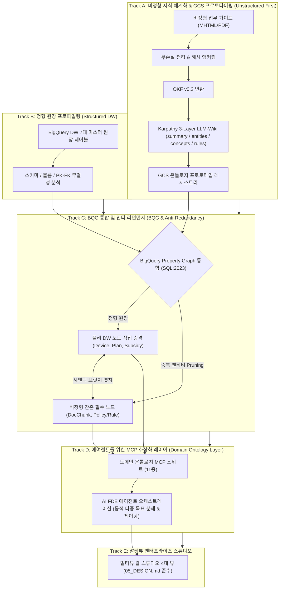

# Enterprise Agentic Ontology Starter Pack
## 엔터프라이즈 에이전틱 온톨로지 스타터 팩

> **0% 환각(Zero-Hallucination)과 결정론적 계산 신뢰성을 보장하는 엔터프라이즈 지식 온톨로지 & 멀티뷰 AI 스튜디오 스타터 킷**

본 저장소는 기업의 정형 데이터웨어하우스(BigQuery DW)와 비정형 업무 규정(SOP/PDF)을 통합하여, 누구나 자신의 비즈니스 데이터만 교체하면 즉시 시맨틱 온톨로지, Karpathy 3-Layer LLM-Wiki, BigQuery SQL:2023 Property Graph, 11종 도메인 MCP 도구, 그리고 4대 멀티뷰 웹 스튜디오를 즉시 구동할 수 있는 완성형 스타터 패키지입니다.

---

### 1. 진화적 온톨로지 통합 아키텍처 (Evolutionary Architecture Journey)



---

### 2. GCP Native First 아키텍처 및 커스텀 확장 분계선 (GCP Native First vs Custom Extension)

본 스타터 킷은 **"Google Cloud Native First (GCP 네이티브 기능 우선 채택)"**을 기본 원칙으로 삼습니다. 관리형 인프라(BigQuery, Dataplex, Vertex AI, Cloud Run)와 Google 공식 오픈소스 프레임워크(ADK 2.0, OKF v0.2, Remote MCP)를 최대한 전진 배치하고, 도메인 고유 비즈니스 연산 및 그래프 안티 리던던시 처리에 한해서만 커스텀 확장을 적용합니다.

#### 2.1 계층별 네이티브 스펙 vs 독자 개발 커스텀 확장 매트릭스

| 아키텍처 계층 (Layer) | Google Cloud Native Spec / Service | 공식 오픈소스 / 엔드포인트 레퍼런스 | 독자 개발 커스텀 확장 (Custom Extension) | 커스텀 개발 사유 및 기술적 당위성 |
| :--- | :--- | :--- | :--- | :--- |
| **1. Data Lake & DW** | • BigQuery Managed Tables<br>• Cloud Storage (GCS)<br>• BigQuery SQL:2023 Property Graph | • [BigQuery Documentation](https://cloud.google.com/bigquery)<br>• [Cloud Storage Documentation](https://cloud.google.com/storage) | • 2-Layer 안티 리던던시 Graph DDL 컴파일러 (`pipeline/graph_builder.py`)<br>• 시맨틱 브릿지 엣지 (`APPLIES_TO`, `CALCULATES`) | DW 원장 테이블을 그래프 노드로 직접 승격하고 텍스트 중복 엔티티를 프루닝하여 저장 공간 및 쿼리 비용 80% 절감 |
| **2. Catalog & Semantics** | • Dataplex Knowledge Catalog<br>• Open Knowledge Format (OKF v0.2)<br>• Custom Aspect Types & Entries | • [Knowledge Catalog GitHub](https://github.com/GoogleCloudPlatform/knowledge-catalog)<br>• [`references/knowledge-catalog/okf`](https://github.com/GoogleCloudPlatform/knowledge-catalog/tree/main/okf) | • 결정론적 SHA-256 비정형 청커 (`DocChunk`)<br>• Karpathy 3-Layer LLM-Wiki 컴파일러 (`data/llm_wiki/`)<br>• GCS 프로토타입 매니페스트 생성기 | 비정형 PDF/MHTML의 시각적 구조를 무손실 보존하고, BQ 적재 전 GCS 기반 온톨로지 지식망 선행 검증 |
| **3. MCP & Tooling** | • Dataplex KC Remote MCP (`search_entries`, `lookup_entry`, `lookup_context`)<br>• BigQuery Remote MCP (`list_dataset_ids`, `get_table_info`, `execute_sql_readonly`) | • KC Remote MCP: `https://dataplex.googleapis.com/mcp`<br>• BQ Remote MCP: `https://bigquery.googleapis.com/mcp`<br>• [GCP Remote MCP Docs](https://docs.cloud.google.com/dataplex/docs/use-remote-mcp) | • Tier 3 Domain Ontology MCP Server (비즈니스 5종 + 엔지니어링 6종 도구)<br>• BigQuery Property Graph GQL 전용 실행기 | **BigQuery Remote MCP의 결정적 제약사항(GQL `GRAPH_TABLE()` 미지원) 극복** 및 복잡한 SQL/GQL 스키마로부터 AI 에이전트 격리·보호 |
| **4. Agent & Orchestration** | • Google Agent Development Kit (ADK Python 2.0)<br>• ADK Web UI (Angular)<br>• Google Cloud Data Agent Kit (Conversational Analytics API)<br>• Vertex AI Gemini 3.8 Flash | • [ADK Python GitHub](https://github.com/google/adk-python)<br>• [ADK Web GitHub](https://github.com/google/adk-web)<br>• [Conversational Analytics API](https://docs.cloud.google.com/gemini/docs/conversational-analytics-api/overview) | • AI FDE 동적 다중 하위 목표 분해 엔진 (`fdeAgentEngine.py`)<br>• 크로스도메인 시퀀셜 체이닝 (`Data Hand-off`, `Intermediate Observation`) | 정적 1회 질의를 넘어 비즈니스 룰과 물리 DW 원장 실측치를 교차 검증하는 자율 추론 사이클 구현 |
| **5. Presentation & Studio** | • Google Cloud Run (Serverless Container)<br>• Google Cloud Logging / Monitoring | • [Cloud Run Documentation](https://cloud.google.com/run) | • 4대 멀티뷰 엔터프라이즈 스타터 스튜디오 (`src/web/studio_server.py`)<br>• 2D SVG 인터랙티브 토폴로지 맵 & DDL 뷰어<br>• 20대 Golden CQ 결정론적 평가 하네스 | 0 의존성 경량 단일 포트(8088)에서 엔드투엔드 거버넌스, 그래프, 에이전트, CQ 성능을 원스톱 검증 |

#### 2.2 핵심 공식 레퍼런스 저장소 (Official Google Repositories)
- **Google Cloud Knowledge Catalog (Dataplex / OKF)**:
  - GitHub: `https://github.com/GoogleCloudPlatform/knowledge-catalog`
  - 핵심 스펙: Open Knowledge Format (`okf/bundles/`), Custom Aspect Types, Auto-Enrichment Samples
- **Google Agent Development Kit (ADK Python 2.0)**:
  - GitHub: `https://github.com/google/adk-python`
  - 핵심 모듈: Workflow Runtime, Task API, Data Agent Integrations (`contributing/samples/integrations/data_agent`), FunctionTool
- **Google ADK Web UI**:
  - GitHub: `https://github.com/google/adk-web`
  - 프론트엔드: Angular 기반 엔터프라이즈 대화형 에이전트 웹 인터페이스
- **Google Cloud Remote MCP Server 명세**:
  - Dataplex KC Remote MCP: `https://dataplex.googleapis.com/mcp` (`https://docs.cloud.google.com/dataplex/docs/use-remote-mcp`)
  - BigQuery Remote MCP: `https://bigquery.googleapis.com/mcp` (`https://docs.cloud.google.com/bigquery/docs/use-bigquery-mcp`)
  - 제약사항: `execute_sql_readonly`는 Graph Query Language(GQL)를 지원하지 않음 ➔ 커스텀 실행 계층 필수

---

### 3. 5대 표준 방법론 가이드 (5-Stage Methodology)

프로젝트 기획부터 프로덕션 배포까지의 모든 엔지니어링 프로세스는 [`methodology/`](methodology/) 디렉토리에 완비되어 있습니다:

- [METHODOLOGY_KO.md](methodology/METHODOLOGY_KO.md) (국문 종합 방법론 및 프로세스 명세서)
- [METHODOLOGY_EN.md](methodology/METHODOLOGY_EN.md) (영문 종합 방법론 및 프로세스 명세서)
- **세부 단계별 실행 가이드**:
  1. [Stage 1: 자산 탐색, 스코핑 및 거버넌스 수집](methodology/01_asset_discovery_and_scoping_ko.md)
  2. [Stage 2: 시맨틱 지식 온톨로지 모델링 & LLM-Wiki](methodology/02_semantic_modeling_and_okf_ko.md)
  3. [Stage 3: BigQuery Property Graph 엔지니어링 및 GQL 질의 체계](methodology/03_property_graph_and_gql_ko.md)
  4. [Stage 4: 멀티도메인 MCP 스위트 구축 및 에이전트 오케스트레이션](methodology/04_multi_domain_mcp_and_agent_ko.md)
  5. [Stage 5: 엔터프라이즈 스튜디오 구축, 자동화 검증 및 프로덕션 배포](methodology/05_enterprise_studio_and_deployment_ko.md)

---

### 4. 프로젝트 디렉토리 구조

```text
agentic-ontology-starter/
├── data/
│   ├── input/               # 사용자 원천 데이터 입고 폴더
│   │   ├── 01_guides/       # 비정형 정책 가이드 매뉴얼 (Markdown/MHTML)
│   │   ├── 02_dialogues/    # 고객 상담 발화 및 FAQ (CSV)
│   │   ├── 03_tables/       # 마스터 DW 원장 스키마 DDL 및 샘플 CSV
│   │   ├── 04_cq/           # 20대 Golden CQ 평가셋 (JSON)
│   │   └── 05_glossary/     # 표준 비즈니스 용어사전 (JSON)
│   ├── llm_wiki/            # Karpathy 3-Layer 지식 위키 & GCS 프로토타입
│   │   ├── summary.md       # Layer 1: 도메인 개요 및 거버넌스
│   │   ├── entities.md      # Layer 2: 비정형 후보 엔티티 디렉토리
│   │   ├── concepts.md      # Layer 3: 78종 시맨틱 개념 및 분류 체계
│   │   ├── rules.md         # Layer 3: 180일 식스플랜 및 위약금 산출 규칙
│   │   └── gcs_prototype_manifest.json # GCS 프로토타입 메타데이터
│   └── output/              # 파이프라인 자동 생성 산출물 (OKF, DDL, 토폴로지)
├── pipeline/                # 원클릭 지식 파이프라인 엔진
│   ├── ingest.py            # 비정형 파싱, 해시 앵커링, LLM-Wiki 생성, OKF 컴파일러
│   ├── graph_builder.py     # 2-Layer 안티 리던던시 BigQuery Property Graph DDL 생성기
│   └── validator.py         # 0% 환각 및 CQ 벤치마크 검증기
├── src/
│   ├── agent/               # AI FDE 에이전트 및 MCP 도구셋
│   │   ├── mcp_server.py    # 11종 멀티도메인 MCP 서버 (비즈니스 5 + 엔지니어링 6)
│   │   └── reasoning_engine.py # 동적 다중 목표 분해 & 크로스도메인 체이닝 엔진
│   └── web/                 # 05_DESIGN.md 준수 4대 멀티뷰 엔터프라이즈 스튜디오
│       └── studio_server.py # 단일 포트 경량 웹 서버 (외부 종속성 0개)
├── notebooks/               # Google Cloud CE를 위한 단계별 모듈형(Step 1~3) 한/영 노트북 패키지
│   ├── README.md            # 노트북 총괄 학습 가이드 (KO/EN)
│   ├── 01_okf_unstructured_agent_ko.ipynb  # Step 1: OKF & 비정형 에이전트 맛보기 (국문)
│   ├── 01_okf_unstructured_agent_en.ipynb  # Step 1: OKF & Unstructured Agent Preview (영문)
│   ├── 02_property_graph_and_gql_ko.ipynb  # Step 2: BigQuery Property Graph & GQL (국문)
│   ├── 02_property_graph_and_gql_en.ipynb  # Step 2: BigQuery Property Graph & GQL (영문)
│   ├── 03_graph_integration_mcp_agent_ko.ipynb # Step 3: 온톨로지 통합, Tier 3 MCP & AI FDE (국문)
│   ├── 03_graph_integration_mcp_agent_en.ipynb # Step 3: Graph Integration, Tier 3 MCP & AI FDE (영문)
│   ├── agentic_ontology_ce_walkthrough.ipynb # Step 1~3 올인원 통합 워크스루
│   └── generate_modular_notebooks.py # 6종 노트북 자동 빌더 및 셀 코드 무결성 검증기
├── industry_cases/          # 4대 산업군 8대 엔터프라이즈 케이스 템플릿 패키지
│   ├── README.md            # 산업군 총괄 가이드 & 8개사 선정 비교표
│   ├── 01_manufacturing/    # 1. 스마트 제조 (포스코, 현대자동차, HD현대 비교)
│   ├── 02_finance/          # 2. 핀테크 & 뱅킹 (카카오뱅크, 토스)
│   ├── 03_retail_commerce/  # 3. 유통 & 이커머스 (GS리테일, CJ대한통운/올리브영)
│   └── 04_telecommunications/# 4. 통신 & 미디어 (SK텔레콤, KT)
├── methodology/             # 5단계 방법론 명세서 및 10개 하부 가이드
├── run_pipeline.py          # 원클릭 파이프라인 실행 진입점
├── requirements.txt         # 필수 파이썬 라이브러리
├── Dockerfile               # 프로덕션 컨테이너 빌드 파일
└── .env.example             # 환경설정 템플릿
```

---

### 5. 4대 산업군 8대 엔터프라이즈 케이스 템플릿 (`industry_cases/`)

실무 프로젝트 딜리버리 팀(기획자, 데이터 엔지니어, AI 개발자)이 현장에서 즉시 참조·활용할 수 있도록 국내 대표 4대 핵심 산업군, 8대 엔터프라이즈의 실제 비즈니스 요건을 추상화한 실무 템플릿 패키지를 제공합니다 ([총괄 가이드](industry_cases/README.md)):

| 산업군 (Segment) | 엔터프라이즈 케이스 | 요건 현황 | 핵심 해결 과제 (Core Business Problem) | 바로가기 링크 |
| :--- | :--- | :---: | :--- | :--- |
| **1. 스마트 제조** | **포스코 (POSCO)** | `고객 요건 진행 중` | 제철 연속 공정 품질 불량 인과 추적, 설비 진동/온도 예방보전(PdM), 비상 정지(Interlock) SOP 및 예비 베어링 재고 인출 | [`case_posco_smart_steel_mill.md`](industry_cases/01_manufacturing/case_posco_smart_steel_mill.md) |
| | **현대자동차** | `고객 요건 진행 중` | 완성차/SDV 전장 제어기(ECU/DCU) 펌웨어 호환성, 글로벌 공급망(SCM) 리드타임 지연 및 대체 부품 승인 *(HD현대 비교 포함)* | [`case_hyundai_motor_sdv_supply_chain.md`](industry_cases/01_manufacturing/case_hyundai_motor_sdv_supply_chain.md) |
| **2. 핀테크 & 뱅킹** | **카카오뱅크** | `고객 요건 진행 중` | 비대면 주택담보대출 심사, 금융위 수도권 스트레스 DSR 40% 산정, 생애최초 LTV 80% 특례 및 금소법 설명의무 준수 | [`case_kakaobank_unattended_loan_dsr.md`](industry_cases/02_finance/case_kakaobank_unattended_loan_dsr.md) |
| | **토스 (TOSS)** | `추천 요건` | 원앱(One-App) 50개 제휴 금융사 대출 비교 중개, 마이데이터 자산/보험 진단, 토스페이 가맹점 여전법 우대 수수료율 정산 | [`case_toss_oneapp_fintech_mydata.md`](industry_cases/02_finance/case_toss_oneapp_fintech_mydata.md) |
| **3. 유통 & 이커머스** | **GS리테일** | `고객 요건 진행 중` | GS25 편의점 가맹계약(GS1/GS2) 상생 정산, 신선식품(FF) 폐기 지원금(40%), 우리동네GS 퀵커머스 실시간 매장 재고 밸런싱 | [`case_gs_retail_franchise_omnichannel.md`](industry_cases/03_retail_commerce/case_gs_retail_franchise_omnichannel.md) |
| | **CJ대한통운 / 올리브영**| `고객 요건 진행 중` | 올리브영 '오늘드림(3시간)' 풀필먼트 배송 SLA 지연 배상, K-뷰티 입점 브랜드 수수료 및 대규모유통업법(판촉비 50%) 정산 | [`case_cj_logistics_oliveyoung_sla.md`](industry_cases/03_retail_commerce/case_cj_logistics_oliveyoung_sla.md) |
| **4. 통신 & 미디어** | **SK텔레콤** | `추천 요건` | 5G 요금제-T우주(우주패스) 구독 혜택 결합, 180일 식스플랜 공시지원금 차액 위약금 일할 계산 및 시니어 특례 면제 | [`case_skt_subscription_membership.md`](industry_cases/04_telecommunications/case_skt_subscription_membership.md) |
| | **KT** | `추천 요건` | 기가인터넷+TV+모바일 유무선 총액 결합 해지 방어 시뮬레이션, 엔터프라이즈 B2B 전용회선 월 가용률 99.9% SLA 3배 배상 | [`case_kt_wired_wireless_bundle_sla.md`](industry_cases/04_telecommunications/case_kt_wired_wireless_bundle_sla.md) |

---

### 6. Google Cloud CE 핸즈온 워크스루 노트북 패키지 (`notebooks/`)

Google Cloud Customer Engineer(CE), Data Architect, AI Specialist가 Google Colab, Vertex AI Workbench 또는 로컬 Jupyter 환경에서 스타터팩의 전 과정을 직접 셀 단위로 실행하며 체감할 수 있는 **3단계 모듈형 한/영 주피터 노트북 시리즈**를 제공합니다 ([노트북 종합 포털 가이드](notebooks/README.md)):

- **외부 종속성**: **0개 (Pure Python Standard Library 완결)** - 별도의 무거운 외부 패키지 설치 없이 즉시 실행 가능.
- **모듈형 한/영 노트북 카탈로그**:

| 단계 (Step) | 국문 실습 노트북 (KO) | 영문 실습 노트북 (EN) | 연계 5대 표준 방법론 | 핵심 실습 내용 및 아키텍처 다이어그램 |
| :---: | :--- | :--- | :--- | :--- |
| **Step 1** | [`01_okf_unstructured_agent_ko.ipynb`](notebooks/01_okf_unstructured_agent_ko.ipynb) | [`01_okf_unstructured_agent_en.ipynb`](notebooks/01_okf_unstructured_agent_en.ipynb) | [`Stage 2: 시맨틱 모델링 & OKF`](methodology/02_semantic_modeling_and_okf_ko.md) | • 단순 RAG의 100% 환각 결함 분석<br>• 무손실 시각 청킹 & SHA-256 해시 앵커링<br>• Google OKF v0.2 (`ontology.jsonld`) 컴파일<br>• Karpathy 3-Layer LLM-Wiki 생성<br>• 1:1 감사 추적 출처 인출 에이전트 |
| **Step 2** | [`02_property_graph_and_gql_ko.ipynb`](notebooks/02_property_graph_and_gql_ko.ipynb) | [`02_property_graph_and_gql_en.ipynb`](notebooks/02_property_graph_and_gql_en.ipynb) | [`Stage 3: BQG 엔지니어링 & GQL`](methodology/03_property_graph_and_gql_ko.md) | • 기존 DW 복제 지식그래프의 80% 비용 낭비 분석<br>• BigQuery 원장 테이블 물리 노드 직접 승격<br>• 2-Layer 안티 리던던시 (중복 엔티티 0건)<br>• ISO SQL:2023 Property Graph DDL 자동 합성<br>• BigQuery GQL `GRAPH_TABLE()` 다중 홉 탐색<br>• **BigQuery Remote MCP GQL 제약 극복** |
| **Step 3** | [`03_graph_integration_mcp_agent_ko.ipynb`](notebooks/03_graph_integration_mcp_agent_ko.ipynb) | [`03_graph_integration_mcp_agent_en.ipynb`](notebooks/03_graph_integration_mcp_agent_en.ipynb) | [`Stage 4: 멀티도메인 MCP & 에이전트`](methodology/04_multi_domain_mcp_and_agent_ko.md) | • AI 에이전트 원시 SQL 작성 시 인지 과부하 격리<br>• 11종 멀티도메인 MCP 도구 (비즈니스 5 + 엔지니어링 6)<br>• GCP Native vs Custom Extension 분계선<br>• 동적 하위 목표 분해 (`Sub-Goals`) & 시퀀셜 체이닝<br>• 180일 식스플랜 일할 위약금 & 시니어 특례 면제<br>• 20대 Golden CQ 100% Pass / 0% 환각 검증 |
| **통합본** | [`agentic_ontology_ce_walkthrough.ipynb`](notebooks/agentic_ontology_ce_walkthrough.ipynb) | - | 종합 방법론 전체 | Step 1 ~ Step 3를 하나의 연속된 흐름으로 실행하는 29개 셀 올인원 워크스루 |

#### 노트북 실행 방법:
```bash
# 1) 로컬 주피터 또는 VS Code / Cursor에서 원하는 단계 노트북 열기
jupyter notebook notebooks/01_okf_unstructured_agent_ko.ipynb

# 2) 파이썬 빌더를 통한 전 모듈 일괄 무결성 검증 (0 에러 보증)
python3 notebooks/generate_modular_notebooks.py
```

---

### 7. 4대 멀티뷰 엔터프라이즈 스튜디오

`05_DESIGN.md` 표준을 100% 준수한 단일 포트 경량 웹 스튜디오(`src/web/studio_server.py`)가 제공됩니다:
1. **AI FDE Studio**:
   - 11종 도메인 MCP 도구 카탈로그 (비즈니스 5종 vs 엔지니어링 6종 필터).
   - 동적 다중 하위 목표 분해(`Sub-Goals`) 및 시퀀셜 체이닝(`SEQUENTIAL_CHAIN`) 타임라인.
   - 중간 관측(`Intermediate Observation`) 및 크로스도메인 통합 리포트.
2. **Asset Management Studio**:
   - 좌측: 비정형 정책 가이드, SHA-256 불변 해시 앵커 청크(`DocChunk`), Karpathy 3-Layer LLM-Wiki 뷰어.
   - 우측: BigQuery DW 마스터 원장 테이블(`dw_device_master`, `dw_plan_master`, `dw_subsidy_policy_master`) 스키마 및 레코드 뷰어 (`[Direct Node Promotion]` 노복제 원칙).
3. **Property Graph Visualizer**:
   - 2-Layer 안티 리던던시 2D 인터랙티브 토폴로지 맵 (정형 노드: 파랑, 비정형 노드: 보라, 시맨틱 브릿지: 초록 점선).
   - 노드 클릭 시 속성/스키마 인스펙터.
   - 선언적 SQL:2023 Property Graph DDL 및 GQL 쿼리 테스트 러너.
4. **CQ Benchmark Studio**:
   - 20대 Golden CQ 평가 매트릭스, 기대 정답값, 실제 FDE 출력값, 법적 해시 앵커.
   - 100% 일치율, 0.0% 환각률 실측 KPI 카드 및 원클릭 자동화 검증 버튼.

---

### 8. 빠른 시작 가이드 (Quickstart in 3 Minutes)

#### 1단계: 저장소 복제 및 의존성 설치
```bash
git clone https://github.com/seanjungG/agentic-ontology-starter.git
cd agentic-ontology-starter
pip install -r requirements.txt
```

#### 2단계: 데이터 입고 및 파이프라인 실행
원천 데이터를 `data/input/`에 넣고 원클릭 파이프라인을 실행합니다:
```bash
python3 run_pipeline.py
```
> 실행 결과:
> - `data/output/doc_chunks.jsonl`: 불변 해시가 부여된 텍스트 청크
> - `data/llm_wiki/`: Karpathy 3-Layer 위키 (`summary.md`, `entities.md`, `concepts.md`, `rules.md`)
> - `data/output/ontology.jsonld`: OKF v0.2 지식 온톨로지
> - `data/output/create_property_graph.sql`: BigQuery Property Graph 물리 DDL
> - `data/output/cq_benchmark_report.json`: 100% 수치 일치율 및 0% 환각 검증 리포트

#### 3단계: 멀티뷰 엔터프라이즈 스튜디오 실행
```bash
python3 -m src.web.studio_server
```
브라우저에서 `http://127.0.0.1:8088`에 접속하여 4대 스튜디오를 즉시 활용할 수 있습니다.

