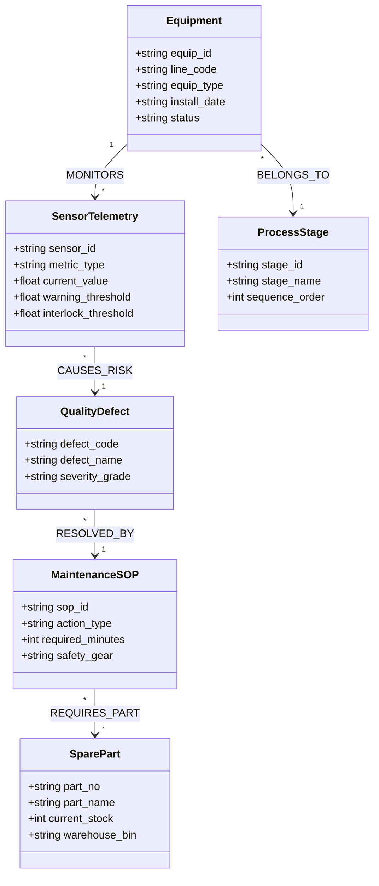

# Segment 1: 스마트 제조 (Smart Manufacturing) 온톨로지 프레임워크

## 1. 세그먼트 개요 및 데이터 구조적 특성

스마트 제조 산업은 **초당 수만 건의 시계열 IoT 센서 계측치(PLC/SCADA)**, **초단위 배치 생산 실적(MES)**, **설비/부품 마스터 원장(ERP/EAM)** 등 거대한 정형 빅데이터를 보유하고 있습니다. 그러나 설비 이상 발생 시 현장 엔지니어가 취해야 할 **표준작업절차서(SOP)**, **품질 불량 판정 매뉴얼**, **공정 안전관리 지침(PSM)**은 수천 페이지의 비정형 PDF 및 도면 문서로 파편화되어 있어 신속한 원인 규명과 대응이 어렵습니다.

본 프레임워크는 스마트 제철소 A사(연속 공정 제철)와 글로벌 완성차 B사(조립 공정 완성차/SDV)의 실무 요건을 기반으로, 정형 설비/공정 원장과 비정형 SOP 지식을 **BigQuery Property Graph**로 연결하여 **근거 출처 기반 설비 예방보전 및 품질 인과 추론 AI 에이전트**를 구현합니다.

---

## 2. 스마트 제조 공통 도메인 메타모델 (Domain Metamodel)

---

## 3. 수록 엔터프라이즈 케이스 2종 요약

### Case 1-1: 스마트 제철소 A사 (Smart Steel Corp) - 스마트 제철 연속 공정 품질 & 설비 예방보전
- **진행 상태**: `고객 요건 진행 중`
- **핵심 과제**: 고로(Blast Furnace) ➔ 제강 ➔ 연주 ➔ 압연으로 이어지는 연속 공정에서 롤러 베어링 진동 및 온도 이상 계측 시, 품질 결함(두께 편차, 표면 흠) 유발 인과 사슬 추적 및 긴급 가동 정지(Interlock) SOP 자동 인출.
- **상세 명세**: [`case_smart_steel_mill.md`](case_smart_steel_mill.md)

### Case 1-2: 글로벌 완성차 B사 (Mobility OEM Corp Company) - 완성차/SDV 부품 BOM & 글로벌 공급망
- **진행 상태**: `고객 요건 진행 중`
- **핵심 과제**: 소프트웨어 정의 차량(SDV) 전장 제어기(ECU/DCU) 펌웨어 버전 호환성 매트릭스, 1/2차 협력사 납기 지연에 따른 생산 라인 중단 위험(Line-Stop) 예측, 설계변경(ECN) 이력 추적.
- **확장 가이드**: 중공업·기계 C사 조선/해양 플랜트 EPC 기자재 사양 온톨로지 비교 수록.
- **상세 명세**: [`case_automotive_sdv_supply_chain.md`](case_automotive_sdv_supply_chain.md)

---

## 4. 정형 원장 DDL 및 비정형 템플릿 안내

본 디렉토리 하위의 [`data_templates/`](data_templates/)에 제조 도메인 즉시 실행 에셋이 준비되어 있습니다:
1. `schema_manufacturing.sql`: BigQuery 호환 설비/텔레메트리/SOP 테이블 DDL
2. `sample_equipment_telemetry.csv`: 센서 계측 및 임계치 초과 샘플 데이터
3. `sop_steel_bearing_inspection.md`: 제철 압연 라인 베어링 점검 표준작업절차서 비정형 문서
