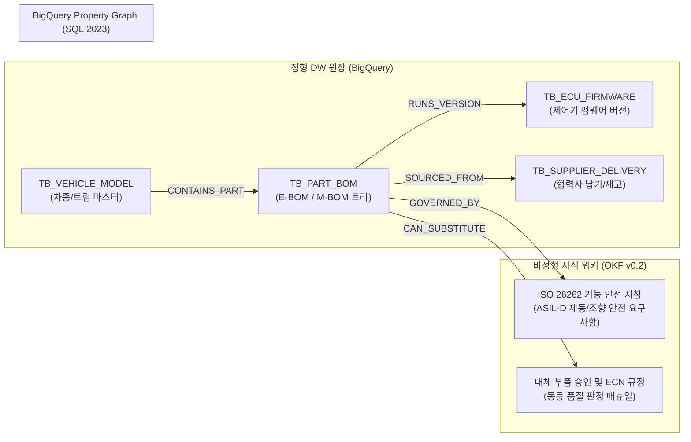

# [제조 케이스 2] 현대자동차 (Hyundai Motor) - SDV 부품 BOM & 글로벌 공급망(SCM) 온톨로지

- **고객사**: 현대자동차 (Hyundai Motor Company) *(HD현대 조선/해양 비교 수록)*
- **도메인**: 완성차 및 SDV(소프트웨어 정의 차량) 전장 BOM, 제어기 펌웨어 호환성, 협력사 납기 지연 예측
- **상태**: `고객 요건 진행 중`
- **해당 세그먼트**: `01_manufacturing`

---

## 1. 비즈니스 배경 및 핵심 과제 (Pain Points)

현대자동차는 기존 내연기관 중심의 기계 조립 제조업에서 **SDV(Software Defined Vehicle)** 및 전동화 모빌리티 기업으로 급격히 전환하고 있습니다. 최신 차량 1대에는 100여 개 이상의 전자제어기(ECU/DCU)와 수만 줄의 펌웨어 버전, 그리고 2만여 개 이상의 하드웨어 부품이 1차·2차 협력사 글로벌 공급망을 통해 복잡하게 얽혀 있습니다.

### 당면 핵심 과제:
1. **소프트웨어 펌웨어와 하드웨어 BOM의 비호환 리스크**: 통합 도메인 제어기(DCU)의 OTA(Over-The-Air) 무선 업데이트 시, 하위 조향/제동 ECU의 펌웨어 버전 불일치로 차량 결함이나 리콜이 발생할 위험.
2. **글로벌 공급망(SCM) 지연의 생산 라인 파급력**: 2차 협력사의 차량용 반도체나 와이어링 하네스 공급이 단 3일 지연되더라도 울산/아산 완성차 조립 공장의 '라인스톱(Line-Stop)'으로 직결됨.
3. **설계 변경(ECN) 및 대체 부품 승인 지연**: 특정 부품 결품 시 즉시 투입 가능한 대체 부품(Alternative Part)이 사내 설계 규정 및 기능 안전(ISO 26262) 기준을 충족하는지 검토하는 데 수일이 소요됨.

> **[비교 가이드] HD현대 조선/해양 플랜트 EPC와의 아키텍처 비교**:
> - 현대자동차가 초당 수십만 대 단위의 **대량 양산 조립 공정 및 펌웨어 버전 호환성**에 초점을 맞춘다면, HD현대는 1척당 3~4년이 소요되는 **초대형 수주 선박(LNG선, FPSO)의 수만 개 배관/철의장 기자재 사양 및 국제선급협회(DNV, Lloyd) 안전 규정 적합성**에 온톨로지가 활용됩니다.
> - 두 기업 모두 **"수만 단계의 복합 BOM 원장(정형)"**과 **"엄격한 국제 안전 기준 및 설계 규정(비정형)"**을 하이브리드 온톨로지로 통합한다는 본질적 아키텍처는 100% 동일합니다.

---

## 2. 하이브리드 온톨로지 데이터 아키텍처



---

## 3. 정형 DW 원장 테이블 명세 (BigQuery)

### 3.1 `TB_PART_BOM` (엔지니어링 부품 BOM 원장)
```sql
CREATE TABLE IF NOT EXISTS `hyundai_dw.TB_PART_BOM` (
  part_no STRING NOT NULL,           -- 예: 'ECU-BRK-902' (통합 전자 브레이크)
  parent_part_no STRING,             -- 'DCU-MAIN-01' (통합 바디 제어기)
  part_name STRING NOT NULL,         -- 'IEB 모듈 2세대'
  category STRING NOT NULL,          -- 'CHASSIS', 'POWERTRAIN', 'ELECTRONICS'
  tier_level INT64 NOT NULL          -- 1, 2, 3
);
```

### 3.2 `TB_ECU_FIRMWARE` (제어기 펌웨어 호환성 원장)
```sql
CREATE TABLE IF NOT EXISTS `hyundai_dw.TB_ECU_FIRMWARE` (
  fw_id STRING NOT NULL,             -- 예: 'FW-DCU-2.4.0'
  part_no STRING NOT NULL,           -- 'DCU-MAIN-01'
  fw_version STRING NOT NULL,        -- '2.4.0'
  min_req_brake_fw STRING NOT NULL,  -- '1.8.0' (필수 하위 브레이크 펌웨어 최소 버전)
  release_status STRING NOT NULL     -- 'STABLE_OTA', 'RC', 'DEPRECATED'
);
```

### 3.3 `TB_SUPPLIER_DELIVERY` (글로벌 협력사 납기 현황)
```sql
CREATE TABLE IF NOT EXISTS `hyundai_dw.TB_SUPPLIER_DELIVERY` (
  po_no STRING NOT NULL,             -- 발주 번호
  supplier_code STRING NOT NULL,     -- 'SUP-MOBIS-01'
  part_no STRING NOT NULL,           -- 'WH-GV-03' (와이어링 하네스)
  lead_time_days INT64 NOT NULL,     -- 납기 리드타임 (일)
  delay_risk STRING NOT NULL,        -- 'LOW', 'MEDIUM', 'CRITICAL'
  dest_plant STRING NOT NULL         -- 'ULSAN_PLANT_2'
);
```

---

## 4. 비정형 지식 및 비즈니스 룰 명세 (OKF v0.2)

- **출처 문서**: `현대차 SDV 통합제어기 OTA 펌웨어 배포 지침 (HMC-SPEC-SDV-2026)`
- **기능 안전(ISO 26262) 준수 룰**:
  - `ASIL-D 등급 제어기`: 조향(MDPS) 및 제동(IEB) 펌웨어 버전이 DCU와 호환 검증 매트릭스를 통과하지 못할 경우, OTA 업데이트 승인 절대 불가(Interlock).
- **SCM 결품 시 대체 부품 승인 룰**:
  - 1차 협력사 납기 지연이 72시간을 초과할 경우, 사내 부품 온톨로지에서 'CAN_SUBSTITUTE' 플래그가 지정된 사양 동등 부품(`ALT-WH-GV-03A`)으로 긴급 변경 발주 가능.

---

## 5. Tier 3 Domain Ontology MCP 도구 명세

| 도구명 (Tool Name) | 유형 | 주요 매개변수 | 기능 설명 및 결정론적 로직 |
| :--- | :---: | :--- | :--- |
| `check_sdv_firmware_compatibility` | 비즈니스 | `target_fw: str`, `model_code: str` | 대상 차종의 전장 부품 트리를 횡단하여 하위 ECU 펌웨어 간 호환성 및 ISO 26262 ASIL-D 위반 여부 검증 |
| `predict_scm_line_stop_risk` | 비즈니스 | `part_no: str`, `dest_plant: str` | 협력사 납기 지연 일수와 공장 내 안전 재고를 연산하여 조립 라인 중단(Line-Stop) 발생 예정 일시 계산 |
| `find_certified_alternative_parts` | 비즈니스 | `shortage_part_no: str` | 설계 변경 규정 및 동등 품질 기준을 충족하는 대체 승인 부품 번호와 협력사 재고 현황 인출 |

---

## 6. 3대 골든 역량 평가 질문 (CQ) 및 추론 경로

### CQ 1: GV80 SDV OTA 제어기 펌웨어 업그레이드 호환성 검증
- **사용자 질문**: *"GV80 페이스리프트 모델의 통합 도메인 제어기(DCU-MAIN-01) 펌웨어를 v2.4.0으로 OTA 배포할 때, 전자식 브레이크(ECU-BRK-902)와의 버전 호환 요구조건 및 ASIL-D 안전 규정 준수 여부는?"*
- **에이전트 추론 경로**:
  1. `check_sdv_firmware_compatibility(target_fw='FW-DCU-2.4.0', model_code='GENESIS-GV80-PE')` 호출.
  2. BQG 상에서 `(DCU-MAIN-01)-[:RUNS_VERSION]->(FW-DCU-2.4.0)-[:REQUIRES_MIN_FW]->(FW-BRK-1.8.0)` 및 `(ECU-BRK-902)-[:GOVERNED_BY]->(RULE-ASIL-D)` 횡단.
- **결정론적 답변**:
  > "DCU-MAIN-01의 v2.4.0 배포를 위해서는 하위 전자식 브레이크(ECU-BRK-902)의 펌웨어가 최소 **v1.8.0 이상**이어야 합니다. 현재 양산 탑재 버전은 v1.8.2이므로 버전 호환성을 충족합니다. 또한 ISO 26262 **ASIL-D 안전 규정**에 따른 통신 타임아웃 페일세이프(Fail-Safe) 로직이 검증되어 OTA 무선 업데이트 진행이 승인되었습니다."

---

## 7. 기대 효과 및 도입 성과

1. **SDV 펌웨어 배포 사고율 0% 달성**: 다단계 제어기 간 종속성을 온톨로지 그래프로 100% 사전 시뮬레이션하여 펌웨어 버전 불일치로 인한 리콜 위험 차단.
2. **공급망 위기 시 대체 부품 전환 98% 단축**: 부품 수급 차질 시 1~2주 소요되던 설계팀-구매팀-품질팀 수동 결재를 온톨로지 승인 룰을 통해 10분 만에 자동 처리.
