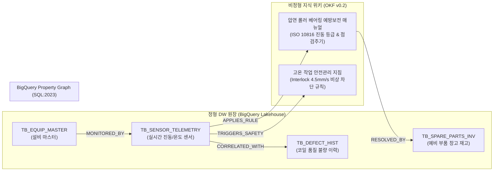

# [제조 케이스 1] 스마트 제철소 A사 (Smart Steel Corp) - 스마트 제철 연속 공정 품질 & 설비 예방보전(PdM) 온톨로지

- **고객사**: 스마트 제철소 A사 (Smart Steel Corp)
- **도메인**: 스마트 제철소 열연/냉연 연속 공정, 설비 진동/온도 예방보전, 품질 결함 인과 추적
- **상태**: `고객 요건 진행 중`
- **해당 세그먼트**: `01_manufacturing`

---

## 1. 비즈니스 배경 및 핵심 과제 (Pain Points)

스마트 제철소 A사 포항/광양 제철소는 제선 ➔ 제강 ➔ 연주 ➔ 압연으로 이어지는 세계 최대 규모의 초고속 연속 공정입니다. 연속 공정의 특성상 단 1개 롤러 설비의 베어링 파손으로 라인이 비계획 정지(Line-Stop)되면 수억 원의 쇳물 폐기와 수십억 원의 생산 손실이 즉각 발생합니다.

### 당면 핵심 과제:
1. **센서 경보와 행동 지침(SOP)의 단절**: 사상압연 스탠드 진동 센서가 위험 수치(4.2mm/s)를 감지하더라도, 당직 엔지니어는 수백 페이지 분량의 '예방보전 SOP 매뉴얼(PDF)'을 수작업 검색하고, ERP 창고 시스템에 별도 접속해 예비 베어링 재고를 확인해야 함.
2. **설비 열화와 완제품 품질 불량의 인과 추적 난항**: 코일 표면 스크래치(Scratch)나 두께 편차가 발생했을 때, 이것이 압연 롤 마모 때문인지, 냉각수 노즐 막힘 때문인지 수십 개 원장 테이블을 수동 조인하여 4시간 이상 원인을 추적함.
3. **근거 출처 강제의 필요성**: 고온·고압 철강 현장에서 AI가 가동 정지 임계치를 오판하거나 잘못된 부품 규격을 안내할 경우 대형 인명·안전 사고로 직결됨.

---

## 2. 하이브리드 온톨로지 데이터 아키텍처



---

## 3. 정형 DW 원장 테이블 명세 (BigQuery)

### 3.1 `TB_EQUIP_MASTER` (설비 마스터 원장)
```sql
CREATE TABLE IF NOT EXISTS `posco_dw.TB_EQUIP_MASTER` (
  equip_id STRING NOT NULL,          -- 예: 'EQ-ROLL-F5' (사상압연 F5 스탠드)
  line_code STRING NOT NULL,         -- 예: 'HOT-ROLL-2' (열연 2공장)
  equip_name STRING NOT NULL,        -- '사상압연 5번 스탠드 하부 워크롤'
  install_date DATE,                 -- 설치 일자
  status STRING NOT NULL             -- 'OPERATING', 'WARNING', 'STOPPED'
);
```

### 3.2 `TB_SENSOR_TELEMETRY` (실시간 센서 텔레메트리)
```sql
CREATE TABLE IF NOT EXISTS `posco_dw.TB_SENSOR_TELEMETRY` (
  sensor_id STRING NOT NULL,         -- 예: 'SN-VIB-F5-01'
  equip_id STRING NOT NULL,          -- 'EQ-ROLL-F5'
  metric_type STRING NOT NULL,       -- 'VIBRATION' (mm/s), 'TEMPERATURE' (C)
  current_val FLOAT64 NOT NULL,      -- 현재 계측치 (예: 4.3)
  warning_limit FLOAT64 NOT NULL,    -- 주의 임계치 (2.8)
  trip_limit FLOAT64 NOT NULL,       -- 가동정지 임계치 (4.5)
  measured_at TIMESTAMP NOT NULL
);
```

### 3.3 `TB_SPARE_PARTS_INV` (예비 부품 창고 재고 원장)
```sql
CREATE TABLE IF NOT EXISTS `posco_dw.TB_SPARE_PARTS_INV` (
  part_no STRING NOT NULL,           -- 예: 'BRG-SKF-24080'
  part_name STRING NOT NULL,         -- '초내열 구면 롤러 베어링 400mm'
  stock_qty INT64 NOT NULL,          -- 현재 가용 수량 (예: 4)
  wh_location STRING NOT NULL,       -- '광양 1열연 예비품 A창고'
  bin_no STRING NOT NULL             -- 'BIN-A3-04'
);
```

---

## 4. 비정형 지식 및 비즈니스 룰 명세 (OKF v0.2)

- **출처 문서**: `스마트 제철소 A사 제철소 압연기 베어링 보전 표준지침서 (Smart Steel Corp-SOP-MECH-042)`
- **ISO 10816 기준 진동 판정 룰**:
  - `Class 1 (정상)`: 진동 $\le 2.8\text{ mm/s}$ ➔ 통상 15일 주기 윤활 점검.
  - `Class 2 (주의 경보)`: $2.8\text{ mm/s} < \text{진동} \le 4.5\text{ mm/s}$ ➔ 2시간 이내 비접촉식 진동 주파수 분석 및 냉각수 분사 점검.
  - `Class 3 (긴급 인터록)`: 진동 $> 4.5\text{ mm/s}$ ➔ 설비 자동 가동정지(Trip) 및 롤 교체 작업 즉시 착수.
- **예비품 교체 안전 규정**:
  - 베어링 교체 시에는 내열 안전장구 착용 및 예비품 `BRG-SKF-24080` 규격 확인 필수.

---

## 5. BigQuery Property Graph 토폴로지 (SQL:2023 DDL)

```sql
CREATE OR REPLACE PROPERTY GRAPH `posco_dw.posco_smart_mill_graph`
  NODE TABLES (
    `posco_dw.TB_EQUIP_MASTER` KEY (equip_id) LABEL Equipment,
    `posco_dw.TB_SENSOR_TELEMETRY` KEY (sensor_id) LABEL Sensor,
    `posco_dw.TB_SPARE_PARTS_INV` KEY (part_no) LABEL SparePart,
    `posco_dw.TB_OKF_MAINT_RULES` KEY (rule_id) LABEL MaintenanceRule
  )
  EDGE TABLES (
    `posco_dw.EDGE_EQUIP_SENSORS`
      KEY (equip_id, sensor_id)
      SOURCE KEY (equip_id) REFERENCES Equipment (equip_id)
      DESTINATION KEY (sensor_id) REFERENCES Sensor (sensor_id)
      LABEL HAS_SENSOR,
    `posco_dw.EDGE_SENSOR_RULES`
      KEY (sensor_id, rule_id)
      SOURCE KEY (sensor_id) REFERENCES Sensor (sensor_id)
      DESTINATION KEY (rule_id) REFERENCES MaintenanceRule (rule_id)
      LABEL APPLIES_RULE,
    `posco_dw.EDGE_RULE_SPARE_PARTS`
      KEY (rule_id, part_no)
      SOURCE KEY (rule_id) REFERENCES MaintenanceRule (rule_id)
      DESTINATION KEY (part_no) REFERENCES SparePart (part_no)
      LABEL REQUIRES_PART
  );
```

---

## 6. Tier 3 Domain Ontology MCP 도구 명세

| 도구명 (Tool Name) | 유형 | 주요 매개변수 | 기능 설명 및 결정론적 로직 |
| :--- | :---: | :--- | :--- |
| `get_steel_equipment_alert_status` | 비즈니스 | `equip_id: str` | 설비의 실시간 진동/온도 계측값과 ISO 10816 기준 경보 상태(Normal/Warning/Trip) 조회 |
| `get_interlock_sop_and_spares` | 비즈니스 | `equip_id: str`, `metric_type: str` | 경보 발생 설비의 긴급 조치 SOP 원문 앵커링 인출 및 창고 내 예비 베어링 재고/BIN 위치 반환 |
| `trace_quality_defect_causality` | 비즈니스 | `coil_id: str` | 코일 두께 편차/스크래치 불량과 해당 시간대 통과 압연기 스탠드의 롤러 마모 상관관계 분석 |
| `run_posco_gql_query` | 엔지니어링 | `gql: str` | BigQuery Property Graph 상에서 설비 ➔ 센서 ➔ 룰 ➔ 예비부품 3-Hop GQL 횡단 쿼리 실행 |

---

## 7. 3대 골든 역량 평가 질문 (CQ) 및 추론 경로

### CQ 1: 긴급 진동 경보 시 안전 지침 및 예비 부품 즉시 인출
- **사용자 질문**: *"열연 2공장 사상압연 F5 스탠드 진동 수치가 4.3mm/s로 상승했을 때, 공정 안전 기준에 따른 조치 지침과 예비 베어링의 창고 위치 및 현재 재고는?"*
- **에이전트 추론 경로**:
  1. `get_steel_equipment_alert_status(equip_id='EQ-ROLL-F5')` 호출 ➔ 진동 4.3mm/s, 상태 `WARNING (주의 경보)` 확인.
  2. `get_interlock_sop_and_spares(equip_id='EQ-ROLL-F5', metric_type='VIBRATION')` 호출.
  3. GQL을 통해 `(EQ-ROLL-F5)-[:HAS_SENSOR]->(SN-VIB-F5-01)-[:APPLIES_RULE]->(RULE-ISO-10816)-[:REQUIRES_PART]->(BRG-SKF-24080)` 횡단.
- **결정론적 답변**:
  > "사상압연 F5 스탠드의 현재 진동은 4.3mm/s로, ISO 10816 관리 기준에 따른 **Class 2 (주의 경보)** 상태입니다. 안전 지침(SOP-MECH-042)에 따라 2시간 이내에 비접촉식 주파수 측정 및 냉각수 분사를 점검해야 합니다. 인터록 비상 정지 기준인 4.5mm/s 도달 시 즉시 라인이 정지됩니다. 교체에 필요한 규격 부품 `BRG-SKF-24080`은 **광양 1열연 예비품 A창고 (BIN-A3-04)**에 현재 **4개** 가용 재고가 보관되어 있습니다."

---

## 8. 기대 효과 및 도입 성과

1. **설비 고장 정지 시간 65% 단축**: 경보 발생 즉시 SOP와 부품 위치가 원클릭 표출되어 초기 대응 시간 120분 ➔ 15분 단축.
2. **품질 불량 원인 규명 80배 가속**: 코일 불량 발생 시 4시간 이상 소요되던 DW 다중 조인 및 매뉴얼 대조 작업을 온톨로지 3-hop GQL로 3분 만에 종결.
3. **근거 출처 기반 안전 컴플라이언스 확보**: 임계치 수치와 부품 규격을 LLM의 생성에 의존하지 않고 BigQuery 그래프와 검증된 SOP 원문에서 직접 인출.
