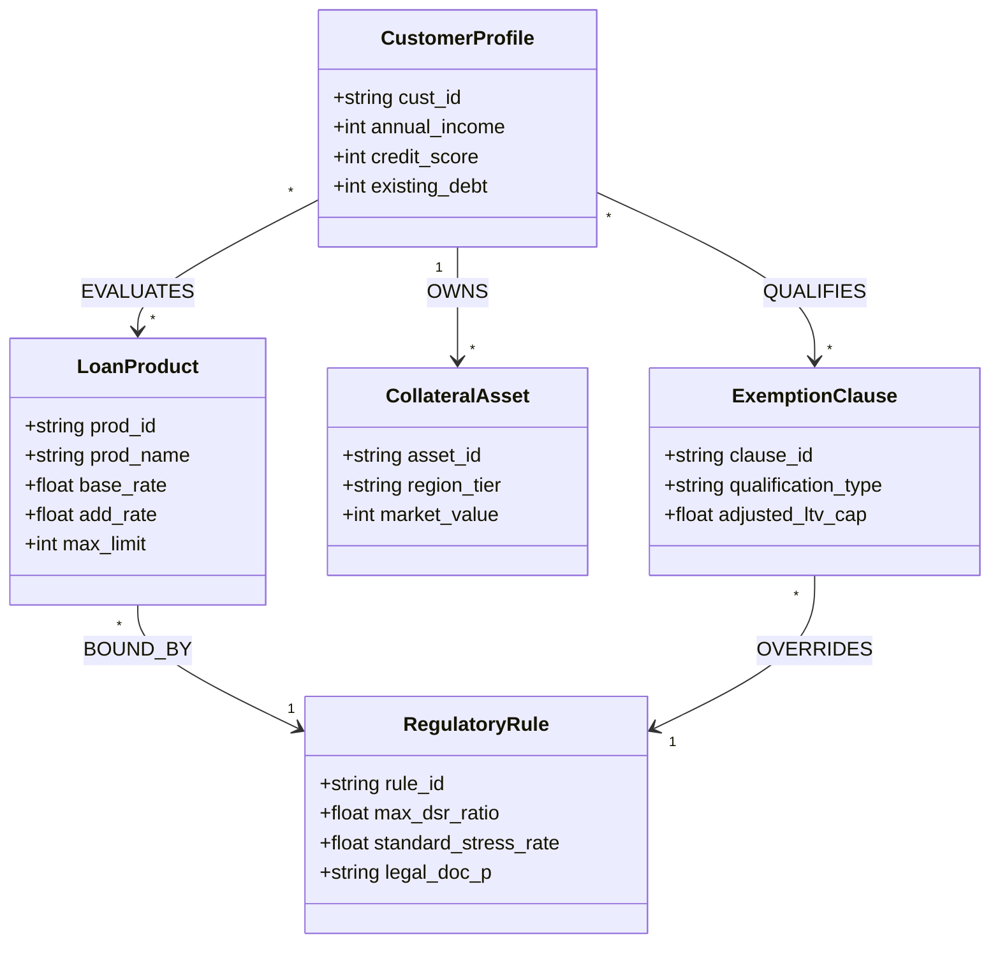

# Segment 2: 핀테크 & 뱅킹 (Fintech & Banking) 온톨로지 프레임워크

## 1. 세그먼트 개요 및 데이터 구조적 특성

금융 및 핀테크 도메인은 **수천만 고객의 실시간 여신/수신 원장(계좌, 거래, 신용평점)**과 **금융위원회·금융감독원 감독규정(DSR 산정 지침, LTV 상한, 금융소비자보호법)**이 가장 엄격하게 교차하는 영역입니다.

단 0.1%의 금리 계산 오류나 비정형 대출 약관의 설명의무 누락은 금융당국의 막대한 과징금 및 고객 분쟁으로 직결됩니다.

본 프레임워크는 **카카오뱅크(인터넷전문은행 비대면 여신/DSR)**와 **토스(원앱 멀티금융 중개/마이데이터)**의 실무 요건을 기반으로, 정형 고객 부채 원장과 비정형 금융 규제 지침을 **BigQuery Property Graph**로 연결하여 **근거 출처 기반 대출 한도 산출 및 컴플라이언스 AI 에이전트**를 제공합니다.

---

## 2. 핀테크 & 금융 공통 도메인 메타모델 (Domain Metamodel)

---

## 3. 수록 엔터프라이즈 케이스 2종 요약

### Case 2-1: 카카오뱅크 (KakaoBank) - 비대면 여신 심사 & DSR 40% 온톨로지
- **진행 상태**: `고객 요건 진행 중`
- **핵심 과제**: 지점 방문 없는 100% 모바일 비대면 주택담보대출 및 신용대출 심사 시, 금융위 DSR 40% 규제 한도와 생애최초 주택구입 LTV 80%(최대 6억 원) 특례를 교차 검증하고, 금소법 제19조 설명의무 준수 보고서 자동 발행.
- **상세 명세**: [`case_kakaobank_unattended_loan_dsr.md`](case_kakaobank_unattended_loan_dsr.md)

### Case 2-2: 토스 (TOSS / Viva Republica) - 원앱 멀티금융 중개 & 마이데이터 온톨로지
- **진행 상태**: `추천 요건`
- **핵심 과제**: 50개 제휴 금융사 대출 상품을 실시간 비교·추천하는 대출 비교 서비스에서 고객의 마이데이터 계좌/부채 이력을 융합하고, 토스페이 가맹점 연 매출 구간별 영세·중소 우대 수수료율 매트릭스 자동 정산.
- **상세 명세**: [`case_toss_oneapp_fintech_mydata.md`](case_toss_oneapp_fintech_mydata.md)

---

## 4. 정형 원장 DDL 및 비정형 템플릿 안내

본 디렉토리 하위의 [`data_templates/`](data_templates/)에 금융 도메인 즉시 실행 에셋이 준비되어 있습니다:
1. `schema_finance.sql`: BigQuery 호환 고객/대출상품/DSR 규제 테이블 DDL
2. `sample_loan_products.csv`: 대출 상품 금리/한도 및 DSR 적용 계수 샘플 데이터
3. `policy_dsr_regulation_guide.md`: 금융위 은행업 감독규정 주택담보대출 DSR/LTV 산정 지침 비정형 문서
