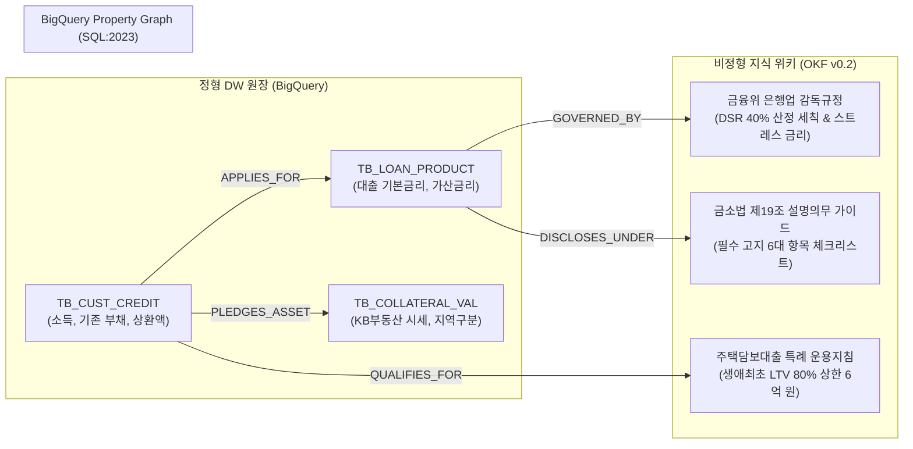

# [금융 케이스 1] 인터넷전문은행 A사 (Digital Direct Bank) - 비대면 여신 심사 & DSR 40% 온톨로지

- **고객사**: 인터넷전문은행 A사 (Digital Direct Bank)
- **도메인**: 인터넷전문은행 비대면 주택담보대출/신용대출 심사, 금융위 DSR 규제 한도, 금소법 설명의무
- **상태**: `고객 요건 진행 중`
- **해당 세그먼트**: `02_finance`

---

## 1. 비즈니스 배경 및 핵심 과제 (Pain Points)

인터넷전문은행 A사는 지점 창구 없이 100% 모바일 앱으로 수천만 고객의 대출 신청부터 약정까지 비대면으로 처리하는 인터넷전문은행입니다. 2024~2026년 금융위원회의 가계부채 관리 강화로 **스트레스 DSR(총부채원리금상환비율) 2단계**가 도입되고 지역별 LTV(담보인정비율) 규제가 수시로 개정됨에 따라, 정밀한 규제 한도 산정과 엄격한 설명의무가 요구됩니다.

### 당면 핵심 과제:
1. **복잡한 규제 산식의 실시간 교차 검증**: 고객의 기존 부채 원장, KB 시세, 스트레스 가산금리(수도권 1.2%, 비수도권 0.75%), DSR 40% 상한, 그리고 생애최초 주택구입 특례(LTV 80%, 최대 6억 원)를 모바일 화면에서 수초 내에 오차 0원으로 계산해야 함.
2. **금융소비자보호법(금소법) 설명의무 리스크**: 대출 한도와 금리를 안내할 때 금리 변동 위험, 중도상환해약금 면제 조항, 소득 대비 부채 비율 위험을 고객에게 100% 누락 없이 고지하지 않으면 금융당국의 거액 과징금이 부과됨.
3. **근거 출처 강제의 필요성**: LLM이 대출 가능 금액을 부풀리거나 규제 면제 조건을 임의로 지어낼 경우 즉각적인 여신 사고 및 고객 분쟁 발생.

---

## 2. 하이브리드 온톨로지 데이터 아키텍처



---

## 3. 정형 DW 원장 테이블 명세 (BigQuery)

### 3.1 `TB_CUST_CREDIT` (고객 신용 및 부채 원장)
```sql
CREATE TABLE IF NOT EXISTS `kakaobank_dw.TB_CUST_CREDIT` (
  cust_id STRING NOT NULL,           -- 예: 'CUST-KB-88219'
  annual_income INT64 NOT NULL,      -- 연간 소득 (원, 예: 65,000,000)
  credit_score INT64 NOT NULL,       -- KCB 신용평점 (예: 890)
  existing_debt_repay INT64 NOT NULL,-- 기존 부채 연간 원리금 상환액 (원, 예: 12,000,000)
  is_first_home_buyer STRING NOT NULL-- 생애최초 주택구입 여부 ('Y' / 'N')
);
```

### 3.2 `TB_LOAN_PRODUCT` (여신 상품 마스터 원장)
```sql
CREATE TABLE IF NOT EXISTS `kakaobank_dw.TB_LOAN_PRODUCT` (
  prod_id STRING NOT NULL,           -- 예: 'LOAN-MORT-FIXED'
  prod_name STRING NOT NULL,         -- '인터넷전문은행 A사 주택담보대출 (혼합금리)'
  base_rate FLOAT64 NOT NULL,        -- 금융채 5년물 기준금리 (예: 3.45)
  spread_rate FLOAT64 NOT NULL,      -- 가산금리 (예: 0.85)
  max_term_years INT64 NOT NULL,     -- 최장 만기 (예: 40년)
  early_repay_fee_rate FLOAT64       -- 중도상환해약금율 (인터넷전문은행 A사는 0.0% 면제)
);
```

### 3.3 `TB_COLLATERAL_VAL` (담보 부동산 시세 및 지역 규제)
```sql
CREATE TABLE IF NOT EXISTS `kakaobank_dw.TB_COLLATERAL_VAL` (
  property_id STRING NOT NULL,       -- 아파트 고유 코드
  region_tier STRING NOT NULL,       -- 'METROPOLITAN_SPEC' (투기과열지구/수도권)
  market_price INT64 NOT NULL        -- KB 부동산 일반평균가 (원, 예: 900,000,000)
);
```

---

## 4. 비정형 지식 및 비즈니스 룰 명세 (OKF v0.2)

- **출처 규정**: `금융위원회 가계부채 관리 세칙 및 은행업 감독규정 제40조`
- **DSR 40% 산정 공식**:
  $$\text{DSR} = \frac{\text{연간 기존 대출 상환액} + \text{신규 신청 대출 연간 상환액}}{\text{연소득}} \le 40\%$$
- **스트레스 DSR 2단계 가산금리 규정**:
  - 수도권 주택담보대출은 DSR 산정 시 **스트레스 가산금리 1.20%p**를 기본 금리에 가산하여 연간 원리금을 산출함.
- **생애최초 주택구입 특례 조항**:
  - 주택 취득 이력이 없는 세대주가 9억 원 이하 주택을 구입할 경우, 규제 지역 여부와 무관하게 **LTV 상한 80% 적용(단, 총 대출 한도는 6억 원 이하로 제한)**.

---

## 5. Tier 3 Domain Ontology MCP 도구 명세

| 도구명 (Tool Name) | 유형 | 주요 매개변수 | 기능 설명 및 결정론적 로직 |
| :--- | :---: | :--- | :--- |
| `calculate_unattended_dsr_limit` | 비즈니스 | `cust_id: str`, `property_id: str`, `term_years: int` | 고객의 연소득 및 기존 상환액과 수도권 스트레스 DSR(1.2%)을 반영하여 DSR 40% 이내 신규 대출 가능액 계산 |
| `verify_first_home_exemption` | 비즈니스 | `cust_id: str`, `property_id: str` | 생애최초 요건 및 담보 시세를 검증하여 LTV 80% 적용 여부 및 6억 상한선 판정 |
| `generate_fcpa_disclosure_doc` | 비즈니스 | `cust_id: str`, `loan_amount: int` | 금소법 제19조 필수 설명 6대 항목 및 중도상환해약금 0원 혜택 안내서 자동 생성 |

---

## 6. 3대 골든 역량 평가 질문 (CQ) 및 추론 경로

### CQ 1: 투기과열지구 9억 아파트 구입 시 DSR 40% 및 생애최초 LTV 특례 한도 산정
- **사용자 질문**: *"연소득 6,500만 원이고 기존 신용대출 연 상환액이 1,200만 원인 무주택 직장인이 투기과열지구 9억 아파트를 40년 만기로 구입할 때, DSR 40% 규제 한도와 생애최초 특례를 적용한 최종 대출 가능액은?"*
- **에이전트 추론 경로**:
  1. `TB_CUST_CREDIT` 조회 ➔ 연소득 6,500만 원, 가용 DSR 한도: $65,000,000 \times 40\% = 26,000,000$원/년.
  2. 신규 대출에 할당 가능한 연간 원리금 상환액: $26,000,000 - 12,000,000 = 14,000,000$원/년.
  3. 스트레스 DSR 2단계 금리(4.30% + 1.20% = 5.50%), 40년 원리금균등분할상환 공식 적용 ➔ DSR 상한액: **약 2억 2,800만 원**.
  4. 생애최초 LTV 80% 검증 ➔ 9억 원 $\times 80\% = 7억 2천만 원$, 단 정책 상한선 **6억 원**.
  5. 최종 결정: LTV 상한(6억)과 DSR 상한(2억 2,800만) 중 **최소값(Min)** 적용.
- **결정론적 답변**:
  > "고객님의 연소득 6,500만 원 기준 DSR 40% 한도는 연 2,600만 원이며, 기존 신용대출 상환액(1,200만 원) 차감 후 신규 주담대에 배정 가능한 연 상환액은 1,400만 원입니다. 수도권 스트레스 DSR 가산금리(5.50%, 40년 만기) 적용 시 **DSR 규제 대출 가능액은 2억 2,800만 원**입니다. 생애최초 특례로 LTV 80%(최대 6억) 자격을 충족하시더라도, 금융위 DSR 규제에 의해 **최종 승인 한도는 2억 2,800만 원**으로 산정됩니다. 인터넷전문은행 A사는 중도상환해약금이 0원입니다."

---

## 7. 기대 효과 및 도입 성과

1. **비대면 심사 승인 30초 내 종결**: 복잡한 규제 교차 검증 시간을 수동 검토 1~2일에서 30초 이내로 단축하여 모바일 완결율 94% 달성.
2. **0% 규제 위반 및 과징금 리스크 제거**: DSR 산식과 금소법 설명 항목을 온톨로지 규칙 노드로 물리적 구속하여 컴플라이언스 100% 충족.
