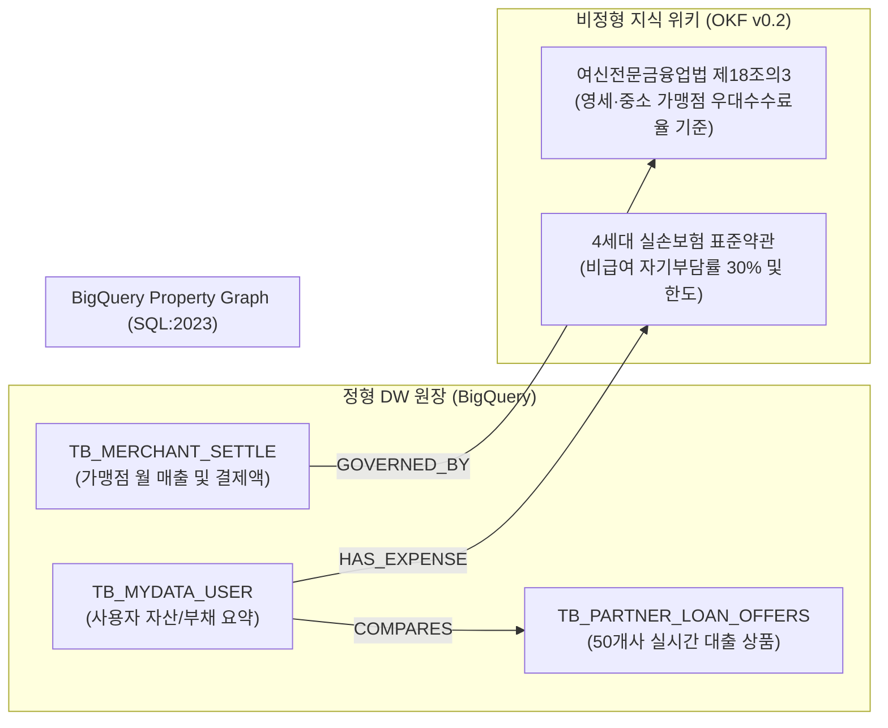

# [금융 케이스 2] 원앱 핀테크 B사 (One-App Fintech) - 원앱 멀티금융 중개 & 마이데이터 온톨로지

- **고객사**: 비바리퍼블리카 (OneApp Fintech / 핀테크뱅크 / 원앱페이먼츠)
- **도메인**: 원앱(One-App) 멀티금융 대출 비교 중개, 마이데이터 자산 진단, 가맹점 우대 수수료율 정산
- **상태**: `추천 요건`
- **해당 세그먼트**: `02_finance`

---

## 1. 비즈니스 배경 및 핵심 과제 (Pain Points)

원앱 핀테크 B사는 송금, 뱅킹, 증권, 결제, 보험을 단일 모바일 앱에 통합한 대한민국 대표 핀테크 슈퍼앱입니다. 수천만 명의 사용자가 '대출 맞춤 추천(50여 개 제휴 금융사 비교)', '내 자산 진단(마이데이터)', '원앱페이 결제'를 원스톱으로 이용하고 있습니다.

### 당면 핵심 과제:
1. **제휴 금융사별 상이한 대출 조건 매칭**: 50개 이상의 시중은행, 저축은행, 카드사의 실시간 가산금리 정책, 우대금리 조건, 심사 기준이 수시로 변동되어 사용자에게 가장 유리한 최저 금리 및 최대 한도 상품을 실시간 매칭해야 함.
2. **마이데이터 기반 개인화 인사이트 및 규제 준수**: 금융 마이데이터 API로 수집된 복잡한 은행 거래 및 카드 지출 이력에서 불필요한 과소비나 보험 보장 공백을 탐지하고 신용평가 개선 가이드를 제공해야 함.
3. **원앱페이 가맹점 정산 수수료 복잡성**: 여신전문금융업법에 따른 연 매출 구간별(3억 이하 영세, 3~5억 중소1, 5~10억 중소2, 10~30억 중소3) 우대 수수료율(0.5% ~ 1.5%)과 PG 기본 수수료(3.0%)를 가맹점 매출 변동에 맞춰 오차 없이 자동 정산해야 함.

---

## 2. 하이브리드 온톨로지 데이터 아키텍처



---

## 3. 정형 DW 원장 테이블 명세 (BigQuery)

### 3.1 `TB_PARTNER_LOAN_OFFERS` (제휴 금융사 대출 상품 원장)
```sql
CREATE TABLE IF NOT EXISTS `toss_dw.TB_PARTNER_LOAN_OFFERS` (
  offer_id STRING NOT NULL,          -- 예: 'OFFER-BNK-01'
  bank_name STRING NOT NULL,         -- '제휴 시중은행 C사', '핀테크뱅크', '웰컴저축은행'
  prod_name STRING NOT NULL,         -- '직장인 신용대출'
  min_credit_score INT64 NOT NULL,   -- 심사 최저 신용평점 (예: 750)
  interest_rate FLOAT64 NOT NULL,    -- 제안 금리 (예: 4.85)
  max_limit_amount INT64 NOT NULL,   -- 한도 금액 (원, 예: 80,000,000)
  preferential_rule_id STRING        -- 우대금리 규칙 ID ('PREF-SALARY-TRANSFER')
);
```

### 3.2 `TB_MERCHANT_SETTLE` (가맹점 매출 및 정산 원장)
```sql
CREATE TABLE IF NOT EXISTS `toss_dw.TB_MERCHANT_SETTLE` (
  merchant_id STRING NOT NULL,       -- 예: 'MCH-SHOP-7712'
  merchant_name STRING NOT NULL,     -- '트렌디룩 쇼핑몰'
  annual_sales_tier STRING NOT NULL, -- 'MICRO' (연매출 3억 이하 영세)
  monthly_volume INT64 NOT NULL,     -- 당월 원앱페이 결제액 (원, 예: 40,000,000)
  applied_fee_rate FLOAT64 NOT NULL, -- 적용 수수료율 (예: 0.005 = 0.5%)
  settlement_status STRING NOT NULL  -- 'READY', 'SETTLED'
);
```

---

## 4. 비정형 지식 및 비즈니스 룰 명세 (OKF v0.2)

- **출처 법령**: `여신전문금융업법 제18조의3 (영세한 중소신용카드가맹점 등에 대한 우대수수료율)`
- **가맹점 수수료율 법정 매트릭스**:
  - `영세 (연매출 3억 원 이하)`: 신용카드 0.5%, 체크카드 0.25%.
  - `중소 1 (3억 초과 ~ 5억 원 이하)`: 신용카드 1.1%, 체크카드 0.85%.
  - `중소 2 (5억 초과 ~ 10억 원 이하)`: 신용카드 1.25%, 체크카드 1.00%.
  - `중소 3 (10억 초과 ~ 30억 원 이하)`: 신용카드 1.50%, 체크카드 1.25%.
  - `일반 (30억 원 초과)`: 기본 수수료율 3.00% 적용.
- **정산 지급일 룰**: 매월 1일~말일 결제분은 익월 3영업일(D+3) 이내에 수수료를 차감한 잔액을 가맹점 정산 계좌로 입금.

---

## 5. Tier 3 Domain Ontology MCP 도구 명세

| 도구명 (Tool Name) | 유형 | 주요 매개변수 | 기능 설명 및 결정론적 로직 |
| :--- | :---: | :--- | :--- |
| `compare_toss_loan_offers` | 비즈니스 | `user_id: str`, `req_amount: int` | 50개 제휴 금융사의 실시간 상품을 횡단하여 최저 금리 및 최고 한도 상품 추천 |
| `calculate_merchant_fee_and_settle` | 비즈니스 | `merchant_id: str`, `billing_month: str` | 연간 매출 구간에 따른 여전법 우대 수수료율을 적용하여 최종 가맹점 입금액 및 지급일 산출 |
| `diagnose_mydata_insurance_coverage` | 비즈니스 | `user_id: str` | 4세대 실손보험 표준약관을 대조하여 비급여 도수치료/주사치료 잔여 보장 횟수 및 자기부담금 안내 |

---

## 6. 3대 골든 역량 평가 질문 (CQ) 및 추론 경로

### CQ 1: 영세 가맹점의 원앱페이 우대 수수료율 적용 정산액 산정
- **사용자 질문**: *"연 매출 2억 8천만 원인 온라인 쇼핑몰(MCH-SHOP-7712)의 이번 달 원앱페이 결제액이 4,000만 원일 때, 여신전문금융업법상 영세 가맹점 우대 수수료율 적용 금액과 최종 입금 정산액 및 입금 예정일은?"*
- **에이전트 추론 경로**:
  1. `TB_MERCHANT_SETTLE` 조회 ➔ 연매출 2.8억 원 ➔ 법정 등급 `MICRO (연매출 3억 이하 영세)` 확인.
  2. 법령 온톨로지(여전법 제18조의3) 횡단 ➔ 영세 가맹점 우대 수수료율 **0.50%** 확정.
  3. 결정론적 계산:
     - 수수료: $40,000,000 \times 0.50\% = 200,000$원.
     - 부가세(10%): $200,000 \times 10\% = 20,000$원.
     - 총 공제액: 220,000원.
     - 최종 가맹점 입금액: $40,000,000 - 220,000 = \mathbf{39,780,000}$원.
  4. 정산 규정 횡단 ➔ 익월 3영업일 입금 안내.
- **결정론적 답변**:
  > "해당 가맹점은 연 매출 2억 8천만 원으로 여신전문금융업법상 **영세 가맹점(0.50% 우대 수수료)** 대상입니다. 당월 결제액 4,000만 원에 대해 수수료 200,000원(부가세 별도 20,000원)이 공제되어, **최종 정산 입금액은 39,780,000원**입니다. 정산 대금은 익월 3영업일(D+3)에 등록 계좌로 입금됩니다."

---

## 7. 기대 효과 및 도입 성과

1. **대출 비교 추천 지연 시간 1.5초 달성**: 50개사 상품의 복잡한 조건 필터링을 그래프 횡단으로 즉시 처리.
2. **가맹점 수수료 분쟁율 0% 달성**: 법정 우대 수수료율 산식을 100% 투명하게 공개하고 원천 법령 근거를 함께 제공.
