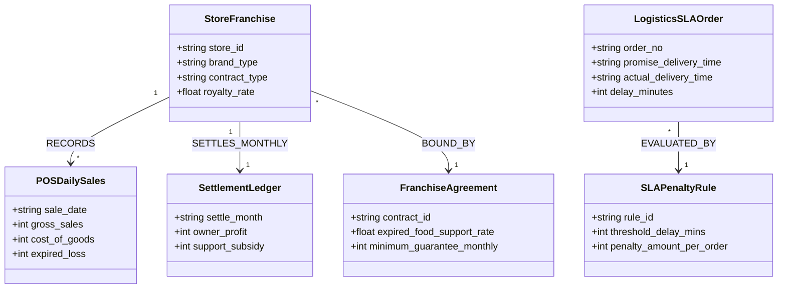

# Segment 3: 유통 & 이커머스 (Retail & Commerce) 온톨로지 프레임워크

## 1. 세그먼트 개요 및 데이터 구조적 특성

유통, 편의점 및 옴니채널 이커머스 산업은 **전국 수만 개 매장의 실시간 POS 판매 실적**, **물류센터(WMS/TMS) 입출고·배송 타임스탬프**, **공급자/가맹점 정산 원장** 등 방대한 거래 데이터를 다룹니다.

그러나 본부와 점주 간의 **가맹계약서(상생지원 특약, 폐기 지원금 산식)**와 물류사-화주 간의 **풀필먼트 배송 SLA 계약서(지연 배상금, 권역별 페널티 규정)**는 비정형 계약 문서로 체결되어 매월 정산 시 수많은 대조 작업과 분쟁이 발생합니다.

본 프레임워크는 **GS리테일(편의점/슈퍼 프랜차이즈 정산 및 옴니 재고)**과 **CJ대한통운/올리브영(옴니채널 풀필먼트 SLA 및 입점 정산)**의 실무 요건을 기반으로, 정형 거래 원장과 비정형 상생/SLA 계약 규정을 **BigQuery Property Graph**로 연결하여 **0% 환각 정산 검증 및 물류 모니터링 AI 에이전트**를 구현합니다.

---

## 2. 유통 & 이커머스 공통 도메인 메타모델 (Domain Metamodel)

---

## 3. 수록 엔터프라이즈 케이스 2종 요약

### Case 3-1: GS리테일 (GS Retail) - 편의점 가맹계약 정산 & 옴니채널 재고 온톨로지
- **진행 상태**: `고객 요건 진행 중`
- **핵심 과제**: GS25 가맹점 계약 타입별(GS1, GS2, 부속형) 본부-점주 수익 배분율, 신선식품 유통기한 임박 상품 폐기 지원금(최대 50% 본부 지원) 산정, 퀵커머스(우리동네GS) 실시간 매장 재고 밸런싱.
- **상세 명세**: [`case_gs_retail_franchise_omnichannel.md`](case_gs_retail_franchise_omnichannel.md)

### Case 3-2: CJ대한통운 / 올리브영 (CJ Logistics / Olive Young) - 풀필먼트 SLA & 정산 온톨로지
- **진행 상태**: `고객 요건 진행 중`
- **핵심 과제**: 올리브영 '오늘드림(3시간 내 배송)' 및 익일배송 풀필먼트 지연 발생 시 택배 표준약관 기준 화주 배상금 계산, 입점 헬스&뷰티 브랜드 수수료율 및 행사 프로모션 분담금 자동 정산.
- **상세 명세**: [`case_cj_logistics_oliveyoung_sla.md`](case_cj_logistics_oliveyoung_sla.md)

---

## 4. 정형 원장 DDL 및 비정형 템플릿 안내

본 디렉토리 하위의 [`data_templates/`](data_templates/)에 유통 도메인 즉시 실행 에셋이 준비되어 있습니다:
1. `schema_retail.sql`: BigQuery 호환 가맹점/POS판매/물류SLA 테이블 DDL
2. `sample_franchise_settlement.csv`: 가맹점 매출, 폐기 손실, 정산 지원금 샘플 데이터
3. `policy_logistics_sla_contract.md`: 풀필먼트 당일배송 SLA 및 지연 배상금 계약 규정 비정형 문서
