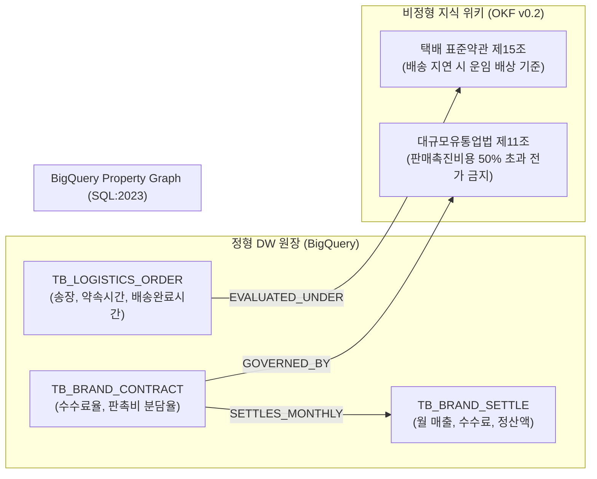

# [유통 케이스 2] CJ대한통운 / 올리브영 (CJ) - 풀필먼트 SLA & 브랜드 정산 온톨로지

- **고객사**: CJ대한통운 / CJ올리브영
- **도메인**: 옴니채널 풀필먼트 물류 배송 SLA 지연 배상, K-뷰티 입점 브랜드 수수료 및 프로모션 분담금 정산
- **상태**: `고객 요건 진행 중`
- **해당 세그먼트**: `03_retail_commerce`

---

## 1. 비즈니스 배경 및 핵심 과제 (Pain Points)

CJ대한통운은 아시아 최대 규모의 곤지암 메가허브를 운영하는 물류 1위 기업이며, CJ올리브영은 전국 1,300여 개 오프라인 매장과 온라인몰을 연계하여 3시간 이내 배송하는 '오늘드림' 서비스를 제공하는 K-뷰티 옴니채널 1위 기업입니다.

### 당면 핵심 과제:
1. **옴니채널 오늘드림 배송 SLA 지연 배상**: 주문 후 3시간 내 배송을 약속하는 '빠름배송'에서 기상 악화나 라이더 부족으로 30분 이상 지연 시, 택배 표준약관 및 화주사 SLA 계약에 따른 지연 배상액(운임의 50%~100%)을 실시간 자동 정산해야 함.
2. **입점 브랜드 정산 및 대규모유통업법 컴플라이언스**: 올영세일 등 대규모 할인 프로모션 시, 입점 브랜드(협력사)와의 판촉비 분담 비율이 법정 상한(대규모유통업법상 본부 50% 이상 분담 의무)을 위반하지 않도록 계약서와 정산 원장을 교차 검증해야 함.
3. **도심 마이크로 풀필먼트 센터(MFC)와 허브 물류 연계**: 온라인 주문 인입 시 인근 오프라인 매장 재고(MFC)와 곤지암 허브 재고의 배송 리드타임과 비용을 비교하여 최적 출고지를 라우팅해야 함.

---

## 2. 하이브리드 온톨로지 데이터 아키텍처



---

## 3. 정형 DW 원장 테이블 명세 (BigQuery)

### 3.1 `TB_LOGISTICS_ORDER` (풀필먼트 배송 실적 원장)
```sql
CREATE TABLE IF NOT EXISTS `cj_dw.TB_LOGISTICS_ORDER` (
  waybill_no STRING NOT NULL,        -- 운송장 번호 (예: 'WB-CJ-992104')
  order_type STRING NOT NULL,        -- 'TODAY_FAST' (3시간 빠름), 'NEXT_DAY' (익일)
  carrier_code STRING NOT NULL,      -- 배송 담당사 ('CJ_LOGISTICS')
  promise_time TIMESTAMP NOT NULL,   -- 고객 약속 도착 시간
  actual_delivery TIMESTAMP NOT NULL,-- 실제 배송 완료 타임스탬프
  delivery_fee INT64 NOT NULL,       -- 기본 배송 운임 (원, 예: 5,000)
  delay_minutes INT64 NOT NULL       -- 지연 시간 (분)
);
```

### 3.2 `TB_BRAND_CONTRACT` (입점 브랜드 계약 마스터)
```sql
CREATE TABLE IF NOT EXISTS `cj_dw.TB_BRAND_CONTRACT` (
  brand_code STRING NOT NULL,        -- 예: 'BRD-COSRX-01'
  brand_name STRING NOT NULL,        -- '코스알엑스'
  category STRING NOT NULL,          -- 'SKINCARE'
  base_commission_rate FLOAT64 NOT NULL, -- 기본 판매 수수료율 (예: 0.30 = 30%)
  promo_share_ratio FLOAT64 NOT NULL     -- 판촉비 브랜드 분담율 (법정 상한 0.50 = 50%)
);
```

---

## 4. 비정형 지식 및 비즈니스 룰 명세 (OKF v0.2)

- **출처 규정**: `공정거래위원회 택배 표준약관 제15조 (손해배상) & 대규모유통업법 제11조`
- **배송 지연 배상 룰 (오늘드림)**:
  - 지연 시간 30분 초과 ~ 2시간 이내: 배송 운임의 **50% 고객 환불/배상**.
  - 지연 시간 2시간 초과: 배송 운임의 **100% 전액 환불** 및 5,000원 상당 보상 쿠폰 지급.
- **대규모유통업법 판촉비 분담 규정**:
  - 대규모유통업자(올리브영)는 납품업자(입점 브랜드)에게 판촉비의 **50%를 초과하여 분담시킬 수 없음 (위반 시 시정명령 및 과징금)**.

---

## 5. Tier 3 Domain Ontology MCP 도구 명세

| 도구명 (Tool Name) | 유형 | 주요 매개변수 | 기능 설명 및 결정론적 로직 |
| :--- | :---: | :--- | :--- |
| `audit_delivery_sla_penalty` | 비즈니스 | `waybill_no: str` | 실제 배송 완료 시각과 약속 시각을 대조하여 지연 시간 산출 및 택배 표준약관 기준 배상액 결정 |
| `calculate_brand_monthly_settlement` | 비즈니스 | `brand_code: str`, `billing_month: str` | 브랜드 총 매출에서 기본 수수료와 판촉비 분담금을 차감하되 법정 50% 상한 준수 검증 후 지급액 계산 |
| `check_fair_trade_promotion_limit` | 비즈니스 | `brand_code: str`, `promo_cost_total: int`, `brand_share: int` | 특정 프로모션 분담 비율이 대규모유통업법 제11조(50% 초과 금지)에 위배되는지 판정 |

---

## 6. 3대 골든 역량 평가 질문 (CQ) 및 추론 경로

### CQ 1: 올영세일 프로모션 분담금 및 브랜드 최종 정산액 산정 (대규모유통업법 준수)
- **사용자 질문**: *"올영세일 기간 입점 뷰티 브랜드(BRD-COSRX-01)의 월간 총 매출이 2억 원(수수료율 30%)이고, 고객 쿠폰 할인 지원금이 2,000만 원 발생했을 때, 대규모유통업법 50% 분담 규정을 반영한 최종 정산 지급액은?"*
- **에이전트 추론 경로**:
  1. `TB_BRAND_CONTRACT` 조회 ➔ 기본 수수료율 **30%** 확인.
     - 기본 수수료 공제: $200,000,000 \times 30\% = 60,000,000$원.
  2. 법령 온톨로지(대규모유통업법 제11조) 횡단 ➔ 납품업체 판촉비 분담 비율은 최대 **50% 이하**로 제한.
     - 총 쿠폰 할인액 2,000만 원 중 브랜드 최대 분담액: $20,000,000 \times 50\% = \mathbf{10,000,000}$원 (올리브영 본부 1,000만 원 부담).
  3. 브랜드 최종 정산 입금액:
     - $200,000,000(\text{총매출}) - 60,000,000(\text{기본수수료}) - 10,000,000(\text{판촉분담금}) = \mathbf{130,000,000}$원.
- **결정론적 답변**:
  > "코스알엑스의 월 매출 2억 원에 대한 기본 수수료(30%)는 6,000만 원입니다. 올영세일 쿠폰 할인액 2,000만 원 중 대규모유통업법 제11조에 따라 브랜드 분담 비율은 최대 50%(1,000만 원)로 제한되며, 나머지 1,000만 원은 올리브영 본부가 부담합니다. 따라서 **브랜드 앞 최종 정산 입금액은 1억 3,000만 원**입니다."

---

## 7. 기대 효과 및 도입 성과

1. **배송 SLA 지연 배상 심사 자동화 100%**: 일 수십만 건의 배송 완료 로그를 온톨로지 룰로 자동 판정하여 보상 승인 시간 3일 ➔ 즉시 처리.
2. **공정거래 유통 규제 리스크 0건**: 프로모션 정산 시 대규모유통업법 50% 상한을 자동 강제하여 법률 위반 및 과징금 위험 원천 차단.
