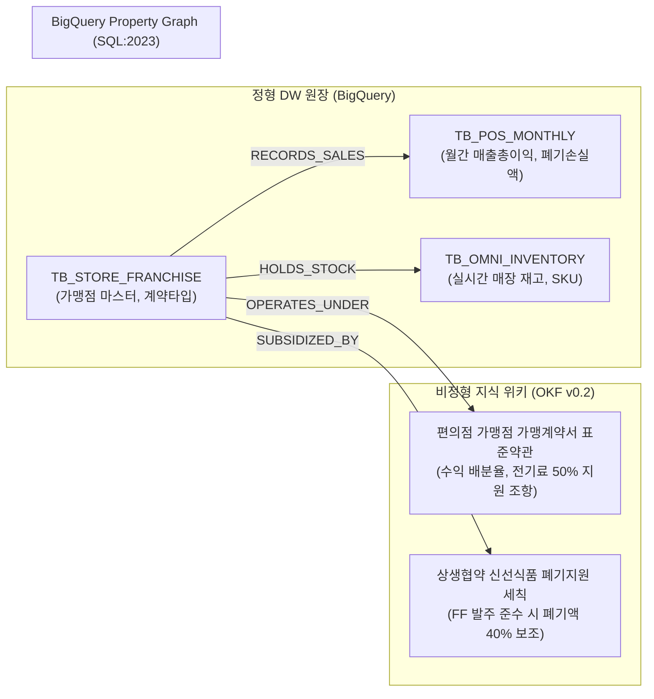

# [유통 케이스 1] 전국 가맹 유통 A사 (Convenience Franchise Corp) - 가맹계약 상생 정산 & 옴니채널 재고 온톨로지

- **고객사**: 전국 가맹 유통 A사 (편의점 가맹점 편의점 / 수퍼마켓 가맹점 / 옴니채널 픽업앱)
- **도메인**: 프랜차이즈 가맹계약 정산, 신선식품(FF) 폐기 지원금 산정, 옴니 퀵커머스 매장 재고 밸런싱
- **상태**: `고객 요건 진행 중`
- **해당 세그먼트**: `03_retail_commerce`

---

## 1. 비즈니스 배경 및 핵심 과제 (Pain Points)

전국 가맹 유통 A사은 전국 1만 7천여 개 편의점 가맹점 편의점과 400여 개 수퍼마켓 가맹점 슈퍼마켓을 운영하며, 모바일 앱 '옴니채널 픽업앱'를 통해 1시간 내 퀵커머스 배송과 픽업 서비스를 제공하는 국내 1위 유통 기업입니다.

### 당면 핵심 과제:
1. **가맹 타입별 복잡한 월간 정산 구조**: 점포 임차권 보유 주체에 따라 GS1 타입(경영주 임차, 이익 배분율 70%), GS2 타입(본부 임차, 이익 배분율 60%) 등 상이한 계약 조건과 전기료 지원, 최저수입보장 산식이 결합되어 매월 점주 문의가 쇄도함.
2. **신선식품(FF) 폐기 지원금 산정 분쟁**: 삼각김밥, 도시락 등 유통기한이 짧은 신선식품의 폐기 손실에 대해 본부가 상생 협약으로 20%~50%의 폐기 지원금을 보조하고 있으나, 지원 대상 SKU 요건과 발주 준수율 조건 대조가 복잡함.
3. **옴니채널 퀵커머스 실시간 재고 불일치**: 모바일 고객이 앱에서 주문했을 때 매장 POS의 실제 물리 재고와 불일치하여 주문이 강제 취소되고 배송 지연 패널티가 발생하는 문제.

---

## 2. 하이브리드 온톨로지 데이터 아키텍처



---

## 3. 정형 DW 원장 테이블 명세 (BigQuery)

### 3.1 `TB_STORE_FRANCHISE` (가맹 점포 마스터 원장)
```sql
CREATE TABLE IF NOT EXISTS `gs_dw.TB_STORE_FRANCHISE` (
  store_code STRING NOT NULL,        -- 예: '편의점 가맹점-SE-0412'
  store_name STRING NOT NULL,        -- '편의점 가맹점 강남역삼점'
  contract_type STRING NOT NULL,     -- 'GS1' (경영주 70%), 'GS2' (경영주 60%)
  owner_id STRING NOT NULL,          -- 경영주 ID
  open_date DATE NOT NULL,
  elec_subsidy_rate FLOAT64 NOT NULL -- 전기료 지원율 (예: 0.50 = 50%)
);
```

### 3.2 `TB_POS_MONTHLY` (월간 점포 손익 및 폐기 원장)
```sql
CREATE TABLE IF NOT EXISTS `gs_dw.TB_POS_MONTHLY` (
  settle_month STRING NOT NULL,      -- 예: '2026-08'
  store_code STRING NOT NULL,
  gross_profit INT64 NOT NULL,       -- 매출총이익 (원, 예: 15,000,000)
  ff_waste_loss INT64 NOT NULL,      -- FF 신선식품 폐기 원가 손실 (원, 예: 800,000)
  utility_cost INT64 NOT NULL,       -- 점포 발생 전기료 (원, 예: 1,200,000)
  order_compliance_rate FLOAT64      -- 본부 권장 발주 준수율 (예: 0.92 = 92%)
);
```

---

## 4. 비정형 지식 및 비즈니스 룰 명세 (OKF v0.2)

- **출처 계약서**: `편의점 가맹점 가맹계약서 표준약관 제18조 및 상생협약 세칙`
- **수익 정산 산식**:
  $$\text{점주 정산금} = (\text{매출총이익} \times \text{배분율}) + \text{폐기지원금} + \text{전기료지원금} - \text{점포운영비}$$
- **신선식품(FF) 폐기지원 룰**:
  - 발주 준수율 $\ge 85\%$인 점포: 신선식품 폐기 원가 손실의 **40% 본부 현금 지원**.
  - 발주 준수율 $< 85\%$인 점포: 폐기 지원율 20%로 축소 적용.
- **전기료 지원 룰**:
  - 매월 한전 청구 전기요금 실비의 **50% 정액 지원**.

---

## 5. Tier 3 Domain Ontology MCP 도구 명세

| 도구명 (Tool Name) | 유형 | 주요 매개변수 | 기능 설명 및 결정론적 로직 |
| :--- | :---: | :--- | :--- |
| `calculate_gs25_owner_settlement` | 비즈니스 | `store_code: str`, `settle_month: str` | 계약 타입별 배분율, 전기료 50% 지원, FF 폐기지원금을 정밀 합산하여 당월 최종 점주 지급액 산출 |
| `evaluate_ff_waste_subsidy` | 비즈니스 | `store_code: str`, `settle_month: str` | 점포 발주 준수율을 검증하여 40% 또는 20% 폐기 지원율 자동 적용 및 보조금 계산 |
| `balance_omni_quick_commerce_stock` | 비즈니스 | `sku_code: str`, `target_lat: float`, `target_lng: float` | 고객 반경 1.5km 매장 중 실시간 가용 재고를 횡단하여 결품율 0% 퀵커머스 최적 매장 라우팅 |

---

## 6. 3대 골든 역량 평가 질문 (CQ) 및 추론 경로

### CQ 1: GS1 타입 점포의 월간 수익 정산 및 폐기·전기료 상생 지원금 정밀 계산
- **사용자 질문**: *"편의점 가맹점 강남역삼점(GS1 타입)의 당월 매출총이익이 1,500만 원, 전기료 120만 원, FF 폐기손실이 80만 원(발주 준수율 92%)일 때, 본부 상생 지원금과 점주의 최종 정산 수익은?"*
- **에이전트 추론 경로**:
  1. `TB_STORE_FRANCHISE` 조회 ➔ GS1 계약 타입 ➔ 점주 기본 배분율 **70%**.
     - 기본 배분 이익: $15,000,000 \times 70\% = 10,500,000$원.
  2. 폐기 지원 규정 횡단 ➔ 발주 준수율 92% $\ge 85\%$이므로 폐기 지원율 **40%** 적용.
     - 본부 폐기 지원금: $800,000 \times 40\% = \mathbf{320,000}$원.
  3. 전기료 지원 규정 횡단 ➔ 전기요금 실비의 **50%** 본부 지원.
     - 본부 전기료 지원금: $1,200,000 \times 50\% = \mathbf{600,000}$원.
  4. 점주 최종 수익 정산:
     - $10,500,000(\text{기본}) + 320,000(\text{폐기지원}) + 600,000(\text{전기료지원}) = \mathbf{11,420,000}$원.
- **결정론적 답변**:
  > "GS1 계약(70% 배분)에 따른 기본 수익은 10,500,000원입니다. 발주 준수율 92%를 달성하여 FF 폐기 지원금 40%(320,000원)와 전기료 50% 지원금(600,000원)이 가산되어, **총 본부 상생 지원금은 920,000원**이며, **점주님의 최종 당월 정산 수익은 11,420,000원**입니다."

---

## 7. 기대 효과 및 도입 성과

1. **정산 내역 문의 및 분쟁 90% 감소**: 복잡한 상생 지원금과 배분 산식을 투명하게 온톨로지 근거와 함께 즉시 제공.
2. **신선식품 폐기율 18% 감축**: 폐기 지원 룰과 발주 가이드를 연동하여 적정 발주량 유지 유도.
