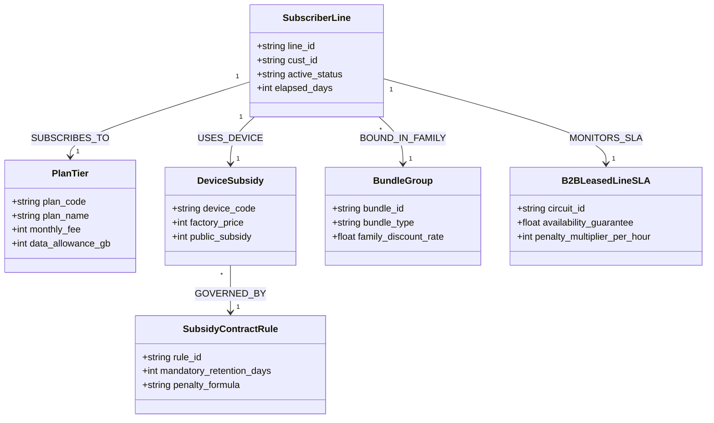

# Segment 4: 통신 & 미디어 (Telecommunications) 온톨로지 프레임워크

## 1. 세그먼트 개요 및 데이터 구조적 특성

통신 산업은 **수천만 가입자의 실시간 회선 상태(Billing/BSS)**, **단말 출고가 및 요금제 원장(OSS/ERP)**, **유무선 결합 이력(Bundle Ledger)** 등 거대한 정형 트랜잭션 데이터를 실시간으로 처리합니다.

그러나 고객 상담 및 계약 변경 시 적용되는 **공시지원금 180일 의무 유지(식스플랜) 약정**, **유무선 결합 할인 반환금 일할 계산 공식**, **기업용 전용회선/IDC 가용성 99.9% SLA 배상 규정**은 수십 페이지의 복잡한 비정형 이용약관에 명시되어 있어, 상담사 실수로 인한 오안내 및 위약금 민원이 빈번히 발생합니다.

본 프레임워크는 **SK텔레콤(구독형 AI/T우주 결합 상품 및 멤버십)**과 **KT(유무선 결합 해지 방어 및 B2B 전용회선 SLA)**의 실무 요건을 기반으로, 정형 회선/요금 원장과 비정형 약관 산식을 **BigQuery Property Graph**로 연결하여 **근거 출처 기반 위약금 일할 계산 및 결합 최적화 AI 에이전트**를 구현합니다.

---

## 2. 통신 & 미디어 공통 도메인 메타모델 (Domain Metamodel)

---

## 3. 수록 엔터프라이즈 케이스 2종 요약

### Case 4-1: SK텔레콤 (SK Telecom) - T우주 구독 결합 & 멤버십 온톨로지
- **진행 상태**: `추천 요건`
- **핵심 과제**: 5G 고가 요금제와 T우주(우주패스/AI 서비스 에이닷) 패키지 결합 시 중복 할인 배제 규칙, 180일 식스플랜 기간 내 하위 요금제(65 ➔ 45) 변경 시 공시지원금 차액 위약금(할인반환금) 일할 계산.
- **상세 명세**: [`case_skt_subscription_membership.md`](case_skt_subscription_membership.md)

### Case 4-2: KT (KT Corporation) - 유무선 결합 해지 방어 & B2B 회선 SLA 온톨로지
- **진행 상태**: `추천 요건`
- **핵심 과제**: 인터넷(Giga WiFi) + 올레TV + 모바일 다회선 결합 고객의 특정 회선 해지 시 남은 결합 할인율 변동 시뮬레이션, 금융/공공 B2B 전용회선 월 가용률 99.9% 미달 장애 시 약관 기준 3배 배상액 자동 산정.
- **상세 명세**: [`case_kt_wired_wireless_bundle_sla.md`](case_kt_wired_wireless_bundle_sla.md)

---

## 4. 정형 원장 DDL 및 비정형 템플릿 안내

본 디렉토리 하위의 [`data_templates/`](data_templates/)에 통신 도메인 즉시 실행 에셋이 준비되어 있습니다:
1. `schema_telecom.sql`: BigQuery 호환 회선/요금제/결합/SLA 테이블 DDL
2. `sample_subscription_bundles.csv`: 요금제, T우주 번들, 결합 할인율 샘플 데이터
3. `policy_six_plan_subsidy_rules.md`: 단통법 공시지원금 180일 식스플랜 및 위약금 일할 계산식 비정형 문서
