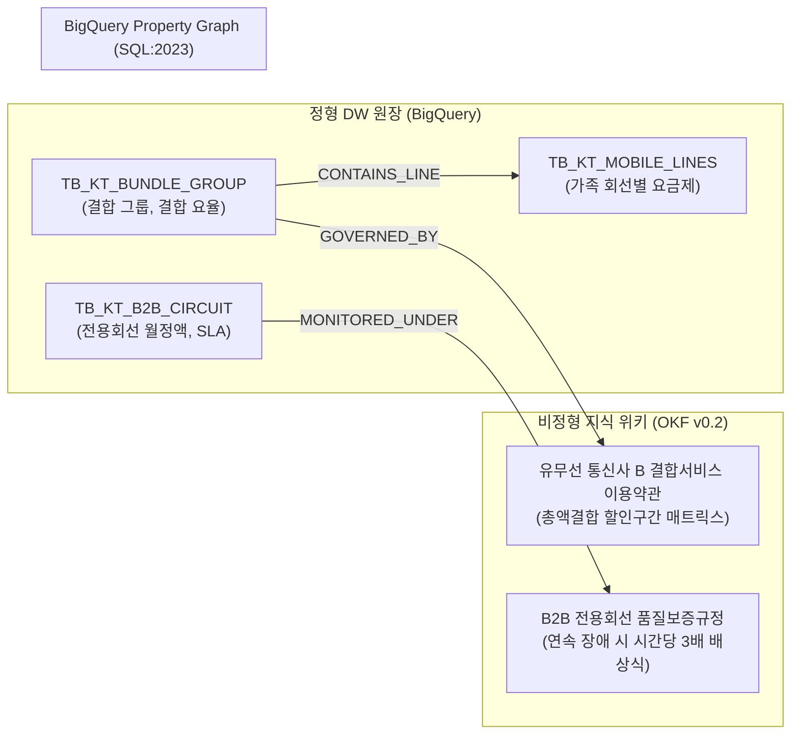

# [통신 케이스 2] 유무선 결합 통신사 B사 (Converged Carrier B) - 유무선 결합 해지 방어 & B2B 회선 SLA 온톨로지

- **고객사**: 유무선 결합 통신사 B사 (Converged Carrier B)
- **도메인**: 초고속 1Gbps 인터넷/프리미엄 IPTV/모바일 유무선 총액 결합 할인, 해지 방어 시뮬레이션, 엔터프라이즈 B2B 전용회선 SLA 품질 배상
- **상태**: `추천 요건`
- **해당 세그먼트**: `04_telecommunications`

---

## 1. 비즈니스 배경 및 핵심 과제 (Pain Points)

KT는 대한민국 1위 유선 초고속인터넷(초고속 1Gbps 인터넷), IPTV(프리미엄 IPTV)와 무선 모바일을 융합한 강력한 '유무선 결합 서비스'와 공공·금융기관 전용회선(Kornet/B2B Leased Line)을 공급하는 국가 기간통신사업자입니다.

### 당면 핵심 과제:
1. **유무선 결합 해지 시 연쇄 할인 축소 시뮬레이션**: 모바일 3회선 + 초고속 1Gbps 인터넷 결합 가구에서 가족 1명이 통신사를 이탈할 경우, 총액 결합 할인 구간이 하락하여 남은 가족 구성원의 모바일 및 인터넷 요금이 얼마씩 인상되는지 실시간 계산하여 해지를 방어해야 함.
2. **B2B 전용회선 SLA 장애 보상 분쟁**: 금융망/공공망 전용회선에서 광케이블 단선이나 라우터 장애로 서비스가 수시간 중단되었을 때, SLA 약관(월 가용률 99.9% 미달 및 연속 장애 시간당 월정액 시간 환산액의 3배 배상)에 따른 정확한 요금 감면액을 산출해야 함.
3. **약정 만료 전 위약금 일할 계산 신뢰성**: 인터넷 3년 약정 고객의 중도 해지 시 사은품(상품권) 및 모뎀 임대료 반환금 산식을 투명하게 안내하여 방송통신위원회 분쟁을 방지해야 함.

---

## 2. 하이브리드 온톨로지 데이터 아키텍처



---

## 3. 정형 DW 원장 테이블 명세 (BigQuery)

### 3.1 `TB_KT_BUNDLE_GROUP` (유무선 결합 그룹 원장)
```sql
CREATE TABLE IF NOT EXISTS `kt_dw.TB_KT_BUNDLE_GROUP` (
  bundle_id STRING NOT NULL,         -- 예: 'BND-FAM-0491'
  bundle_type STRING NOT NULL,       -- 'TOTAL_FAMILY_BUNDLE' (총액 결합)
  internet_circuit_id STRING NOT NULL,-- 'INT-GIGA-1G' (초고속 1Gbps 인터넷 1G)
  mobile_count INT64 NOT NULL,       -- 결합된 모바일 회선 수 (예: 3)
  total_mobile_fee INT64 NOT NULL,   -- 결합 모바일 요금 총액 (원, 예: 198,000)
  internet_discount INT64 NOT NULL,  -- 인터넷 할인액 (원, 예: 5,500)
  mobile_total_discount INT64 NOT NULL -- 모바일 총 할인액 (원, 예: 27,600)
);
```

### 3.2 `TB_KT_B2B_CIRCUIT` (기업 전용회선 SLA 모니터링 원장)
```sql
CREATE TABLE IF NOT EXISTS `kt_dw.TB_KT_B2B_CIRCUIT` (
  circuit_id STRING NOT NULL,        -- 예: 'KT-CORP-901'
  customer_name STRING NOT NULL,     -- '미래에셋증권 전용망'
  monthly_fee INT64 NOT NULL,        -- 월 전용회선 이용료 (원, 예: 3,000,000)
  sla_target_rate FLOAT64 NOT NULL,  -- 보증 가용률 (예: 0.999 = 99.9%)
  outage_minutes INT64 NOT NULL,     -- 당월 누적 장애 시간 (분, 예: 200)
  billing_month STRING NOT NULL      -- '2026-08'
);
```

---

## 4. 비정형 지식 및 비즈니스 룰 명세 (OKF v0.2)

- **출처 약관 1**: `유무선 통신사 B 유무선 결합서비스 이용약관 제12조 (결합할인 기준 및 해지 규정)`
  - 모바일 총액 14만 원 이상 ~ 17만 원 미만: 인터넷 5,500원 할인 + 모바일 16,500원 할인.
  - 모바일 총액 17만 원 이상 ~ 22만 원 미만: 인터넷 5,500원 할인 + 모바일 27,600원 할인.
  - 1회선 이탈로 총액이 17만 원 미만으로 하락 시: 모바일 할인액이 즉시 11,100원 축소.
- **출처 약관 2**: `유무선 통신사 B B2B 기업전용회선 품질보증(SLA) 이용약관 제8조 (손해배상)`
  - 연속 장애 시간이 1시간 이상인 경우:
    $$\text{배상 감면액} = \left(\frac{\text{월정액}}{30\text{일} \times 24\text{시간}}\right) \times \text{장애 시간(시간 단위 올림)} \times 3$$

---

## 5. Tier 3 Domain Ontology MCP 도구 명세

| 도구명 (Tool Name) | 유형 | 주요 매개변수 | 기능 설명 및 결정론적 로직 |
| :--- | :---: | :--- | :--- |
| `simulate_bundle_churn_impact` | 비즈니스 | `bundle_id: str`, `leaving_line: str` | 특정 회선 해지 시 결합 총액 구간 변동에 따른 남은 가족의 요금 인상액 및 인터넷 할인 유지 여부 시뮬레이션 |
| `calculate_b2b_circuit_sla_compensation` | 비즈니스 | `circuit_id: str`, `billing_month: str` | 전용회선 월 장애 시간을 대조하여 약관 제8조 기준 3배 요금 감면액 자동 계산 |
| `recommend_bundle_defense_offer` | 비즈니스 | `bundle_id: str` | 결합 해지 방어를 위한 소액 부가서비스 할인 또는 결합 유지 대체 혜택 추천 |

---

## 6. 3대 골든 역량 평가 질문 (CQ) 및 추론 경로

### CQ 1: B2B 전용회선 3시간 20분 단절 시 SLA 3배 배상 감면액 계산
- **사용자 질문**: *"월 이용료 300만 원인 금융사 전용회선(KT-CORP-901)이 광케이블 단선으로 3시간 20분 동안 서비스 중단되었을 때, 유무선 통신사 B 전용회선 SLA 약관(시간당 3배 배상)에 따른 월 청구서 감면액은?"*
- **에이전트 추론 경로**:
  1. `TB_KT_B2B_CIRCUIT` 조회 ➔ 월정액 3,000,000원, 장애 시간 200분 (3시간 20분).
  2. B2B SLA 약관 제8조 횡단 ➔ 1시간 이상 연속 장애 시 **시간 단위 올림(CEIL)** 적용:
     - 인정 장애 시간: 3시간 20분 ➔ **4시간**.
  3. 시간당 통상 요금 계산:
     $$\text{시간당 요금} = \frac{3,000,000}{720\text{시간}} = 4,166.67\text{원}.$$
  4. SLA 약관 3배 배상 적용:
     $$\text{감면액} = 4,166.67 \times 4\text{시간} \times 3 = \mathbf{50,000}\text{원}.$$
- **결정론적 답변**:
  > "유무선 통신사 B 전용회선 SLA 약관 제8조에 따라 3시간 20분 장애는 4시간으로 올림 산정되며, 시간당 이용료(4,166.67원)의 3배 배상 규정이 적용됩니다. 이에 따라 당월 통신료 청구서에서 **총 50,000원이 자동 감면** 처리됩니다."

---

## 7. 기대 효과 및 도입 성과

1. **가구 결합 해지 방어율 28% 향상**: 결합 이탈 시 가구 전체 요금 인상액을 즉시 시뮬레이션하여 고객 설득력 확보.
2. **B2B SLA 배상 분쟁 해결 시간 2주 ➔ 10분 단축**: 장애 로그와 약관 산식을 온톨로지로 실시간 연계하여 자동 감면 청구서 발행.
