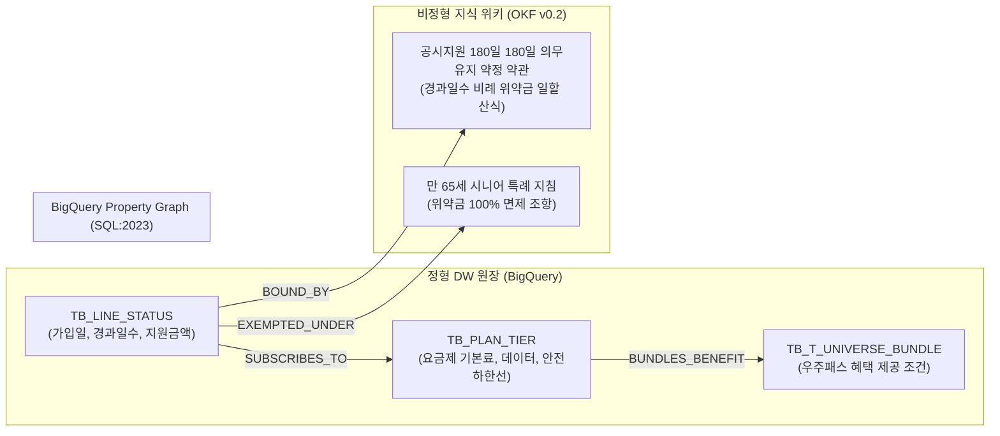

# [통신 케이스 1] 모바일 구독 통신사 A사 (Mobile Carrier A) - AI 라이프 구독패스 구독 결합 & 멤버십 위약금 온톨로지

- **고객사**: 모바일 구독 통신사 A사 (Mobile Carrier A)
- **도메인**: 5G 모바일 요금제, AI 라이프 구독패스(우주패스/에이닷) 라이프 구독 결합, 공시지원금 180일 180일 의무유지 약정 위약금 일할 계산
- **상태**: `추천 요건`
- **해당 세그먼트**: `04_telecommunications`

---

## 1. 비즈니스 배경 및 핵심 과제 (Pain Points)

모바일 구독 통신사 A사은 3천만 이상의 무선 가입자를 기반으로, 구독 플랫폼 'AI 라이프 구독패스(우주패스)', AI 개인비서 '에이닷(A.)', 유무선 온가족 결합 상품을 서비스하는 국내 1위 이동통신사입니다.

### 당면 핵심 과제:
1. **고가 요금제와 AI 라이프 구독패스 구독 혜택의 복합 종속성**: 5GX 프라임(월 89,000원) 이상 요금제는 우주패스 life 무료 혜택(월 9,900원 가치)을 기본 번들링하여 제공합니다. 고객이 요금제를 중도 변경할 경우 혜택이 즉시 유료 전환되거나 자동 해지되는 조건을 실시간 시뮬레이션해야 함.
2. **180일 180일 의무유지 약정 위약금(할인반환금)의 복잡한 일할 산식**: 공시지원금을 받고 개통한 고객이 180일 의무 유지 기간 내에 하위 요금제로 변경할 때, 경과 일수에 따른 정확한 차액 위약금을 계산해야 하며, 오안내 시 고객 민원과 방통위 제재로 직결됨.
3. **가족 결합 할인율 연쇄 변동 방어**: 가족 3회선 결합 고객 중 1명이 요금제를 변경하거나 해지할 때 남은 가족 구성원의 결합 할인 혜택이 축소되는 것을 사전 경고하고 안전 하한선 요금제를 추천해야 함.

---

## 2. 하이브리드 온톨로지 데이터 아키텍처



---

## 3. 정형 DW 원장 테이블 명세 (BigQuery)

### 3.1 `TB_LINE_STATUS` (가입 회선 상태 원장)
```sql
CREATE TABLE IF NOT EXISTS `skt_dw.TB_LINE_STATUS` (
  line_no STRING NOT NULL,           -- 예: '010-9876-5432'
  plan_code STRING NOT NULL,         -- 현재 요금제 ('PLAN-5GX-PRIME')
  join_date DATE NOT NULL,           -- 개통 일자
  elapsed_days INT64 NOT NULL,       -- 개통 후 경과 일수 (예: 110일)
  subsidy_received INT64 NOT NULL,   -- 개통 시 수령 공시지원금 (원, 예: 500,000)
  cust_age INT64 NOT NULL            -- 고객 연령 (만 나이)
);
```

### 3.2 `TB_PLAN_TIER` (요금제 마스터 원장)
```sql
CREATE TABLE IF NOT EXISTS `skt_dw.TB_PLAN_TIER` (
  plan_code STRING NOT NULL,         -- 예: 'PLAN-5GX-PRIME', 'PLAN-5GX-REGULAR'
  plan_name STRING NOT NULL,         -- '5GX 프라임', '5GX 레귤러'
  monthly_fee INT64 NOT NULL,        -- 월정액 기본료 (원, 예: 89,000 / 69,000)
  subsidy_amount INT64 NOT NULL,     -- 해당 요금제 공시지원금 (원, 예: 500,000 / 320,000)
  is_safe_lower_bound STRING NOT NULL-- 위약금 미발생 안전 하한선 ('Y' / 'N')
);
```

---

## 4. 비정형 지식 및 비즈니스 룰 명세 (OKF v0.2)

- **출처 약관**: `모바일 구독 통신사 A사 5G 이용약관 제24조 (지원금 연계 약정 및 위약금 산정)`
- **180일 180일 의무유지 약정 차액 위약금 일할 계산식**:
  $$\text{위약금} = (\text{개통 시 지원금} - \text{변경 요금제 지원금}) \times \frac{180 - \text{경과 일수}}{180}$$
  *(단, 경과 일수가 180일 이상이거나 만 65세 이상 시니어 특례 대상인 경우 위약금 0원 면제)*
- **AI 라이프 구독패스 번들 혜택 유지 조건**:
  - 월정액 89,000원 이상 고가 요금제 유지 시 우주패스 life 무료 혜택 제공. 89,000원 미만 하위 요금제로 변경 시 혜택 즉시 종료(월 9,900원 청구 전환).

---

## 5. Tier 3 Domain Ontology MCP 도구 명세

| 도구명 (Tool Name) | 유형 | 주요 매개변수 | 기능 설명 및 결정론적 로직 |
| :--- | :---: | :--- | :--- |
| `calculate_skt_plan_downgrade_penalty` | 비즈니스 | `line_no: str`, `target_plan_code: str` | 경과 일수, 수령 지원금, 고객 연령(시니어 면제)을 대조하여 정확한 차액 위약금을 일할 계산 |
| `verify_t_universe_entitlement` | 비즈니스 | `target_plan_code: str` | 변경 대상 요금제에서 AI 라이프 구독패스 우주패스 무료 혜택이 유지되는지 여부 및 유료 청구 전환 안내 |
| `get_safe_lower_bound_plan` | 비즈니스 | `line_no: str` | 현재 결합 할인과 공시지원금 약정을 깨뜨리지 않는 최적의 안전 하한선 요금제 탐색 |

---

## 6. 3대 골든 역량 평가 질문 (CQ) 및 추론 경로

### CQ 1: 5GX 프라임 가입 110일차 고객의 레귤러 요금제 하향 시 위약금 및 AI 라이프 구독패스 혜택 판정
- **사용자 질문**: *"5GX 프라임(89,000원)으로 지원금 50만 원을 받고 개통한 지 110일 된 고객(만 42세)이 5GX 레귤러(69,000원, 지원금 32만 원)로 변경할 때, 청구되는 위약금과 AI 라이프 구독패스 우주패스 무료 혜택 유지 여부는?"*
- **에이전트 추론 경로**:
  1. `TB_LINE_STATUS` 조회 ➔ 경과일수 110일 (< 180일 의무 기간), 개통 지원금 500,000원, 고객 만 42세(시니어 면제 비해당).
  2. `TB_PLAN_TIER` 조회 ➔ 5GX 레귤러 공시지원금 320,000원 확인.
     - 지원금 차액: $500,000 - 320,000 = 180,000$원.
     - 잔여 의무일수: $180 - 110 = 70$일.
  3. 결정론적 위약금 일할 계산:
     $$\text{위약금} = 180,000 \times \frac{70}{180} = \mathbf{70,000}\text{원}.$$
  4. AI 라이프 구독패스 약관 횡단 ➔ 5GX 레귤러는 월 69,000원으로 89,000원 미만이므로 우주패스 무료 혜택 종료(유료 전환).
- **결정론적 답변**:
  > "개통 후 110일차로 180일 180일 의무유지 약정 약정 기간 내 변경에 해당하여, **지원금 차액 위약금 70,000원**이 일할 계산되어 청구됩니다. 또한 5GX 레귤러는 우주패스 무료 번들링 대상이 아니므로, 기존 무료 제공되던 **우주패스 life 혜택은 자동 유료 전환(월 9,900원 청구)**됩니다. 위약금 없이 변경하시려면 개통 후 **70일 뒤(180일 도래 시)** 변경하시길 권장합니다."

---

## 7. 기대 효과 및 도입 성과

1. **위약금 오안내 민원 0건 달성**: 복합 일할 산식을 온톨로지 규칙 노드로 물리적 검증하여 상담 오안내 원천 배제.
2. **상담 소요 시간 85% 단축**: 약관 및 원장 테이블을 수작업으로 찾던 콜센터 상담 시간을 8분에서 40초로 단축.
