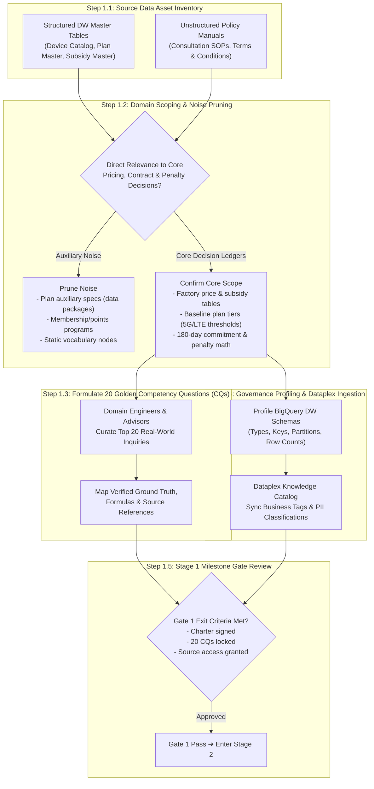

# Stage 1: Asset Discovery, Scoping & Governance Ingestion Detailed Execution Guide
## Stage 1: Asset Discovery, Scoping & Governance Ingestion (English Edition)

- **Master Methodology**: [METHODOLOGY_EN.md](file:///Users/seanjung/Downloads/Uplus%20Ontology/agentic-ontology-starter/methodology/METHODOLOGY_EN.md)
- **Document Version**: `v1.0.0`
- **Objective**: Identify distributed structured DW ledgers and unstructured SOP manuals across the enterprise, proactively prune irrelevant noise, formulate 20 Golden Competency Questions (CQs), and ingest metadata into Google Cloud Dataplex Knowledge Catalog.

---

## 1. Overall Execution Process

Stage 1 defines the operational scope, quality benchmarks, and foundational data governance for building an enterprise agentic ontology.

---

## 2. Detailed Methodology & Technology Standards

### 2.1 Abstracted Source Asset Blueprint
To ensure broad cross-industry applicability, the starter pack abstracts customer-specific table names into standardized business architectural components.

| Abstracted Asset Name | Asset Type | Contents & Schema Blueprint | De-identified Concrete Example |
| :--- | :---: | :--- | :--- |
| **[Device Catalog DW Table]** | Structured DW | Manufacturer, model code, marketing name, storage tier, list price | `L0NUEM_TB_RCSP_MBL_TRM_M` |
| **[Tariff & Plan Master DW Table]** | Structured DW | Plan code, plan name, network tier (5G/LTE), monthly charge, threshold flag | `L0NUEM_TB_RCSP_FEE_PRD_M` |
| **[Subsidy Policy Master DW Table]** | Structured DW | Policy ID, applicable device, commitment tier, base subsidy, bonus discount | `L0NUEM_TB_RCSP_MBL_TRM_SUFU_PLCY_M` |
| **[Customer Consultation SOP Manual]** | Unstructured SOP | MHTML/PDF consultation guide, penalty math formulas, 180-day grace policy | `Consultation_Guide_2.0_Subsidy.mhtml` |
| **[Business Glossary Registry]** | Governance | Standard enterprise lexicon, synonym registry, boundary definitions | `Business_Glossary.json` |

### 2.2 Noise Pruning Charter & Scoping Rules
1. **Decision-Centric Knowledge Focus**:
   - 100% of modeling effort is concentrated on financial subsidies, contractual penalty formulas, and legal commitment grace periods.
2. **Auxiliary Feature Pruning**:
   - Secondary plan features (e.g., streaming subscriptions, data rollover options) that do not alter subsidy eligibility are pruned to prevent semantic drift.
3. **Glossary Excluded from Graph Topology**:
   - The business glossary serves as an Asset Registry and LLM prompt grounding anchor, but is strictly **excluded from GQL traversal nodes**.

---

## 3. Stage 1 Quality Gate Checklist

- [ ] Domain Scoping Charter signed by Data Architect and business stakeholders.
- [ ] 20 Golden CQs with verified ground truth formulas fully established.
- [ ] Source DW schemas and unstructured documents access verified.
- [ ] Dataplex catalog metadata and PII security profiles applied.
