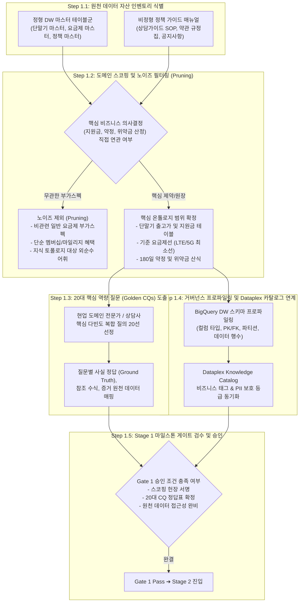

# Stage 1: 자산 탐색, 도메인 스코핑 및 거버넌스 수집 세부 실행 명세서
## Stage 1: Asset Discovery, Scoping & Governance Ingestion Detailed Execution Guide (KO)

- **상위 방법론**: [METHODOLOGY_KO.md](file:///Users/seanjung/Downloads/Uplus%20Ontology/agentic-ontology-starter/methodology/METHODOLOGY_KO.md)
- **문서 버전**: `v1.0.0`
- **목적**: 기업 내 분산된 정형 DW 원장과 비정형 업무 규정을 식별하고, 불필요한 노이즈를 사전에 배제(Pruning)하며, 20대 핵심 역량 질문(Golden CQs)과 Dataplex 거버넌스 메타데이터를 통합 수집하는 표준 절차 명세

---

## 1. 전체 실행 프로세스 (Overall Execution Process)

Stage 1은 프로젝트 착수 시 도메인의 경계를 획정하고, 신뢰성 있는 지식 온톨로지를 구축하기 위한 원천 자산의 품질과 범위를 규정하는 진입 단계입니다.



---

## 2. 세부 방법론 및 기술 아키텍처 (Detailed Methodology & Technologies)

### 2.1 원천 자산 추상화 및 식별 기준 (Source Asset Abstraction)
엔터프라이즈 온톨로지 스타터팩에서는 특정 고객사의 물리적 테이블명에 의존하지 않고, 범용 비즈니스 아키텍처 수준으로 1단계 추상화하여 관리합니다.

| 추상화된 원천 자산 명칭 | 자산 유형 | 설명 및 포함 필드 (Schema Blueprint) | 추상화 전 예시 (특정사 명칭) |
| :--- | :---: | :--- | :--- |
| **[단말기 카탈로그 마스터 BQ 테이블]** | 정형 DW | 제조사, 펫네임, 모델코드, 용량, 공식 출고가, 단말기 카테고리 | `L0NUEM_TB_RCSP_MBL_TRM_M` 등 |
| **[요금제 사양 마스터 BQ 테이블]** | 정형 DW | 요금제 코드, 요금제명, 네트워크(5G/LTE), 월정액, 기준선 여부 | `L0NUEM_TB_RCSP_FEE_PRD_M` 등 |
| **[지원금 정책 마스터 BQ 테이블]** | 정형 DW | 정책 ID, 적용 단말기, 약정 요금제선, 공시지원금, 유통망지원금 | `L0NUEM_TB_RCSP_MBL_TRM_SUFU_PLCY_M` |
| **[고객 상담가이드 비정형 매뉴얼]** | 비정형 SOP | 상담 가이드 MHTML/PDF, 위약금 계산 규정, 180일 유예 규칙, 예외 조항 | `상담가이드 2.0_이통지원금.mhtml` |
| **[비즈니스 용어사전 (Glossary)]** | 거버넌스 | 고객 확정 표준 어휘, 동의어, 포함/제외 의미 경계 정의서 | `Uplus_Business_Glossary.json` |

### 2.2 도메인 스코핑 및 노이즈 필터링 원칙 (Noise Pruning Charter)
1. **의사결정 핵심 지식 집중**:
   - 지원금, 위약금, 차액정산금, 단통법 규정, 약정 기간(180일 식스플랜)에 100% 집중합니다.
2. **비관련 부가스펙 노이즈 제외 (Pruning)**:
   - 일반 요금제의 데이터 기본 제공량, 로밍 혜택, 부가통화 옵션 등은 의사결정 엔진의 의미적 혼선을 방지하기 위해 과감히 온톨로지 대상에서 배제합니다.
3. **용어사전의 그래프 노드 제외 원칙 (Glossary Excluded from Topology)**:
   - 비즈니스 용어사전은 LLM 프롬프트 어휘 표준화(Lexicon Grounding) 및 자산 레지스트리로만 취급하며, **연산 가능한 그래프 노드 및 GQL 탐색 대상에서 전면 제외**합니다.

### 2.3 20대 Golden Competency Questions (CQs) 수립 방법론
1. **CQ 도출 프레임워크**:
   - 도메인 전문가(FDE)와 현업 상담사가 실무에서 반복 검증해야 하는 20개 대표 질문을 선별합니다.
   - 단일 원장 단순 조회(1-Hop), 정책 교차 검증(2-Hop), 복합 수치 연산(Multi-Hop), 모호/정보부족 질의를 균형 있게 배분합니다.
2. **CQ 평가 메트릭 (Evaluation Metrics)**:
   - **수치 일치율 (Numerical Accuracy)**: 산정된 지원금, 위약금, 최종 실구매가가 원장과 100% 일치하는지 검증.
   - **사실 일관성 (Faithfulness)**: 출력된 법적 조항 및 예외 규정이 원천 문서의 해시 앵커와 일치하는지 검증.
   - **환각률 (Hallucination Rate)**: 존재하지 않는 정책이나 근거 없는 계산이 0%인지 검증.

---

## 3. 실행 템플릿 및 산출물 스펙 (Templates & Deliverables)

### 3.1 D1.1: 도메인 스코핑 헌장 (`SCOPE_CHARTER.md`) 템플릿
```markdown
# [Project Name] Domain Scoping & Noise Pruning Charter

## 1. Core Target Scope
- Primary Domain: Device Subsidy, Commitment Contracts & Penalty Computation
- Target DW Ledgers: [Device Master], [Plan Master], [Subsidy Master]
- Target Unstructured Documents: [Consultation Guide SOP Manual]

## 2. Pruning Boundaries (Excluded Specifications)
- General Plan Options: Data rollover, supplementary call packages, membership perks
- Auxiliary Specs: Screen size, camera megapixels, accessory bundles
```

### 3.2 D1.2: 20대 Golden CQ 명세서 (`CQ_SPECIFICATION.md`) 템플릿
```markdown
| CQ ID | 질의 유형 | 대표 질의 원문 | 참조 원천 자산 | 기대 정답 및 판정 공식 |
| :---: | :---: | :--- | :--- | :--- |
| `CQ-01` | 1-Hop 단순조회 | [단말기 A] 모델의 [기준 요금제 B] 기준 공시지원금은 얼마인가? | [지원금 마스터] | 기본 지원금: 500,000원 |
| `CQ-07` | 2-Hop 정책교차 | [단말기 A] 개통 후 120일 시점에 [하위 요금제 C]로 변경 시 위약금은? | [지원금 마스터] + [상담가이드 SOP] | 식스플랜 180일 미충족 위약금 산식 적용 |
| `CQ-15` | Multi-Hop 복합 | 24개월 총비용 관점에서 공시지원금과 선택약정 중 어느 쪽이 유리한가? | [단말기/요금/지원금 마스터] | 24개월 총납부액 정량 비교표 산출 |
```

---

## 4. Stage 1 품질 게이트 (Gate 1 Exit Checklist)

- [ ] 도메인 스코핑 헌장(`SCOPE_CHARTER.md`)이 도메인 아키텍트 및 이해관계자에게 승인되었는가?
- [ ] 20대 Golden CQ의 정답(Ground Truth)과 계산식이 100% 검증되었는가?
- [ ] 정형 DW 마스터 테이블 및 비정형 문서의 접근 권한과 스키마 프로파일이 확보되었는가?
- [ ] Dataplex 카탈로그 태그 및 PII 보호 등급 매핑이 정의되었는가?
