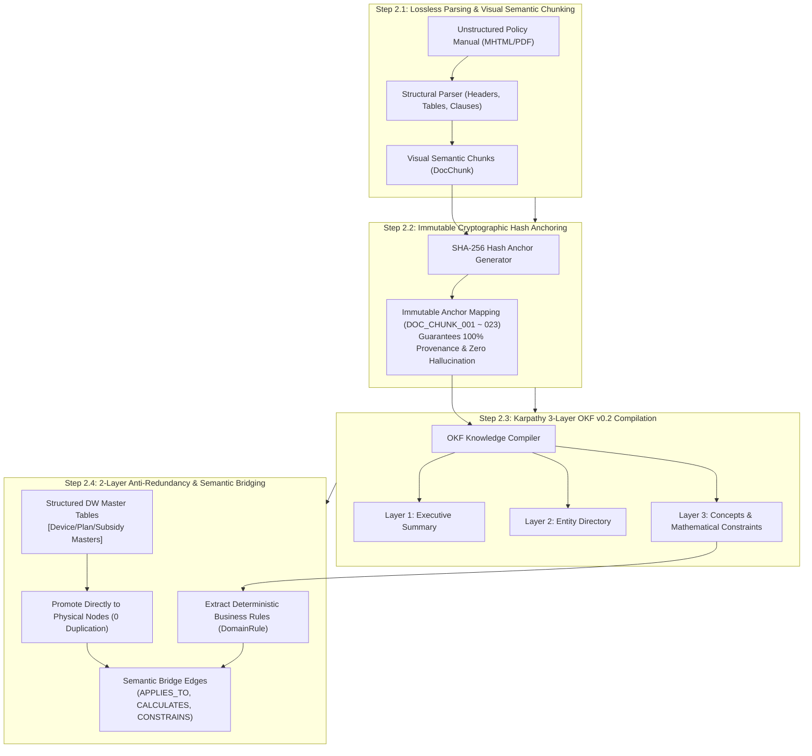

# Stage 2: Semantic Modeling, Open Knowledge Formalization & Grounding Detailed Execution Guide
## Stage 2: Semantic Modeling, OKF & Grounding (English Edition)

- **Master Methodology**: [METHODOLOGY_EN.md](./METHODOLOGY_EN.md)
- **Document Version**: `v1.0.0`
- **Objective**: Structure unstructured policy guides into deterministic chunks with immutable cryptographic hash anchors (`DocChunk`), formalize concepts and rules using Google Cloud Open Knowledge Format (OKF v0.2), and build a 2-Layer Anti-Redundancy knowledge model promoting existing DW tables directly to graph nodes.

---

## 1. Overall Execution Process

Stage 2 transforms implicit business logic locked inside unstructured documents into structured, computable ontology nodes linked directly to enterprise DW ledgers.

### 1.1 GCP Native Foundations & Custom Extensions

| Dimension | Technologies & Specifications | Official Open-Source / Endpoint Reference | Key Role & Engineering Rationale |
| :--- | :--- | :--- | :--- |
| **GCP Native Foundation** | • Google Cloud Open Knowledge Format (OKF v0.2) • Dataplex Knowledge Catalog Custom Aspect Types • Google Cloud Storage (GCS) Ontology Bucket | • [Knowledge Catalog GitHub](https://github.com/GoogleCloudPlatform/knowledge-catalog) • [`okf/bundles/` Standard Spec](https://github.com/GoogleCloudPlatform/knowledge-catalog/tree/main/okf) • [Cloud Storage Documentation](https://cloud.google.com/storage) | Adheres to enterprise OKF v0.2 specification, standard semantic bundles, and cloud storage immutability/lifecycle rules. |
| **Custom Extensions** | • Lossless Visual Chunker & SHA-256 Hash Anchorer (`pipeline/ingest.py`) • Karpathy 3-Layer LLM-Wiki Compiler (`data/llm_wiki/`) • GCS Prototype Manifest Generator • 2-Layer Anti-Redundancy Modeling | Starter Pack Pipeline Engine (`pipeline/ingest.py`) | Preserves full visual layout of policy manuals, provides immutable citation anchors, and prunes redundant text entities before BigQuery graph ingestion. |

---

## 2. Detailed Methodology & Technology Standards

### 2.1 Deterministic Visual Chunking & Hash Anchoring
- Standard token-count splitting fractures critical business tables and conditional clauses.
- Structural chunking preserves complete visual units (tables, formulas, exemption clauses).
- Each chunk receives a permanent SHA-256 hash anchor (e.g., `DOC_CHUNK_007`) ensuring that all model outputs can be traced back to exact source clauses.

### 2.2 Karpathy 3-Layer LLM-Wiki Structure & OKF v0.2
Domain knowledge is codified across Andrej Karpathy's 3-Layer Wiki architecture and Google Cloud OKF v0.2:
- **`summary.md` [Summary Layer]**: Domain overview, governing statutory laws, revision history.
- **`entities.md` [Entity Directory]**: Candidate entity mentions extracted from raw manuals.
- **`concepts.md` [Semantic Concepts]**: 78 domain ontology classes and taxonomy hierarchy.
- **`rules.md` [Business Rules & Formulas]**: 180-day commitment period, clawback penalty math, exemption predicates.

### 2.3 GCS-Based Ontology Prototyping
1. **Rapid Feasibility Prototyping**:
   - The compiled OKF JSON-LD and LLM-Wiki files are pushed to Google Cloud Storage (`gs://<project>-ontology/prototype/`) for early semantic search and grounding validation before full database integration.
2. **Versioned Knowledge Vault**:
   - GCS paths are partitioned by semantic version (`v0.1`, `v0.2`) to track evolving regulatory updates.

### 2.4 2-Layer Anti-Redundancy Architecture
1. **Direct Promotion of DW Tables**:
   - Master prices and plan fees already stored in BigQuery DW are promoted directly to graph node tables without duplicating data.
2. **Pruning Duplicate Entities**:
   - Redundant entity definitions in text are pruned, leaving only **Source Evidence (`DocChunk`)**, **Source Documents (`SourceDoc`)**, and **Business Rules (`DomainRule`/`Policy`)**, joined to DW nodes via semantic edges (`APPLIES_TO`, `CALCULATES`).

---

## 3. Stage 2 Quality Gate Checklist

- [ ] All policy text chunks assigned immutable cryptographic hash anchors.
- [ ] OKF v0.2 Karpathy 3-Layer LLM-Wiki (`summary`, `entities`, `concepts`, `rules`) compiled.
- [ ] GCS ontology prototype deployed and validated for early semantic traversals.
- [ ] 2-layer anti-redundancy architecture verified: zero duplicated ledger records.
- [ ] Semantic bridge relationships (`APPLIES_TO`, `CALCULATES`) fully mapped.
