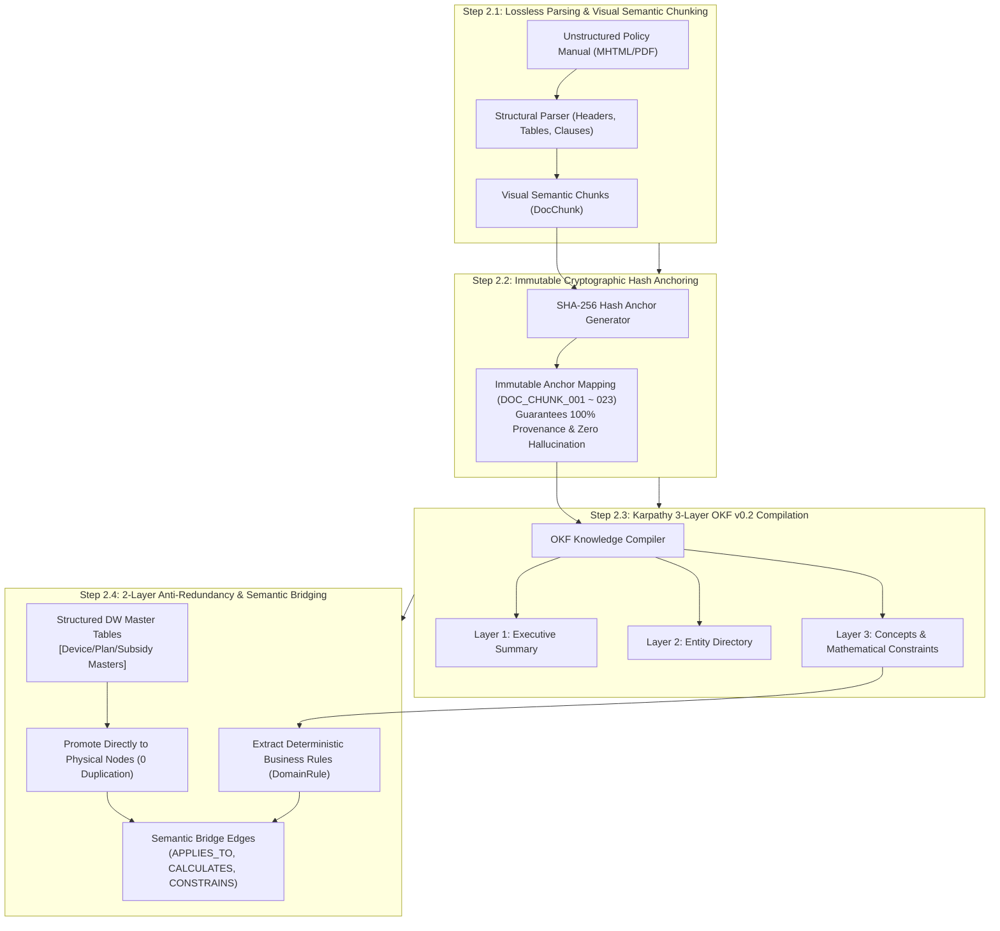

# Stage 2: Semantic Modeling, Open Knowledge Formalization & Grounding Detailed Execution Guide
## Stage 2: Semantic Modeling, OKF & Grounding (English Edition)

- **Master Methodology**: [METHODOLOGY_EN.md](file:///Users/seanjung/Downloads/Uplus%20Ontology/agentic-ontology-starter/methodology/METHODOLOGY_EN.md)
- **Document Version**: `v1.0.0`
- **Objective**: Structure unstructured policy guides into deterministic chunks with immutable cryptographic hash anchors (`DocChunk`), formalize concepts and rules using Google Cloud Open Knowledge Format (OKF v0.2), and build a 2-Layer Anti-Redundancy knowledge model promoting existing DW tables directly to graph nodes.

---

## 1. Overall Execution Process

Stage 2 transforms implicit business logic locked inside unstructured documents into structured, computable ontology nodes linked directly to enterprise DW ledgers.

---

## 2. Detailed Methodology & Technology Standards

### 2.1 Deterministic Visual Chunking & Hash Anchoring
- Standard token-count splitting fractures critical business tables and conditional clauses.
- Structural chunking preserves complete visual units (tables, formulas, exemption clauses).
- Each chunk receives a permanent hash anchor (e.g., `DOC_CHUNK_007`) ensuring that all model outputs can be traced back to exact source clauses.

### 2.2 2-Layer Anti-Redundancy Architecture
1. **Direct Promotion of DW Tables**:
   - Master prices and plan fees already stored in BigQuery DW are promoted directly to graph node tables without duplicating data.
2. **Focus on Rules & Provenance**:
   - Unstructured ingestion is focused purely on **Source Evidence (`DocChunk`)** and **Business Rules (`DomainRule`)**, joined via semantic edges (`APPLIES_TO`).

---

## 3. Stage 2 Quality Gate Checklist

- [ ] All policy text chunks assigned immutable cryptographic hash anchors.
- [ ] OKF v0.2 3-layer taxonomy formally reviewed by Knowledge Engineers.
- [ ] 2-layer anti-redundancy architecture verified: zero duplicated ledger records.
- [ ] Semantic bridge relationships (`APPLIES_TO`, `CALCULATES`) fully mapped.
