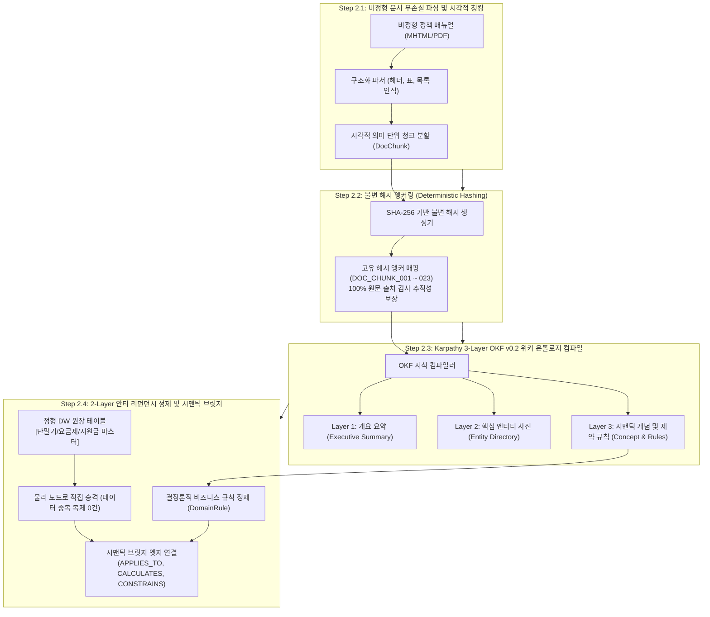
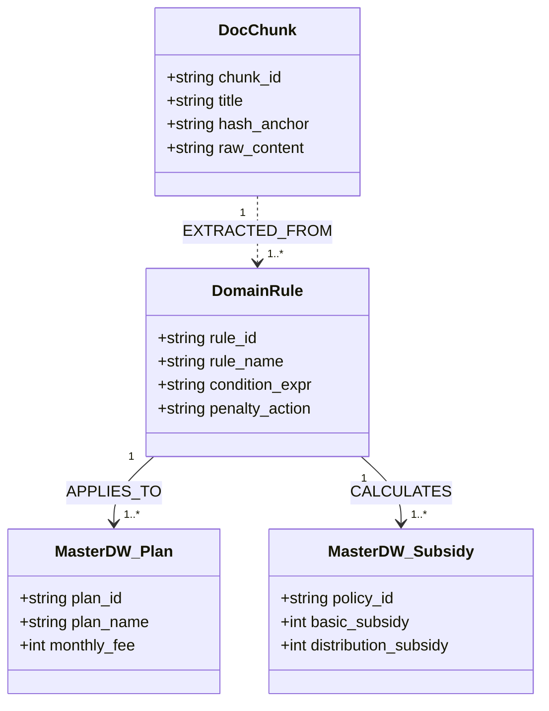

# Stage 2: 시맨틱 지식 온톨로지 모델링 및 정형화 세부 실행 명세서
## Stage 2: Semantic Modeling, Open Knowledge Formalization & Grounding Detailed Execution Guide (KO)

- **상위 방법론**: [METHODOLOGY_KO.md](./METHODOLOGY_KO.md)
- **문서 버전**: `v1.0.0`
- **목적**: 비정형 문서를 구조적으로 분해하여 결정론적 불변 해시 앵커(`DocChunk`)를 부여하고, Google Cloud Open Knowledge Format (OKF v0.2) 기반으로 개념·엔티티·규칙을 정형화하며, 정형 DW 원장 테이블을 노드로 직접 승격시키는 2-Layer 안티 리던던시(Anti-Redundancy) 지식 모델 구축 표준 절차 명세

---

## 1. 전체 실행 프로세스 (Overall Execution Process)

Stage 2는 비정형 텍스트에 포함된 암묵적 업무 규칙을 정형화된 지식 엔티티로 변환하고, 정형 데이터베이스와 유기적으로 연결하는 핵심 시맨틱 엔지니어링 단계입니다.



### 1.1 GCP Native 기반 스펙 및 독자 개발 영역 (GCP Native vs Custom Extension)

| 구분 | 적용 기술 및 사양 | 공식 오픈소스 / 엔드포인트 레퍼런스 | 핵심 역할 및 기술적 의의 |
| :--- | :--- | :--- | :--- |
| **GCP Native 기반** | • Google Cloud Open Knowledge Format (OKF v0.2)<br>• Dataplex Knowledge Catalog Custom Aspect Types<br>• Google Cloud Storage (GCS) 온톨로지 버킷 | • [Knowledge Catalog GitHub](https://github.com/GoogleCloudPlatform/knowledge-catalog)<br>• [`okf/bundles/` 표준 규격](https://github.com/GoogleCloudPlatform/knowledge-catalog/tree/main/okf)<br>• [Cloud Storage Documentation](https://cloud.google.com/storage) | 엔터프라이즈 표준 지식 정형화 포맷(OKF v0.2) 준수, 시맨틱 번들 정의, GCS 기반 객체 스토리지 생명주기 및 불변성 보장 |
| **독자 개발 커스텀 영역** | • 무손실 시각 청커 & SHA-256 불변 해시 앵커러 (`pipeline/ingest.py`)<br>• Karpathy 3-Layer LLM-Wiki 컴파일러 (`data/llm_wiki/`)<br>• GCS 프로토타입 매니페스트 생성기<br>• 2-Layer 안티 리던던시 모델링 | 스타터팩 파이프라인 엔진 (`pipeline/ingest.py`) | 비정형 PDF/MHTML의 시각 구조를 유지하면서 불변 앵커를 부여하고, DW 정형 원장과 중복되는 텍스트 엔티티를 사전에 프루닝하여 BQG 적재 최적화 |

---

## 2. 세부 방법론 및 기술 아키텍처 (Detailed Methodology & Technologies)

### 2.1 결정론적 시각 청킹 및 불변 해시 앵커링
1. **시각적 의미 단위 청킹**:
   - 일반적인 문자수 기반(Character Count) 고정 분할은 표나 수식 규정을 중간에 단절시켜 심각한 의미 왜곡을 유발합니다.
   - 문서의 시각적 계층(H1, H2, 표 원본, 주의사항 박스)을 보존하는 **구조적 청킹(Structural Chunking)**을 적용합니다.
2. **불변 해시 앵커 (`DocChunk`)**:
   - 각 청크 본문과 상위 헤더 경로를 기반으로 고유 식별자(`DOC_CHUNK_XXX`)를 부여합니다.
   - LLM이 답변을 생성할 때 반드시 해당 청크의 해시 식별자를 증거로 인용하도록 강제하여 근거 추적성을 확보합니다.

### 2.2 Karpathy 스타일 Open Knowledge Format (OKF v0.2) 및 LLM-Wiki 구조
Google Cloud OKF v0.2 표준과 Andrej Karpathy의 3-Layer Wiki 아키텍처를 결합하여 도메인 지식을 체계화합니다:
- **`summary.md` [요약 계층 (Summary)]**: 도메인 핵심 취지, 주요 법적 근거, 변경 이력 및 총괄 거버넌스.
- **`entities.md` [엔티티 사전 (Entities)]**: 비정형 문서에서 인출된 단말기 제품군, 요금제 분류, 지원금 정책 후보군.
- **`concepts.md` [시맨틱 개념 (Concepts)]**: 78종 도메인 비즈니스 개념 및 온톨로지 클래스 분류 체계.
- **`rules.md` [제약 및 계산 규칙 (Rules)]**: 180일 식스플랜 의무 기간, 위약금 차액 계산식, 복구 유예기간(18개월).

### 2.3 GCS 기반 온톨로지 프로토타이핑 (GCS Prototyping)
1. **신속한 지식 PoC 검증**:
   - 추출된 OKF JSON-LD(`ontology.jsonld`)와 LLM-Wiki 마크다운 파일들을 Google Cloud Storage 버킷(`gs://<project>-ontology/prototype/`)에 업로드하여 초기 시맨틱 검색 및 질의 응답 적합성을 빠르게 검증(Rapid Prototyping)합니다.
2. **지식 버전 관리 및 감사 레지스트리**:
   - GCS 상에 버전별 디렉토리(`v0.1`, `v0.2`)를 격리하여 비정형 규정 개정 시 변경 사항을 추적합니다.

### 2.4 2-Layer 안티 리던던시 원칙 (Anti-Redundancy Refinement)
1. **정형 DW 테이블 노드 직접 승격**:
   - 단말기 출고가, 요금제 월정액 등 이미 BigQuery DW 원장에 적재된 수치는 온톨로지 파일에 중복 복제하지 않습니다.
   - 정형 테이블 자체를 물리 노드로 지정하여, 데이터 정합성 충돌을 원천 차단합니다.
2. **비정형 영역의 중복 엔티티 Pruning**:
   - 정형 테이블과 중복되는 비정형 엔티티를 전량 제거(Pruning)하고, 비정형 문서는 **원천 증거(`DocChunk`)**, **원본 문서(`SourceDoc`)**, **비즈니스 규칙(`DomainRule`/`Policy`)**의 레이어로만 정제하여 정형 원장에 시맨틱 브릿지로 결합합니다.



---

## 3. 실행 템플릿 및 산출물 스펙 (Templates & Deliverables)

### 3.1 D2.1: OKF v0.2 도메인 온톨로지 (`ontology.jsonld`) 스펙
```json
{
  "@context": "https://cloud.google.com/ontology/v0.2/context.jsonld",
  "@graph": [
    {
      "@id": "rule:SIX_PLAN_180_DAYS",
      "@type": "DomainRule",
      "ruleName": "180-Day Baseline Plan Commitment Rule",
      "commitmentDays": 180,
      "penaltyAction": "CHARGE_SUBSIDY_DIFFERENCE",
      "appliesToPlanType": "5G_BASELINE_OR_ABOVE",
      "groundedChunk": "DOC_CHUNK_007"
    }
  ]
}
```

### 3.2 D2.3: 결정론적 비즈니스 규칙 레지스트리 (`domain_rules.json`)
```json
[
  {
    "rule_id": "RULE-SUB-01",
    "name": "요금제 하향 변경 시 차액정산금 산식",
    "condition": "개통일로부터 경과일수 < 180 AND 변경후 요금제 월정액 < 기준 요금제선",
    "formula": "차액정산금 = (기존 지원금 - 변경후 지원금) * (180 - 경과일수) / 180",
    "exemption_clause": "단, 시니어/키즈 특화 요금제 전환 시 전액 면제"
  }
]
```

---

## 4. Stage 2 품질 게이트 (Gate 2 Exit Checklist)

- [ ] 비정형 문서가 무손실 파싱되어 100% 불변 해시 앵커(`DocChunk`)가 부여되었는가?
- [ ] OKF v0.2 3-Layer 지식 모델 검수가 완료되었는가?
- [ ] 정형 DW 원장 테이블의 중복 데이터 복제 없이 노드 승격 경로가 수립되었는가?
- [ ] 비즈니스 제약 규칙(`DomainRule`)이 정형 테이블과 `APPLIES_TO` 시맨틱 엣지로 연결되었는가?
