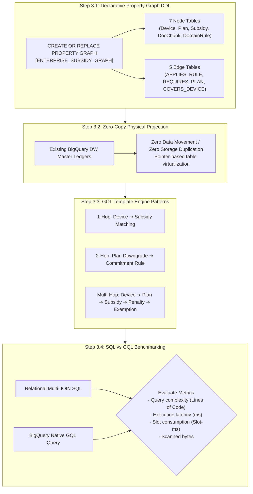

# Stage 3: BigQuery Property Graph Engineering & GQL Compilation Detailed Execution Guide
## Stage 3: Property Graph & GQL Compilation (English Edition)

- **Master Methodology**: [METHODOLOGY_EN.md](file:///Users/seanjung/Downloads/Uplus%20Ontology/agentic-ontology-starter/methodology/METHODOLOGY_EN.md)
- **Document Version**: `v1.0.0`
- **Objective**: Physically implement the hybrid ontology into Google Cloud BigQuery SQL:2023 Property Graph, achieve zero-copy node/edge projection, and engineer a multi-hop Graph Query Language (GQL) template engine.

---

## 1. Overall Execution Process

Stage 3 compiles declarative ontology models into production-grade BigQuery graph structures, enabling sub-second multi-hop graph traversals.

---

## 2. Detailed Methodology & Technology Standards

### 2.1 BigQuery SQL:2023 Property Graph Standard
- Utilizes native ISO SQL:2023 Property Graph extensions.
- Projects relational DW tables directly into graph nodes (`DeviceNode`, `PlanNode`, `SubsidyNode`) without moving bytes.
- Maps relationship tables as typed edges (`APPLIES_RULE`, `REQUIRES_PLAN`, `GROUNDED_IN`).

### 2.2 Multi-Hop GQL Traversal Patterns
- **1-Hop Matching**: Direct device-to-subsidy policy lookup.
- **2-Hop Policy Traversal**: Traversing from plan downgrade events to commitment rules and original source chunks.
- **Multi-Hop Synthesis**: Single-statement evaluation spanning device pricing, plan thresholds, penalty calculations, and statutory exemption clauses.

---

## 3. Stage 3 Quality Gate Checklist

- [ ] BigQuery Property Graph DDL compiled successfully with zero syntax errors.
- [ ] 7 node tables and 5 edge tables projected with zero physical data duplication.
- [ ] 1-hop, 2-hop, and multi-hop GQL queries successfully validated.
- [ ] SQL vs GQL performance and cost benchmarking report completed.
