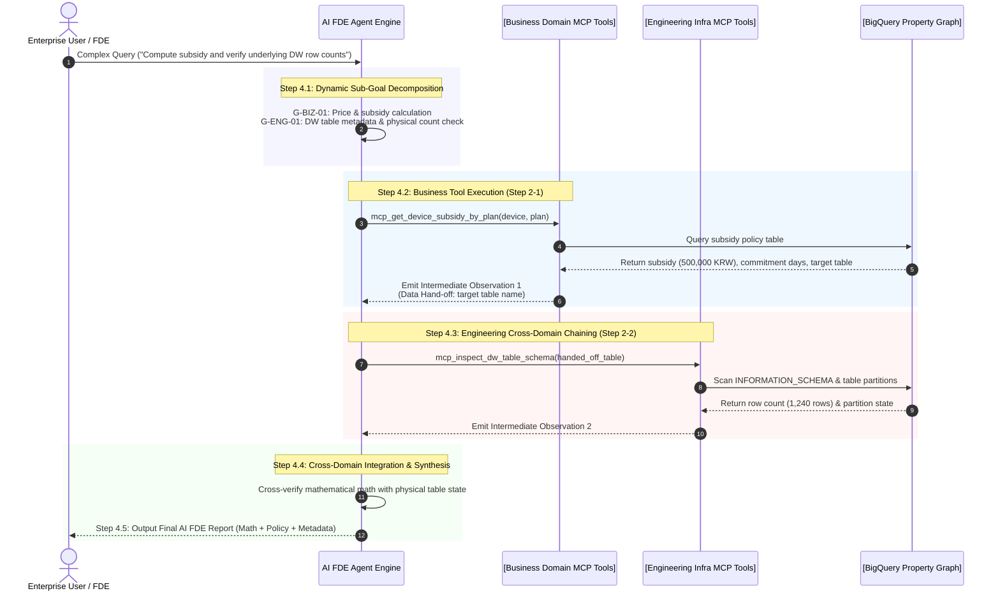

# Stage 4: Multi-Domain MCP Suite Packaging & Agentic Orchestration Detailed Execution Guide
## Stage 4: Multi-Domain MCP Suite & Agentic Orchestration (English Edition)

- **Master Methodology**: [METHODOLOGY_EN.md](file:///Users/seanjung/Downloads/Uplus%20Ontology/agentic-ontology-starter/methodology/METHODOLOGY_EN.md)
- **Document Version**: `v1.0.0`
- **Objective**: Package domain ontology and graph engines into standardized Model Context Protocol (MCP) tools, and orchestrate an autonomous AI Forward Deployed Engineer (FDE) agent capable of dynamic multi-goal decomposition and cross-domain sequential chaining.

---

## 1. Overall Execution Process

Stage 4 connects intelligent LLM reasoning with certified enterprise tools, enabling transparent multi-step decision pipelines.

---

## 2. Detailed Methodology & Technology Standards

### 2.1 MCP as the Domain Ontology Abstraction Layer
Rather than burdening LLMs with writing fragile raw SQL joins or raw GQL graph traversals, the Model Context Protocol (MCP) functions as the **Domain Ontology Abstraction Layer**:
- **Agent Shielding**: Encapsulates table schemas, partitioning keys, and multi-hop graph traversals behind intuitive business domain tool signatures.
- **Deterministic Reliability**: Blends deterministic relational ledger lookups, GQL traversals, and Python math calculations within tool boundaries, returning 0% hallucination facts.
- **Categorized Suite (11 Tools)**:
  - **5 Business Tools**: Device list price, subsidy policies, penalty formulas, 24-month contract comparisons, policy chunk grounding.
  - **6 Engineering/Infra Tools**: Property graph GQL traversal, DW table schema/volume inspection, Dataplex catalog search, 4-tier lineage tracing, graph DDL export, CQ benchmark runner.

### 2.2 Dynamic Sub-Goal Decomposition & Sequential Chaining
- Eliminates fragile hardcoded `if-elif` logic by parsing complex user intents into an array of sub-goals.
- Automatically passes outputs from upstream business queries into downstream infrastructure tools.
- Surfaces intermediate observations directly on the chat timeline, providing complete transparency and auditability.

---

## 3. Stage 4 Quality Gate Checklist

- [ ] All 11 MCP tool JSON schemas verified.
- [ ] Dynamic multi-goal decomposition verified on multi-part inquiries.
- [ ] Inter-tool context hand-off validated across domain boundaries.
- [ ] Guardrails verified for unmapped entities and restricted permissions.
