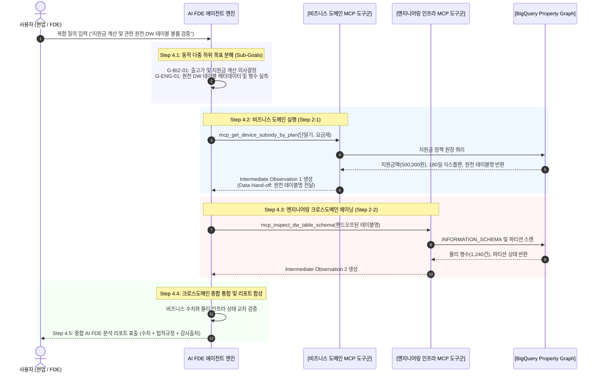

# Stage 4: 멀티도메인 MCP 스위트 구축 및 에이전트 오케스트레이션 세부 실행 명세서
## Stage 4: Multi-Domain MCP Suite Packaging & Agentic Orchestration Detailed Execution Guide (KO)

- **상위 방법론**: [METHODOLOGY_KO.md](./METHODOLOGY_KO.md)
- **문서 버전**: `v1.0.0`
- **목적**: 온톨로지 지식과 물리 그래프 탐색을 Model Context Protocol (MCP) 표준 도구로 패키징하고, 복합 질의를 하위 목표로 동적 분해하여 비즈니스-엔지니어링 크로스도메인 시퀀셜 체이닝을 실행하는 지능형 AI FDE 오케스트레이터 구축 표준 절차 명세

---

## 1. 전체 실행 프로세스 (Overall Execution Process)

Stage 4는 자연어 질의를 수신한 AI 에이전트가 단일 도구 호출의 한계를 극복하고, 여러 단계의 도메인 도구를 유기적으로 엮어 신뢰성 높은 의사결정을 도출하는 오케스트레이션 단계입니다.

### 1.1 GCP Native 기반 스펙 및 독자 개발 영역 (GCP Native vs Custom Extension)

| 구분 | 적용 기술 및 사양 | 공식 오픈소스 / 엔드포인트 레퍼런스 | 핵심 역할 및 기술적 의의 |
| :--- | :--- | :--- | :--- |
| **GCP Native 기반** | • Google Agent Development Kit (ADK Python 2.0) • Google Cloud Data Agent Kit (Conversational Analytics API) • Dataplex & BigQuery Remote MCP • Vertex AI Gemini 3.8 Flash | • [ADK Python GitHub](https://github.com/google/adk-python) • [Conversational Analytics API](https://docs.cloud.google.com/gemini/docs/conversational-analytics-api/overview) • [GCP Remote MCP 명세](https://docs.cloud.google.com/dataplex/docs/use-remote-mcp) | 에이전트 런타임(Workflow Runtime, Task API), 엔터프라이즈 IAM 인증 기반 Remote MCP 연결, 자연어 추론 파운데이션 모델 제공 |
| **독자 개발 커스텀 영역** | • Tier 3 Domain Ontology MCP Server (11종 도구) • AI FDE 동적 다중 하위 목표 분해 엔진 (`fdeAgentEngine.py`) • 크로스도메인 시퀀셜 체이닝 (`Data Hand-off`, `Intermediate Observation`) | 스타터팩 에이전트 엔진 (`src/agent/`) | 원천 스키마의 인지적 복잡성으로부터 LLM을 보호하고, 비즈니스 판정과 물리 인프라 실측치를 상호 교차 검증하는 자율 추론 파이프라인 구현 |

---

## 2. 세부 방법론 및 기술 아키텍처 (Detailed Methodology & Technologies)

### 2.1 도메인 온톨로지 추상화 레이어 (Domain Ontology Abstraction Layer)로서의 MCP
전통적인 Text-to-SQL이나 로우 그래프 쿼리 생성 방식은 테이블 스키마나 GQL 문법 변경 시 에이전트의 환각률이 급격히 치솟습니다. 본 방법론에서는 **Model Context Protocol(MCP)을 도메인 온톨로지 추상화 레이어로 정의**합니다:
- **에이전트 보호 (Agent Shielding)**: 에이전트는 복잡한 물리 테이블의 JOIN 구조, 파티션 필터, GQL 다중 홉 순회 문법을 직접 알 필요 없이, 도메인 비즈니스 개념 수준의 함수 시그니처만 호출합니다.
- **결정론적 신뢰성**: 도구 내부에서 정형 DW 원장 쿼리, GQL 탐색, 비즈니스 규칙 엔진이 결합되어 원천에서 조회·계산된 결정론적 데이터만을 에이전트에 반환합니다.
- **도구 분류 체계**: 모델의 도구 호출 권한과 책임을 **비즈니스 도메인 도구(5종)**와 **엔지니어링 인프라 도구(6종)**로 명확히 격리·설계합니다:

| 카테고리 | MCP 도구명 | 핵심 역할 및 추상화된 기능 명세 |
| :--- | :--- | :--- |
| **비즈니스 (5종)** | `mcp_get_device_factory_price` | [단말기 카탈로그 마스터 BQ 테이블]에서 용량별 공식 출고가 인출 |
| | `mcp_get_device_subsidy_by_plan` | [지원금 정책 마스터 BQ 테이블]에서 공시/유통망 지원금 및 180일 약정 인출 |
| | `mcp_calculate_plan_change_penalty` | [비즈니스 규칙 레지스트리] 기반 요금제 하향 시 일할 차액정산금 산정 |
| | `mcp_compare_contract_plans` | 24개월 기준 공시지원금 vs 선택약정할인 총비용 정량 비교 |
| | `mcp_get_policy_anchor_grounding` | [고객 상담가이드 비정형 매뉴얼] 내 불변 해시 앵커 원문 증거 인출 |
| **엔지니어링 (6종)** | `mcp_explore_property_graph` | [BigQuery Property Graph] GQL 횡단 탐색 쿼리 실행 |
| | `mcp_inspect_dw_table_schema` | 물리 DW 테이블의 컬럼 타입, 파티션 필터, 실제 물리 행수 스캔 |
| | `mcp_search_dataplex_catalog` | Dataplex Knowledge Catalog 거버넌스 태그 및 PII 보호 등급 검색 |
| | `mcp_get_lineage_trace` | 원천 문서부터 에이전트까지 4-Tier 데이터 리니지 역추적 |
| | `mcp_export_graph_ddl` | 프로퍼티 그래프 DDL 및 노드/엣지 스키마 명세서 추출 |
| | `mcp_run_cq_benchmark` | 20대 Golden CQ 자동화 벤치마크 실행 및 지연시간/일치율 측정 |

### 2.2 동적 다중 목표 분해 (`Sub-Goals`) 엔진
- **정적 분기문의 한계 극복**: 단순 키워드 매칭 `if-else` 분기문은 복합 질문("갤럭시 지원금과 원천 DW 테이블 행수 같이 확인해줘") 처리 시 한쪽 도구만 호출하고 멈추는 결함이 발생합니다.
- **의미적 다중 분해**: LLM 추론기가 사용자 입력을 분석하여 독립된 하위 목표 리스트(`G-BIZ-01`, `G-ENG-01` 등)를 생성하고, 각각에 최적화된 MCP 도구를 병렬 또는 순차로 매핑합니다.

### 2.3 크로스도메인 시퀀셜 체이닝 (`SEQUENTIAL_CHAIN`) 및 컨텍스트 전달
- **Data Hand-off 프로토콜**: 선행 비즈니스 도구에서 도출된 메타데이터(예: 정책 적용 테이블명, 개통일 기준 유예일수)를 메모리에 유지하고, 후속 엔지니어링 도구의 입력 인자로 자동 주입합니다.
- **중간 관측 (Intermediate Observation)**: 각 단계별 도구 실행 결과를 사용자 채팅 타임라인에 중간 과정으로 투명하게 표출하여, 블랙박스 문제를 완전히 해소합니다.

### 2.4 모호 및 권한 제한 질의 가드레일 (Safety Guardrails)
1. **미지원 자산 (`ENTITY_NOT_FOUND` / `INVALID_INPUT_BOUNDARY`)**: 온톨로지 카탈로그에 없는 단말이나 요금제 문의 시, 무음 기본값 대체(Silent Default Fallback)를 금지하고 허용된 표준 어휘 목록과 함께 명시적 구조화 오류를 반환.
2. **도메인 외 거절 (`UNSUPPORTED_MODALITY_ABSTENTION`)**: 개통·장바구니·결제 실행 등 조회/검증 범위를 벗어난 요청은 명시적으로 거절.
3. **보안 가드레일 (`SECURITY_GUARDRAIL_BLOCKED`)**: `DROP`/`DELETE`/`TRUNCATE`/`ALTER` 등 파괴적 GQL·DDL 인젝션 또는 스토리지 삭제 요청은 실행 전 차단.

### 2.5 3대 MCP 계층(16종) 24대 경계값 검증 및 2단계 반복 고도화 프로토콜 (`scripts/evaluate_mcp_quality_suite.py`)
- **검증 대상**: 비즈니스 MCP 5종(10 시나리오), BQ+KC 엔지니어링 MCP 6종(7 시나리오), 방법론 Stage MCP 5종(5 시나리오), AI FDE 라우터(2 시나리오) = 총 **24개 경계값 시나리오**.
- **2단계 반복 고도화 (Round 1 ➔ Round 2)**:
  - **Round 1 (Baseline)**: 초기 핸들러의 무음 기본값 대체 및 무조건적 `SUCCESS` 반환 결함을 적발 (**5 / 24 통과, 20.8%**).
  - **Round 2 (Refined)**: 각 도구 핸들러에 입력 계약 검증·실제 레지스트리 대조·읽기 전용 GQL 정규식·Stage 품질 게이트 임계치 검사를 반영하여 재검증 (**24 / 24 통과, 100.0%, +79.2%p**).

---

## 3. Stage 4 품질 게이트 (Gate 4 Exit Checklist)

- [x] 16종 3대 계층 도메인 MCP 도구(비즈니스 5 · BQ+KC 6 · Stage 5)의 JSON Schema 인터페이스 검증이 완료되었는가?
- [x] 복합 질의에 대한 다중 하위 목표 분해(`Sub-Goals`) 및 5-Stage 순차 체이닝이 정상 작동하는가?
- [x] 선행 도구 출력 ➔ 후속 도구 입력으로 이어지는 컨텍스트 전달(Data Hand-off)이 실측 검증되었는가?
- [x] 24대 경계값·계약·예외·인젝션 차단 검증 스위트(`evaluate_mcp_quality_suite.py`)에서 24/24(100.0%) 통과를 달성했는가?

