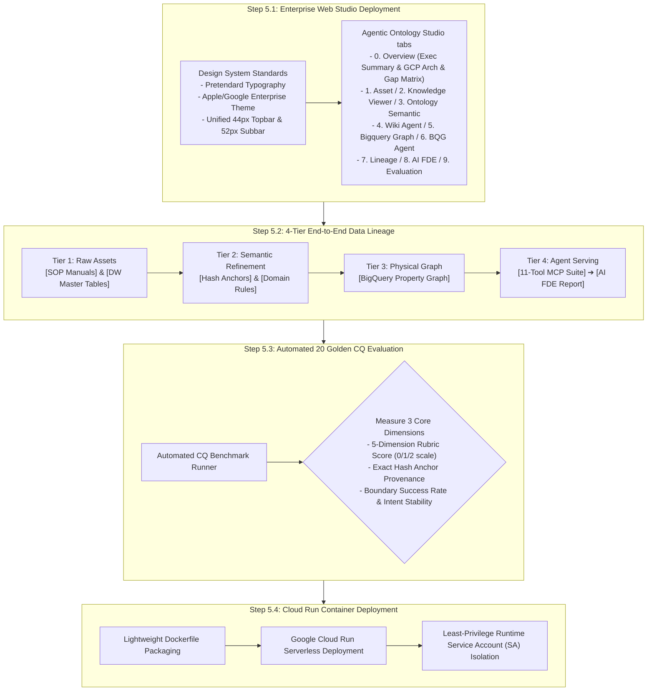

# Stage 5: Enterprise Studio Integration, Automated Evaluation & Production Deployment Detailed Execution Guide
## Stage 5: Studio, Evaluation & Production Deployment (English Edition)

- **Master Methodology**: [METHODOLOGY_EN.md](./METHODOLOGY_EN.md)
- **Document Version**: `v1.1.0`
- **Objective**: Deploy the **`Agentic Ontology Studio` (`0. Overview` plus `1. Asset` ~ `9. Evaluation`)** compliant with `05_DESIGN.md`, visualize 4-tier end-to-end data lineage (`7. Lineage`), execute rubric-scored evaluation across 20 Golden CQs plus boundary-question regression (`9. Evaluation`), and achieve containerized production deployment on Google Cloud Run.

---

## 1. Overall Execution Process

Stage 5 delivers the 8-step production studio interface (plus the `0. Overview` tab), comprehensive auditing views, and containerized deployment infrastructure.

### 1.1 GCP Native Foundations & Custom Extensions

| Dimension | Technologies & Specifications | Official Documentation / Spec Reference | Key Role & Engineering Rationale |
| :--- | :--- | :--- | :--- |
| **GCP Native Foundation** | • Google Cloud Run (Serverless Container) • Google Cloud Logging & Monitoring • Google ADK Web UI (Angular) | • [Cloud Run Documentation](https://cloud.google.com/run) • [ADK Web GitHub](https://github.com/google/adk-web) | Global HTTPS traffic serving, zero-maintenance auto-scaling, least-privilege IAM service account isolation, and standard ADK conversational interface compatibility. |
| **Custom Extensions** | • 4-View Enterprise Starter Studio (`src/web/studio_server.py`) • 2D Interactive SVG Topology Map • 20 Golden CQ Evaluation Harness (`pipeline/validator.py`) • 4-Tier Data Lineage Visualizer | Starter Pack Web Studio (`src/web/`) | Lightweight zero-dependency server running on a single port (8088) providing integrated verification of assets, DDL, reasoning chains, and CQ performance. |

---

## 2. Detailed Methodology & Technology Standards

### 2.1 Enterprise UI/UX Design System Standards
- Full adherence to `05_DESIGN.md`: Dark theme, Pretendard typography, Apple/Google Enterprise color tokens.
- Complete exclusion of decorative cartoon emojis; adoption of enterprise SVG emblems and informative text tags (`[DOC]`, `[DW]`, `[MCP]`).

### 2.2 4-Tier End-to-End Data Lineage
- Complete provenance tracing from raw assets (Tier 1) through semantic rules (Tier 2), physical BigQuery graph structures (Tier 3), to agent MCP executions (Tier 4).

### 2.3 Golden CQ Rubric Evaluation & Boundary-Question Regression
- Automatic verification of 20 Golden CQs using exact numerical comparisons and ground-truth hash anchor matching.

---

## 3. Stage 5 Quality Gate Checklist

- [ ] All 5 web studios verified compliant with `05_DESIGN.md`.
- [ ] 4-tier data lineage fully traceable across all entity relationships.
- [ ] 20 Golden CQs reach a rubric average of 95 or above, with source citations attached to every answer.
- [ ] Boundary-question success rate and failure-cause taxonomy are published as measured values on the `9. Evaluation` tab.
- [ ] Cloud Run container successfully serving production traffic under a least-privilege runtime SA.
