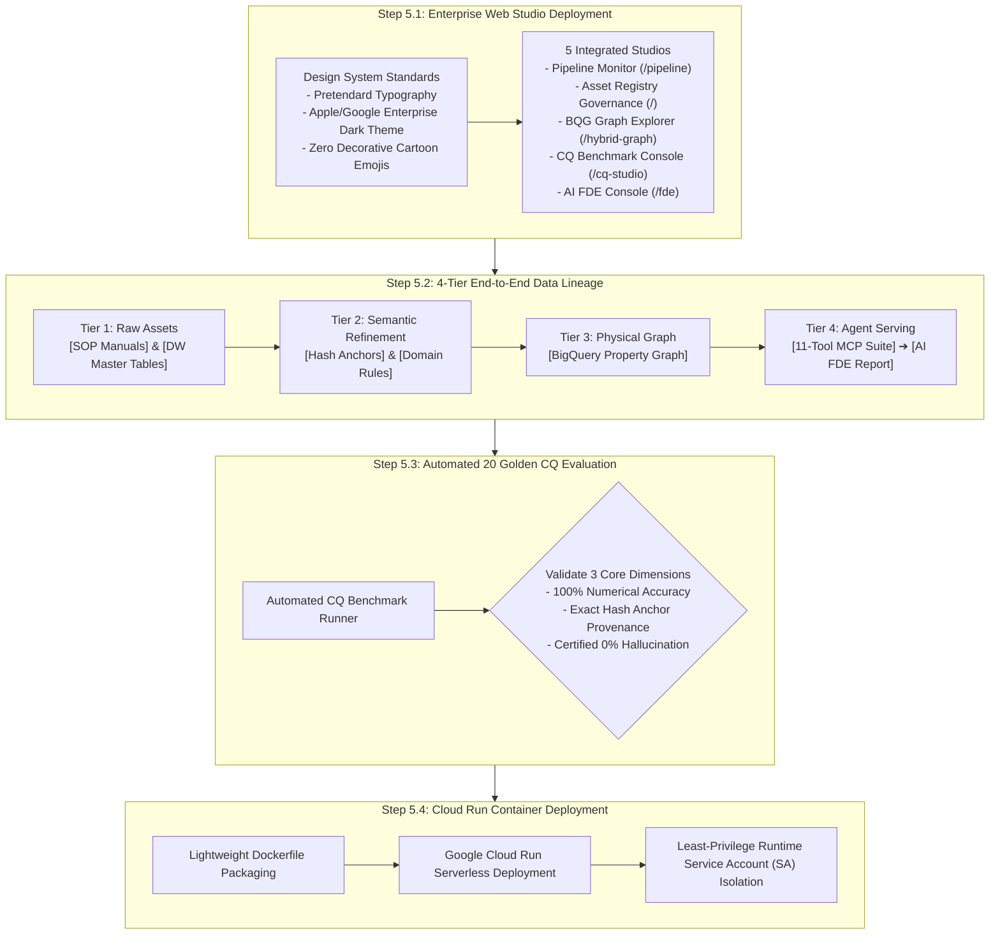

# Stage 5: Enterprise Studio Integration, Automated Evaluation & Production Deployment Detailed Execution Guide
## Stage 5: Studio, Evaluation & Production Deployment (English Edition)

- **Master Methodology**: [METHODOLOGY_EN.md](file:///Users/seanjung/Downloads/Uplus%20Ontology/agentic-ontology-starter/methodology/METHODOLOGY_EN.md)
- **Document Version**: `v1.0.0`
- **Objective**: Deploy 5 integrated enterprise web studios fully compliant with `05_DESIGN.md`, visualize 4-tier end-to-end data lineage, execute automated regression evaluation across 20 Golden CQs to certify zero hallucination, and achieve containerized production deployment on Google Cloud Run.

---

## 1. Overall Execution Process

Stage 5 delivers the production interface, comprehensive auditing views, and containerized deployment infrastructure.

---

## 2. Detailed Methodology & Technology Standards

### 2.1 Enterprise UI/UX Design System Standards
- Full adherence to `05_DESIGN.md`: Dark theme, Pretendard typography, Apple/Google Enterprise color tokens.
- Complete exclusion of decorative cartoon emojis; adoption of enterprise SVG emblems and informative text tags (`[DOC]`, `[DW]`, `[MCP]`).

### 2.2 4-Tier End-to-End Data Lineage
- Complete provenance tracing from raw assets (Tier 1) through semantic rules (Tier 2), physical BigQuery graph structures (Tier 3), to agent MCP executions (Tier 4).

### 2.3 Automated Zero-Hallucination Evaluation
- Automatic verification of 20 Golden CQs using exact numerical comparisons and ground-truth hash anchor matching.

---

## 3. Stage 5 Quality Gate Checklist

- [ ] All 5 web studios verified compliant with `05_DESIGN.md`.
- [ ] 4-tier data lineage fully traceable across all entity relationships.
- [ ] 20 Golden CQs achieve 100% numerical match and 0% hallucination.
- [ ] Cloud Run container successfully serving 100% of production traffic under least-privilege runtime SA.
