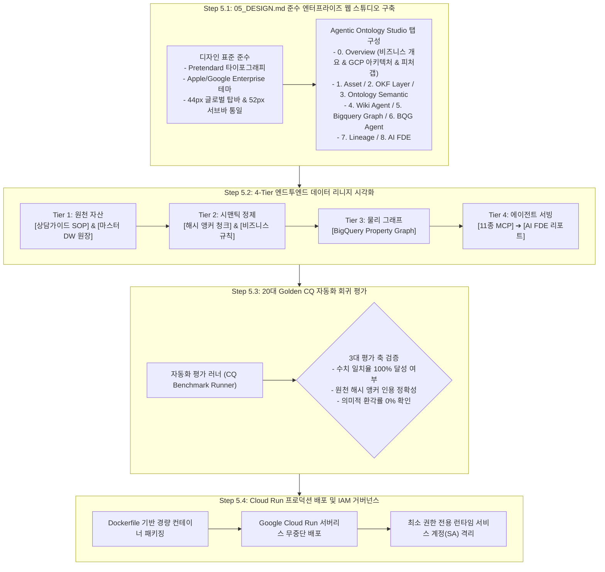

# Stage 5: 엔터프라이즈 스튜디오 구축, 자동화 검증 및 프로덕션 배포 세부 실행 명세서
## Stage 5: Enterprise Studio Integration, Automated Evaluation & Production Deployment Detailed Execution Guide (KO)

- **상위 방법론**: [METHODOLOGY_KO.md](./METHODOLOGY_KO.md)
- **문서 버전**: `v1.1.0`
- **목적**: `05_DESIGN.md` 표준을 준수하는 **`Agentic Ontology Studio - LG Uplus` 통합 웹 스튜디오(`0. Overview` 및 `1. Asset` ~ `8. AI FDE`)**를 구축하고, 4-Tier 데이터 리니지(`7. Lineage`)를 시각화하며, 20대 Golden CQ 기반 자동화 0% 환각 평가 및 Google Cloud Run 컨테이너 무중단 배포를 완결하는 표준 절차 명세

---

## 1. 전체 실행 프로세스 (Overall Execution Process)

Stage 5는 구축된 지식 온톨로지, 물리 그래프 및 에이전트를 실사용자가 직관적으로 검증하고 운영할 수 있도록 8단계 통합 웹 스튜디오(`0. Overview` 포함 9개 탭)를 제공하고, 프로덕션 환경으로 안전하게 릴리스하는 최종 인도 단계입니다.

### 1.1 GCP Native 기반 스펙 및 독자 개발 영역 (GCP Native vs Custom Extension)

| 구분 | 적용 기술 및 사양 | 공식 오픈소스 / 문서 레퍼런스 | 핵심 역할 및 기술적 의의 |
| :--- | :--- | :--- | :--- |
| **GCP Native 기반** | • Google Cloud Run (Serverless Container) • Google Cloud Logging & Monitoring • Google ADK Web UI (Angular) | • [Cloud Run Documentation](https://cloud.google.com/run) • [ADK Web GitHub](https://github.com/google/adk-web) | 글로벌 HTTPS 트래픽 서빙, 무중단 자동 스케일링, 엔터프라이즈 IAM 런타임 서비스 계정 격리, 표준 ADK 대화형 인터페이스 호환 |
| **독자 개발 커스텀 영역** | • 4대 멀티뷰 엔터프라이즈 스타터 스튜디오 (`src/web/studio_server.py`) • 2D SVG 인터랙티브 토폴로지 맵 • 20대 Golden CQ 결정론적 평가 하네스 (`pipeline/validator.py`) • 4-Tier 데이터 리니지 시각화 | 스타터팩 웹 스튜디오 (`src/web/`) | 외부 종속성 0개의 경량 단일 포트(8088)에서 온톨로지 에셋, 물리 그래프 DDL, AI FDE 추론 타임라인, CQ 벤치마크를 통합 검증 |

---

## 2. 세부 방법론 및 기술 아키텍처 (Detailed Methodology & Technologies)

### 2.1 엔터프라이즈 UI/UX 디자인 시스템 표준 (`05_DESIGN.md`)
1. **타이포그래피 및 테마 토큰**:
   - 폰트: 시스템 기본 Pretendard 적용.
   - 배경/전경 컬러: Enterprise Dark Theme (`--apple-bg: #000000`, `--apple-card: #1c1c1e`, `--apple-text-primary: #f5f5f7`).
2. **장식용 만화 이모지 전면 배제 (Zero Decorative Emojis)**:
   - 만화형 아이콘을 지양하고, Enterprise SVG 벡터 엠블럼 또는 구조적 대괄호 정보성 텍스트 태그(`[DOC]`, `[DW]`, `[MCP]`, `[AGENT]`)를 적용.
3. **글로벌 탑바 및 서브바 표준**:
   - 44px 글로벌 헤더 및 52px 서브 컨트롤 바 레이아웃 통일.
   - 한/영 로컬라이제이션 토글 스위치 제공.

### 2.2 4-Tier 엔드투엔드 데이터 리니지 (End-to-End Lineage)
온톨로지 플랫폼은 원천 데이터로부터 최종 AI 답변에 이르기까지 데이터의 이동과 변환 과정을 4단계 계층으로 완벽히 추적합니다:
- **Tier 1 [원천 자산 (Raw Assets)]**: [고객 상담가이드 매뉴얼 (MHTML/PDF)] 및 [BigQuery DW 7대 마스터 테이블].
- **Tier 2 [시맨틱 정제 (Semantic Refinement)]**: 불변 해시가 부여된 23개 `DocChunk` 및 180일 식스플랜 등 `DomainRule`.
- **Tier 3 [물리 그래프 (Physical Graph)]**: BigQuery SQL:2023 `LGUPLUS_SUBSIDY_GRAPH` 노드 테이블 7종과 엣지 테이블 5종.
- **Tier 4 [에이전트 서빙 (Agent Serving)]**: 11종 멀티도메인 MCP 도구와 AI FDE의 동적 추론 타임라인.

### 2.3 20대 Golden CQ 기반 자동화 0% 환각 검증
1. **LLM-as-a-Judge 다면 평가**:
   - Gemini 3.8 Flash를 평가 모델로 투입하여 20대 Golden CQ를 전수 실행.
   - 정답 수치(출고가, 지원금, 위약금)의 정확 일치(Exact Match)를 수학적으로 판정.
2. **환각 검출 알고리즘**:
   - 인출된 답변에 원천 `DocChunk`의 해시 앵커가 누락되었거나, 정형 DW에 없는 가상 수치가 포함되었을 경우 즉각 실패(Fail) 플래그 부여.

### 2.4 Google Cloud Run 프로덕션 컨테이너 배포 원칙 (Rule 15)
- **호스팅 프로젝트 (Hosting Project)**: `seanjung-poc`, 리전 `asia-northeast3`.
- **런타임 서비스 계정 (Runtime SA)**: `924723860007-compute@developer.gserviceaccount.com` (BigQuery Data Viewer 및 Vertex AI User 최소 권한만 부여).
- **데이터 소스 프로젝트 (Data Source Project)**: `lguplus-ontology` (데이터 레벨 IAM 격리).

---

## 3. Stage 5 품질 게이트 (Gate 5 Exit Checklist)

- [ ] 웹 스튜디오가 `05_DESIGN.md` 디자인 표준을 100% 준수하며 장식용 이모지가 배제되었는가?
- [ ] 4-Tier 데이터 리니지가 끊김 없이 역추적 가능한가?
- [ ] 20대 Golden CQ 자동화 평가에서 수치 일치율 100% 및 0% 환각이 검증되었는가?
- [ ] Cloud Run 컨테이너가 최소 권한 서비스 계정(SA) 환경에서 정상 배포되어 트래픽 100%를 서빙하는가?
