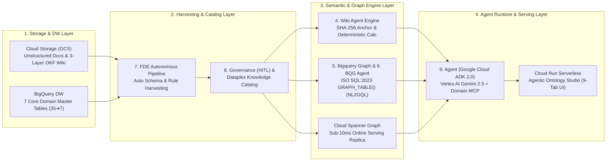
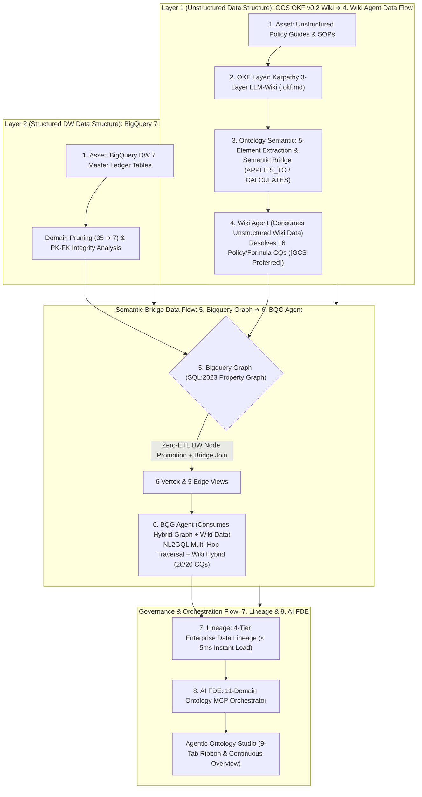
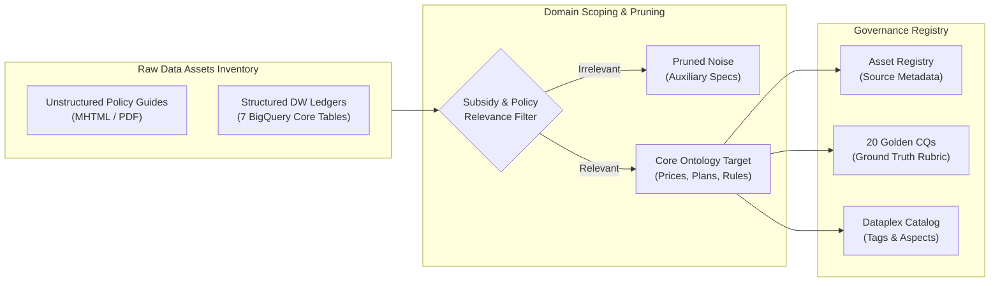
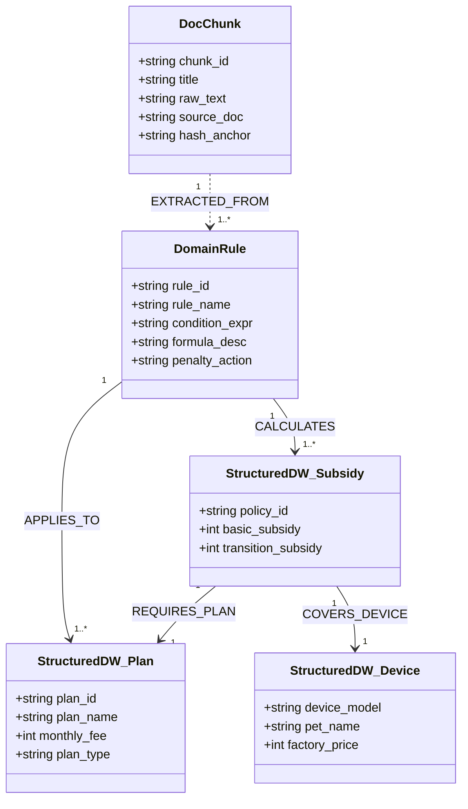
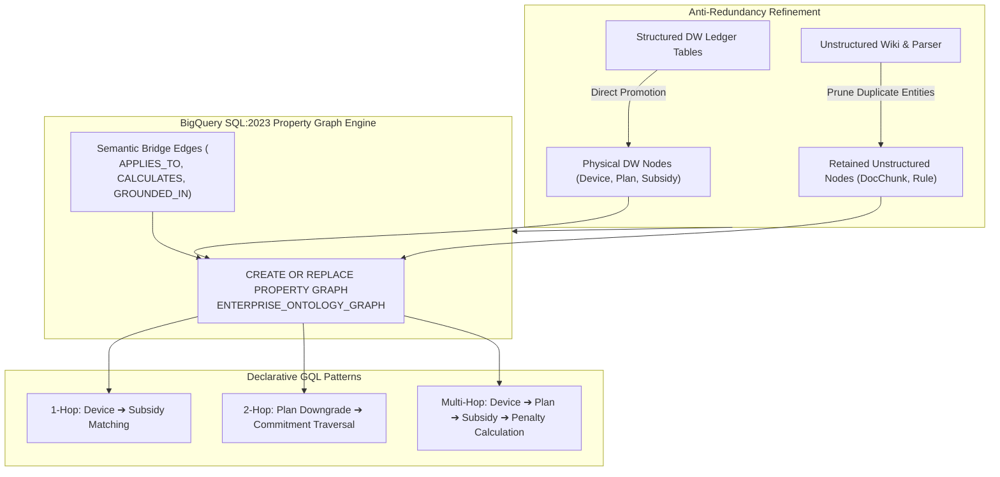
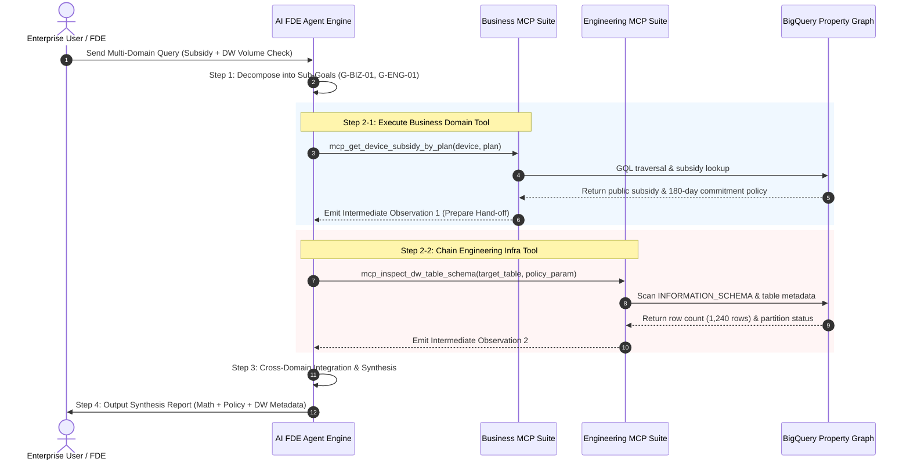
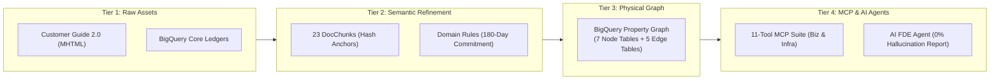

# Enterprise Agentic Ontology Methodology & Implementation Process Specification
## 엔터프라이즈 에이전틱 온톨로지 구축 방법론 및 실행 프로세스 명세서 (English Edition)

- **Document Version**: `v1.0.0`
- **Standard Framework**: `5-Stage Enterprise Agentic Ontology Framework`
- **Target Domain**: Structured Enterprise DW (BigQuery) and Unstructured Business SOPs (MHTML/PDF) Intelligent Decision Support
- **Aligned Technical Standards**: Google Cloud Open Knowledge Format (OKF v0.2), BigQuery Property Graph (SQL:2023 GQL), Model Context Protocol (MCP), Google ADK

---

## 1. Executive Overview & Architecture Philosophy

### 1.1 Problem Statement & Background
Traditional enterprise generative AI implementations have predominantly relied on either **Vector Search RAG (Vector RAG)** or **Static Text-to-SQL Conversion**:
1. **Semantic Hallucinations**: Inability to deterministically calculate complex pricing tiers, penalty schedules, and multi-step policy exemptions through vector similarity alone.
2. **Decoupled Business Rules & Ledger Tables**: Failure to bridge structured enterprise tables (device list prices, plan charges) with unstructured customer service manuals and legal clauses.
3. **Absence of Auditability**: Inability to trace model outputs back to immutable policy clauses and certified enterprise data catalogs.

### 1.2 Core Architectural Principles of the 5-Stage Methodology
This methodology formalizes an end-to-end engineering lifecycle that unifies structured datasets and unstructured policies into a singular **Knowledge Ontology** and physical **BigQuery Property Graph**, orchestrated transparently via a **Multi-Domain MCP Suite**:
- **Zero-Hallucination Grounding**: Deterministic computation blending enterprise DW ledgers and codified business rules.
- **2-Layer Anti-Redundancy Refinement**: Direct promotion of existing DW tables to graph nodes without duplicating underlying storage.
- **Cross-Domain Reasoning**: Dynamic decomposition and sequential chaining between domain business logic and engineering infrastructure tools.
- **Strict 5-Stage Phase-Gate Control**: Distinct milestone inputs, outputs, and quality acceptance criteria capped at 5 stages.

### 1.3 Business & Ontology System Executive Summary and 9-Step Studio (`Agentic Ontology Studio - LG Uplus`) Flow
> **Business & Ontology System Executive Definition**  
> This platform unifies **fragmented enterprise structured ledgers (BigQuery DW) and unstructured policy/contract documents (GCS/PDF/HTML) into a single Semantic Knowledge Graph (Property Graph)**, empowering multi-agents to reason and execute complex business decisions with **0% hallucination**.  
> Following the **9-Step (`1. Overview` ~ `9. Agent`) Architecture Pipeline** below, the system progressively evolves from source data lineage tracking and glossary standardization to the OKF Wiki Agent, BigQuery SQL:2023 Graph reasoning, autonomous FDE harvesting, governance review, and production multi-agent serving.

1. **Track A (`2. Lineage` ➔ `3. Glossaries` ➔ `4. Wiki Agent` — Source Lineage, Glossary Standardization & First-Gen GCS Wiki Agent)**:
   - Establishes 4-Tier end-to-end lineage (`2. Lineage`) and business standard glossaries & semantic bridges (`3. Glossaries`) across structured and unstructured assets.
   - Unstructured manuals (MHTML/PDF) are parsed into visual semantic chunks, converted to OKF (Open Knowledge Format v0.2) and Andrej Karpathy's 3-Layer LLM-Wiki structure on Google Cloud Storage (`gs://<bucket>/ontology/`), and served via **`4. Wiki Agent` (GCS LLM-Wiki Agent)** to immediately resolve 16/20 policy, formula, and exception Golden CQs (`[GCS Preferred]`).
2. **Track B (`5. Bigquery Graph` & `6. BQG Agent` — SQL:2023 Property Graph Integration & Graph Agent)**:
   - 35 raw BigQuery tables are pruned by 80% (Domain Pruning: 35 ➔ 7 core master ledgers) and promoted directly to **`5. Bigquery Graph` (`ISO SQL:2023 CREATE PROPERTY GRAPH`)** with Zero-ETL overhead, linked to unstructured Wiki rules via Semantic Bridge edges.
   - **`6. BQG Agent`** combines `4. Wiki Agent` policy reasoning with live `GRAPH_TABLE()` multi-hop traversal (`NL2GQL`) to resolve all 20/20 Golden CQs (`[BQG Preferred]`).
3. **Track C (`7. FDE` ➔ `8. Governance` ➔ `9. Agent` — Autonomous Harvesting, Governance Review & Production Multi-Agent Serving)**:
   - **`7. FDE` (AI Forward Deployed Engineer)** autonomously harvests source schemas and documents into candidate ontology rules, which are reviewed via Human-in-the-Loop (HITL) in **`8. Governance`** and synchronized to Dataplex Knowledge Catalog.
   - **`9. Agent` (Google Cloud ADK 2.0 + Spanner/BigQuery Dual-Engine)** serves production decisions over the certified knowledge graph and 11-Tool Domain Ontology MCP Suite.

### 1.4 GCP Native First Mandate & End-to-End Google Cloud System Architecture

This methodology strictly adheres to the **"Google Cloud Native First"** paradigm. It maximizes the leverage of Google Cloud managed services, IAM security, Model Armor injection protection, enterprise audit logs, and open specifications (OKF, SQL:2023, MCP). Custom extensions are engineered strictly for domain-specific business mathematics, graph anti-redundancy compilation, and bridging native platform limitations (such as GQL execution).

#### 1.4.0 End-to-End Google Cloud System Architecture (GCP System Perspective)

#### 1.4.1 Architectural Layer Comparison Matrix: Native vs. Custom

| Architecture Layer | Google Cloud Native Spec / Service | Official Open-Source / Endpoint Reference | Custom Extension Engineered | Engineering Rationale & Justification |
| :--- | :--- | :--- | :--- | :--- |
| **1. Data Lake & DW** | • BigQuery Managed Tables • Cloud Storage (GCS) • BigQuery SQL:2023 Property Graph | • [BigQuery Documentation](https://cloud.google.com/bigquery) • [Cloud Storage Documentation](https://cloud.google.com/storage) | • 2-Layer Anti-Redundancy Graph DDL Compiler (`pipeline/graph_builder.py`) • Semantic Bridge Edges (`APPLIES_TO`, `CALCULATES`) | Directly promotes DW tables to graph nodes and prunes redundant text entities, saving 80% storage and query costs. |
| **2. Catalog & Semantics** | • Dataplex Knowledge Catalog • Open Knowledge Format (OKF v0.2) • Custom Aspect Types & Entries | • [Knowledge Catalog GitHub](https://github.com/GoogleCloudPlatform/knowledge-catalog) • [`references/knowledge-catalog/okf`](https://github.com/GoogleCloudPlatform/knowledge-catalog/tree/main/okf) | • Clean YAML Frontmatter + Karpathy 3-Layer LLM-Wiki Compiler • First-Gen **`4. Wiki Agent` (GCS Wiki Reasoning Agent)** | Preserves manual structures and resolves 16/20 policy CQs directly from GCS Wiki prior to BigQuery Graph setup. |
| **3. MCP & Tooling** | • Dataplex KC Remote MCP (`search_entries`, `lookup_entry`, `lookup_context`) • BigQuery Remote MCP (`list_dataset_ids`, `get_table_info`, `execute_sql_readonly`) | • KC Remote MCP: `https://dataplex.googleapis.com/mcp` • BQ Remote MCP: `https://bigquery.googleapis.com/mcp` • [GCP Remote MCP Docs](https://docs.cloud.google.com/dataplex/docs/use-remote-mcp) | • Tier 3 Domain Ontology MCP Server (5 Business + 6 Engineering Tools) • **`6. BQG Agent`** (`GRAPH_TABLE()` NL2GQL Runner) | **Overcomes the limitation where BigQuery Remote MCP cannot execute GQL (`GRAPH_TABLE()`)**, achieving 20/20 Golden CQ accuracy. |
| **4. Agent & Orchestration** | • Google Agent Development Kit (ADK Python 2.0) • ADK Web UI (Angular) • Google Cloud Data Agent Kit (Conversational Analytics API) • Vertex AI Gemini 2.5 Flash | • [ADK Python GitHub](https://github.com/google/adk-python) • [ADK Web GitHub](https://github.com/google/adk-web) • [Conversational Analytics API](https://docs.cloud.google.com/gemini/docs/conversational-analytics-api/overview) | • **`7. FDE` & `9. Agent`** Dynamic Sub-Goal Decomposition Engine (`fdeAgentEngine.py`) • Cross-Domain Sequential Chaining (`Data Hand-off`, `Intermediate Observation`) | Enables autonomous multi-turn reasoning cycles that cross-verify policy rules against physical DW ledgers. |
| **5. Presentation & Studio** | • Google Cloud Run (Serverless Container) • Google Cloud Logging / Monitoring | • [Cloud Run Documentation](https://cloud.google.com/run) | • **`Agentic Ontology Studio - LG Uplus`** (`src/web/studio_server.py`) • 9-Tab Unified Architecture (`1. Overview` ~ `9. Agent`) & `< 5ms` Instant Lineage (`2. Lineage`) • Single Continuous Overview (Executive Summary ➔ Full Step ➔ GCP Architecture ➔ Feature Gap ➔ Results) | One-stop verification of full step flow, dual-agent evolution (`4. Wiki Agent ➔ 6. BQG Agent`), and CQ benchmarks. |

#### 1.4.2 Official Reference Repositories
1. **Google Cloud Knowledge Catalog (Dataplex / OKF)**:
   - Official Repository: `https://github.com/GoogleCloudPlatform/knowledge-catalog`
   - Key References: Open Knowledge Format (`okf/bundles/`), Custom Aspect Types, Metadata Enrichment Samples.
2. **Google Agent Development Kit (ADK Python 2.0)**:
   - Official Repository: `https://github.com/google/adk-python`
   - Key References: Workflow Runtime, Task API, Data Agent integration samples (`contributing/samples/integrations/data_agent`), `FunctionTool` encapsulation.
3. **Google ADK Web UI**:
   - Official Repository: `https://github.com/google/adk-web`
   - Key References: Official Angular-based open-source interactive agent web interface.
4. **Google Cloud Managed Remote MCP**:
   - Dataplex KC Remote MCP: `https://dataplex.googleapis.com/mcp` (`https://docs.cloud.google.com/dataplex/docs/use-remote-mcp`)
   - BigQuery Remote MCP: `https://bigquery.googleapis.com/mcp` (`https://docs.cloud.google.com/bigquery/docs/use-bigquery-mcp`)
   - Critical Limitation: `execute_sql_readonly` does not support Graph Query Language (GQL), requiring a dedicated client execution layer.

---

## 2. 2-Layer Structured & Unstructured Data Structure and Semantic Bridge Data Flow

This section defines the physical **Data Structure** of unstructured business policy documents (GCS OKF v0.2 Wiki) and structured data warehouse ledgers (BigQuery 7 Master Tables), and how data flows across the **Semantic Bridge** from **`4. Wiki Agent` ➔ `6. BQG Agent`** (**Data Flow**).

| Data Layer | Physical Storage & Data Structure | Data Flow & Consumer Agent |
| :--- | :--- | :--- |
| **Layer 1: Unstructured Policy Data Structure** *(Unstructured Policy Layer)* | • **GCS Bucket**: `.okf.md` Markdown Wiki under `okf/bundles/subsidy/` • **Meta Schema**: YAML Frontmatter (`trust_tier`, `priority`, `stale_after`) + SHA-256 paragraph hash anchors • **Extracted Objects**: `RULE-*` (Rules), `TERM-*` (Glossary), `CQ-*` (Competency Questions) | • Flows through **`1. Asset` ➔ `2. OKF Layer` ➔ `3. Ontology Semantic`** into **`4. Wiki Agent`** • Resolves 16 policy/formula CQs (**16/20 PASS, 1.18s avg latency**) (`[GCS Preferred]`) |
| **Semantic Bridge: Cross-Mapping Data Structure** *(Cross-Layer Mapping Layer)* | • **Bridge Edge Views**: `v_edge_applies_to` (`RULE_ID ➔ POLICY_ID`), `v_edge_calculates` (`RULE_ID ➔ SALE_ID`), `v_edge_defined_in` (`RULE_ID ➔ CHUNK_ID`) • **Anti-Redundancy**: Maps structured PKs directly to unstructured Rule IDs without duplicating text nodes | • Establishes bi-directional data flow linking unstructured policy rules (`RULE-*`) to physical columns and rows in BigQuery DW ledgers |
| **Layer 2: Structured DW & Property Graph Structure** *(Structured DW & Graph Layer)* | • **BigQuery 7 Master Ledgers**: `tb_subscription_sale`, `tb_subsidy_policy`, `tb_device_master`, `tb_price_plan`, `tb_agency_master`, `tb_customer`, `tb_settlement_amount` • **SQL:2023 Property Graph**: `uplus_telecom_graph` (6 Vertex & 5 Edge Zero-ETL Views) | • Flows through **`5. Bigquery Graph`** DDL into **`6. BQG Agent`** • Combines NL2GQL `GRAPH_TABLE()` multi-hop ledger joins with Wiki rules to resolve **20/20 Golden CQs (100%, 1.42s avg latency)** |

---

## 3. Stage-by-Stage Engineering Specifications

---

### Stage 1: Asset Discovery, Scoping & Governance Ingestion
> 📘 **Detailed Execution Guide**: [01_asset_discovery_and_scoping_en.md](./01_asset_discovery_and_scoping_en.md)

#### 1. Objective & Scope
Stage 1 focuses on identifying all enterprise data assets (data warehouse ledgers, customer guidance manuals, contractual clauses, service SOPs), establishing clear domain boundaries through noise pruning, and standardizing the benchmark criteria through 20 Golden Competency Questions (CQs).

#### 2. Detailed Work Items
1. **Domain Scoping & Noise Pruning Charter**:
   - Strictly focus the ontology boundary on device subsidies, plan change penalty formulas, and legal commitment policies.
   - Proactively prune non-essential auxiliary specifications (e.g., standard plan voice/data perks, membership options) that do not impact subsidy eligibility.
2. **20 Golden Competency Questions (CQs) Formulation**:
   - Curate 20 representative real-world inquiries frequently encountered by domain engineers and front-line advisors.
   - Formulate ground-truth calculation formulas, required source references, and evaluation rubrics for each CQ.
3. **Source Asset Profiling & Registry Construction**:
   - Profile schemas, row counts, partition schemes, and key constraints for the 7 core BigQuery DW tables.
   - Inspect hierarchical headers, table structures, and text blocks in unstructured MHTML and PDF documentation.
4. **Google Cloud Dataplex Knowledge Catalog Integration**:
   - Ingest metadata aspects, apply governance business tags, and catalog sensitive data attributes (PII classification).

#### 3. Stage 1 Deliverable Matrix
| Deliverable ID | Deliverable Title | Format | Contents & Purpose | Lead Role |
| :--- | :--- | :--- | :--- | :--- |
| `D1.1` | Domain Scoping & Noise Pruning Charter | Markdown (`SCOPE_CHARTER.md`) | Domain boundaries, inclusion/exclusion rules, noise pruning criteria | Data Architect |
| `D1.2` | 20 Golden CQ & Ground Truth Specification | Markdown / CSV (`CQ_SPECIFICATION.md`) | 20 real-world CQs, verified ground truth, formulas, scoring criteria | Domain Expert / FDE |
| `D1.3` | Source Asset Inventory & Schema Profile | Markdown / JSON (`ASSET_REGISTRY.md`) | DW schemas, row counts, column types, document metadata | Data Engineer |
| `D1.4` | Dataplex Catalog Tagging & Governance Map | YAML / JSON (`CATALOG_MAP.yaml`) | Tag templates, PII classification, enterprise search index mappings | Governance Lead |

---

### Stage 2: Semantic Modeling, Open Knowledge Formalization & Grounding
> 📘 **Detailed Execution Guide**: [02_semantic_modeling_and_okf_en.md](./02_semantic_modeling_and_okf_en.md)

#### 1. Objective & Scope
Stage 2 decomposes unstructured manuals into deterministic visual chunks with immutable hash anchors, codifies domain knowledge using the Google Cloud Open Knowledge Format (OKF v0.2), and links unstructured rules to structured DW ledgers via a 2-Layer Anti-Redundancy architecture.

#### 2. Detailed Work Items
1. **Lossless Visual Parsing & Deterministic Hash Anchoring (`DocChunk`)**:
   - Segment policy tables, text blocks, and contractual conditions into visual semantic units.
   - Assign deterministic, immutable SHA-256 hash anchors (e.g., `DOC_CHUNK_001` through `023`) for permanent auditability.
2. **OKF v0.2 Wiki Ontology Modeling & Karpathy 3-Layer LLM-Wiki**:
   - Structure domain knowledge across Andrej Karpathy's 3-Layer Wiki taxonomy:
     - `summary.md`: Global domain overview and operational principles.
     - `entities.md`: Candidate entity registry parsed from text.
     - `concepts.md`: 78 distinct conceptual classes covering terminal devices, plans, commitment options, and legal provisions.
     - `rules.md`: 180-day commitment policy, penalty formulas, and exemption predicates.
3. **GCS-Based Ontology Prototyping (GCS Prototyping)**:
   - Deploy generated LLM-Wiki and JSON-LD ontologies to Google Cloud Storage (`gs://<bucket>/ontology/prototype/`) for rapid feasibility and knowledge traversal PoC.
4. **2-Layer Anti-Redundancy Refinement**:
   - Eliminate duplicate entity storage: Existing DW tables (devices, monthly fees, basic subsidies) are directly promoted to graph nodes.
   - Limit unstructured knowledge ingestion to **Source Evidence (`DocChunk`)**, **Source Documents (`SourceDoc`)**, and **Business Rules (`DomainRule`)**.
5. **Semantic Bridging**:
   - Establish typed relationships (`APPLIES_TO`, `CALCULATES`, `CONSTRAINS`) connecting rules directly to physical DW ledger entities.

#### 3. Stage 2 Deliverable Matrix
| Deliverable ID | Deliverable Title | Format | Contents & Purpose | Lead Role |
| :--- | :--- | :--- | :--- | :--- |
| `D2.1` | OKF v0.2 Domain Ontology Specification | JSON-LD / YAML (`ontology.jsonld`) | 78 concepts/entities taxonomy, relationship schemas, namespaces | Knowledge Engineer |
| `D2.2` | Karpathy 3-Layer LLM-Wiki Directory | Markdown (`data/llm_wiki/*.md`) | `summary.md`, `entities.md`, `concepts.md`, `rules.md` wiki | Knowledge Engineer |
| `D2.3` | GCS Ontology Prototype Registry | GCS URI / JSON (`gcs_prototype_manifest.json`) | Metadata & sync state of GCS bucket ontology prototype | Data Engineer |
| `D2.4` | Text Chunk & Immutable Hash Anchor Manifest | JSONL (`doc_chunks.jsonl`) | Chunk bodies, hierarchical headers, cryptographic anchors | Data Engineer |
| `D2.5` | Deterministic Business Rule Registry | JSON / SQL (`domain_rules.json`) | 180-day plan rule, penalty math formulas, exemption criteria | Domain Engineer |
| `D2.6` | 2-Layer Semantic Bridge Mapping Matrix | Markdown (`SEMANTIC_BRIDGE_MATRIX.md`) | Specifications for edges linking unstructured rules to DW ledgers | Solution Architect |

---

### Stage 3: BigQuery Property Graph Engineering & GQL Compilation
> 📘 **Detailed Execution Guide**: [03_property_graph_and_gql_en.md](./03_property_graph_and_gql_en.md)

#### 1. Objective & Scope
Stage 3 implements the hybrid ontology into physical infrastructure using the Google Cloud BigQuery SQL:2023 Property Graph standard, executing strict anti-redundancy pruning and enabling multi-hop declarative knowledge traversals via Graph Query Language (GQL) without physical data duplication.

#### 2. Detailed Work Items
1. **Anti-Redundancy Refinement & Direct DW Node Promotion**:
   - Structured DW tables are promoted directly to graph nodes (`DeviceNode`, `PlanNode`, `SubsidyNode`).
   - Redundant entity definitions in unstructured text are pruned away, leaving only **DocChunks, SourceDocs, and DomainRules/Policies**.
2. **Declarative Property Graph DDL Formulation (`CREATE PROPERTY GRAPH`)**:
   - SQL:2023 DDL referencing BigQuery tables as 7 node types and 5 edge types without data duplication.
   - Project semantic edges (`COVERS_DEVICE`, `REQUIRES_PLAN`, `APPLIES_TO`, `CALCULATES`, `GROUNDED_IN`).
3. **GQL Template Engine Design**:
   - 1-hop (subsidy by plan), 2-hop (commitment constraints upon plan downgrade), and multi-hop (full penalty & exemption evaluation) query templates.
4. **SQL vs GQL Performance & Cost Benchmark**:
   - Measure query brevity, readability, execution latency, and slot time against conventional multi-join SQL.

#### 3. Stage 3 Deliverable Matrix
| Deliverable ID | Deliverable Title | Format | Contents & Purpose | Lead Role |
| :--- | :--- | :--- | :--- | :--- |
| `D3.1` | BigQuery Property Graph Physical DDL Suite | SQL (`create_property_graph.sql`) | 7 node & 5 edge DDL statements, labels, and property definitions | Graph Engineer |
| `D3.2` | Graph Topology & Dataflow Specification | Markdown (`GRAPH_TOPOLOGY.md`) | Node-to-edge schema matrix, foreign key and join mappings | Data Architect |
| `D3.3` | GQL Query Pattern Catalog & Template Engine | Python / SQL (`GQL_PATTERNS.md`) | 1~3 hop traversal templates and runtime parameter bindings | Agent Engineer |
| `D3.4` | SQL vs GQL Performance & Cost Benchmark Report | Markdown (`BENCHMARK_REPORT.md`) | Empirical latency, slot consumption, and byte scan comparison | Performance QA |

---

### Stage 4: Multi-Domain MCP Suite Packaging & Agentic Orchestration
> 📘 **Detailed Execution Guide**: [04_multi_domain_mcp_and_agent_en.md](./04_multi_domain_mcp_and_agent_en.md)

#### 1. Objective & Scope
Stage 4 packages the domain ontology and graph traversal capabilities into a high-level **Domain Ontology MCP Abstraction Layer**, shielding AI agents from raw database schemas and direct GQL traversal syntax. This enables an autonomous AI Forward Deployed Engineer (FDE) agent to dynamically decompose multi-part user prompts and execute cross-domain sequential chaining at the business semantic level.

#### 2. Detailed Work Items
1. **Domain Ontology MCP Abstraction Layer (11-Tool MCP Suite)**:
   - Shield agent logic from underlying table schemas and raw graph traversals.
   - **5 Business Tools**: Device list price (`mcp_get_device_factory_price`), subsidy lookup (`mcp_get_device_subsidy_by_plan`), penalty calculation (`mcp_calculate_plan_change_penalty`), contract plan comparison (`mcp_compare_contract_plans`), grounding chunk retrieval (`mcp_get_policy_anchor_grounding`).
   - **6 Engineering/Infra Tools**: Property graph GQL traversal (`mcp_explore_property_graph`), DW schema inspection (`mcp_inspect_dw_table_schema`), Dataplex catalog search (`mcp_search_dataplex_catalog`), lineage trace (`mcp_get_lineage_trace`), DDL export (`mcp_export_graph_ddl`), CQ benchmark execution (`mcp_run_cq_benchmark`).
2. **AI FDE Dynamic Multi-Goal Decomposition Engine**:
   - Deconstruct complex user queries into discrete sub-goals (`G-BIZ-01`, `G-ENG-01`, etc.) without brittle static if-else branches.
3. **Cross-Domain Sequential Chaining (`SEQUENTIAL_CHAIN`) & Data Hand-off**:
   - Dynamically inject outputs from business lookups (e.g., target table name, commitment dates) into subsequent engineering infrastructure tools.
   - Cross-verify mathematical results with physical database row counts and catalog tags (`cross_domain_integration`).
4. **Transparent Timeline Synthesis & Guardrails**:
   - Surface dispatch reasons, intermediate observations, and data hand-off states in real-time.
   - Provide safe fallback handling for unsupported requests (`[NOT_FOUND]`) or restricted permissions (`[RESTRICTED]`).

#### 3. Stage 4 Deliverable Matrix
| Deliverable ID | Deliverable Title | Format | Contents & Purpose | Lead Role |
| :--- | :--- | :--- | :--- | :--- |
| `D4.1` | 11-Tool Domain Ontology MCP Server Suite | Python / JSON (`src/agents/mcpServer.py`) | Tool schemas, parameter definitions, mock & live backend handlers | Agent Engineer |
| `D4.2` | AI FDE Semantic Routing & Multi-Goal Engine | Python (`src/agents/fdeAgentEngine.py`) | Sub-goal decomposition, sequential chaining, observation generator | AI Lead |
| `D4.3` | Cross-Domain Context Hand-off Protocol | Markdown (`HANDOFF_PROTOCOL.md`) | Typed inter-tool parameter passing standards and data contracts | Solution Architect |
| `D4.4` | Guardrail Policy & Ambiguous Query Handler | Python / Markdown (`GUARDRAIL_RULES.md`) | Guardrail rules for restricted IAM permissions and unmapped terms | Security Lead |

---

### Stage 5: Enterprise Studio Integration, Automated Evaluation & Production Deployment
> 📘 **Detailed Execution Guide**: [05_enterprise_studio_and_deployment_en.md](./05_enterprise_studio_and_deployment_en.md)

#### 1. Objective & Scope
Stage 5 deploys a unified enterprise web console adhering to enterprise design standards, provides 4-tier data lineage visualization, executes automated regression evaluation across 20 Golden CQs to certify zero hallucination, and delivers containerized production deployment on Google Cloud Run with least-privilege IAM governance.

#### 2. Detailed Work Items
1. **Unified Enterprise Web Studio Implementation**:
   - Adhere strictly to `05_DESIGN.md` (Pretendard font, enterprise dark mode, 0% decorative emojis).
   - Deliver 5 integrated studios: Pipeline Monitor, Asset Registry, Property Graph Explorer, CQ Benchmark Console, AI FDE Studio.
2. **4-Tier End-to-End Data Lineage Visualization**:
   - Provide complete provenance tracking from Tier 1 (Source Documents/DW) ➔ Tier 2 (Chunks/Rules) ➔ Tier 3 (OKF/BQG) ➔ Tier 4 (MCP/Agents).
3. **Automated 20 Golden CQ Evaluation & Audit**:
   - Benchmark factual accuracy and zero hallucination across all 20 CQs using LLM-as-a-Judge and exact numerical matching.
   - Profile response latency, token consumption, and BigQuery slot costs.
4. **Cloud Run Production Deployment & IaC Automation**:
   - Build standardized Docker container images and deploy via declarative scripts with dedicated runtime service accounts (`SA`).

#### 3. Stage 5 Deliverable Matrix
| Deliverable ID | Deliverable Title | Format | Contents & Purpose | Lead Role |
| :--- | :--- | :--- | :--- | :--- |
| `D5.1` | Unified Enterprise Web Studio Suite | Python / HTML / JS (`src/web/`) | 5 integrated web studios, responsive UI, bilingual localization | Frontend / Fullstack |
| `D5.2` | 4-Tier End-to-End Lineage Specification | Markdown (`LINEAGE_ARCHITECTURE.md`) | Lineage graph architecture, provenance tracing, audit viewer | Data Architect |
| `D5.3` | Automated Golden CQ Evaluation Report | Markdown / JSON (`CQ_EVALUATION_REPORT.md`) | 20 CQ benchmark execution results, numerical accuracy, zero hallucination audit | QA Lead / FDE |
| `D5.4` | Cloud Run Deployment Scripts & Operations Runbook | Shell / Markdown (`OPERATIONAL_RUNBOOK.md`) | Container build, gcloud deployment commands, health checks, IAM | DevOps / Cloud Architect |

---

## 4. Comprehensive Deliverable WBS & RACI Matrix

| Stage | Deliverable ID | Deliverable Name | DA | DE | KE | AE | QA |
| :---: | :---: | :--- | :---: | :---: | :---: | :---: | :---: |
| **Stage 1** | `D1.1` | Domain Scoping & Noise Pruning Charter | **A/R** | C | C | I | I |
| | `D1.2` | 20 Golden CQ & Ground Truth Specification | C | I | C | **R** | **A** |
| | `D1.3` | Source Asset Inventory & Schema Profile | C | **A/R** | I | I | I |
| | `D1.4` | Dataplex Catalog Tagging & Governance Map | **A** | **R** | C | I | I |
| **Stage 2** | `D2.1` | OKF v0.2 Domain Ontology Specification | C | I | **A/R** | C | I |
| | `D2.2` | Text Chunk & Immutable Hash Anchor Manifest | I | **R** | **A** | I | I |
| | `D2.3` | Deterministic Business Rule Registry | C | I | **A** | **R** | C |
| | `D2.4` | 2-Layer Semantic Bridge Mapping Matrix | **A** | C | **R** | C | I |
| **Stage 3** | `D3.1` | BigQuery Property Graph Physical DDL Suite | C | **R** | I | **A** | I |
| | `D3.2` | Graph Topology & Dataflow Specification | **A/R** | C | C | I | I |
| | `D3.3` | GQL Query Pattern Catalog & Template Engine | I | C | I | **A/R** | C |
| | `D3.4` | SQL vs GQL Performance & Cost Benchmark Report | I | C | I | C | **A/R** |
| **Stage 4** | `D4.1` | 11-Tool Domain Ontology MCP Server Suite | I | I | I | **A/R** | C |
| | `D4.2` | AI FDE Semantic Routing & Multi-Goal Engine | I | I | I | **A/R** | C |
| | `D4.3` | Cross-Domain Context Hand-off Protocol | **A** | I | C | **R** | I |
| | `D4.4` | Guardrail Policy & Ambiguous Query Handler | C | I | I | **R** | **A** |
| **Stage 5** | `D5.1` | Unified Enterprise Web Studio Suite | I | I | I | **A/R** | C |
| | `D5.2` | 4-Tier End-to-End Lineage Specification | **A/R** | C | C | I | I |
| | `D5.3` | Automated Golden CQ Evaluation Report | I | I | I | C | **A/R** |
| | `D5.4` | Cloud Run Deployment Scripts & Operations Runbook | C | **R** | I | **A** | I |

> **RACI Legend**:
> - **A (Accountable)**: Final sign-off authority and quality owner.
> - **R (Responsible)**: Primary author and implementer.
> - **C (Consulted)**: Subject matter advisor providing reviews and inputs.
> - **I (Informed)**: Stakeholders notified upon milestone progress and completion.
> - **Roles**: DA (Data Architect), DE (Data Engineer), KE (Knowledge Engineer), AE (Agent Engineer), QA (Quality Assurance / FDE)

---

## 5. Milestone Quality Gates & Sign-off Criteria

| Stage | Milestone Gate | Gate Exit Criteria | Required Evidence Deliverables |
| :--- | :--- | :--- | :--- |
| **Gate 1** | Asset Discovery & Scoping Sign-off | - Signed charter establishing domain scope and pruning boundaries - 100% agreement on 20 Golden CQs and verified ground truth - Data access confirmed for 7 DW tables and policy documents | `D1.1`, `D1.2`, `D1.3` |
| **Gate 2** | Semantic Ontology Model Sign-off | - Formal approval of OKF 3-layer conceptual taxonomy - 100% of policy text chunks assigned immutable hash anchors - Verified 2-layer anti-redundancy semantic bridge mapping | `D2.1`, `D2.2`, `D2.4` |
| **Gate 3** | Property Graph DDL Sign-off | - Error-free compilation of BigQuery Property Graph DDL - Verified projection of 7 node tables and 5 edge tables - Demonstrated query expressiveness and efficiency of GQL over SQL | `D3.1`, `D3.3`, `D3.4` |
| **Gate 4** | MCP Suite & Agentic Routing Sign-off | - Verified contract tests for all 11 domain MCP tools - Successful execution of multi-goal decomposition & sequential chaining - Validated guardrails for ambiguous terms and restricted permissions | `D4.1`, `D4.2`, `D4.4` |
| **Gate 5** | Production Readiness & Go-Live Sign-off | - 100% compliance with enterprise UI design system (`05_DESIGN.md`) - 100% accuracy and zero hallucination verified across 20 Golden CQs - Successful Cloud Run deployment with IAM security audit clearance | `D5.1`, `D5.3`, `D5.4` |
