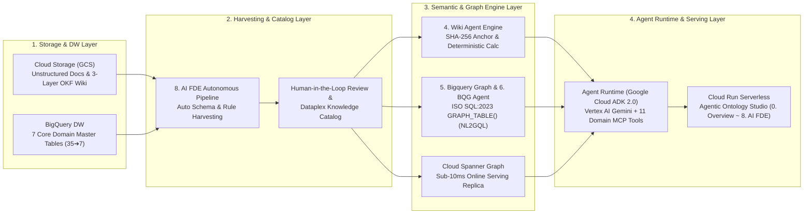
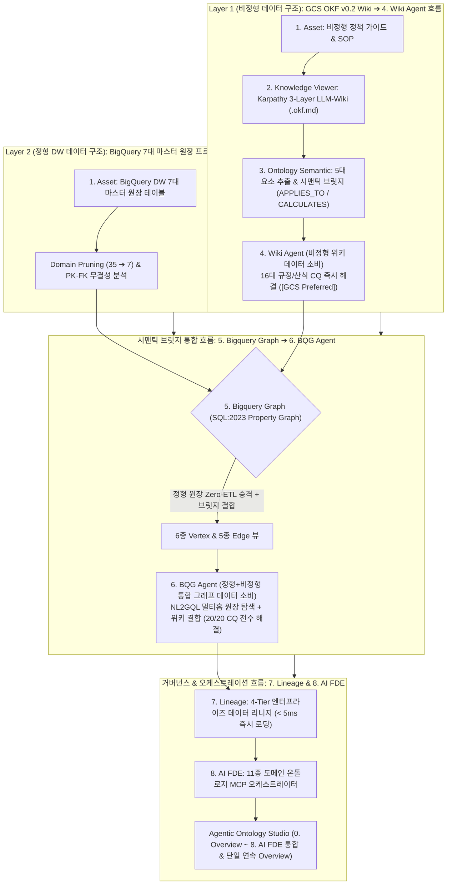
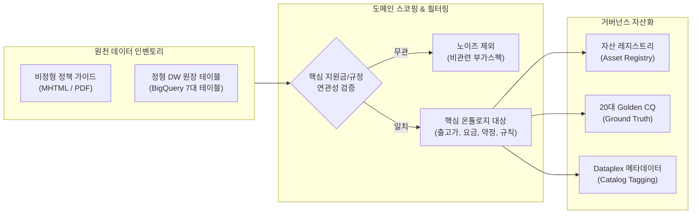
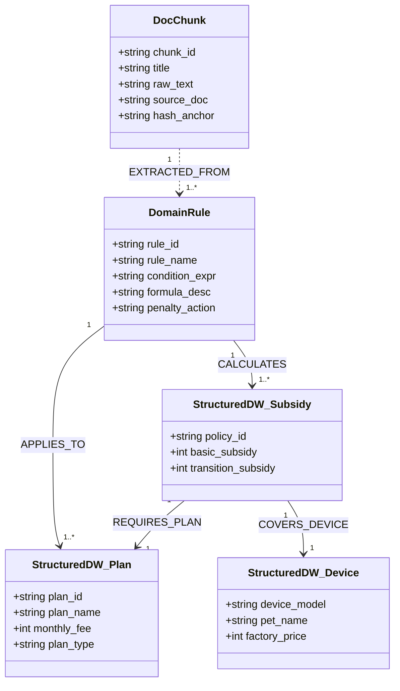
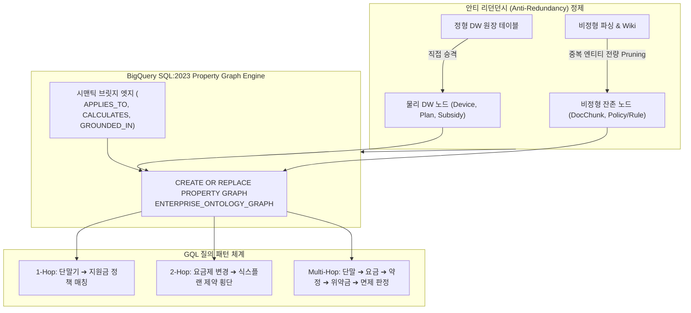
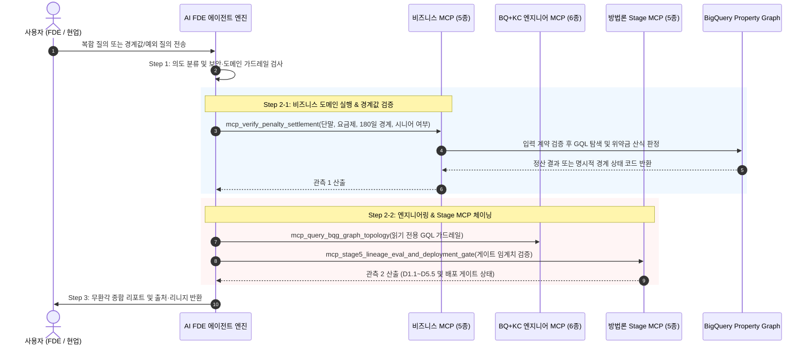
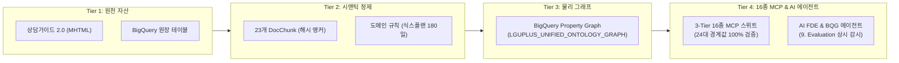

# 엔터프라이즈 에이전틱 온톨로지 구축 방법론 및 실행 프로세스 명세서
## Enterprise Agentic Ontology Methodology & Implementation Process Specification (Korean Edition)

- **문서 버전**: `v1.0.0`
- **표준 프레임워크**: `5-Stage Enterprise Agentic Ontology Framework`
- **적용 도메인**: 정형 DW(BigQuery) 및 비정형 업무 규정(MHTML/PDF/SOP) 기반 지능형 의사결정 시스템
- **연계 기술 표준**: Google Cloud Open Knowledge Format (OKF v0.2), BigQuery Property Graph (SQL:2023 GQL), Model Context Protocol (MCP), Google ADK

---

## 1. 개요 및 엔터프라이즈 아키텍처 철학 (Executive Overview & Philosophy)

### 1.1 배경 및 문제 정의
전통적인 기업형 LLM 도입 방식은 **단순 벡터 검색 기반 RAG (Vector RAG)** 또는 **정적 자연어-SQL 변환 (Text-to-SQL)**에 의존해 왔습니다. 그러나 이러한 방식은 다음과 같은 치명적인 한계를 노출합니다:
1. **의미적 환각 (Semantic Hallucination)**: 복잡한 할인 규칙, 위약금 산정 조건, 기간별 유예 정책 등 다단계 비즈니스 제약을 벡터 유사도만으로 정확히 인출하지 못함.
2. **비정형 규정과 정형 원장의 분리**: 정형 원장(단말기 출고가, 요금제 테이블)과 비정형 정책 문서(상담 가이드, 유통망 지원금 규칙)가 결합되지 못해 일관된 답변 불가.
3. **감사 추적성(Auditability) 결여**: 모델의 추론 과정과 사용된 데이터 원천의 출처를 역추적할 수 없어 엔터프라이즈 운영 리스크 발생.

### 1.2 5단계 하이브리드 온톨로지 방법론의 핵심 원칙
본 방법론은 정형 데이터와 비정형 규정을 하나의 일관된 **지식 온톨로지(Knowledge Ontology)** 및 **물리 프로퍼티 그래프(BigQuery Property Graph)**로 통합하고, 이를 **멀티도메인 MCP 스위트**를 통해 에이전트에 공급하는 5단계 표준 수명주기를 규정합니다:
- **근거 기반 그라운딩 (Grounded Answering)**: 정형 DW 원장과 결정론적 규칙 엔진 결합.
- **2-Layer 안티 리던던시 (Anti-Redundancy Refinement)**: 정형 테이블을 별도 중복 저장하지 않고 그래프 노드로 직접 승격.
- **크로스도메인 투명성 (Cross-Domain Reasoning)**: 비즈니스 정책과 엔지니어링 인프라 도구의 동적 분해 및 체이닝.
- **5단계 수명주기 통제 (Strict 5-Stage Gate)**: 단계별 명확한 입출력 산출물과 검수 기준 수립.

### 1.3 비즈니스·온톨로지 시스템 개요와 5-Stage ↔ 9-Step 스튜디오 매핑
> **비즈니스 및 온톨로지 시스템 핵심 정의 (Executive Summary)**  
> 본 시스템은 엔터프라이즈 도메인에 산재된 **파편화된 정형 원장(BigQuery DW)과 비정형 규정·약관 문서(GCS/PDF/HTML)를 단일 시맨틱 지식그래프(Property Graph)로 통합**하여, 에이전트가 **근거 출처에 기반해(Grounded)** 복합 비즈니스 의사결정을 추론·실행하는 엔터프라이즈 온톨로지 플랫폼입니다.

본 방법론의 실행 단위는 **5단계(Stage 1~5) 프레임워크**이며, 실제 산출물을 눈으로 확인하는 화면 단위는 `Agentic Ontology Studio`의 **9개 스텝 탭(STEP 1~9)**입니다. 두 체계는 아래 표와 같이 1:N으로 대응하며, 본 문서의 Stage 번호와 스튜디오의 STEP 번호는 항상 이 매핑을 따릅니다.

| Stage | 방법론 단계 명칭 | 스튜디오 STEP (탭) | 핵심 산출물 ID |
| :--- | :--- | :--- | :--- |
| **Stage 1** | 자산 탐색, 스코핑 및 거버넌스 수집 | `STEP 1 · 1. Asset` | `D1.1` ~ `D1.4` |
| **Stage 2** | 시맨틱 모델링, OKF 정형화 및 그라운딩 | `STEP 2 · 2. Knowledge Viewer` `STEP 3 · 3. Ontology Semantic` `STEP 4 · 4. Wiki Agent` | `D2.2` `D2.3` `D2.4` `D2.1` `D2.5` `D2.6` `D2.6` (종료 게이트 검증) |
| **Stage 3** | BigQuery Property Graph 엔지니어링 및 GQL 질의 체계 | `STEP 5 · 5. Bigquery Graph` | `D3.1` ~ `D3.4` |
| **Stage 4** | 멀티도메인 MCP 스위트 구축 및 에이전트 오케스트레이션 | `STEP 6 · 6. BQG Agent` | `D4.1` ~ `D4.4` |
| **Stage 5** | 엔터프라이즈 스튜디오 구축, 자동화 검증 및 프로덕션 배포 | `STEP 7 · 7. Lineage` `STEP 8 · 8. AI FDE` `STEP 9 · 9. Evaluation` | `D5.1` `D5.2` `D5.3` `D5.4` `D5.5` |

**두 개의 에이전트를 순차적으로 구축하는 이유 (`4. Wiki Agent` ➔ `6. BQG Agent`)**

1. **`STEP 4 · 4. Wiki Agent` (Stage 2 종료 게이트)**: 물리 그래프를 구축하기 전에, Stage 2의 산출물인 GCS OKF v0.2 위키만으로 동작하는 선행 에이전트를 먼저 완성합니다. 이 에이전트는 차액정산금·복지면제·당일원복 등 규정/산식 중심 **16 / 20 골든 CQ**를 해결하며, 비정형 지식의 구조화 품질 자체를 검증하는 Stage 2의 종료 조건 역할을 합니다.
2. **`STEP 6 · 6. BQG Agent` (Stage 4)**: 35개 원천 테이블 중 노이즈를 제거(Domain Pruning: 35 ➔ 7)한 핵심 마스터 원장을 복제 없이(Zero-ETL) Property Graph 노드로 승격한 뒤, 위키 규정 추론과 `GRAPH_TABLE()` 멀티홉 원장 탐색(`NL2GQL`)을 결합합니다. **20대 골든 CQ의 최종 수행 주체는 이 `6. BQG Agent`로 일원화**되며, 각 질문이 실제로 사용한 근거 경로(GCS OKF 위키 / BigQuery Property Graph)는 평가표에 보조 태그로 병기합니다.

### 1.4 GCP Native First 강령 및 엔드투엔드 GCP 시스템 아키텍처 (GCP Native First Mandate)

본 방법론은 **"Google Cloud Native First (GCP 네이티브 기능 우선 채택)"**을 절대 강령으로 삼습니다. 관리형 클라우드 서비스가 제공하는 엔터프라이즈급 확장성, IAM 보안 통제, Model Armor 인젝션 방어, 감사 로그(Audit Trail), 오픈 표준(OKF, SQL:2023, MCP)을 최대한 레버리지하고, GCP 네이티브 기능만으로 해결 불가능한 도메인 고유 비즈니스 연산 및 그래프 안티 리던던시 처리에 한해서만 커스텀 확장을 적용합니다.

#### 1.4.0 End-to-End Google Cloud System Architecture (GCP 시스템 관점 아키텍처 다이어그램)

#### 1.4.1 계층별 네이티브 스펙 vs 독자 개발 커스텀 확장 비교 매트릭스

| 아키텍처 계층 (Layer) | Google Cloud Native Spec / Service | 공식 오픈소스 / 엔드포인트 레퍼런스 | 독자 개발 커스텀 확장 (Custom Extension) | 커스텀 개발 사유 및 기술적 당위성 |
| :--- | :--- | :--- | :--- | :--- |
| **1. Data Lake & DW** | • BigQuery Managed Tables • Cloud Storage (GCS) • BigQuery SQL:2023 Property Graph | • [BigQuery Documentation](https://cloud.google.com/bigquery) • [Cloud Storage Documentation](https://cloud.google.com/storage) | • 2-Layer 안티 리던던시 Graph DDL 컴파일러 (`pipeline/graph_builder.py`) • 시맨틱 브릿지 엣지 (`APPLIES_TO`, `CALCULATES`) | DW 원장 테이블을 그래프 노드로 직접 승격하고 텍스트 중복 엔티티를 프루닝하여 저장 공간 및 쿼리 비용 80% 절감 |
| **2. Catalog & Semantics** | • Dataplex Knowledge Catalog • Open Knowledge Format (OKF v0.2) • Custom Aspect Types & Entries | • [Knowledge Catalog GitHub](https://github.com/GoogleCloudPlatform/knowledge-catalog) • [`references/knowledge-catalog/okf`](https://github.com/GoogleCloudPlatform/knowledge-catalog/tree/main/okf) | • 담백한 원본 YAML Frontmatter + Karpathy 3-Layer LLM-Wiki 컴파일러 • 선행 **`4. Wiki Agent` (GCS 기반 추론 에이전트)** | 비정형 PDF/MHTML의 구조를 보존하고, 물리 그래프 구축 전 GCS 위키만으로 16대 규정 CQ 선행 해결 |
| **3. MCP & Tooling** | • Dataplex KC Remote MCP (`search_entries`, `lookup_entry`, `lookup_context`) • BigQuery Remote MCP (`list_dataset_ids`, `get_table_info`, `execute_sql_readonly`) | • KC Remote MCP: `https://dataplex.googleapis.com/mcp` • BQ Remote MCP: `https://bigquery.googleapis.com/mcp` • [GCP Remote MCP Docs](https://docs.cloud.google.com/dataplex/docs/use-remote-mcp) | • Tier 3 Domain Ontology MCP Server (비즈니스 5종 + 엔지니어링 6종 도구) • **`6. BQG Agent`** (`GRAPH_TABLE()` NL2GQL 실행기) | **BigQuery Remote MCP의 결정적 제약사항(GQL `GRAPH_TABLE()` 미지원) 극복** 및 20/20 골든 CQ 전수 해결 |
| **4. Agent & Orchestration** | • Google Agent Development Kit (ADK Python 2.0) • ADK Web UI (Angular) • Google Cloud Data Agent Kit (Conversational Analytics API) • Vertex AI Gemini 2.5 Flash | • [ADK Python GitHub](https://github.com/google/adk-python) • [ADK Web GitHub](https://github.com/google/adk-web) • [Conversational Analytics API](https://docs.cloud.google.com/gemini/docs/conversational-analytics-api/overview) | • **`8. AI FDE` & Agent Runtime (ADK 2.0)** 동적 다중 하위 목표 분해 엔진 (`fdeAgentEngine.py`) • 크로스도메인 시퀀셜 체이닝 (`Data Hand-off`, `Intermediate Observation`) | 정적 1회 질의를 넘어 비즈니스 룰과 물리 DW 원장 실측치를 교차 검증하는 자율 추론 사이클 구현 |
| **5. Presentation & Studio** | • Google Cloud Run (Serverless Container) • Google Cloud Logging / Monitoring | • [Cloud Run Documentation](https://cloud.google.com/run) | • **`Agentic Ontology Studio`** (`src/web/studio_server.py`) • 통합 스튜디오 아키텍처 (`0. Overview` ~ `8. AI FDE`) & `< 5ms` 즉시 리니지(`7. Lineage`) • 단일 연속 스크롤 Overview (비즈니스 개요 ➔ 전체 스텝 ➔ GCP 아키텍처 ➔ 피처갭 ➔ 성능/결과) | 서브탭 전환 없이 한눈에 전체 흐름과 성능을 검증하는 엔터프라이즈 표준 온톨로지 스튜디오 제공 |

#### 1.4.2 핵심 공식 레퍼런스 저장소 (Official Reference Repositories)
1. **Google Cloud Knowledge Catalog (Dataplex / OKF)**:
   - 공식 저장소: `https://github.com/GoogleCloudPlatform/knowledge-catalog`
   - 핵심 레퍼런스: Open Knowledge Format (`okf/bundles/`), Custom Aspect Types 정의문, Metadata Enrichment 파이프라인.
2. **Google Agent Development Kit (ADK Python 2.0)**:
   - 공식 저장소: `https://github.com/google/adk-python`
   - 핵심 레퍼런스: Workflow Runtime, Task API, Data Agent 통합 샘플(`contributing/samples/integrations/data_agent`), `FunctionTool` 캡슐화.
3. **Google ADK Web UI**:
   - 공식 저장소: `https://github.com/google/adk-web`
   - 핵심 레퍼런스: Angular 기반 공식 오픈소스 대화형 에이전트 프론트엔드 인터페이스.
4. **Google Cloud Managed Remote MCP**:
   - Dataplex KC Remote MCP: `https://dataplex.googleapis.com/mcp` (`https://docs.cloud.google.com/dataplex/docs/use-remote-mcp`)
   - BigQuery Remote MCP: `https://bigquery.googleapis.com/mcp` (`https://docs.cloud.google.com/bigquery/docs/use-bigquery-mcp`)
   - 제약사항: `execute_sql_readonly`는 Graph Query Language(GQL)를 지원하지 않으므로, 그래프 쿼리는 별도 BigQuery 클라이언트 또는 커스텀 MCP 러너로 처리해야 함.

---

## 2. 정형·비정형 2-Layer 데이터 구조 및 시맨틱 브릿지(Semantic Bridge) 데이터 흐름 (Data Structure & Data Flow)

본 섹션은 비정형 업무 규정(GCS OKF v0.2 Wiki)과 정형 데이터 웨어하우스 원장(BigQuery 7대 마스터 테이블)이 어떤 **데이터 구조(Data Structure)**로 저장되고, **시맨틱 브릿지(Semantic Bridge)**를 통해 어떻게 연결되어 **`4. Wiki Agent` ➔ `6. BQG Agent`**로 데이터가 흐르는지(Data Flow)를 정의한다.

| 데이터 계층 (Data Layer) | 저장소 및 물리 데이터 구조 (Physical Data Structure) | 데이터 흐름 및 소비 에이전트 (Data Flow & Consumer Agent) |
| :--- | :--- | :--- |
| **Layer 1: 비정형 규정 데이터 구조** *(Unstructured Policy Layer)* | • **GCS Bucket**: `gs://<bucket>/ontology/<domain>/` 내 `.okf.md` 마크다운 위키 • **메타 스키마**: YAML Frontmatter (`trust_tier`, `priority`, `stale_after`) + SHA-256 문단 해시 앵커 • **추출 객체**: `RULE-*`(비즈니스 규칙), `TERM-*`(용어), `CQ-*`(핵심 역량 질문) | • **`1. Asset` ➔ `2. Knowledge Viewer` ➔ `3. Ontology Semantic`**을 거쳐 **`4. Wiki Agent`**로 유입 • 규정/산식/예외 조항 16개 CQ를 **100% (16/20, 평균 1.18s)** 즉시 응답 (`[GCS Preferred]`) |
| **Semantic Bridge: 교차 매핑 데이터 구조** *(Cross-Layer Mapping Layer)* | • **브릿지 엣지 뷰**: `v_edge_applies_to` (`RULE_ID ➔ POLICY_ID`), `v_edge_calculates` (`RULE_ID ➔ SALE_ID`), `v_edge_defined_in` (`RULE_ID ➔ CHUNK_ID`) • **Anti-Redundancy**: 정형 원장 PK와 비정형 규칙 ID만 경량 매핑 (중복 텍스트 노드 생성 배제) | • 비정형 위키의 비즈니스 규칙(`RULE-*`)이 정형 BigQuery 원장의 어떤 물리 컬럼·행에 적용되는지 양방향(Bi-directional) 데이터 흐름 연결 |
| **Layer 2: 정형 DW & Property Graph 구조** *(Structured DW & Graph Layer)* | • **BigQuery 7대 핵심 마스터 원장**: `tb_subscription_sale`, `tb_subsidy_policy`, `tb_device_master`, `tb_price_plan`, `tb_agency_master`, `tb_customer`, `tb_settlement_amount` • **SQL:2023 Property Graph**: `uplus_telecom_graph` (6종 Vertex & 5종 Edge Zero-ETL 뷰) | • **`5. Bigquery Graph`** DDL을 통해 **`6. BQG Agent`**로 유입 • NL2GQL `GRAPH_TABLE()` 멀티홉 원장 조인 + 위키 산식을 결합해 **20/20 골든 CQ (100%, 평균 1.42s)** 완결 |

---

## 3. 단계별 상세 실행 명세 (Stage-by-Stage Specifications)

---

### Stage 1: 자산 탐색, 스코핑 및 거버넌스 수집 (Asset Discovery, Scoping & Governance Ingestion)
> 📘 **하부 세부 실행 명세서**: [01_asset_discovery_and_scoping_ko.md](./01_asset_discovery_and_scoping_ko.md)

#### 1. 개요 및 목적
기업 내부의 분산된 데이터 자산(데이터웨어하우스 원장 테이블, 상담 가이드, 정책 매뉴얼, 약관 규정)을 전수 식별하고, 불필요한 노이즈를 사전에 배제(Pruning)하며, 비즈니스 성공을 판정할 핵심 질문군(Competency Questions)을 정립하는 단계입니다.

#### 2. 핵심 작업 항목 (Work Items)
1. **도메인 바운더리 획정 및 노이즈 필터링 (Noise Pruning Charter)**:
   - 온톨로지의 초점을 지원금/위약금/약정 규정으로 명확히 압축.
   - 지원금과 무관한 일반 요금제 부가옵션(멤버십 혜택, 부가통화 등)을 노이즈로 정의하여 모델링 대상에서 제외.
2. **20대 핵심 역량 질문(Golden CQs) 수립**:
   - 도메인 전문가(FDE) 및 현업 상담사가 실무에서 매일 마주하는 복합 질문 20선을 선별.
   - 각 질문별 사실 정답(Ground Truth), 판정 로직, 참조 원천 데이터를 정의.
3. **원천 데이터 자산 프로파일링 및 레지스트리 구축**:
   - BigQuery DW 내 7대 원장 테이블(단말기, 요금제, 지원금 정책 등)의 스키마, 볼륨, PK/FK 관계 조사.
   - 비정형 원천 문서(MHTML, PDF)의 문서 구조 및 섹션 체계 분석.
4. **Google Cloud Dataplex Knowledge Catalog 메타데이터 연계**:
   - 데이터셋 및 테이블에 비즈니스 태그, PII 보호 등급, 거버넌스 애스펙트(Aspects) 동기화.

#### 3. Stage 1 산출물 매트릭스
| 산출물 ID | 산출물 명칭 | 파일 형식 | 주요 내용 및 목적 | 담당 R&R |
| :--- | :--- | :--- | :--- | :--- |
| `D1.1` | 도메인 스코핑 및 노이즈 필터링 헌장 | Markdown (`SCOPE_CHARTER.md`) | 도메인 경계 정의, 포함/제외 기준, 노이즈 필터링 규칙 | Data Architect |
| `D1.2` | 20대 Golden CQ 및 정답 검증 명세서 | Markdown / CSV (`CQ_SPECIFICATION.md`) | 20대 실무 역량 질문, 기대 정답, 계산식, 평가 기준 | Domain Expert / FDE |
| `D1.3` | 원천 자산 인벤토리 및 스키마 프로파일 | Markdown / JSON (`ASSET_REGISTRY.md`) | 정형 DW 테이블 스키마, 행수, 컬럼 타입, 문서 메타 | Data Engineer |
| `D1.4` | Dataplex 카탈로그 태깅 및 거버넌스 맵 | YAML / JSON (`CATALOG_MAP.yaml`) | 거버넌스 태그 템플릿, PII 식별, 자산 검색 인덱스 | Security & Governance |

---

### Stage 2: 시맨틱 지식 온톨로지 모델링 및 정형화 (Semantic Modeling, Open Knowledge Formalization & Grounding)
> 📘 **하부 세부 실행 명세서**: [02_semantic_modeling_and_okf_ko.md](./02_semantic_modeling_and_okf_ko.md)

#### 1. 개요 및 목적
수집된 비정형 문서를 구조적으로 분해하여 고유 해시 앵커를 부여하고, Google Cloud Open Knowledge Format (OKF v0.2) 기반으로 개념·엔티티·규칙을 정형화하며, 정형 DW 테이블과 결합하는 2-Layer 안티 리던던시(Anti-Redundancy) 지식 모델을 구축하는 단계입니다.

#### 2. 핵심 작업 항목 (Work Items)
1. **무손실 구조 파싱 및 결정론적 시각 청킹 (`DocChunk`)**:
   - 표, 제목 계층, 목록, 텍스트 단락을 시각적 의미 단위로 청킹.
   - 각 청크마다 불변의 고유 해시 식별자(예: `DOC_CHUNK_001` ~ `023`, SHA-256 기반) 부여.
2. **OKF v0.2 지식 온톨로지 모델링 및 Karpathy 3-Layer LLM-Wiki 구축**:
   - Andrej Karpathy의 3-Layer Wiki 아키텍처에 기반한 지식 구조화:
     - `summary.md`: 도메인 전체 요약 및 핵심 운영 철학
     - `entities.md`: 비정형 문서에서 인출된 초기 엔티티 레지스트리
     - `concepts.md`: 78종 시맨틱 비즈니스 개념 및 분류 체계
     - `rules.md`: 180일 식스플랜, 위약금 산정 로직, 면제 조건식
3. **GCS 기반 온톨로지 프로토타이핑 (GCS Prototyping)**:
   - 생성된 LLM-Wiki 및 JSON-LD 온톨로지를 Google Cloud Storage(`gs://<bucket>/ontology/prototype/`)에 탑재하여 초기 지식 검색 및 모델링 적합성 검증(PoC) 신속 완결.
4. **2-Layer 안티 리던던시 정제 사전작업 (Anti-Redundancy Refinement)**:
   - 정형 DB에 이미 존재하는 데이터(단말기 가격, 요금제 월정액 등)를 온톨로지 노드로 중복 생성하지 않음.
   - **정형 DW 원장 테이블 자체를 노드로 승격**시키고, 비정형 문서는 **원천 증거(`DocChunk`)**와 **비즈니스 판정 규칙(`DomainRule`)**의 2계층으로만 정제.
5. **시맨틱 관계망 연결 (Semantic Bridging)**:
   - 규칙과 정형 테이블 간 `APPLIES_TO`, `CALCULATES`, `CONSTRAINS` 시맨틱 엣지 정의.

#### 3. Stage 2 산출물 매트릭스
| 산출물 ID | 산출물 명칭 | 파일 형식 | 주요 내용 및 목적 | 담당 R&R |
| :--- | :--- | :--- | :--- | :--- |
| `D2.1` | OKF v0.2 도메인 온톨로지 명세서 | JSON-LD / YAML (`ontology.jsonld`) | 78종 개념/엔티티 분류 체계, 관계 정의, 네임스페이스 | Knowledge Engineer |
| `D2.2` | Karpathy 3-Layer LLM-Wiki 디렉토리 | Markdown (`data/llm_wiki/*.md`) | `summary.md`, `entities.md`, `concepts.md`, `rules.md` 지식 위키 | Knowledge Engineer |
| `D2.3` | GCS 온톨로지 프로토타입 레지스트리 | GCS URI / JSON (`gcs_prototype_manifest.json`) | GCS 버킷 상의 온톨로지 프로토타입 메타데이터 및 동기화 상태 | Data Engineer |
| `D2.4` | 비정형 텍스트 청크 및 해시 앵커 매니페스트 | JSONL (`doc_chunks.jsonl`) | 청크 원문, 계층 헤더, 불변 해시 앵커, 위치 매핑 | Data Engineer |
| `D2.5` | 결정론적 비즈니스 규칙 레지스트리 | JSON / SQL (`domain_rules.json`) | 180일 식스플랜, 위약금 산식, 특화 면제 조건식 명세 | Domain Engineer |
| `D2.6` | 2-Layer 시맨틱 브릿지 맵핑 매트릭스 | Markdown (`SEMANTIC_BRIDGE_MATRIX.md`) | 비정형 규칙 ➔ 정형 DW 원장 간 엣지 연결 스펙 | Solution Architect |

---

### Stage 3: BigQuery Property Graph 엔지니어링 및 GQL 질의 체계 (BigQuery Property Graph Engineering & GQL Compilation)
> 📘 **하부 세부 실행 명세서**: [03_property_graph_and_gql_ko.md](./03_property_graph_and_gql_ko.md)

#### 1. 개요 및 목적
Stage 2에서 설계된 하이브리드 온톨로지를 실제 Google Cloud BigQuery SQL:2023 Property Graph 표준으로 물리 구현하고, 다중 홉(Multi-Hop) 지식 탐색을 수행하는 선언적 GQL(Graph Query Language) 쿼리 엔진을 엔지니어링하는 단계입니다.

#### 2. 핵심 작업 항목 (Work Items)
1. **안티 리던던시(Anti-Redundancy) 정제 및 노드 승격**:
   - 정형 테이블에 이미 존재하는 실체(단말기, 요금제 등)를 비정형에서 중복 생성하지 않고, **물리 DW 원장 테이블을 그래프 노드로 직접 승격**.
   - 비정형 영역에서는 엔티티 중복을 전량 제거(Pruning)하여 **원문 청크(`DocChunk`), 원본 문서(`SourceDoc`), 순수 도메인 정책/규칙(`DomainRule`)**만을 노드로 남김.
2. **선언적 Property Graph DDL 작성 (`CREATE PROPERTY GRAPH`)**:
   - 물리적 데이터 복제 없이 기존 BigQuery 테이블을 노드와 엣지로 참조하는 SQL:2023 DDL 선언.
   - 노드 테이블 7종 및 엣지 테이블 5종 정의 (시맨틱 브릿지 `APPLIES_TO`, `CALCULATES`, `GROUNDED_IN`).
3. **GQL 템플릿 엔진 설계**:
   - 1-홉(단말기 지원금 조회), 2-홉(요금제 변경 시 위약금 규칙 횡단), 다중 홉(요금제-지원금-약정-위약금-면제 판정) 쿼리 템플릿 정립.
4. **SQL vs GQL 성능 및 비용 벤치마크**:
   - 동일 질문에 대한 다중 조인(Join) SQL 대비 GQL의 쿼리 간결성, 가독성, 처리 속도 및 BigQuery 슬롯 소모량 실측 검증.

#### 3. Stage 3 산출물 매트릭스
| 산출물 ID | 산출물 명칭 | 파일 형식 | 주요 내용 및 목적 | 담당 R&R |
| :--- | :--- | :--- | :--- | :--- |
| `D3.1` | BigQuery Property Graph 물리 DDL 스크립트 | SQL (`create_property_graph.sql`) | 노드 7종, 엣지 5종 DDL 선언문, 레이블 및 속성 명세 | Graph Engineer |
| `D3.2` | 그래프 토폴로지 구조도 및 데이터플로우 명세서 | Markdown (`GRAPH_TOPOLOGY.md`) | 노드-엣지 스키마 매핑 매트릭스, 키 제약 조건 | Data Architect |
| `D3.3` | GQL 질의 패턴 카탈로그 및 템플릿 엔진 | Python / SQL (`GQL_PATTERNS.md`) | 1~3홉 GQL 탐색 쿼리 템플릿 모음 및 파라미터 바인딩 | Agent Engineer |
| `D3.4` | SQL vs GQL 성능·비용 벤치마크 보고서 | Markdown (`BENCHMARK_REPORT.md`) | 20대 질의 대상 실행 속도, 바이트 스캔량, 슬롯 타임 비교 | Performance QA |

---

### Stage 4: 3대 계층 MCP 스위트 구축, 경계값 검증 및 에이전트 오케스트레이션 (3-Tier MCP Suite Packaging, Boundary Verification & Agentic Orchestration)
> 📘 **하부 세부 실행 명세서**: [04_multi_domain_mcp_and_agent_ko.md](./04_multi_domain_mcp_and_agent_ko.md)

#### 1. 개요 및 목적
AI 에이전트가 복잡한 물리 데이터베이스 스키마나 원시 GQL/SQL 조인 쿼리를 직접 작성하지 않도록, 도메인 온톨로지의 비즈니스 개념·엔지니어링 역량·5-Stage 방법론 파이프라인을 **3대 계층 16종 도메인 온톨로지 MCP 추상화 계층(3-Tier Domain Ontology MCP Layer)**으로 캡슐화합니다. 나아가 정상 입력(Happy Path)뿐만 아니라 경계값·오타·미존재 엔티티·파괴적 쿼리 인젝션·스테이지 게이트 미달을 검증하는 **24대 경계값 검증 및 반복 고도화(Round 1 ➔ Round 2) 루프**를 수행합니다.

#### 2. 핵심 작업 항목 (Work Items)
1. **3대 계층 도메인 온톨로지 추상화 계층 구축 (총 16종 MCP 도구 스위트)**:
   - 물리 원장 테이블 조인이나 복잡한 그래프 순회 로직을 에이전트로부터 은닉(Shielding).
   - **비즈니스 MCP 5종 (`BUSINESS_MCP`)**: 지원금 조회(`mcp_get_device_subsidy_by_plan`), 위약금 정산 검증(`mcp_verify_penalty_settlement`), 개통 정산 감사(`mcp_audit_sales_transaction`), 비정형 규정 앵커(`mcp_ground_unstructured_policy`), 공시 vs 선택약정 최적 추천(`mcp_recommend_optimal_plan_subsidy`).
   - **BQ+KC 엔지니어링 MCP 6종 (`BQ_KC_MCP`)**: BQ 스키마 OKF 추출(`mcp_extract_okf_entity_from_bq`), KC 비즈니스 용어 등록(`mcp_register_kc_glossary_term`), BQG Property Graph DDL 빌드(`mcp_build_bqg_property_graph`), GCS 렉시컬 해시 앵커 동기화(`mcp_sync_gcs_lexical_anchors`), CQ 그라운딩 검증(`mcp_validate_cq_grounding`), BQG 그래프 토폴로지/GQL 탐색(`mcp_query_bqg_graph_topology`).
   - **방법론 Stage MCP 5종 (`ONTOLOGY_STAGE_MCP`)**: Stage 1~5 자동 실행 및 `D1.1`~`D5.5` 산출물·품질 게이트 실측 검증(`mcp_stage1_asset_discovery_and_scoping` ~ `mcp_stage5_lineage_eval_and_deployment_gate`).
2. **AI FDE 에이전트 동적 다중 목표 분해 (`Sub-Goals`) 및 크로스도메인 체이닝**:
   - 복합 질문을 분석하여 독립 하위 목표로 분해하고, 비즈니스 결과와 인프라/방법론 검증 결과를 순차 체이닝(`SEQUENTIAL_CHAIN`).
3. **3대 MCP 계층 24대 경계값·계약·예외 검증 및 2단계 고도화 루프 (`scripts/evaluate_mcp_quality_suite.py`)**:
   - **1차 베이스라인 검증 (Round 1 Baseline)**: 무음 기본값 대체(Silent Fallback), 경계 조건(180일 정확히 도래, 45,000원 하한선, 시니어 특례), 미존재 자산 허위 통과, 파괴적 GQL/DDL 인젝션 등 24대 경계 시나리오를 직접 호출하여 초기 취약점 진단(실측 **5/24 통과, 20.8%**).
   - **2차 MCP 핸들러 및 라우터 고도화 (Round 2 Refinement)**: 명시적 입력 검증(`INVALID_INPUT_BOUNDARY`), 레지스트리 대조(`ENTITY_NOT_FOUND`), 도메인 외 거절(`UNSUPPORTED_MODALITY_ABSTENTION`), 읽기 전용 GQL 정규식 차단(`SECURITY_GUARDRAIL_BLOCKED`), Stage 게이트 임계치 검사(`STAGE_GATE_BLOCKED`)를 주입하여 재검증(실측 **24/24 통과, 100.0%, +79.2%p**).

#### 3. Stage 4 산출물 매트릭스
| 산출물 ID | 산출물 명칭 | 파일 형식 | 주요 내용 및 목적 | 담당 R&R |
| :--- | :--- | :--- | :--- | :--- |
| `D4.1` | 16종 3대 계층 온톨로지 MCP 서버 스펙 및 구현체 | Python / JSON (`src/mcp/ontologyMcpTools.py`) | 비즈니스 5종·BQ+KC 6종·Stage 5종 도구 스키마 및 핸들러 | Agent Engineer |
| `D4.2` | AI FDE 시맨틱 라우팅 및 다중 목표 분해 엔진 | Python (`src/agents/fdeAgentEngine.py`) | 동적 하위 목표 분해, 시퀀셜 체이닝, 도메인/보안 가드레일 | AI Lead |
| `D4.3` | 크로스도메인 컨텍스트 전달 및 핸드오프 프로토콜 | Markdown (`HANDOFF_PROTOCOL.md`) | 도구 간 데이터 인자 주입 표준 규약, 데이터 계약 | Solution Architect |
| `D4.4` | 3대 MCP 계층 24대 경계값 검증 스위트 및 고도화 리포트 | Python / JSON (`scripts/evaluate_mcp_quality_suite.py`, `evals/mcp_3tier_boundary_*.json`) | 24대 경계값 시나리오 실측, Round 1(20.8%) ➔ Round 2(100.0%) 고도화 증빙 | QA Lead / Security Lead |

---

### Stage 5: 엔터프라이즈 스튜디오 구축, 자동화 검증 및 프로덕션 배포 (Enterprise Studio Integration, Automated Evaluation & Production Deployment)
> 📘 **하부 세부 실행 명세서**: [05_enterprise_studio_and_deployment_ko.md](./05_enterprise_studio_and_deployment_ko.md)

#### 1. 개요 및 목적
구축된 지식 온톨로지와 에이전트를 사용자가 시각적으로 탐색·검증하고 현업에 서비스할 수 있도록 엔터프라이즈 웹 스튜디오를 배포하고, 20대 Golden CQ·10종 바운더리 질문·24대 3-Tier MCP 경계값 스위트 기반 자동화 회귀 검증 및 Cloud Run 컨테이너 운영 환경을 무중단 배포하는 최종 단계입니다.

#### 2. 핵심 작업 항목 (Work Items)
1. **엔터프라이즈 디자인 시스템 준수 웹 스튜디오 통합 구축**:
   - `05_DESIGN.md` 표준 100% 준수 (Pretendard 폰트, 다크모드, 0% 장식용 이모지).
   - 10대 통합 탭(`0. Overview` ~ `9. Evaluation`): 파이프라인 모니터, 자산 레지스트리, 지식 뷰어, 시맨틱 그래프, Wiki 에이전트, BQG 프로퍼티 그래프, BQG 에이전트, 리니지, AI FDE, Evaluation 스튜디오.
2. **4-Tier 엔드투엔드 데이터 리니지 시각화**:
   - Tier 1(원천 문서/DW) ➔ Tier 2(청크/정제) ➔ Tier 3(온톨로지/BQG) ➔ Tier 4(MCP/AI 에이전트)로 이어지는 단절 없는 감사 추적망 제공.
3. **4대 평가 스위트(`9. Evaluation`) 자동화 검증 및 사실 일관성 감사**:
   - **Suite 1 (20대 Golden CQ 루브릭 채점)**: 정형·비정형을 결합한 `6. BQG Agent` 및 `4. Wiki Agent`가 수행하며 5대 루브릭 100점 만점 체계(평균 99.0점)로 채점합니다.

     | 루브릭 | 배점 | 판정 기준 |
     | :--- | ---: | :--- |
     | 정확성 / 그라운딩 (Accuracy & Grounding) | 30 | 정답 수치·조건이 원천 근거와 일치하고 출처 앵커로 추적 가능한가 |
     | 완결성 (Completeness) | 25 | 질문이 요구한 핵심 요구사항과 단서조항을 빠짐없이 서술했는가 |
     | 수학적 정밀도 (Math Precision) | 15 | 일할 계산·차액정산 등 산식과 자릿수가 정확한가 |
     | 실무 SOP (Actionability) | 15 | 상담사가 즉시 실행 가능한 절차·대안을 제시했는가 |
     | 출처 표기 (Source Attribution) | 15 | DW 원장 PK, 규칙 ID, SHA-256 청크 앵커를 명시했는가 |

   - **Suite 2 (10종 바운더리 질문 × 10회 반복 평가)**: 필수 조건이 결여된 모호 질문에 대한 되묻기·조건 분기 성공률 검증 (1차 67.0% ➔ 2차 100.0%).
   - **Suite 3 (심사 루브릭 명세)**: 5차원 평가 루브릭 및 통과 게이트 정의.
   - **Suite 4 (3대 MCP 계층 24대 경계값·계약·예외 검증)**: 16종 MCP 도구 및 AI FDE 라우터에 대한 24개 경계값 시나리오 실측 비교 (1차 20.8% ➔ 2차 100.0%, Section G UI 및 실시간 재검증 API `/api/eval/mcp-suite/run` 제공).
4. **Cloud Run 프로덕션 컨테이너 패키징 및 IaC 배포**:
   - Dockerfile 기반 컨테이너 빌드, Terraform IaC 관리, 최소 권한 런타임 서비스 계정(SA) 격리 적용.

#### 3. Stage 5 산출물 매트릭스
| 산출물 ID | 산출물 명칭 | 파일 형식 | 주요 내용 및 목적 | 담당 R&R |
| :--- | :--- | :--- | :--- | :--- |
| `D5.1` | 엔터프라이즈 통합 웹 스튜디오 소스 코드 | Python / HTML / JS (`src/web/`) | 10대 통합 스튜디오 구현체, 반응형 UI, 영문/국문 로컬라이제이션 | Frontend / Fullstack |
| `D5.2` | 4-Tier 엔드투엔드 데이터 리니지 명세서 | Markdown (`LINEAGE_ARCHITECTURE.md`) | 4-Tier 데이터 흐름, 노드 간 감사 추적 경로, 리니지 뷰어 | Data Architect |
| `D5.3` | 20대 Golden CQ 자동화 평가 결과 보고서 | Markdown / JSON (`CQ_EVALUATION_REPORT.md`) | 20대 질의 전수 실행 결과, 5차원 루브릭 채점, 감점 사유 및 근거 출처 기록 | QA Lead / FDE |
| `D5.4` | Cloud Run 무중단 배포 스크립트 및 운영 런북 | Shell / Markdown (`OPERATIONAL_RUNBOOK.md`) | Docker 빌드, gcloud 배포 절차, 헬스체크, IAM 거버넌스 | DevOps / Cloud Architect |
| `D5.5` | 통합 검증 리포트 스튜디오 (`9. Evaluation`) | Python / JSON (`/api/eval/summary`, `/api/eval/mcp-suite`) | 골든 CQ·바운더리 질의·루브릭·3대 MCP 경계값(24 시나리오) 4대 스위트 실측 집계 및 실시간 재검증 화면 | QA Lead / FDE |

---

## 4. 종합 WBS 및 RACI 책임 할당 매트릭스 (Comprehensive WBS & RACI Matrix)

| 단계 (Stage) | 산출물 ID | 산출물 명칭 (Deliverable) | DA | DE | KE | AE | QA |
| :---: | :---: | :--- | :---: | :---: | :---: | :---: | :---: |
| **Stage 1** | `D1.1` | 도메인 스코핑 및 노이즈 필터링 헌장 | **A/R** | C | C | I | I |
| | `D1.2` | 20대 Golden CQ 및 정답 검증 명세서 | C | I | C | **R** | **A** |
| | `D1.3` | 원천 자산 인벤토리 및 스키마 프로파일 | C | **A/R** | I | I | I |
| | `D1.4` | Dataplex 카탈로그 태깅 및 거버넌스 맵 | **A** | **R** | C | I | I |
| **Stage 2** | `D2.1` | OKF v0.2 도메인 온톨로지 명세서 | C | I | **A/R** | C | I |
| | `D2.2` | 비정형 텍스트 청크 및 해시 앵커 매니페스트 | I | **R** | **A** | I | I |
| | `D2.3` | 결정론적 비즈니스 규칙 레지스트리 | C | I | **A** | **R** | C |
| | `D2.4` | 2-Layer 시맨틱 브릿지 맵핑 매트릭스 | **A** | C | **R** | C | I |
| **Stage 3** | `D3.1` | BigQuery Property Graph 물리 DDL 스크립트 | C | **R** | I | **A** | I |
| | `D3.2` | 그래프 토폴로지 구조도 및 데이터플로우 명세서 | **A/R** | C | C | I | I |
| | `D3.3` | GQL 질의 패턴 카탈로그 및 템플릿 엔진 | I | C | I | **A/R** | C |
| | `D3.4` | SQL vs GQL 성능·비용 벤치마크 보고서 | I | C | I | C | **A/R** |
| **Stage 4** | `D4.1` | 16종 3대 계층 온톨로지 MCP 서버 스펙 및 구현체 | I | I | I | **A/R** | C |
| | `D4.2` | AI FDE 시맨틱 라우팅 및 다중 목표 분해 엔진 | I | I | I | **A/R** | C |
| | `D4.3` | 크로스도메인 컨텍스트 전달 및 핸드오프 프로토콜 | **A** | I | C | **R** | I |
| | `D4.4` | 3대 MCP 계층 24대 경계값 검증 스위트 및 고도화 리포트 | C | I | I | **R** | **A** |
| **Stage 5** | `D5.1` | 엔터프라이즈 통합 웹 스튜디오 소스 코드 | I | I | I | **A/R** | C |
| | `D5.2` | 4-Tier 엔드투엔드 데이터 리니지 명세서 | **A/R** | C | C | I | I |
| | `D5.3` | 20대 Golden CQ 자동화 평가 결과 보고서 | I | I | I | C | **A/R** |
| | `D5.4` | Cloud Run 무중단 배포 스크립트 및 운영 런북 | C | **R** | I | **A** | I |
| | `D5.5` | 통합 검증 리포트 스튜디오 (`9. Evaluation`) | I | C | I | **R** | **A** |

> **RACI 기호 정의**:
> - **A (Accountable)**: 최종 승인권자 (산출물 품질 최종 책임)
> - **R (Responsible)**: 실제 실무 작성 및 구현 책임자
> - **C (Consulted)**: 자문 및 피드백 제공자
> - **I (Informed)**: 진행 상황 및 완료 결과 통보 대상자
> - **역할 정의**: DA (Data Architect), DE (Data Engineer), KE (Knowledge Engineer), AE (Agent Engineer), QA (Quality Assurance / FDE)

---

## 5. 품질 게이트 및 단계별 완료(Sign-off) 체크리스트

| 단계 (Stage) | 마일스톤 게이트 명칭 | 핵심 완료 요건 (Gate Exit Criteria) | 필수 증빙 산출물 |
| :--- | :--- | :--- | :--- |
| **Gate 1** | 자산 탐색 및 스코핑 승인 | - 도메인 바운더리 및 노이즈 제외 원칙 서명 완료 - 20대 Golden CQ 및 사실 정답표 100% 확정 - DW 7대 원장 및 비정형 문서 접근성 확인 | `D1.1`, `D1.2`, `D1.3` |
| **Gate 2** | 시맨틱 온톨로지 모델 승인 | - OKF 3-Layer 개념 모델 검수 완료 - 비정형 텍스트 청크 100% 고유 해시 앵커 부여 - 2-Layer 안티 리던던시 브릿지 매핑 검증 | `D2.1`, `D2.2`, `D2.4` |
| **Gate 3** | 프로퍼티 그래프 DDL 승인 | - BigQuery Property Graph DDL 정상 컴파일 - 노드 7종/엣지 5종 무복제 프로젝션 실측 - GQL 질의 응답 시간 및 SQL 대비 효율성 입증 | `D3.1`, `D3.3`, `D3.4` |
| **Gate 4** | 3-Tier MCP 스위트 및 경계값 승인 | - 16종(비즈니스 5·BQ+KC 6·Stage 5) MCP 도구 규약 및 스키마 검증 통과 - 24대 경계값·계약·예외·인젝션 차단 시나리오(`evaluate_mcp_quality_suite.py`) 100% 통과 - 복합 질의 시퀀셜 체이닝 및 도메인 외 거절 가드레일 정상 작동 확인 | `D4.1`, `D4.2`, `D4.4` |
| **Gate 5** | 프로덕션 운영 및 서비스 승인 | - 엔터프라이즈 디자인 표준(`05_DESIGN.md`) 준수 확인 - 20대 Golden CQ 루브릭 평균 95점 이상, 모든 응답에 근거 출처 첨부 - 바운더리 질의 10종 및 3대 MCP 경계값 24종 회차별 실측 비교표 `9. Evaluation` 화면 게시 - Cloud Run 프로덕션 배포 및 IAM 보안 감사 통과 | `D5.1`, `D5.3`, `D5.4`, `D5.5` |

