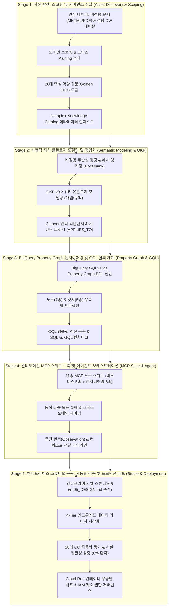
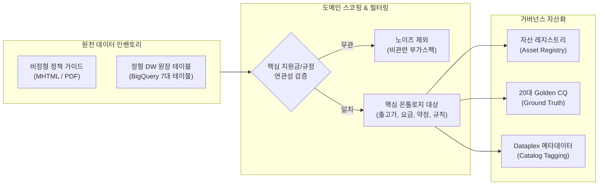
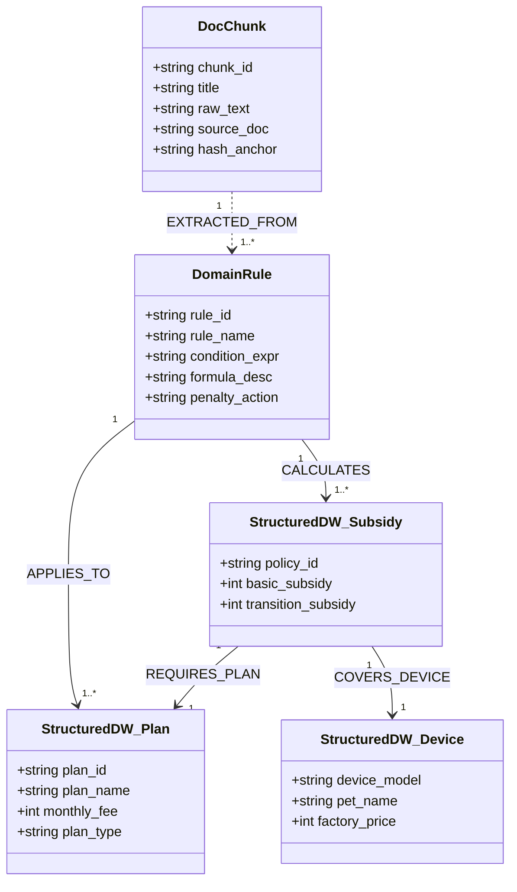
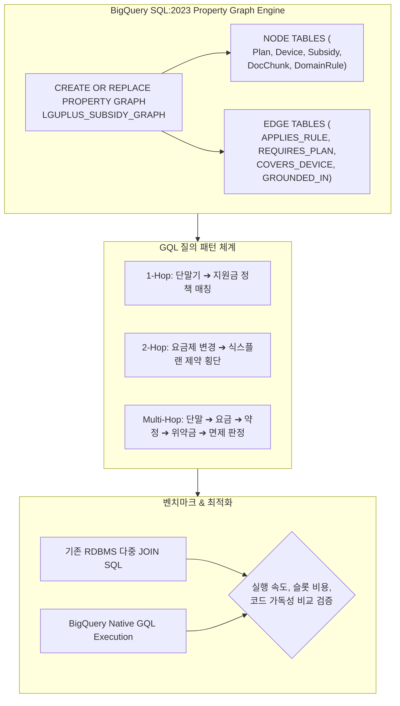
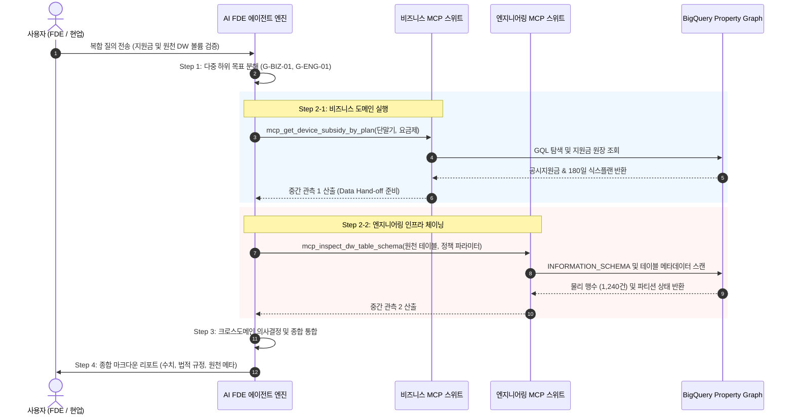
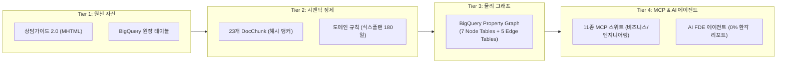

# 엔터프라이즈 에이전틱 온톨로지 구축 방법론 및 실행 프로세스 명세서
## Enterprise Agentic Ontology Methodology & Implementation Process Specification (Korean Edition)

- **문서 버전**: `v1.0.0`
- **표준 프레임워크**: `5-Stage Enterprise Agentic Ontology Framework`
- **적용 도메인**: 정형 DW(BigQuery) 및 비정형 업무 규정(MHTML/PDF/SOP) 기반 지능형 의사결정 시스템
- **연계 기술 표준**: Google Cloud Open Knowledge Format (OKF v0.2), BigQuery Property Graph (SQL:2023 GQL), Model Context Protocol (MCP), Google ADK

---

## 1. 개요 및 엔터프라이즈 아키텍처 철학 (Executive Overview & Philosophy)

### 1.1 배경 및 문제 정의
전통적인 기업형 LLM 도입 방식은 **단순 벡터 검색 기반 RAG (Vector RAG)** 또는 **정적 자연어-SQL 변환 (Text-to-SQL)**에 의존해 왔습니다. 그러나 이러한 방식은 다음과 같은 치명적인 한계를 노출합니다:
1. **의미적 환각 (Semantic Hallucination)**: 복잡한 할인 규칙, 위약금 산정 조건, 기간별 유예 정책 등 다단계 비즈니스 제약을 벡터 유사도만으로 정확히 인출하지 못함.
2. **비정형 규정과 정형 원장의 분리**: 정형 원장(단말기 출고가, 요금제 테이블)과 비정형 정책 문서(상담 가이드, 유통망 지원금 규칙)가 결합되지 못해 일관된 답변 불가.
3. **감사 추적성(Auditability) 결여**: 모델의 추론 과정과 사용된 데이터 원천의 출처를 역추적할 수 없어 엔터프라이즈 운영 리스크 발생.

### 1.2 5단계 하이브리드 온톨로지 방법론의 핵심 원칙
본 방법론은 정형 데이터와 비정형 규정을 하나의 일관된 **지식 온톨로지(Knowledge Ontology)** 및 **물리 프로퍼티 그래프(BigQuery Property Graph)**로 통합하고, 이를 **멀티도메인 MCP 스위트**를 통해 에이전트에 공급하는 5단계 표준 수명주기를 규정합니다:
- **0% 환각 (Zero-Hallucination Grounding)**: 정형 DW 원장과 결정론적 규칙 엔진 결합.
- **2-Layer 안티 리던던시 (Anti-Redundancy Refinement)**: 정형 테이블을 별도 중복 저장하지 않고 그래프 노드로 직접 승격.
- **크로스도메인 투명성 (Cross-Domain Reasoning)**: 비즈니스 정책과 엔지니어링 인프라 도구의 동적 분해 및 체이닝.
- **5단계 수명주기 통제 (Strict 5-Stage Gate)**: 단계별 명확한 입출력 산출물과 검수 기준 수립.

---

## 2. 5단계 엔드투엔드 라이프사이클 흐름도 (End-to-End Lifecycle Architecture)

---

## 3. 단계별 상세 실행 명세 (Stage-by-Stage Specifications)

---

### Stage 1: 자산 탐색, 스코핑 및 거버넌스 수집 (Asset Discovery, Scoping & Governance Ingestion)
> 📘 **하부 세부 실행 명세서**: [01_asset_discovery_and_scoping_ko.md](file:///Users/seanjung/Downloads/Uplus%20Ontology/agentic-ontology-starter/methodology/01_asset_discovery_and_scoping_ko.md)

#### 1. 개요 및 목적
기업 내부의 분산된 데이터 자산(데이터웨어하우스 원장 테이블, 상담 가이드, 정책 매뉴얼, 약관 규정)을 전수 식별하고, 불필요한 노이즈를 사전에 배제(Pruning)하며, 비즈니스 성공을 판정할 핵심 질문군(Competency Questions)을 정립하는 단계입니다.

#### 2. 핵심 작업 항목 (Work Items)
1. **도메인 바운더리 획정 및 노이즈 필터링 (Noise Pruning Charter)**:
   - 온톨로지의 초점을 지원금/위약금/약정 규정으로 명확히 압축.
   - 지원금과 무관한 일반 요금제 부가옵션(멤버십 혜택, 부가통화 등)을 노이즈로 정의하여 모델링 대상에서 제외.
2. **20대 핵심 역량 질문(Golden CQs) 수립**:
   - 도메인 전문가(FDE) 및 현업 상담사가 실무에서 매일 마주하는 복합 질문 20선을 선별.
   - 각 질문별 사실 정답(Ground Truth), 판정 로직, 참조 원천 데이터를 정의.
3. **원천 데이터 자산 프로파일링 및 레지스트리 구축**:
   - BigQuery DW 내 7대 원장 테이블(단말기, 요금제, 지원금 정책 등)의 스키마, 볼륨, PK/FK 관계 조사.
   - 비정형 원천 문서(MHTML, PDF)의 문서 구조 및 섹션 체계 분석.
4. **Google Cloud Dataplex Knowledge Catalog 메타데이터 연계**:
   - 데이터셋 및 테이블에 비즈니스 태그, PII 보호 등급, 거버넌스 애스펙트(Aspects) 동기화.

#### 3. Stage 1 산출물 매트릭스
| 산출물 ID | 산출물 명칭 | 파일 형식 | 주요 내용 및 목적 | 담당 R&R |
| :--- | :--- | :--- | :--- | :--- |
| `D1.1` | 도메인 스코핑 및 노이즈 필터링 헌장 | Markdown (`SCOPE_CHARTER.md`) | 도메인 경계 정의, 포함/제외 기준, 노이즈 필터링 규칙 | Data Architect |
| `D1.2` | 20대 Golden CQ 및 정답 검증 명세서 | Markdown / CSV (`CQ_SPECIFICATION.md`) | 20대 실무 역량 질문, 기대 정답, 계산식, 평가 기준 | Domain Expert / FDE |
| `D1.3` | 원천 자산 인벤토리 및 스키마 프로파일 | Markdown / JSON (`ASSET_REGISTRY.md`) | 정형 DW 테이블 스키마, 행수, 컬럼 타입, 문서 메타 | Data Engineer |
| `D1.4` | Dataplex 카탈로그 태깅 및 거버넌스 맵 | YAML / JSON (`CATALOG_MAP.yaml`) | 거버넌스 태그 템플릿, PII 식별, 자산 검색 인덱스 | Security & Governance |

---

### Stage 2: 시맨틱 지식 온톨로지 모델링 및 정형화 (Semantic Modeling, Open Knowledge Formalization & Grounding)
> 📘 **하부 세부 실행 명세서**: [02_semantic_modeling_and_okf_ko.md](file:///Users/seanjung/Downloads/Uplus%20Ontology/agentic-ontology-starter/methodology/02_semantic_modeling_and_okf_ko.md)

#### 1. 개요 및 목적
수집된 비정형 문서를 구조적으로 분해하여 고유 해시 앵커를 부여하고, Google Cloud Open Knowledge Format (OKF v0.2) 기반으로 개념·엔티티·규칙을 정형화하며, 정형 DW 테이블과 결합하는 2-Layer 안티 리던던시(Anti-Redundancy) 지식 모델을 구축하는 단계입니다.

#### 2. 핵심 작업 항목 (Work Items)
1. **무손실 구조 파싱 및 결정론적 시각 청킹 (`DocChunk`)**:
   - 표, 제목 계층, 목록, 텍스트 단락을 시각적 의미 단위로 청킹.
   - 각 청크마다 불변의 고유 해시 식별자(예: `DOC_CHUNK_001` ~ `023`) 부여.
2. **OKF v0.2 지식 온톨로지 모델링**:
   - Karpathy 3-Layer(Summary / Entities / Concepts) 구조에 기반한 온톨로지 모델링.
   - 단말기, 요금제, 약정상품, 지원금 정책 등 78종 개념 모델링.
3. **2-Layer 안티 리던던시 정제 (Anti-Redundancy Refinement)**:
   - 정형 DB에 이미 존재하는 데이터(단말기 가격, 요금제 월정액 등)를 온톨로지 노드로 중복 생성하지 않음.
   - **정형 DW 원장 테이블 자체를 노드로 승격**시키고, 비정형 문서는 **원천 증거(`DocChunk`)**와 **비즈니스 판정 규칙(`DomainRule`)**의 2계층으로만 정제.
4. **시맨틱 관계망 연결 (Semantic Bridging)**:
   - 규칙과 정형 테이블 간 `APPLIES_TO`, `CALCULATES`, `CONSTRAINS` 시맨틱 엣지 정의.

#### 3. Stage 2 산출물 매트릭스
| 산출물 ID | 산출물 명칭 | 파일 형식 | 주요 내용 및 목적 | 담당 R&R |
| :--- | :--- | :--- | :--- | :--- |
| `D2.1` | OKF v0.2 도메인 온톨로지 명세서 | JSON-LD / YAML (`ontology.jsonld`) | 78종 개념/엔티티 분류 체계, 관계 정의, 네임스페이스 | Knowledge Engineer |
| `D2.2` | 비정형 텍스트 청크 및 해시 앵커 매니페스트 | JSONL (`doc_chunks.jsonl`) | 청크 원문, 계층 헤더, 불변 해시 앵커, 위치 매핑 | Data Engineer |
| `D2.3` | 결정론적 비즈니스 규칙 레지스트리 | JSON / SQL (`domain_rules.json`) | 180일 식스플랜, 위약금 산식, 특화 면제 조건식 명세 | Domain Engineer |
| `D2.4` | 2-Layer 시맨틱 브릿지 맵핑 매트릭스 | Markdown (`SEMANTIC_BRIDGE_MATRIX.md`) | 비정형 규칙 ➔ 정형 DW 원장 간 엣지 연결 스펙 | Solution Architect |

---

### Stage 3: BigQuery Property Graph 엔지니어링 및 GQL 질의 체계 (BigQuery Property Graph Engineering & GQL Compilation)
> 📘 **하부 세부 실행 명세서**: [03_property_graph_and_gql_ko.md](file:///Users/seanjung/Downloads/Uplus%20Ontology/agentic-ontology-starter/methodology/03_property_graph_and_gql_ko.md)

#### 1. 개요 및 목적
Stage 2에서 설계된 하이브리드 온톨로지를 실제 Google Cloud BigQuery SQL:2023 Property Graph 표준으로 물리 구현하고, 다중 홉(Multi-Hop) 지식 탐색을 수행하는 선언적 GQL(Graph Query Language) 쿼리 엔진을 엔지니어링하는 단계입니다.

#### 2. 핵심 작업 항목 (Work Items)
1. **선언적 Property Graph DDL 작성 (`CREATE PROPERTY GRAPH`)**:
   - 물리적 데이터 복제 없이 기존 BigQuery 테이블을 노드와 엣지로 참조하는 DDL 선언.
   - 노드 테이블 7종 및 엣지 테이블 5종 정의.
2. **물리 노드/엣지 프로젝션**:
   - 노드: `PlanNode`, `DeviceNode`, `SubsidyNode`, `DocChunkNode`, `DomainRuleNode`, `PenaltyFormulaNode`, `ExemptionNode`.
   - 엣지: `COVERS_DEVICE`, `REQUIRES_PLAN`, `APPLIES_RULE`, `CALCULATES_PENALTY`, `GROUNDED_IN`.
3. **GQL 템플릿 엔진 설계**:
   - 1-홉(단말기 지원금 조회), 2-홉(요금제 변경 시 위약금 규칙 횡단), 다중 홉(요금제-지원금-약정-위약금-면제 판정) 쿼리 템플릿 정립.
4. **SQL vs GQL 성능 및 비용 벤치마크**:
   - 동일 질문에 대한 다중 조인(Join) SQL 대비 GQL의 쿼리 간결성, 가독성, 처리 속도 및 BigQuery 슬롯 소모량 실측 검증.

#### 3. Stage 3 산출물 매트릭스
| 산출물 ID | 산출물 명칭 | 파일 형식 | 주요 내용 및 목적 | 담당 R&R |
| :--- | :--- | :--- | :--- | :--- |
| `D3.1` | BigQuery Property Graph 물리 DDL 스크립트 | SQL (`create_property_graph.sql`) | 노드 7종, 엣지 5종 DDL 선언문, 레이블 및 속성 명세 | Graph Engineer |
| `D3.2` | 그래프 토폴로지 구조도 및 데이터플로우 명세서 | Markdown (`GRAPH_TOPOLOGY.md`) | 노드-엣지 스키마 매핑 매트릭스, 키 제약 조건 | Data Architect |
| `D3.3` | GQL 질의 패턴 카탈로그 및 템플릿 엔진 | Python / SQL (`GQL_PATTERNS.md`) | 1~3홉 GQL 탐색 쿼리 템플릿 모음 및 파라미터 바인딩 | Agent Engineer |
| `D3.4` | SQL vs GQL 성능·비용 벤치마크 보고서 | Markdown (`BENCHMARK_REPORT.md`) | 20대 질의 대상 실행 속도, 바이트 스캔량, 슬롯 타임 비교 | Performance QA |

---

### Stage 4: 멀티도메인 MCP 스위트 구축 및 에이전트 오케스트레이션 (Multi-Domain MCP Suite Packaging & Agentic Orchestration)
> 📘 **하부 세부 실행 명세서**: [04_multi_domain_mcp_and_agent_ko.md](file:///Users/seanjung/Downloads/Uplus%20Ontology/agentic-ontology-starter/methodology/04_multi_domain_mcp_and_agent_ko.md)

#### 1. 개요 및 목적
온톨로지와 그래프 엔진을 에이전트가 직접 호출할 수 있도록 Model Context Protocol (MCP) 표준 인터페이스로 패키징하고, 복합 질의를 하위 목표로 동적 분해하여 크로스도메인 체이닝을 실행하는 지능형 오케스트레이터를 구축하는 단계입니다.

#### 2. 핵심 작업 항목 (Work Items)
1. **11종 도메인 온톨로지 MCP 스위트 개발**:
   - **비즈니스 도구 5종**: 단말기 출고가(`mcp_get_device_factory_price`), 지원금(`mcp_get_device_subsidy_by_plan`), 위약금 계산(`mcp_calculate_plan_change_penalty`), 약정 계약비교(`mcp_compare_contract_plans`), 근거 청크(`mcp_get_policy_anchor_grounding`).
   - **엔지니어링/인프라 도구 6종**: BigQuery GQL 탐색(`mcp_explore_property_graph`), DW 볼륨/통계(`mcp_inspect_dw_table_schema`), Dataplex 카탈로그(`mcp_search_dataplex_catalog`), 리니지 조회(`mcp_get_lineage_trace`), DDL 내보내기(`mcp_export_graph_ddl`), 벤치마크(`mcp_run_cq_benchmark`).
2. **AI FDE 에이전트 동적 다중 목표 분해 (`Sub-Goals`) 엔진 구현**:
   - 복합 질문을 분석하여 1개 이상의 독립 하위 목표(`G-BIZ-01`, `G-ENG-01` 등)로 분해.
   - 단일 정적 분기문을 완전 배제하고 질의 의도 기반 의미적 라우팅 수행.
3. **크로스도메인 시퀀셜 체이닝 (`SEQUENTIAL_CHAIN`) 및 컨텍스트 전달**:
   - 선행 도구의 출력물(인출된 테이블명, 정책 기간 등)을 후속 도구의 인자로 동적 주입.
   - 비즈니스 결과(지원금 계산)와 인프라 결과(원천 테이블 행수)를 교차 검증(`cross_domain_integration`).
4. **타임라인 시각화 및 모호 질의 가드레일 수립**:
   - 사유(Reason), 중간 관측(Intermediate Observation), 데이터 핸드오프를 투명하게 표출.
   - 카탈로그 미지원(`[NOT_FOUND]`) 및 권한 제한(`[RESTRICTED]`) 시 안전한 대체 안내.

#### 3. Stage 4 산출물 매트릭스
| 산출물 ID | 산출물 명칭 | 파일 형식 | 주요 내용 및 목적 | 담당 R&R |
| :--- | :--- | :--- | :--- | :--- |
| `D4.1` | 11종 도메인 온톨로지 MCP 서버 스펙 및 구현체 | Python / JSON (`src/agents/mcpServer.py`) | 도구 정의, JSON 스키마, 파라미터 명세, 모의/실제 백엔드 | Agent Engineer |
| `D4.2` | AI FDE 시맨틱 라우팅 및 다중 목표 분해 엔진 | Python (`src/agents/fdeAgentEngine.py`) | 동적 하위 목표 분해, 시퀀셜 체이닝, 중간 관측 생성기 | AI Lead |
| `D4.3` | 크로스도메인 컨텍스트 전달 및 핸드오프 프로토콜 | Markdown (`HANDOFF_PROTOCOL.md`) | 도구 간 데이터 인자 주입 표준 규약, 데이터 계약 | Solution Architect |
| `D4.4` | 모호/권한부족 질의 가드레일 정책 핸들러 | Python / Markdown (`GUARDRAIL_RULES.md`) | 예외 처리 가드레일, IAM 권한 부족 대응, 감사 로그 정책 | Security Lead |

---

### Stage 5: 엔터프라이즈 스튜디오 구축, 자동화 검증 및 프로덕션 배포 (Enterprise Studio Integration, Automated Evaluation & Production Deployment)
> 📘 **하부 세부 실행 명세서**: [05_enterprise_studio_and_deployment_ko.md](file:///Users/seanjung/Downloads/Uplus%20Ontology/agentic-ontology-starter/methodology/05_enterprise_studio_and_deployment_ko.md)

#### 1. 개요 및 목적
구축된 지식 온톨로지와 에이전트를 사용자가 시각적으로 탐색·검증하고 현업에 서비스할 수 있도록 엔터프라이즈 웹 스튜디오를 배포하고, 20대 Golden CQ 기반 자동화 회귀 검증 및 Cloud Run 컨테이너 운영 환경을 무중단 배포하는 최종 단계입니다.

#### 2. 핵심 작업 항목 (Work Items)
1. **엔터프라이즈 디자인 시스템 준수 웹 스튜디오 통합 구축**:
   - `05_DESIGN.md` 표준 100% 준수 (Pretendard 폰트, 다크모드, 0% 장식용 이모지).
   - 5대 스튜디오: 파이프라인 모니터, 자산 레지스트리, BQG 프로퍼티 그래프 탐색기, CQ 벤치마크 콘솔, AI FDE 스튜디오.
2. **4-Tier 엔드투엔드 데이터 리니지 시각화**:
   - Tier 1(원천 문서/DW) ➔ Tier 2(청크/정제) ➔ Tier 3(온톨로지/BQG) ➔ Tier 4(MCP/AI 에이전트)로 이어지는 무결점 감사 추적망 제공.
3. **20대 Golden CQ 자동화 평가 및 사실 일관성 감사**:
   - LLM-as-a-Judge 및 수치 일치율 메트릭을 통해 0% 환각 달성 여부 정량 검증.
   - 응답 레이턴시, 토큰 소모량, 슬롯 비용 프로파일링.
4. **Cloud Run 프로덕션 컨테이너 패키징 및 IaC 배포**:
   - Dockerfile 기반 컨테이너 빌드, Terraform IaC 관리, 최소 권한 런타임 서비스 계정(SA) 격리 적용.

#### 3. Stage 5 산출물 매트릭스
| 산출물 ID | 산출물 명칭 | 파일 형식 | 주요 내용 및 목적 | 담당 R&R |
| :--- | :--- | :--- | :--- | :--- |
| `D5.1` | 엔터프라이즈 통합 웹 스튜디오 소스 코드 | Python / HTML / JS (`src/web/`) | 5대 통합 스튜디오 구현체, 반응형 UI, 영문/국문 로컬라이제이션 | Frontend / Fullstack |
| `D5.2` | 4-Tier 엔드투엔드 데이터 리니지 명세서 | Markdown (`LINEAGE_ARCHITECTURE.md`) | 4-Tier 데이터 흐름, 노드 간 감사 추적 경로, 리니지 뷰어 | Data Architect |
| `D5.3` | 20대 Golden CQ 자동화 평가 결과 보고서 | Markdown / JSON (`CQ_EVALUATION_REPORT.md`) | 20대 질의 전수 검증 결과, 수치 일치율, 환각 지수 0% 인증 | QA Lead / FDE |
| `D5.4` | Cloud Run 무중단 배포 스크립트 및 운영 런북 | Shell / Markdown (`OPERATIONAL_RUNBOOK.md`) | Docker 빌드, gcloud 배포 절차, 헬스체크, IAM 거버넌스 | DevOps / Cloud Architect |

---

## 4. 종합 WBS 및 RACI 책임 할당 매트릭스 (Comprehensive WBS & RACI Matrix)

| 단계 (Stage) | 산출물 ID | 산출물 명칭 (Deliverable) | DA | DE | KE | AE | QA |
| :---: | :---: | :--- | :---: | :---: | :---: | :---: | :---: |
| **Stage 1** | `D1.1` | 도메인 스코핑 및 노이즈 필터링 헌장 | **A/R** | C | C | I | I |
| | `D1.2` | 20대 Golden CQ 및 정답 검증 명세서 | C | I | C | **R** | **A** |
| | `D1.3` | 원천 자산 인벤토리 및 스키마 프로파일 | C | **A/R** | I | I | I |
| | `D1.4` | Dataplex 카탈로그 태깅 및 거버넌스 맵 | **A** | **R** | C | I | I |
| **Stage 2** | `D2.1` | OKF v0.2 도메인 온톨로지 명세서 | C | I | **A/R** | C | I |
| | `D2.2` | 비정형 텍스트 청크 및 해시 앵커 매니페스트 | I | **R** | **A** | I | I |
| | `D2.3` | 결정론적 비즈니스 규칙 레지스트리 | C | I | **A** | **R** | C |
| | `D2.4` | 2-Layer 시맨틱 브릿지 맵핑 매트릭스 | **A** | C | **R** | C | I |
| **Stage 3** | `D3.1` | BigQuery Property Graph 물리 DDL 스크립트 | C | **R** | I | **A** | I |
| | `D3.2` | 그래프 토폴로지 구조도 및 데이터플로우 명세서 | **A/R** | C | C | I | I |
| | `D3.3` | GQL 질의 패턴 카탈로그 및 템플릿 엔진 | I | C | I | **A/R** | C |
| | `D3.4` | SQL vs GQL 성능·비용 벤치마크 보고서 | I | C | I | C | **A/R** |
| **Stage 4** | `D4.1` | 11종 도메인 온톨로지 MCP 서버 스펙 및 구현체 | I | I | I | **A/R** | C |
| | `D4.2` | AI FDE 시맨틱 라우팅 및 다중 목표 분해 엔진 | I | I | I | **A/R** | C |
| | `D4.3` | 크로스도메인 컨텍스트 전달 및 핸드오프 프로토콜 | **A** | I | C | **R** | I |
| | `D4.4` | 모호/권한부족 질의 가드레일 정책 핸들러 | C | I | I | **R** | **A** |
| **Stage 5** | `D5.1` | 엔터프라이즈 통합 웹 스튜디오 소스 코드 | I | I | I | **A/R** | C |
| | `D5.2` | 4-Tier 엔드투엔드 데이터 리니지 명세서 | **A/R** | C | C | I | I |
| | `D5.3` | 20대 Golden CQ 자동화 평가 결과 보고서 | I | I | I | C | **A/R** |
| | `D5.4` | Cloud Run 무중단 배포 스크립트 및 운영 런북 | C | **R** | I | **A** | I |

> **RACI 기호 정의**:
> - **A (Accountable)**: 최종 승인권자 (산출물 품질 최종 책임)
> - **R (Responsible)**: 실제 실무 작성 및 구현 책임자
> - **C (Consulted)**: 자문 및 피드백 제공자
> - **I (Informed)**: 진행 상황 및 완료 결과 통보 대상자
> - **역할 정의**: DA (Data Architect), DE (Data Engineer), KE (Knowledge Engineer), AE (Agent Engineer), QA (Quality Assurance / FDE)

---

## 5. 품질 게이트 및 단계별 완료(Sign-off) 체크리스트

| 단계 (Stage) | 마일스톤 게이트 명칭 | 핵심 완료 요건 (Gate Exit Criteria) | 필수 증빙 산출물 |
| :--- | :--- | :--- | :--- |
| **Gate 1** | 자산 탐색 및 스코핑 승인 | - 도메인 바운더리 및 노이즈 제외 원칙 서명 완료 - 20대 Golden CQ 및 사실 정답표 100% 확정 - DW 7대 원장 및 비정형 문서 접근성 확인 | `D1.1`, `D1.2`, `D1.3` |
| **Gate 2** | 시맨틱 온톨로지 모델 승인 | - OKF 3-Layer 개념 모델 검수 완료 - 비정형 텍스트 청크 100% 고유 해시 앵커 부여 - 2-Layer 안티 리던던시 브릿지 매핑 검증 | `D2.1`, `D2.2`, `D2.4` |
| **Gate 3** | 프로퍼티 그래프 DDL 승인 | - BigQuery Property Graph DDL 정상 컴파일 - 노드 7종/엣지 5종 무복제 프로젝션 실측 - GQL 질의 응답 시간 및 SQL 대비 효율성 입증 | `D3.1`, `D3.3`, `D3.4` |
| **Gate 4** | MCP 스위트 및 에이전트 승인 | - 11종 도메인 MCP 도구 규약 테스트 통과 - 복합 질의 2단계 시퀀셜 체이닝 및 핸드오프 검증 - 예외/모호 질의 가드레일 정상 작동 확인 | `D4.1`, `D4.2`, `D4.4` |
| **Gate 5** | 프로덕션 운영 및 서비스 승인 | - 엔터프라이즈 디자인 표준 100% 준수 확인 - 20대 Golden CQ 평가 수치 일치율 100% 달성 - Cloud Run 프로덕션 배포 및 IAM 보안 감사 통과 | `D5.1`, `D5.3`, `D5.4` |
