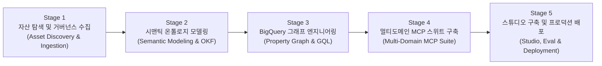

# Enterprise Agentic Ontology Methodology & Implementation Process
## 엔터프라이즈 에이전틱 온톨로지 구축 방법론 및 실행 프로세스 가이드

본 디렉토리는 정형 데이터웨어하우스(BigQuery DW)와 비정형 업무 가이드(MHTML/PDF)를 단일 지식 체계로 통합하여, 0% 환각(Zero-Hallucination)과 결정론적 계산 신뢰성을 보장하는 **에이전틱 지식 온톨로지(Agentic Knowledge Ontology)**를 엔드투엔드로 구축·배포하기 위한 표준 방법론과 실행 프로세스를 제공합니다.

특정 고객사의 환경에 종속되지 않고 누구나 데이터만 교체하여 재구성할 수 있도록 모든 원천 자산과 테이블 명칭을 표준 비즈니스 아키텍처 수준으로 1단계 추상화(예: `[단말기 카탈로그 마스터 BQ 테이블]`, `[고객 상담가이드 비정형 매뉴얼]`)하여 수록하였습니다.

---

### 1. 전체 문서 구성 (Document Structure)

#### 마스터 총괄 가이드
| 문서명 (Master Document) | 언어 (Language) | 주요 내용 및 목적 |
| :--- | :---: | :--- |
| [METHODOLOGY_KO.md](file:///Users/seanjung/Downloads/Uplus%20Ontology/agentic-ontology-starter/methodology/METHODOLOGY_KO.md) | 한국어 (Korean) | 5단계 표준 라이프사이클 마스터 총괄 명세서, RACI 매트릭스, 종합 품질 게이트 |
| [METHODOLOGY_EN.md](file:///Users/seanjung/Downloads/Uplus%20Ontology/agentic-ontology-starter/methodology/METHODOLOGY_EN.md) | 영어 (English) | Master 5-Stage Framework Specification, RACI Matrix, Comprehensive Quality Gates |

#### 5대 단계별 세부 하부 실행 명세서 (Detailed Stage Sub-Documents)
| 단계 (Stage) | 한국어 상세 명세서 (KO) | 영어 상세 명세서 (EN) | 핵심 다이어그램 및 기술 스펙 |
| :--- | :--- | :--- | :--- |
| **Stage 1: 자산 탐색 및 거버넌스 수집** | [01_asset_discovery_and_scoping_ko.md](file:///Users/seanjung/Downloads/Uplus%20Ontology/agentic-ontology-starter/methodology/01_asset_discovery_and_scoping_ko.md) | [01_asset_discovery_and_scoping_en.md](file:///Users/seanjung/Downloads/Uplus%20Ontology/agentic-ontology-starter/methodology/01_asset_discovery_and_scoping_en.md) | 자산 스코핑 데이터플로우, 노이즈 Pruning 헌장, 20대 Golden CQ 정의, Dataplex 태깅 |
| **Stage 2: 시맨틱 온톨로지 모델링** | [02_semantic_modeling_and_okf_ko.md](file:///Users/seanjung/Downloads/Uplus%20Ontology/agentic-ontology-starter/methodology/02_semantic_modeling_and_okf_ko.md) | [02_semantic_modeling_and_okf_en.md](file:///Users/seanjung/Downloads/Uplus%20Ontology/agentic-ontology-starter/methodology/02_semantic_modeling_and_okf_en.md) | 시각 청킹 & 불변 해시 앵커링, Karpathy 3-Layer OKF 모델, 2-Layer 안티 리던던시 클래스도 |
| **Stage 3: BigQuery 그래프 엔지니어링** | [03_property_graph_and_gql_ko.md](file:///Users/seanjung/Downloads/Uplus%20Ontology/agentic-ontology-starter/methodology/03_property_graph_and_gql_ko.md) | [03_property_graph_and_gql_en.md](file:///Users/seanjung/Downloads/Uplus%20Ontology/agentic-ontology-starter/methodology/03_property_graph_and_gql_en.md) | SQL:2023 Property Graph DDL, 노드/엣지 무복제 프로젝션, 다중 홉 GQL 템플릿, 벤치마크 |
| **Stage 4: 멀티도메인 MCP 스위트 구축** | [04_multi_domain_mcp_and_agent_ko.md](file:///Users/seanjung/Downloads/Uplus%20Ontology/agentic-ontology-starter/methodology/04_multi_domain_mcp_and_agent_ko.md) | [04_multi_domain_mcp_and_agent_en.md](file:///Users/seanjung/Downloads/Uplus%20Ontology/agentic-ontology-starter/methodology/04_multi_domain_mcp_and_agent_en.md) | 11종 MCP 도구셋(비즈니스/엔지니어링), 동적 다중 목표 분해, 시퀀셜 체이닝 시퀀스도 |
| **Stage 5: 스튜디오 구축 및 배포** | [05_enterprise_studio_and_deployment_ko.md](file:///Users/seanjung/Downloads/Uplus%20Ontology/agentic-ontology-starter/methodology/05_enterprise_studio_and_deployment_ko.md) | [05_enterprise_studio_and_deployment_en.md](file:///Users/seanjung/Downloads/Uplus%20Ontology/agentic-ontology-starter/methodology/05_enterprise_studio_and_deployment_en.md) | 05_DESIGN.md 엔터프라이즈 스튜디오 5종, 4-Tier 데이터 리니지 흐름도, Cloud Run 무중단 배포 |

---

### 2. 5대 핵심 단계 요약 (5-Stage Framework Overview)

---

### 3. 방법론 활용 및 실행 순서
1. **착수 및 스코핑**: [Stage 1 가이드](file:///Users/seanjung/Downloads/Uplus%20Ontology/agentic-ontology-starter/methodology/01_asset_discovery_and_scoping_ko.md)를 따라 비즈니스 경계와 20대 Golden CQ를 확정합니다.
2. **시맨틱 지식 정형화**: [Stage 2 가이드](file:///Users/seanjung/Downloads/Uplus%20Ontology/agentic-ontology-starter/methodology/02_semantic_modeling_and_okf_ko.md)를 통해 비정형 텍스트 청킹 및 OKF 3-Layer 모델을 구축합니다.
3. **물리 그래프 배포**: [Stage 3 가이드](file:///Users/seanjung/Downloads/Uplus%20Ontology/agentic-ontology-starter/methodology/03_property_graph_and_gql_ko.md)에 명시된 DDL을 실행하여 BigQuery Property Graph를 생성합니다.
4. **에이전트 오케스트레이션**: [Stage 4 가이드](file:///Users/seanjung/Downloads/Uplus%20Ontology/agentic-ontology-starter/methodology/04_multi_domain_mcp_and_agent_ko.md)를 기반으로 11종 MCP 도구 및 동적 체이닝 라우터를 연동합니다.
5. **검증 및 프로덕션 릴리스**: [Stage 5 가이드](file:///Users/seanjung/Downloads/Uplus%20Ontology/agentic-ontology-starter/methodology/05_enterprise_studio_and_deployment_ko.md)에 따라 20대 CQ 0% 환각 검증을 마치고 Cloud Run으로 배포합니다.
