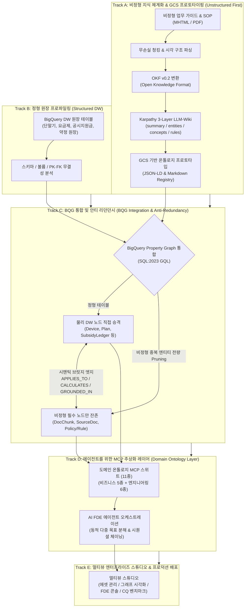

# Enterprise Agentic Ontology Methodology & Implementation Process
## 엔터프라이즈 에이전틱 온톨로지 구축 방법론 및 실행 프로세스 가이드

본 디렉토리는 정형 데이터웨어하우스(BigQuery DW)와 비정형 업무 가이드(MHTML/PDF)를 단일 지식 체계로 통합하여, 0% 환각(Zero-Hallucination)과 결정론적 계산 신뢰성을 보장하는 **에이전틱 지식 온톨로지(Agentic Knowledge Ontology)**를 엔드투엔드로 구축·배포하기 위한 표준 방법론과 실행 프로세스를 제공합니다.

특정 고객사의 환경에 종속되지 않고 누구나 데이터만 교체하여 재구성할 수 있도록 모든 원천 자산과 테이블 명칭을 표준 비즈니스 아키텍처 수준으로 1단계 추상화(예: `[단말기 카탈로그 마스터 BQ 테이블]`, `[고객 상담가이드 비정형 매뉴얼]`)하여 수록하였습니다.

---

### 1. 진화적 온톨로지 통합 아키텍처 (Evolutionary Architecture Journey)

본 방법론의 핵심은 초기 비정형 문서 프로토타이핑에서 출발하여 엔터프라이즈 프로덕션 수준의 물리 그래프와 에이전트 추상화 계층으로 발전해 나가는 **4단계 진화 여정(Evolutionary Journey)**에 있습니다:

#### 4대 진화 축의 상세 원리
1. **비정형 우선 프로토타이핑 (Unstructured First & GCS Prototyping)**:
   - 비정형 업무 매뉴얼을 파싱하여 OKF(Open Knowledge Format v0.2)로 변환하고, Karpathy 3-Layer LLM-Wiki(`summary.md`, `entities.md`, `concepts.md`, `rules.md`) 구조로 재구성하여 GCS 버킷 상에서 신속하게 개념 검증(PoC)을 수행합니다.
2. **정형 DW 원장과의 병렬 프로파일링 (Structured DW Profiling)**:
   - 비정형 가이드와는 별개로, 데이터웨어하우스 내에 존재하는 마스터 원장 테이블(출고가, 공시지원금 테이블 등)의 스키마, 키 관계, 제약 조건을 독립적으로 프로파일링합니다.
3. **BigQuery Property Graph 결합 및 안티 리던던시 (Anti-Redundancy into BQG)**:
   - 두 영역을 통합할 때, 정형 테이블에 이미 존재하는 실체(단말기, 요금제)를 비정형에서 중복 생성하지 않고 **DW 테이블을 물리 그래프 노드로 직접 승격**시킵니다.
   - 비정형 영역에서는 엔티티 중복을 전량 제거(Pruning)하여, 오직 **원문 텍스트 청크(`DocChunk`), 원본 문서(`SourceDoc`), 순수 비즈니스 정책/규정(`DomainRule`/`Policy`)**만을 노드로 남깁니다.
   - 그리고 이들을 정형 노드와 시맨틱 브릿지 엣지(`APPLIES_TO`, `CALCULATES`, `GROUNDED_IN`)로 결합합니다.
4. **에이전트를 위한 도메인 MCP 추상화 레이어 (Domain Ontology Abstraction for Agents)**:
   - AI 에이전트가 복잡한 원천 테이블 조인이나 원시 그래프 DDL/GQL 쿼리를 직접 다루지 않고, 비즈니스 도메인 레벨로 정의된 고수준 MCP 도구 인터페이스를 호출하도록 캡슐화합니다.
   - 이를 통해 에이전트는 질문의 의도를 분석하여 비즈니스 도메인 도구와 엔지니어링 인프라 도구를 유기적으로 체이닝하며, 0% 환각의 결정론적 답변을 생성합니다.

---

### 2. 전체 문서 구성 (Document Structure)

#### 마스터 총괄 가이드
| 문서명 (Master Document) | 언어 (Language) | 주요 내용 및 목적 |
| :--- | :---: | :--- |
| [METHODOLOGY_KO.md](file:///Users/seanjung/Downloads/Uplus%20Ontology/agentic-ontology-starter/methodology/METHODOLOGY_KO.md) | 한국어 (Korean) | 진화적 통합 아키텍처, 5단계 표준 라이프사이클 마스터 명세서, RACI 매트릭스, 종합 품질 게이트 |
| [METHODOLOGY_EN.md](file:///Users/seanjung/Downloads/Uplus%20Ontology/agentic-ontology-starter/methodology/METHODOLOGY_EN.md) | 영어 (English) | Evolutionary Architecture Framework, Master 5-Stage Specification, RACI Matrix, Quality Gates |

#### 5대 단계별 세부 하부 실행 명세서 (Detailed Stage Sub-Documents)
| 단계 (Stage) | 한국어 상세 명세서 (KO) | 영어 상세 명세서 (EN) | 핵심 다이어그램 및 기술 스펙 |
| :--- | :--- | :--- | :--- |
| **Stage 1: 자산 탐색 및 거버넌스 수집** | [01_asset_discovery_and_scoping_ko.md](file:///Users/seanjung/Downloads/Uplus%20Ontology/agentic-ontology-starter/methodology/01_asset_discovery_and_scoping_ko.md) | [01_asset_discovery_and_scoping_en.md](file:///Users/seanjung/Downloads/Uplus%20Ontology/agentic-ontology-starter/methodology/01_asset_discovery_and_scoping_en.md) | 자산 스코핑 데이터플로우, 노이즈 Pruning 헌장, 20대 Golden CQ 정의, Dataplex 태깅 |
| **Stage 2: 시맨틱 온톨로지 모델링 & LLM-Wiki** | [02_semantic_modeling_and_okf_ko.md](file:///Users/seanjung/Downloads/Uplus%20Ontology/agentic-ontology-starter/methodology/02_semantic_modeling_and_okf_ko.md) | [02_semantic_modeling_and_okf_en.md](file:///Users/seanjung/Downloads/Uplus%20Ontology/agentic-ontology-starter/methodology/02_semantic_modeling_and_okf_en.md) | 비정형 파싱, Karpathy 3-Layer LLM-Wiki, GCS 프로토타이핑, 2-Layer 안티 리던던시 |
| **Stage 3: BigQuery 그래프 엔지니어링** | [03_property_graph_and_gql_ko.md](file:///Users/seanjung/Downloads/Uplus%20Ontology/agentic-ontology-starter/methodology/03_property_graph_and_gql_ko.md) | [03_property_graph_and_gql_en.md](file:///Users/seanjung/Downloads/Uplus%20Ontology/agentic-ontology-starter/methodology/03_property_graph_and_gql_en.md) | SQL:2023 Property Graph DDL, DW 노드 승격 & 청크/정책 브릿지, 다중 홉 GQL 템플릿 |
| **Stage 4: 멀티도메인 MCP 스위트 구축** | [04_multi_domain_mcp_and_agent_ko.md](file:///Users/seanjung/Downloads/Uplus%20Ontology/agentic-ontology-starter/methodology/04_multi_domain_mcp_and_agent_ko.md) | [04_multi_domain_mcp_and_agent_en.md](file:///Users/seanjung/Downloads/Uplus%20Ontology/agentic-ontology-starter/methodology/04_multi_domain_mcp_and_agent_en.md) | 11종 MCP 도구셋(비즈니스/엔지니어링), 에이전트 추상화 계층, 동적 체이닝 시퀀스 |
| **Stage 5: 스튜디오 구축 및 배포** | [05_enterprise_studio_and_deployment_ko.md](file:///Users/seanjung/Downloads/Uplus%20Ontology/agentic-ontology-starter/methodology/05_enterprise_studio_and_deployment_ko.md) | [05_enterprise_studio_and_deployment_en.md](file:///Users/seanjung/Downloads/Uplus%20Ontology/agentic-ontology-starter/methodology/05_enterprise_studio_and_deployment_en.md) | 05_DESIGN.md 멀티뷰 스튜디오(에셋/그래프/FDE/CQ), 4-Tier 데이터 리니지, 무중단 배포 |

---

### 3. 방법론 활용 및 실행 순서
1. **착수 및 스코핑**: [Stage 1 가이드](file:///Users/seanjung/Downloads/Uplus%20Ontology/agentic-ontology-starter/methodology/01_asset_discovery_and_scoping_ko.md)를 따라 비즈니스 경계와 20대 Golden CQ를 확정합니다.
2. **비정형 체계화 및 LLM-Wiki 프로토타이핑**: [Stage 2 가이드](file:///Users/seanjung/Downloads/Uplus%20Ontology/agentic-ontology-starter/methodology/02_semantic_modeling_and_okf_ko.md)를 통해 비정형 텍스트 청킹, OKF 변환 및 Karpathy 3-Layer LLM-Wiki를 GCS에 프로토타이핑합니다.
3. **물리 그래프 결합 및 안티 리던던시**: [Stage 3 가이드](file:///Users/seanjung/Downloads/Uplus%20Ontology/agentic-ontology-starter/methodology/03_property_graph_and_gql_ko.md)에 따라 BigQuery Property Graph DDL을 정의하고, DW 테이블을 물리 노드로 승격하며 비정형은 청크/규칙만 결합합니다.
4. **도메인 MCP 추상화 및 에이전트 오케스트레이션**: [Stage 4 가이드](file:///Users/seanjung/Downloads/Uplus%20Ontology/agentic-ontology-starter/methodology/04_multi_domain_mcp_and_agent_ko.md)를 기반으로 에이전트가 호출할 11종 도메인 MCP 도구 및 동적 체이닝을 구성합니다.
5. **멀티뷰 스튜디오 검증 및 프로덕션 릴리스**: [Stage 5 가이드](file:///Users/seanjung/Downloads/Uplus%20Ontology/agentic-ontology-starter/methodology/05_enterprise_studio_and_deployment_ko.md)에 따라 멀티뷰 스튜디오에서 20대 CQ 0% 환각 검증을 마치고 배포합니다.
