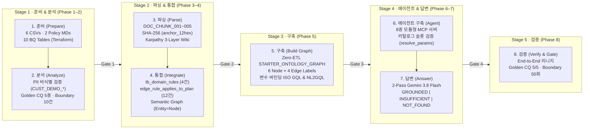
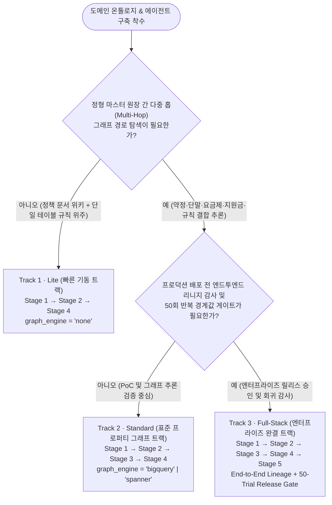

# Agentic Ontology Starter — Interactive Bilingual Jupyter Notebooks (`notebooks/ko/` & `notebooks/en/`)

> **🇰🇷 국문 마스터 초기 화면 (`notebooks/ko/`)**: [`ko/stage0_overview_walkthrough_ko.ipynb`](./ko/stage0_overview_walkthrough_ko.ipynb) ｜ **🇺🇸 English Master Entrypoint (`notebooks/en/`)**: [`en/stage0_overview_walkthrough_en.ipynb`](./en/stage0_overview_walkthrough_en.ipynb)
>
> **정본 방법론 문서 (Methodology Docs)**: [한국어 (`METHODOLOGY_KO.md`)](../methodology/ko/METHODOLOGY_KO.md) · [English (`METHODOLOGY_EN.md`)](../methodology/en/METHODOLOGY_EN.md) ｜ **Live Web Studio**: [`Agentic Ontology Studio`](https://agentic-ontology-starter-lwrlf7yogq-du.a.run.app) ｜ **License**: [`LICENSE`](../LICENSE)

본 디렉터리는 **Agentic Ontology Starter Pack v2.0**의 **5-Stage × 8-Phase 엔터프라이즈 에이전틱 온톨로지 방법론**을 BigQuery(`seanjung-poc.starter_ontology_dw`), BigQuery Property Graph(`STARTER_ONTOLOGY_GRAPH`), Vertex AI Gemini(`gemini-3.8-flash`) 실환경에서 단계별로 실행·검증하는 **12종의 인터랙티브 Jupyter 노트북**을 제공합니다.

가독성과 언어별 학습 일관성을 위해 **국문 노트북 6종은 [`notebooks/ko/`](./ko/) 폴더**에, **영문 노트북 6종은 [`notebooks/en/`](./en/) 폴더**에 분리 배치되어 있으며, 첨부 아키텍처 배너(`notebooks/assets/*_{ko,en}.png`)와 인라인 그래프·차트 라벨까지 언어별로 분리되어 있습니다.

```text
notebooks/
├── README.md                                          # 본 문서: ① 전체 흐름 → ② 선택 흐름 → ③ 문서 및 노트북 링크
├── ko/                                                # 🇰🇷 국문 실행형 노트북 6종 (Korean Notebooks)
│   ├── stage0_overview_walkthrough_ko.ipynb           #   0. 전체 8단계 엔지니어링 파이프라인 마스터 워크스루
│   ├── stage1_asset_and_cq_ko.ipynb                   #   Stage 1. [준비·분석] 원천 자산·10개 테이블 스키마·탐색 & Golden CQ
│   ├── stage2_wiki_and_semantic_graph_ko.ipynb        #   Stage 2. [파싱·통합] SHA-256 청킹·3-Layer Wiki & 시맨틱 그래프
│   ├── stage3_property_graph_bigquery_spanner_ko.ipynb#   Stage 3. [그래프 구축] Zero-ETL Property Graph & 변수 바인딩 ISO GQL
│   ├── stage4_agent_and_mcp_execution_ko.ipynb        #   Stage 4. [에이전트·답변] 8종 MCP 서버·슬롯 검증 & 2-Pass AI FDE
│   └── stage5_lineage_and_evaluation_ko.ipynb         #   Stage 5. [리니지·검증] 엔드투엔드 데이터 리니지 & 50회 벤치마크 게이트
├── en/                                                # 🇺🇸 영문 실행형 노트북 6종 (English Notebooks — 100% EN Images & Labels)
│   ├── stage0_overview_walkthrough_en.ipynb           #   0. End-to-End 8-Phase Engineering Pipeline Master Walkthrough
│   ├── stage1_asset_and_cq_en.ipynb                   #   Stage 1. [Prepare & Analyze] Asset Scoping, Schema & Golden CQs
│   ├── stage2_wiki_and_semantic_graph_en.ipynb        #   Stage 2. [Parse & Integrate] SHA-256 Chunking, Wiki & Semantic Graph
│   ├── stage3_property_graph_bigquery_spanner_en.ipynb#   Stage 3. [Build Graph] Zero-ETL Property Graph & Parameterized ISO GQL
│   ├── stage4_agent_and_mcp_execution_en.ipynb        #   Stage 4. [Build Agent & Answer] 8-Tool MCP & 2-Pass AI FDE Agent
│   └── stage5_lineage_and_evaluation_en.ipynb         #   Stage 5. [Verify & Gate] End-to-End Data Lineage & 50-Trial Release Gate
├── assets/                                            # 한/영 분리 고해상도 아키텍처 배너 PNG 12종 (stage0~5_*_{ko,en}.png)
├── nb_helpers.py                                      # 공통 BigFrames/BigQuery 실행기, GQL 변수/문장 렌더러, 비충돌 그래프 도식화
├── nb_specs_s0_s2.py / nb_specs_s3_s5.py              # Stage 0~5 한/영 노트북 셀 스펙 및 상·하단 네비게이션 빌더
├── generate_banner_assets.py                          # 한/영 아키텍처 배너 PNG 12종 생성 스크립트
├── generate_notebooks.py                              # 12개 노트북 일괄 생성 · 병렬 실행(--execute) · 검증 오케스트레이터
└── validate_and_pack_notebooks.py                     # PNG Base64 어태치먼트 패킹 및 NBFormat v4.5 무결성 검증기
```

---

## 1. 전체 흐름 (End-to-End 8-Phase & 5-Stage Engineering Flow)

### 1.1 8단계 엔지니어링 파이프라인 아키텍처 (Prepare → Analyze → Parse → Integrate → Build → Agent → Answer → Verify)

본 스타터 팩의 노트북은 단순 데이터 조회(EDA)에 머물지 않고, 원시 CSV와 마크다운 정책 문서가 **어떤 엔지니어링 변환과 검증 게이트(`Gate 1` ~ `Gate 5`)를 거쳐 근거 기반 에이전트 답변으로 합성되는지** 전 과정을 순차적으로 실행합니다.



### 1.2 단계별 상세 입출력 · 실행 코드 · 도식화 매핑표

| Stage (8-Phase) | 입력 데이터 및 자산 (Inputs) | 핵심 파이프라인 모듈 & MCP 도구 | 실행 쿼리 (`%%bqsql` / ISO GQL) 및 중간 확인 산출물 | 그래프 도식화 & 차트 (Visual Schematics) | 통과 게이트 (Gate) |
| :--- | :--- | :--- | :--- | :--- | :--- |
| **Stage 0**<br>*(0. 전체 흐름 개요)* | 전 단계 자산 및 라이브 카탈로그 통합 점검 | `DomainMcpServer`<br>`AiFdeAgentEngine`<br>`H.run_gql()` / `H.nl2gql()` | • 10개 테이블 행 수(`62행`) 실측<br>• `CUST_DEMO_001` 3-Hop ISO GQL (바인딩 변수 + 실행 문장 + 결과)<br>• `CQ-03`, `CQ-05` 에이전트 2-Pass 실행 | • 8단계 파이프라인 매핑 도식<br>• 10개 테이블 스키마 설계도<br>• 시맨틱 그래프 & 6N×4E 메타모델<br>• 25노드·29엣지 5계층 전체 토폴로지<br>• 2-Pass 에이전트 오케스트레이션 도식 | `Gate 1` ~ `Gate 5` 통합 판정표 |
| **Stage 1**<br>*(1. 준비 · 2. 분석)* | • 정형 CSV 6종 (`data/input/02_structured/`)<br>• 정책 마크다운 2종 (`01_guides/`)<br>• `golden_competency_questions.json` | `terraform/bigquery.tf`<br>`mcp_stage1_asset_discovery`<br>`H.check_cq_sql()` | • `INFORMATION_SCHEMA.COLUMNS` 10개 테이블 스키마 검증<br>• `CUST_DEMO_001~006` 비식별 검사(`0건` 위반)<br>• Golden CQ 5종 `verification_sql` 대조 | • 10개 테이블 ER 블루프린트 (`pos` 배치)<br>• 테이블별 물리 크기 가로 막대 차트<br>• 고객별 경과일 vs 180일 기준선 차트<br>• 단말×요금제 실구매가 및 용어 빈도 히트맵 | **Gate 1**: 10개 테이블 적재, PII 위반 0건, CQ 5/5 SQL 일치 |
| **Stage 2**<br>*(3. 파싱 · 4. 통합)* | • `sample_policy_guide.md`<br>• `sample_welfare_exemption_guide.md`<br>• `tb_doc_chunks`, `tb_domain_rules` | `pipeline/ingest.py`<br>`mcp_stage2_wiki_and_semantic`<br>`H.propose_triples()` | • `DOC_CHUNK_001~005` 정규식 파싱 및 실시간 SHA-256(`anchor_<12hex>`) 대조<br>• 3-Layer Wiki(`summary`, `entities`, `concepts`, `rules.md`) & GCS 매니페스트<br>• Gemini 후보 트리플 추출 및 검수 | • Stage 2 시맨틱 온톨로지 그래프 설계 도식 (Sky Blue 허브 4열 배치)<br>• BigQuery 실데이터 기반 `Rule → Plan (APPLIES_TO_PLAN)` & `Rule ⇢ DocChunk (GROUNDED_IN)` 브릿지 그래프 | **Gate 2**: 5개 청크 해시 일치, 3-Layer Wiki GCS 동기화, 12개 브릿지 엣지 |
| **Stage 3**<br>*(5. 그래프 구축)* | • BigQuery 10개 테이블 (6 Node + 4 Edge)<br>• `create_property_graph.sql`<br>• `create_spanner_graph.sql` | `pipeline/graph_builder.py`<br>`mcp_stage3_property_graph`<br>`H.run_gql()` / `H.nl2gql()` | • `INFORMATION_SCHEMA.PROPERTY_GRAPHS` 카탈로그 조회<br>• `GQL-01`~`GQL-05` 다중 홉 쿼리 (**바인딩 변수 명세표 + 실행 GQL 문장 + 결과**)<br>• Gemini `nl2gql` 및 미보유 스키마 차단 | • 6 Node × 4 Edge 프로퍼티 그래프 메타모델 설계도<br>• 노드/엣지 레이블별 인스턴스 분포 차트<br>• 25노드·29엣지 전체 물리 토폴로지 (5계층)<br>• `CUST_DEMO_001` 1~2홉 가변 경로 서브그래프 | **Gate 3**: 그래프 DDL 성공, 노드 중복 키 0건(`31행`), GQL 템플릿 검증 |
| **Stage 4**<br>*(6. 에이전트 · 7. 답변)* | • 8종 MCP 도구 카탈로그<br>• 실시간 BigQuery 엔티티 카탈로그<br>• `STARTER_ONTOLOGY_GRAPH` | `src/agent/mcp_server.py`<br>`src/agent/reasoning_engine.py`<br>`mcp_stage4_agent_orchestration` | • `resolve_params()` 슬롯 파싱 및 미등록 엔티티(`QuantumFold 99`) 차단<br>• 런타임 MCP 3종 직접 실행 (`mcp_query_graph_and_wiki` GQL 문장·변수 출력)<br>• `CQ-01~03` 및 경계 시나리오 4단계 트레이스 | • 2-Pass AI FDE 에이전트 & MCP 오케스트레이션 블루프린트<br>• `CUST_DEMO_001` 경과일(30~200일)별 위약금 선형 감소 곡선 (180일 면제 경계)<br>• 시나리오별 LLM vs BigQuery 지연시간 비교 차트 | **Gate 4**: 8종 MCP 활성, `GROUNDED` / `INSUFFICIENT` / `NOT_FOUND` 분기 |
| **Stage 5**<br>*(8. 리니지 · 검증)* | • `cq_benchmark_report.json`<br>• `boundary_benchmark_results.json`<br>• `tb_customer_contract` ~ `tb_doc_chunks` | `pipeline/validator.py`<br>`mcp_stage5_lineage_and_eval`<br>`H.recheck_cq()` | • 엔드투엔드 리니지 18행 조인(`Source → Chunk → Rule → Contract → CQ`)<br>• `CQ-02` 실시간 4대 채점 조건 재검증<br>• Boundary 10건×5회(`50 Trials`) 실패 분류(`root_cause_code`) 집계 | • End-to-End 데이터 리니지 멀티파타이트 그래프 (Tier 0~Tier 4 5열 배치)<br>• Golden CQ별 응답 소요 시간 차트<br>• Boundary 10건×5회 성공률·일관성·의도 안정성 그룹 막대 차트 | **Gate 5**: Golden CQ 5/5 (`100%`) 및 Boundary 50회 (`98.0%`) 통과 |

### 1.3 실제 GQL 실행 구간의 투명성 표준 (GQL Statement & Bound Variables Display)

모든 GQL 실행 구간(`Stage 0` 섹션 4, `Stage 3` 섹션 3~5, `Stage 4` 섹션 3~4)은 블랙박스 호출 없이 다음 3가지를 항상 순서대로 명시합니다:
1. **1) GQL 바인딩 변수 명세 (`Bound GQL Variables & Parameters`)**: 쿼리에 주입된 그래프 식별자(`GRAPH`), 필터 변수(`$customer_id`, `$target_plan_id`, `$elapsed_days`), 가변 경로 범위(`-{1,2}-`) 및 카탈로그 검증 슬롯(`applied_params`)을 마크다운 표로 먼저 출력합니다.
2. **2) 실행된 ISO GQL 문장 (`Executed ISO GQL Statement`)**: BigQuery Graph 엔진에 실제로 전송된 `GRAPH ... MATCH ... WHERE ... RETURN ...` 또는 `GRAPH_TABLE(...)` SQL/GQL 전문을 구문 강조 코드 블록으로 출력합니다.
3. **3) BigQuery 실행 메타데이터 및 결과 테이블**: 실제 실행된 BigQuery `job_id`, 소요 시간(`ms`), 반환 행 수(`rows`)와 DataFrame 결과를 함께 표시합니다.

---

## 2. 선택 흐름 (Selective Adoption Tracks, Graph Engine & Role-Based Paths)

프로젝트의 일정, 데이터 복잡도, 인프라 환경, 또는 담당자의 역할에 따라 전체 12개 노트북을 순차 학습하거나 필요한 트랙만 선택하여 실행할 수 있습니다.

### 2.1 조직 성숙도 및 과업 범위에 따른 3-Track 선택 흐름 (`config/starter_config.json`)



| 선택 트랙 (Adoption Track) | 실행 Stage 순서 | `starter_config.json` 설정 | 필수 실행 노트북 (`ko/` 또는 `en/`) | 적합한 도입 시나리오 및 기대 효과 |
| :--- | :--- | :--- | :--- | :--- |
| **Track 1 · Lite**<br>*(Wiki + Rule SQL Agent)* | `Stage 1 → Stage 2 → Stage 4` | `"track": "lite"`<br>`"graph_engine": "none"` | `stage1` → `stage2` → `stage4` | 물리 프로퍼티 그래프 구축 없이 **비정형 정책 가이드의 SHA-256 청킹(3-Layer LLM-Wiki)**과 **결정론적 SQL 산식(`mcp_calculate_penalty_rule`)**만으로 1~2주 내에 근거 인용 에이전트를 빠르게 기동할 때 적합합니다. |
| **Track 2 · Standard**<br>*(Zero-ETL Property Graph)* | `Stage 1 → Stage 2 → Stage 3 → Stage 4` | `"track": "standard"`<br>`"graph_engine": "bigquery"` (또는 `"spanner"`) | `stage1` → `stage2` → `stage3` → `stage4` | 정형 DW 마스터 원장 4종과 비정형 도메인 규칙을 **Zero-ETL BigQuery Property Graph(`6 Node × 4 Edge`)**로 결합하여, 다중 홉 ISO GQL 탐색과 `nl2gql`을 수행할 때 권장됩니다. |
| **Track 3 · Full-Stack**<br>*(Enterprise Release Gate)* | `Stage 1 → Stage 2 → Stage 3 → Stage 4 → Stage 5` | `"track": "full_stack"`<br>`"graph_engine": "bigquery"` | `stage0` → `stage1` → `stage2` → `stage3` → `stage4` → `stage5` | 원천 파일부터 답변까지의 **엔드투엔드 데이터 리니지**, **Golden CQ 5/5(100%) 자동 채점**, **Boundary 10건×5회(50회) 안정성 벤치마크**를 통과해야 하는 엔터프라이즈 운영 환경의 기본 트랙입니다. |

### 2.2 물리 그래프 엔진 선택 흐름 및 Graph Fabric (BigQuery Graph vs. Spanner Graph & `both`)

`Stage 1` 노트북(`stage1_asset_and_cq_{ko,en}.ipynb`)은 **5축 그래프 엔진 선택 체크리스트**(`source_system`, `latency_slo`, `concurrency`, `write_freshness`, `data_scale`)를 점검하고, `Stage 3` 노트북(`stage3_property_graph_bigquery_spanner_{ko,en}.ipynb`)은 동일한 `6 Node × 4 Edge` 온톨로지 메타모델에 대해 **BigQuery Property Graph(기본값)**와 **Cloud Spanner Graph(`starter-spanner`, `100 PU`)**의 `N=3` 반복 `p50`/`p95` 지연시간 벤치마크 및 **`EXTERNAL_QUERY(spanner_fabric_conn)` Graph Fabric 연합 조인**을 실측하며, `Stage 4` 노트북(`stage4_agent_and_mcp_execution_{ko,en}.ipynb`)은 런타임 MCP 도구를 양대 엔진(`engine="bigquery" | "spanner"`)에서 직접 비교 실행합니다.

| 비교 항목 | BigQuery Property Graph (`"bigquery"`, 기본값) | Cloud Spanner Graph (`"spanner"`, 온라인 저지연 옵션) | Dual-Engine & Graph Fabric (`"both"`, 샘플 활성) |
| :--- | :--- | :--- | :--- |
| **DDL 산출물 / 리소스** | [`data/output/create_property_graph.sql`](../data/output/create_property_graph.sql) | [`data/output/create_spanner_graph.sql`](../data/output/create_spanner_graph.sql) (`starter-spanner`, `100 PU`) | 양대 그래프 동시 배포 + BigQuery 연결(`spanner_fabric_conn`) |
| **데이터 복제 여부** | **Zero-ETL** (기존 BigQuery DW 10개 테이블 위에 메타데이터 뷰로 즉시 선언) | Spanner 인스턴스 내 인터리브드/외래키 테이블 적재(`pipeline/ingest.py`) | 온라인 원장은 Spanner, 정책 청크·이력 원장은 BigQuery 유지 |
| **쿼리 문법** | ISO/IEC 39075 GQL (`GRAPH ... MATCH ...` / `GRAPH_TABLE`) | ISO/IEC 39075 GQL (`GRAPH STARTER_ONTOLOGY_GRAPH MATCH ...`) | `EXTERNAL_QUERY("...spanner_fabric_conn", "GRAPH ...")` 연합 조인 |
| **권장 선택 기준** | DW 원장 분석, 대화형 AI FDE 에이전트, 추가 상시 비용 없이 즉시 도입 시 (기본값) | 대고객 실시간 상담·트랜잭션 제어(`p50 ~120ms` 저지연 포인트 탐색) | 실시간 OLTP 그래프 탐색 결과와 BigQuery 대규모 분석 테이블을 결합할 때 |

### 2.3 담당 직무(Role)별 추천 노트북 선택 경로

- **아키텍트 / 기술 리더 (Architect & Tech Lead)**:
  - 추천 순서: [`stage0_overview_walkthrough`](./ko/stage0_overview_walkthrough_ko.ipynb) → [`stage3_property_graph`](./ko/stage3_property_graph_bigquery_spanner_ko.ipynb) → [`stage5_lineage_and_evaluation`](./ko/stage5_lineage_and_evaluation_ko.ipynb)
  - 핵심 확인 포인트: 8단계 파이프라인 구조, Zero-ETL 프로퍼티 그래프 메타모델, Gate 1~5 릴리스 승인 기준.
- **데이터 엔지니어 / 온톨로지 모델러 (Data & Ontology Engineer)**:
  - 추천 순서: [`stage1_asset_and_cq`](./ko/stage1_asset_and_cq_ko.ipynb) → [`stage2_wiki_and_semantic_graph`](./ko/stage2_wiki_and_semantic_graph_ko.ipynb) → [`stage3_property_graph`](./ko/stage3_property_graph_bigquery_spanner_ko.ipynb)
  - 핵심 확인 포인트: 10개 테이블 PK/FK 블루프린트, `DOC_CHUNK` SHA-256 해시 앵커링, `Entity=Node / Concept=Edge` 시맨틱 매핑, 바인딩 변수 기반 ISO GQL 쿼리.
- **AI 에이전트 / MCP 엔지니어 (AI FDE & Agent Engineer)**:
  - 추천 순서: [`stage3_property_graph`](./ko/stage3_property_graph_bigquery_spanner_ko.ipynb) (섹션 4~5) → [`stage4_agent_and_mcp_execution`](./ko/stage4_agent_and_mcp_execution_ko.ipynb) → [`stage5_lineage_and_evaluation`](./ko/stage5_lineage_and_evaluation_ko.ipynb)
  - 핵심 확인 포인트: `resolve_params()` 카탈로그 슬롯 검증, 8종 MCP 도구 입출력 및 실행 GQL 문장, 2-Pass Gemini 추론과 가드레일 상태(`GROUNDED`, `INSUFFICIENT_PARAMETERS`, `MATCH_NOT_FOUND`).

---

## 3. 문서 및 노트북 링크 (Bilingual Notebooks, Methodology Guides & Live Studio Links)

### 3.1 🇰🇷 국문 노트북 (`notebooks/ko/`) — 6종 전체 목록

| 순서 | 국문 노트북 파일 링크 (`notebooks/ko/`) | 대응 Stage & Phase | 핵심 실행 내용 및 포함 도식 | 대응 국문 방법론 문서 (`methodology/`) |
| :---: | :--- | :--- | :--- | :--- |
| **0** | [`ko/stage0_overview_walkthrough_ko.ipynb`](./ko/stage0_overview_walkthrough_ko.ipynb) | **Stage 0** (`Phase 1`–`8` 전 구간 요약) | 8단계 파이프라인 도식, 10개 테이블 블루프린트, Stage 1~5 MCP 실행, 3-Hop ISO GQL(변수+문장), 25노드 물리 그래프 토폴로지, `CQ-03`/`CQ-05` 에이전트 추론, Gate 1~5 체크리스트 | [`METHODOLOGY_KO.md`](../methodology/ko/METHODOLOGY_KO.md) |
| **1** | [`ko/stage1_asset_and_cq_ko.ipynb`](./ko/stage1_asset_and_cq_ko.ipynb) | **Stage 1** (`1. 준비` · `2. 분석`) | 원시 CSV/MD 인벤토리, 10개 테이블 스키마 블루프린트, `mcp_stage1_asset_discovery` PII 검증, 고객 경과일/실구매가/용어 빈도 히트맵, Golden CQ 5종 `verification_sql` 대조 | [`01_stage1_asset_and_cq_ko.md`](../methodology/ko/01_stage1_asset_and_cq_ko.md) |
| **2** | [`ko/stage2_wiki_and_semantic_graph_ko.ipynb`](./ko/stage2_wiki_and_semantic_graph_ko.ipynb) | **Stage 2** (`3. 파싱` · `4. 통합`) | `DOC_CHUNK_001~005` SHA-256 해시 앵커 검증, Karpathy 3-Layer Wiki 4종 컴파일 및 GCS 동기화, Gemini 후보 트리플 추출, 시맨틱 온톨로지 그래프 & Rule→Plan 브릿지 그래프 | [`02_stage2_wiki_and_semantic_graph_ko.md`](../methodology/ko/02_stage2_wiki_and_semantic_graph_ko.md) |
| **3** | [`ko/stage3_property_graph_bigquery_spanner_ko.ipynb`](./ko/stage3_property_graph_bigquery_spanner_ko.ipynb) | **Stage 3** (`5. 물리 그래프 구축`) | 6 Node × 4 Edge 메타모델 도식, BigQuery/Spanner Graph DDL, 25노드·29엣지 5계층 토폴로지, `GQL-01`~`GQL-05` 바인딩 변수 & ISO GQL 문장 실습, `CUST_DEMO_001` 1~2홉 서브그래프, Gemini `nl2gql` | [`03_stage3_property_graph_ko.md`](../methodology/ko/03_stage3_property_graph_ko.md) |
| **4** | [`ko/stage4_agent_and_mcp_execution_ko.ipynb`](./ko/stage4_agent_and_mcp_execution_ko.ipynb) | **Stage 4** (`6. 에이전트` · `7. 답변`) | 2-Pass 에이전트 오케스트레이션 블루프린트, 8종 MCP 카탈로그, `resolve_params` 슬롯 검증, 런타임 MCP 3종 직접 호출(GQL 문장·변수 포함), 30~200일 위약금 곡선, Golden CQ & 경계 답변 트레이스 | [`04_stage4_agent_and_mcp_ko.md`](../methodology/ko/04_stage4_agent_and_mcp_ko.md) |
| **5** | [`ko/stage5_lineage_and_evaluation_ko.ipynb`](./ko/stage5_lineage_and_evaluation_ko.ipynb) | **Stage 5** (`8. 리니지` · `검증 게이트`) | `mcp_stage5_lineage_and_eval`, 엔드투엔드 리니지 18행 조인 및 멀티파타이트 그래프, Golden CQ 5/5 리포트 및 `CQ-02` 실시간 재검증(`recheck_cq`), Boundary 50회 벤치마크 & Gate 1~5 최종 판정 | [`05_stage5_lineage_and_eval_ko.md`](../methodology/ko/05_stage5_lineage_and_eval_ko.md) |

### 3.2 🇺🇸 영문 노트북 (`notebooks/en/`) — 6종 전체 목록 (100% 영문 배너 및 그래프 라벨 적용)

| Order | English Notebook File Link (`notebooks/en/`) | Stage & Phase | Key Execution & Visual Schematics (100% English Localized) | English Methodology Guide (`methodology/`) |
| :---: | :--- | :--- | :--- | :--- |
| **0** | [`en/stage0_overview_walkthrough_en.ipynb`](./en/stage0_overview_walkthrough_en.ipynb) | **Stage 0** (`Phase 1`–`8` Master Tour) | English Stage 0 architecture banner, 8-Phase pipeline diagram, 10-table ER blueprint, 3-Hop parameterized ISO GQL, 25-node layered topology, `CQ-03`/`CQ-05` agent traces, Gate 1–5 checklist | [`METHODOLOGY_EN.md`](../methodology/en/METHODOLOGY_EN.md) |
| **1** | [`en/stage1_asset_and_cq_en.ipynb`](./en/stage1_asset_and_cq_en.ipynb) | **Stage 1** (`1. Prepare` · `2. Analyze`) | Raw CSV/MD inventory, 10-table schema blueprint, `mcp_stage1_asset_discovery` PII audit, elapsed days bar chart, net price & localized English policy term heatmaps, 5 Golden CQs SQL check | [`01_stage1_asset_and_cq_en.md`](../methodology/en/01_stage1_asset_and_cq_en.md) |
| **2** | [`en/stage2_wiki_and_semantic_graph_en.ipynb`](./en/stage2_wiki_and_semantic_graph_en.ipynb) | **Stage 2** (`3. Parse` · `4. Integrate`) | `DOC_CHUNK_001~005` SHA-256 anchor verification, Karpathy 3-Layer Wiki & GCS sync, Gemini triple extraction, English Semantic Ontology Graph & `APPLIES_TO_PLAN` / `GROUNDED_IN` bridge graph | [`02_stage2_wiki_and_semantic_graph_en.md`](../methodology/en/02_stage2_wiki_and_semantic_graph_en.md) |
| **3** | [`en/stage3_property_graph_bigquery_spanner_en.ipynb`](./en/stage3_property_graph_bigquery_spanner_en.ipynb) | **Stage 3** (`5. Build Property Graph`) | 6 Node × 4 Edge metamodel schematic, BQ/Spanner Graph DDLs, 25-node 5-column topology, `GQL-01`–`GQL-05` with bound variables tables & ISO GQL statements, `CUST_DEMO_001` ego subgraph, live `nl2gql` | [`03_stage3_property_graph_en.md`](../methodology/en/03_stage3_property_graph_en.md) |
| **4** | [`en/stage4_agent_and_mcp_execution_en.ipynb`](./en/stage4_agent_and_mcp_execution_en.ipynb) | **Stage 4** (`6. Build Agent` · `7. Answer`) | 2-Pass agent orchestration blueprint, 8-tool MCP catalog, `resolve_params` slot guard, direct runtime MCP calls (with executed GQL & bound slots), 30..200d penalty curve, Golden CQ & boundary traces | [`04_stage4_agent_and_mcp_en.md`](../methodology/en/04_stage4_agent_and_mcp_en.md) |
| **5** | [`en/stage5_lineage_and_evaluation_en.ipynb`](./en/stage5_lineage_and_evaluation_en.ipynb) | **Stage 5** (`8. Verify & Release Gate`) | `mcp_stage5_lineage_and_eval`, end-to-end lineage join & multipartite graph, Golden CQ 5/5 audit & live `CQ-02` `recheck_cq`, 50-trial boundary stability metrics & Gate 1–5 release verdict | [`05_stage5_lineage_and_eval_en.md`](../methodology/en/05_stage5_lineage_and_eval_en.md) |

### 3.3 연관 프로젝트 문서 · 헬퍼 모듈 · 라이브 스튜디오 링크

- **최상위 스타터 팩 가이드**: [`../README.md`](../README.md) · [`../config/starter_config.json`](../config/starter_config.json)
- **정본 방법론 마스터 인덱스**: [🇰🇷 `methodology/ko/METHODOLOGY_KO.md`](../methodology/ko/METHODOLOGY_KO.md) · [🇺🇸 `methodology/en/METHODOLOGY_EN.md`](../methodology/en/METHODOLOGY_EN.md)
- **노트북 공통 헬퍼 및 생성/검증 스크립트**:
  - [`nb_helpers.py`](./nb_helpers.py) — BigFrames/BigQuery SQL 및 `run_gql()` 실행기, 바인딩 변수 테이블 렌더러, 비충돌 그래프/다이어그램 도식화 모듈
  - [`nb_specs_s0_s2.py`](./nb_specs_s0_s2.py) · [`nb_specs_s3_s5.py`](./nb_specs_s3_s5.py) — Stage 0~5 한/영 노트북 셀 및 네비게이션 정의
  - [`generate_banner_assets.py`](./generate_banner_assets.py) — `notebooks/assets/stage0~5_*_flow_{ko,en}.png` 12종 배너 생성기
  - [`generate_notebooks.py`](./generate_notebooks.py) · [`validate_and_pack_notebooks.py`](./validate_and_pack_notebooks.py) — 노트북 일괄 생성·실행·PNG 패킹 및 `NBFormat v4.5` 검증기
- **Cloud Run 라이브 웹 스튜디오**: [`https://agentic-ontology-starter-lwrlf7yogq-du.a.run.app`](https://agentic-ontology-starter-lwrlf7yogq-du.a.run.app)

---

## 4. 노트북 일괄 실행 및 무결성 재검증 명령어 (CLI Execution & Validation)

```bash
# 1. 한/영 아키텍처 배너 PNG 12종 재생성 (notebooks/assets/stage0~5_*_{ko,en}.png)
.venv/bin/python notebooks/generate_banner_assets.py

# 2. 국문(notebooks/ko/) 6종 + 영문(notebooks/en/) 6종 전체 실환경 실행 및 PNG 어태치먼트 패킹
SSL_CERT_FILE=/etc/ssl/cert.pem .venv/bin/python notebooks/generate_notebooks.py --execute --workers 2

# 3. 특정 Stage 또는 특정 언어 폴더만 선택 실행
SSL_CERT_FILE=/etc/ssl/cert.pem .venv/bin/python notebooks/generate_notebooks.py --only ko/stage3 en/stage3 --execute

# 4. NBFormat v4.5 및 PNG 어태치먼트 무결성 검증
.venv/bin/python notebooks/validate_and_pack_notebooks.py
```
