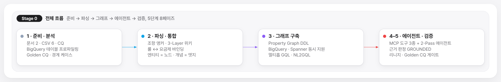

# Colab 노트북 — Agentic Ontology Starter (코드 수준 참고 워크스루)

> **언어**: 한국어 6종(`ko/`) · English 6 (`en/`) — 같은 순서 · 같은 내용
> **관계**: 스타터 데모 화면(`src/web/static/`, 6단계 마법사)이 **무엇을 · 어떤 순서로** 하는지 보여 준다면, 이 노트북들은 같은 방법론을 **코드 한 줄 단위**로 따라가는 참고 자료입니다. 처음이라면 데모 화면 → 이 노트북 순서를 권합니다.

## 1. 노트북 목록

| 단계 | 내용 | 한국어 | English |
| :---: | :--- | :--- | :--- |
| Stage 0 | 전체 흐름 워크스루 — 5단계 8페이즈와 테이블 구조 | [`ko/stage0_overview_walkthrough_ko.ipynb`](ko/stage0_overview_walkthrough_ko.ipynb) | [`en/stage0_overview_walkthrough_en.ipynb`](en/stage0_overview_walkthrough_en.ipynb) |
| Stage 1 | 준비 · 분석 — 입력 자산 · 테이블 프로파일링 · Golden CQ | [`ko/stage1_asset_and_cq_ko.ipynb`](ko/stage1_asset_and_cq_ko.ipynb) | [`en/stage1_asset_and_cq_en.ipynb`](en/stage1_asset_and_cq_en.ipynb) |
| Stage 2 | 파싱 · 통합 — 조항 앵커 · 3-Layer 위키 · 룰 바인딩 | [`ko/stage2_wiki_and_semantic_graph_ko.ipynb`](ko/stage2_wiki_and_semantic_graph_ko.ipynb) | [`en/stage2_wiki_and_semantic_graph_en.ipynb`](en/stage2_wiki_and_semantic_graph_en.ipynb) |
| Stage 3 | 그래프 구축 — Property Graph DDL · GQL · NL2GQL | [`ko/stage3_property_graph_bigquery_spanner_ko.ipynb`](ko/stage3_property_graph_bigquery_spanner_ko.ipynb) | [`en/stage3_property_graph_bigquery_spanner_en.ipynb`](en/stage3_property_graph_bigquery_spanner_en.ipynb) |
| Stage 4 | 에이전트 · MCP — 도메인 도구 3종 · 2-Pass 에이전트 | [`ko/stage4_agent_and_mcp_execution_ko.ipynb`](ko/stage4_agent_and_mcp_execution_ko.ipynb) | [`en/stage4_agent_and_mcp_execution_en.ipynb`](en/stage4_agent_and_mcp_execution_en.ipynb) |
| Stage 5 | 리니지 · 평가 — 원천 → 답변 추적 · Golden CQ · 경계 평가 | [`ko/stage5_lineage_and_evaluation_ko.ipynb`](ko/stage5_lineage_and_evaluation_ko.ipynb) | [`en/stage5_lineage_and_evaluation_en.ipynb`](en/stage5_lineage_and_evaluation_en.ipynb) |

## 2. 실행 전에 알아 둘 것

- 노트북에 남아 있는 출력과 SQL 예시는 **최초 작성 환경(`seanjung-poc.starter_ontology_dw`, 당시 모델 `gemini-4-argon`) 기준 스냅샷**입니다. 내 프로젝트에서 실행하려면 저장소 루트의 `.env`(`.env.example` 참고)로 `GCP_PROJECT_ID` · `BQ_DATASET_ID` · `GCS_WIKI_BUCKET`을 지정하고, `%%bqsql` 셀의 프로젝트 · 데이터셋 이름을 내 값으로 바꿔 주세요. 현재 스타터 기본 모델은 `gemini-4-argon`(Vertex AI `global`)입니다.
- 데이터 적재는 스타터 데모 화면의 **4. 데이터 적재** 단계(입력한 리소스에 GCS 문서 · 위키, BigQuery 테이블, Property Graph를 실제로 만듦)로 먼저 해 두면 노트북 셀이 같은 테이블 · 그래프를 조회합니다.
- 흐름 그림(`assets/stage*_flow_{ko,en}.png`)은 Studio v6 흐름도 문법으로 다시 그렸습니다. 다시 만들 때는 `assets/flows/render_stage_flows.html?stage=<이름>&lang=ko|en`을 2배율로 캡처합니다(사양: `assets/flows/nb_stage_flows.js`, 렌더러: `src/web/static/aolflow.js`).

---

## English summary

These six notebooks (KO and EN, same order and content) walk through the same methodology as the starter demo at code level: Stage 0 overview → Stage 1 prepare · analyze → Stage 2 parse · integrate → Stage 3 property graph → Stage 4 agent · MCP → Stage 5 lineage · evaluation. Saved outputs and SQL examples are a snapshot of the original environment (`seanjung-poc.starter_ontology_dw`, then `gemini-4-argon`); set `GCP_PROJECT_ID`, `BQ_DATASET_ID` and `GCS_WIKI_BUCKET` in `.env` and edit the project/dataset in the `%%bqsql` cells to run them in your own project (current default model: `gemini-4-argon`, Vertex AI `global`). Load the data first with step **4 · Load data** of the starter demo. The flow images were redrawn in the Studio v6 grammar; regenerate them from `assets/flows/render_stage_flows.html`.
