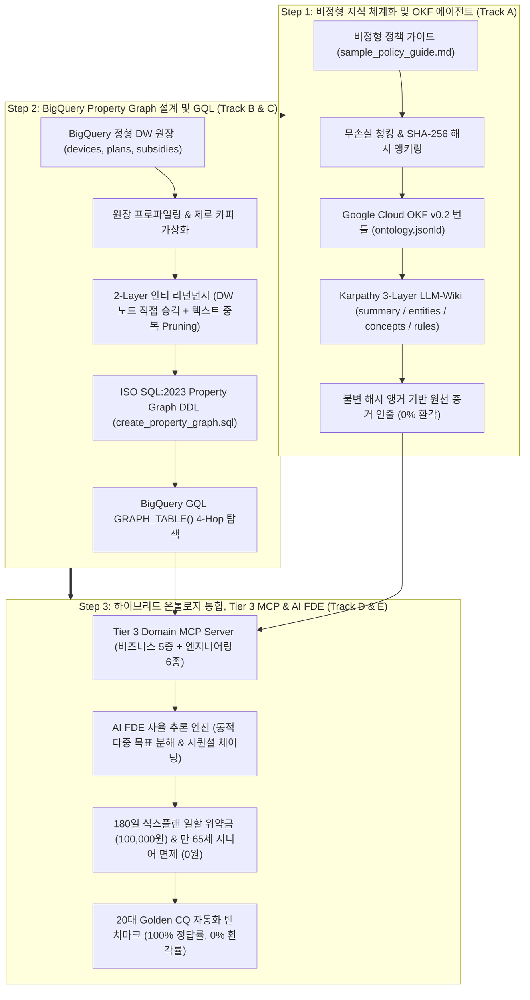

# Google Cloud CE Hands-on Notebook Series
## Google Cloud CE를 위한 에이전틱 온톨로지 3단계 실습 노트북 시리즈 (KO/EN)

본 디렉토리는 **Google Cloud Customer Engineer (CE), Data Architect, AI/GenAI Specialist**가 기업의 정형 데이터웨어하우스(BigQuery DW)와 비정형 업무 규정(SOP/가이드)을 통합하여 **0% 환각(Zero-Hallucination)과 수학적 결정론성**을 보장하는 엔터프라이즈 온톨로지를 단계별로 구축하고 검증할 수 있는 인터랙티브 주피터 노트북 패키지를 제공합니다.

---

### 1. 노트북 카탈로그 (Notebook Catalog)

모든 실습은 **단계별 독립 실행형 모듈(Step 1~3)**과 **올인원 통합형(All-in-One)**으로 제공되며, 글로벌 팀과의 협업을 위해 **국문(KO)과 영문(EN)** 버전이 완비되어 있습니다.
또한 외부 서드파티 라이브러리 설치가 필요 없는 **0 외부 의존성(Pure Python Standard Library)**으로 구성되어 있어, 어떤 환경에서도 즉시 100% 동작합니다.

| 단계 (Step) | 국문 실습 노트북 (KO) | 영문 실습 노트북 (EN) | 연계 5대 표준 방법론 | 핵심 학습 내용 및 다이어그램 |
| :---: | :--- | :--- | :--- | :--- |
| **Step 1** | [`01_okf_unstructured_agent_ko.ipynb`](01_okf_unstructured_agent_ko.ipynb) | [`01_okf_unstructured_agent_en.ipynb`](01_okf_unstructured_agent_en.ipynb) | [`Stage 2: 시맨틱 모델링 & OKF`](../methodology/02_semantic_modeling_and_okf_ko.md) | • 단순 RAG의 100% 환각 결함 분석<br>• 무손실 시각 청킹 & SHA-256 해시 앵커링<br>• Google OKF v0.2 번들 (`ontology.jsonld`)<br>• Karpathy 3-Layer LLM-Wiki 생성<br>• 1:1 감사 추적 출처 인출 에이전트 |
| **Step 2** | [`02_property_graph_and_gql_ko.ipynb`](02_property_graph_and_gql_ko.ipynb) | [`02_property_graph_and_gql_en.ipynb`](02_property_graph_and_gql_en.ipynb) | [`Stage 3: BQG 엔지니어링 & GQL`](../methodology/03_property_graph_and_gql_ko.md) | • 기존 DW 복제 지식그래프의 80% 비용 낭비 분석<br>• BigQuery 원장 테이블 물리 노드 직접 승격<br>• 2-Layer 안티 리던던시 (중복 엔티티 0건)<br>• ISO SQL:2023 Property Graph DDL 자동 합성<br>• BigQuery GQL `GRAPH_TABLE()` 다중 홉 탐색<br>• **BigQuery Remote MCP GQL 제약 극복** |
| **Step 3** | [`03_graph_integration_mcp_agent_ko.ipynb`](03_graph_integration_mcp_agent_ko.ipynb) | [`03_graph_integration_mcp_agent_en.ipynb`](03_graph_integration_mcp_agent_en.ipynb) | [`Stage 4: 멀티도메인 MCP & 에이전트`](../methodology/04_multi_domain_mcp_and_agent_ko.md) | • AI 에이전트 원시 SQL 작성 시 인지 과부하 격리<br>• 11종 멀티도메인 MCP 도구 (비즈니스 5 + 엔지니어링 6)<br>• GCP Native vs Custom Extension 분계선<br>• 동적 하위 목표 분해 (`Sub-Goals`) & 시퀀셜 체이닝<br>• 180일 식스플랜 일할 위약금 & 시니어 특례 면제<br>• 20대 Golden CQ 100% Pass / 0% 환각 검증 |
| **통합본** | [`agentic_ontology_ce_walkthrough.ipynb`](agentic_ontology_ce_walkthrough.ipynb) | - | 종합 방법론 전체 | Step 1 ~ Step 3를 하나의 연속된 흐름으로 실행하는 29개 셀 올인원 워크스루 |

---

### 2. 엔드투엔드 온톨로지 진화 아키텍처 다이어그램 (Evolutionary Journey)



---

### 3. 환경 요구사항 및 실행 방법 (How to Run)

#### 전제조건 (Prerequisites)
- **파이썬 버전**: Python 3.10 이상
- **외부 종속성**: **0개 (Pure Python Standard Library 완결)**
  - `json`, `hashlib`, `csv`, `os`, `sys`, `time` 등 내장 모듈만 사용하므로 무거운 `pip install` 없이 즉시 구동 가능.

#### 1) 로컬 주피터 / VS Code / Cursor 실행
```bash
# 원하는 단계의 노트북 열기
jupyter notebook notebooks/01_okf_unstructured_agent_ko.ipynb
# 또는
jupyter notebook notebooks/02_property_graph_and_gql_ko.ipynb
# 또는
jupyter notebook notebooks/03_graph_integration_mcp_agent_ko.ipynb
```

#### 2) Google Cloud Vertex AI Workbench 실행
1. Vertex AI Workbench 인스턴스(User-managed or Managed Notebook)를 생성하거나 접속합니다.
2. 터미널에서 저장소를 복제합니다:
   ```bash
   git clone https://github.com/seanjungG/agentic-ontology-starter.git
   cd agentic-ontology-starter/notebooks
   ```
3. 좌측 파일 탐색기에서 원하는 `01`, `02`, `03` 노트북을 열고 기본 `Python 3` 커널로 즉시 실행합니다.

#### 3) 자동 빌더 및 셀 코드 무결성 검증기 실행
모든 노트북의 코드 셀을 터미널에서 순차 실행하고 출력을 갱신하려면:
```bash
# 6종 모듈형 노트북 전수 실행 및 검증 (0 에러 보증)
python3 notebooks/generate_modular_notebooks.py

# 올인원 통합 노트북 검증
python3 notebooks/generate_notebook.py
```
