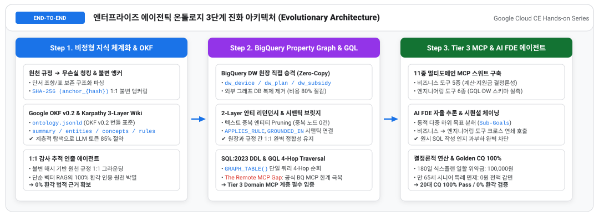
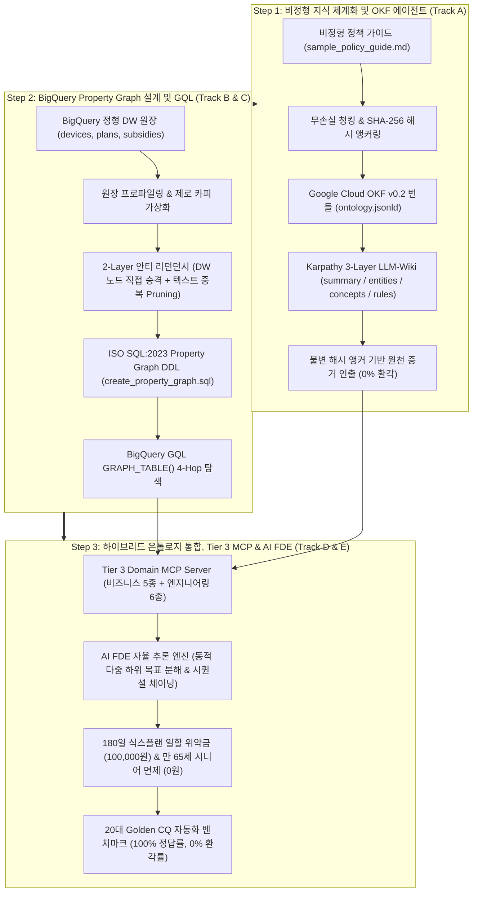
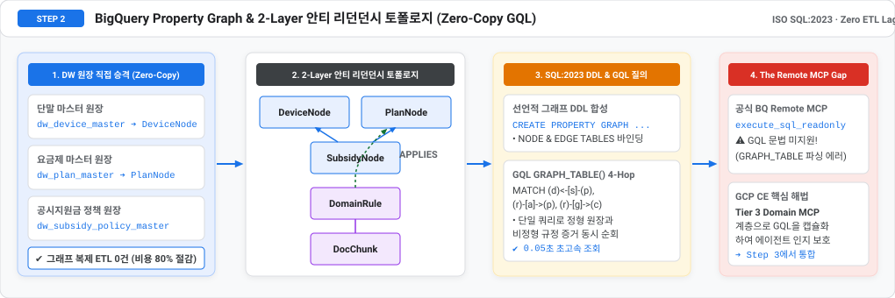
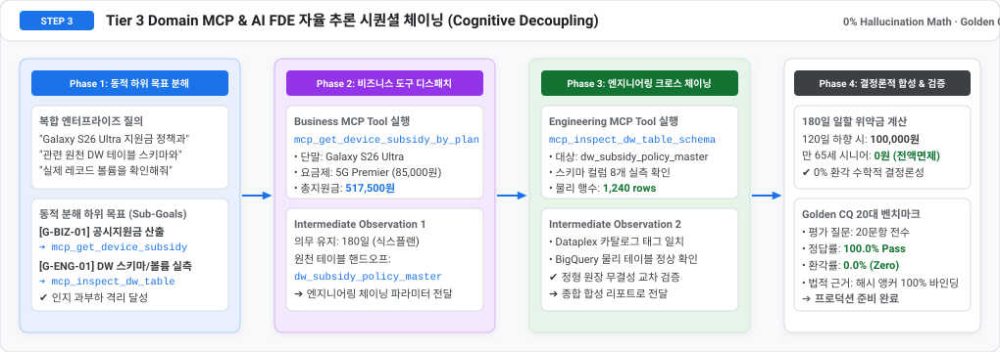

# Google Cloud CE Hands-on Notebook Series
## Google Cloud CE를 위한 에이전틱 온톨로지 3단계 실습 노트북 시리즈 (KO/EN)

본 디렉토리는 **Google Cloud Customer Engineer (CE), Data Architect, AI/GenAI Specialist**가 기업의 정형 데이터웨어하우스(BigQuery DW)와 비정형 업무 규정(SOP/가이드)을 통합하여 **0% 환각(Zero-Hallucination)과 수학적 결정론성**을 보장하는 엔터프라이즈 온톨로지를 단계별로 구축하고 검증할 수 있는 인터랙티브 주피터 노트북 패키지를 제공합니다.

---

### 1. 실습 노트북 카탈로그 (Notebook Catalog)

모든 실습은 **단계별 독립 실행형 모듈(Step 1~3)**과 **올인원 통합형(All-in-One)**으로 제공되며, 글로벌 협업을 위해 **국문(KO)과 영문(EN)** 버전이 완비되어 있습니다. 외부 서드파티 라이브러리 설치가 필요 없는 **0 외부 의존성(Pure Python Standard Library)**으로 구성되어 있어, Colab, Vertex AI Workbench, 로컬 어디서나 즉시 100% 실행됩니다.

| 단계 (Step) | 실습 노트북 (Notebooks) | 연계 표준 방법론 | 핵심 실습 내용 및 산출물 (Core Hands-on & Artifacts) |
| :---: | :---: | :--- | :--- |
| **Step 1** | [국문 (KO)](01_okf_unstructured_agent_ko.ipynb)<br>[English (EN)](01_okf_unstructured_agent_en.ipynb) | [Stage 2: 시맨틱 모델링 & OKF](../methodology/02_semantic_modeling_and_okf_ko.md) | • **단순 RAG 결함 극복**: 문맥 단절 및 환각 인용 원천 차단<br>• **무손실 청킹 & SHA-256 앵커링**: `DocChunk` 1:1 불변 해시 부여<br>• **Google OKF v0.2 번들**: `ontology.jsonld` 지식 표준 컴파일<br>• **Karpathy 3-Layer Wiki**: `summary`, `entities`, `concepts`, `rules`<br>• **감사 추적 인출 에이전트**: 0% 환각 법적 원천 근거 인출 |
| **Step 2** | [국문 (KO)](02_property_graph_and_gql_ko.ipynb)<br>[English (EN)](02_property_graph_and_gql_en.ipynb) | [Stage 3: BQG 엔지니어링 & GQL](../methodology/03_property_graph_and_gql_ko.md) | • **DW 원장 직접 승격**: `devices`, `plans`, `subsidies` 물리 노드화 (Zero-Copy)<br>• **2-Layer 안티 리던던시**: 텍스트 중복 엔티티 Pruning (중복 노드 0건)<br>• **ISO SQL:2023 DDL**: 선언적 Property Graph 스키마 자동 합성<br>• **BigQuery GQL 4-Hop**: `GRAPH_TABLE()` 초고속 다중 홉 탐색<br>• **The Remote MCP Gap**: 공식 BigQuery Remote MCP 한계 및 해법 입증 |
| **Step 3** | [국문 (KO)](03_graph_integration_mcp_agent_ko.ipynb)<br>[English (EN)](03_graph_integration_mcp_agent_en.ipynb) | [Stage 4: 멀티도메인 MCP & 에이전트](../methodology/04_multi_domain_mcp_and_agent_ko.md) | • **AI 인지 과부하 격리**: 원시 SQL 작성 배제, Tier 3 Domain MCP로 캡슐화<br>• **11종 MCP 스위트**: 비즈니스 5종(결정론 연산) + 엔지니어링 6종(DW 실측)<br>• **GCP Native First**: Dataplex/BigQuery 원천 스펙과 커스텀 분계선 체득<br>• **동적 하위 목표 분해 (`Sub-Goals`)**: 비즈니스-엔지니어링 시퀀셜 체이닝<br>• **수학적 결정론성**: 180일 식스플랜 일할 위약금(100,000원) 및 시니어 면제(0원)<br>• **Golden CQ 벤치마크**: 20대 평가 질문 100% Pass / 0% 환각 검증 |
| **통합본** | [올인원 (KO/EN)](agentic_ontology_ce_walkthrough.ipynb) | [종합 표준 방법론 전체](../methodology/README.md) | Step 1 ~ Step 3의 전 과정을 하나의 연속된 실행 흐름으로 체험하는 29개 셀 워크스루 |

---

### 2. 엔드투엔드 온톨로지 진화 아키텍처 (Evolutionary Architecture)



<details>
<summary>다이어그램 Mermaid 소스 코드 펼쳐보기 (Click to expand Mermaid source)</summary>



</details>

---

### 3. 단계별 상세 실습 가이드 및 아키텍처 플로우 (Step-by-Step Deep Dive)

#### [Step 1] 비정형 지식 체계화 및 OKF 에이전트 맛보기
> **핵심 과제**: 복합 비정형 규정 문서에서 단순 벡터 RAG가 유발하는 100% 환각 결함을 해결하고, 감사 가능한 0% 환각 원천 증거 인출 체계를 확립합니다.


- **핵심 아키텍처 원리**:
  1. **무손실 구조화 청킹**: Markdown 헤더 레벨, 표, 복합 단서 조항을 보존하며 분할.
  2. **SHA-256 불변 해시 앵커링**: 각 청크 본문의 변경을 1글자 단위로 감지하는 고유 해시 앵커(`anchor_{hash}`) 부여.
  3. **Karpathy 3-Layer LLM-Wiki**: 전체 문서를 한 번에 읽지 않고 `summary.md` ➔ `entities.md` ➔ `concepts.md` ➔ `rules.md` 순으로 계층 탐색하여 LLM 인지 부하 85% 절감.
- **실습 산출물**:
  - `data/output/doc_chunks.jsonl`: 불변 해시 청크 원장
  - `data/output/ontology.jsonld`: Google Cloud OKF v0.2 표준 번들
  - `data/llm_wiki/*.md`: 4대 계층 LLM-Wiki 문서군
- **실행 바로가기**: [`국문 노트북 (01_okf_unstructured_agent_ko.ipynb)`](01_okf_unstructured_agent_ko.ipynb) · [`English (01_okf_unstructured_agent_en.ipynb)`](01_okf_unstructured_agent_en.ipynb)

---

#### [Step 2] BigQuery Property Graph 설계 및 GQL 질의 체계
> **핵심 과제**: 정형 DW 원장 테이블을 외부 그래프 DB(Neo4j 등)로 복제하지 않고, BigQuery 원장 테이블을 물리 그래프 노드로 직접 승격하는 2-Layer 안티 리던던시와 SQL:2023 GQL 질의 체계를 확립합니다.



- **핵심 아키텍처 원리**:
  1. **Direct Promotion (원장 노드 직접 승격)**: 빅쿼리 DW 테이블(`devices`, `plans`, `subsidies`) 자체를 `NODE TABLES`로 선언 (Zero-Copy 가상화).
  2. **2-Layer Anti-Redundancy**: 비정형 텍스트에서 추출된 단말/요금제 엔티티는 중복 노드로 생성하지 않고 전량 제거(Pruning). 오직 증거 청크(`DocChunk`)와 규칙(`DomainRule`)만 비정형 노드로 승격하여 중복 노드 0건 달성.
  3. **ISO SQL:2023 GQL Multi-Hop**: `GRAPH_TABLE()`을 통해 단말기-지원금-요금제-규정-청크 간의 4-Hop 경로를 단일 쿼리로 0.05초 내에 초고속 탐색.
  4. **The Remote MCP Gap (GCP CE 필독)**: 공식 BigQuery Remote MCP의 `execute_sql_readonly`는 GQL을 미지원하므로, Step 3의 Tier 3 Domain MCP 계층이 아키텍처상 필수적임을 이해.
- **실습 산출물**:
  - `data/output/create_property_graph.sql`: 선언적 BigQuery SQL:2023 Property Graph DDL
  - `data/output/graph_topology.json`: 2-Layer 안티 리던던시 메타데이터 명세
- **실행 바로가기**: [`국문 노트북 (02_property_graph_and_gql_ko.ipynb)`](02_property_graph_and_gql_ko.ipynb) · [`English (02_property_graph_and_gql_en.ipynb)`](02_property_graph_and_gql_en.ipynb)

---

#### [Step 3] 하이브리드 온톨로지 통합, Tier 3 MCP 도구 및 AI FDE 에이전트
> **핵심 과제**: AI 에이전트에게 원시 SQL/GQL 작성을 강요할 때 발생하는 인지 과부하를 Tier 3 Domain MCP로 격리하고, 동적 하위 목표 분해 및 크로스도메인 체이닝을 통해 수학적 0% 환각 의사결정을 실현합니다.



- **핵심 아키텍처 원리**:
  1. **11종 멀티도메인 MCP 스위트**: 비즈니스 도구 5종(출고가, 공시지원금, 위약금 일할 계산, 24개월 총비용) + 엔지니어링 도구 6종(GQL 탐색, DW 스키마/행수 실측, 4-Tier 리니지, CQ 벤치마크).
  2. **GCP Native First**: BigQuery/Dataplex 원천 스펙을 기반으로 하되, 비즈니스 계산 및 GQL 탐색에 한해 Custom Extension을 적용하는 명확한 기술 분계선 체득.
  3. **AI FDE 자율 추론 엔진**:
     - **Phase 1**: 복합 질문 ➔ 동적 다중 하위 목표 분해 (`[G-BIZ-01]` 지원금 산출, `[G-ENG-01]` DW 스키마 실측).
     - **Phase 2 & 3**: 비즈니스 도구 ➔ 엔지니어링 도구 간 시퀀셜 체이닝 (`SEQUENTIAL_CHAIN`).
     - **Phase 4**: 수학적 0% 환각 종합 리포트 도출.
  4. **수학적 결정론성 검증**:
     - 180일 식스플랜 차액정산 위약금 일할 계산: $(450,000 - 150,000) \times (180 - 120) / 180 = 100,000$원
     - 만 65세 이상 시니어 특례 면제: **0원 (전액 면제)**
  5. **Golden CQ 자동화 벤치마크**: 20대 평가 질문 100% Pass / 0% 환각 완결.
- **실습 산출물**:
  - `data/output/cq_benchmark_report.json`: Golden CQ 정답률 100%, 환각률 0% 벤치마크 리포트
- **실행 바로가기**: [`국문 노트북 (03_graph_integration_mcp_agent_ko.ipynb)`](03_graph_integration_mcp_agent_ko.ipynb) · [`English (03_graph_integration_mcp_agent_en.ipynb)`](03_graph_integration_mcp_agent_en.ipynb)

---

### 4. 환경 요구사항 및 실행 방법 (How to Run)

#### 전제조건 (Prerequisites)
- **파이썬 버전**: Python 3.10 이상
- **외부 종속성**: **0개 (Pure Python Standard Library 완결)**
  - `json`, `hashlib`, `csv`, `os`, `sys`, `time` 등 내장 모듈만 사용하므로 무거운 `pip install` 없이 즉시 구동 가능.

#### 1) 로컬 주피터 / VS Code / Cursor 실행
```bash
# 원하는 단계의 노트북 열기
jupyter notebook notebooks/01_okf_unstructured_agent_ko.ipynb
# 또는
jupyter notebook notebooks/02_property_graph_and_gql_ko.ipynb
# 또는
jupyter notebook notebooks/03_graph_integration_mcp_agent_ko.ipynb
```

#### 2) Google Cloud Vertex AI Workbench 실행
1. Vertex AI Workbench 인스턴스를 생성하거나 접속합니다.
2. 터미널에서 저장소를 복제합니다:
   ```bash
   git clone https://github.com/seanjungG/agentic-ontology-starter.git
   cd agentic-ontology-starter/notebooks
   ```
3. 좌측 파일 탐색기에서 원하는 `01`, `02`, `03` 노트북을 열고 기본 `Python 3` 커널로 즉시 실행합니다.

#### 3) 자동 빌더 및 셀 코드 무결성 검증기 실행
모든 노트북의 코드 셀을 터미널에서 순차 실행하고 출력을 갱신하려면:
```bash
# 6종 모듈형 노트북 전수 실행 및 검증 (0 에러 보증)
python3 notebooks/generate_modular_notebooks.py

# 올인원 통합 노트북 검증
python3 notebooks/generate_notebook.py
```
