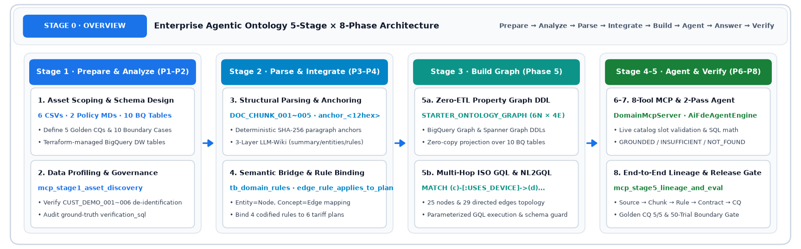

# Notebooks — Live Interactive 3-Lab Web App & 12 Code-Level Walkthroughs

> **Recommended first stop (Live, Zero Setup)**: Run the **[Agentic Ontology Starter Notebook Lab ↗](https://agentic-ontology-starter-notebook-dasz7pvvua-du.a.run.app/#ov)** directly in your browser — **instant guest access (no sign-in required; Google sign-in optional)**, English default with `EN | KO` toggle, real Vertex AI Gemini + isolated per-session GCS / Spanner Graph / BigQuery Property Graph, and one-click **▶ Run all** across 3 progressive labs.

## 1. Live Interactive Notebook Lab (Latest Direction)

| Lab | Duration | Direct Link | What You Run Live |
| :---: | :---: | :--- | :--- |
| **Lab 1 · Ontology** | ~10 min | [`#ov` Overview ↗](https://agentic-ontology-starter-notebook-dasz7pvvua-du.a.run.app/#ov) | `#n1` CQs → `#n2` OKF Wiki + coverage repair → `#n3` Graph design · Spanner Graph load · GQL verify → `#n4` Knowledge Catalog · GQL Agent → `#n5` Head-to-head Wiki vs. GQL Agent evaluation |
| **Lab 2 · Workflow** | ~6 min | [`#w0` Overview ↗](https://agentic-ontology-starter-notebook-dasz7pvvua-du.a.run.app/#w0) | `#w1` Extract rules & workflows → `#w2` Extend Spanner Graph → `#w3` Interactive Workflow Agent → `#w4` Evaluate → `#w5` Change request · Admin approval · Apply · Before/After · Rollback |
| **Lab 3 · Context Graph** | ~6 min | [`#c0` Overview ↗](https://agentic-ontology-starter-notebook-dasz7pvvua-du.a.run.app/#c0) | `#c1` BigQuery Property Graph setup → `#c2` Log runs → `#c3` GQL audit → `#c4` Feedback → tacit candidates → `#c5` Approve · apply to KC · re-ask → `#c6` Loop dashboard · KG snapshots · data explorer |

---

## 2. Offline Code-Level Reference Walkthroughs (12 `.ipynb` Files)

These static notebooks (**6 English under `en/`, 6 Korean under `ko/`** — identical order and content) serve as line-by-line code companions to the live labs and Starter Studio (`/wizard` and `/`).

| Stage | Topic | English (`en/`) | Korean (`ko/`) |
| :---: | :--- | :--- | :--- |
| **Stage 0** | End-to-end overview — 5 stages, 8 phases & table layout | [`en/stage0_overview_walkthrough_en.ipynb`](en/stage0_overview_walkthrough_en.ipynb) | [`ko/stage0_overview_walkthrough_ko.ipynb`](ko/stage0_overview_walkthrough_ko.ipynb) |
| **Stage 1** | Prepare & analyze — input assets · table profiling · Golden CQs | [`en/stage1_asset_and_cq_en.ipynb`](en/stage1_asset_and_cq_en.ipynb) | [`ko/stage1_asset_and_cq_ko.ipynb`](ko/stage1_asset_and_cq_ko.ipynb) |
| **Stage 2** | Parse & unify — clause anchors · 3-layer OKF wiki · rule bindings | [`en/stage2_wiki_and_semantic_graph_en.ipynb`](en/stage2_wiki_and_semantic_graph_en.ipynb) | [`ko/stage2_wiki_and_semantic_graph_ko.ipynb`](ko/stage2_wiki_and_semantic_graph_ko.ipynb) |
| **Stage 3** | Graph build — Property Graph DDL · GQL · NL2GQL | [`en/stage3_property_graph_bigquery_spanner_en.ipynb`](en/stage3_property_graph_bigquery_spanner_en.ipynb) | [`ko/stage3_property_graph_bigquery_spanner_ko.ipynb`](ko/stage3_property_graph_bigquery_spanner_ko.ipynb) |
| **Stage 4** | Agents & MCP — domain tools · 2-pass grounded agent execution | [`en/stage4_agent_and_mcp_execution_en.ipynb`](en/stage4_agent_and_mcp_execution_en.ipynb) | [`ko/stage4_agent_and_mcp_execution_ko.ipynb`](ko/stage4_agent_and_mcp_execution_ko.ipynb) |
| **Stage 5** | Lineage & evaluation — source-to-answer lineage · Golden CQ & boundary eval | [`en/stage5_lineage_and_evaluation_en.ipynb`](en/stage5_lineage_and_evaluation_en.ipynb) | [`ko/stage5_lineage_and_evaluation_ko.ipynb`](ko/stage5_lineage_and_evaluation_ko.ipynb) |

### Running the Offline `.ipynb` Files in Your Own Project

- Saved cell outputs and SQL snippets inside these static `.ipynb` files are reference snapshots captured with `gemini-4-argon` (Vertex AI `global`).
- To execute them against your own project, configure `.env` from [`.env.example`](../.env.example) (`GCP_PROJECT_ID`, `BQ_DATASET_ID`, `GCS_WIKI_BUCKET`) and replace the dataset prefix in `%%bqsql` cells with `<your-gcp-project>.<your_dataset>`.
- Load the sample tables and property graph first using Starter Studio (Step 4) or `/wizard#step-4`, then run the notebook cells against the same dataset.
- Flow diagrams (`assets/stage*_flow_{en,ko}.png`) use the shared Studio v6 flow renderer (`assets/flows/render_stage_flows.html?stage=<name>&lang=en|ko`, renderer `src/web/static/aolflow.js`).

---

## 한국어 요약

- **추천 시작점**: 설치나 로그인 없이 브라우저에서 바로 실행할 수 있는 **[라이브 3-Lab 노트북 랩 ↗](https://agentic-ontology-starter-notebook-dasz7pvvua-du.a.run.app/#ov)** (`#ov` 온톨로지 · `#w0` 워크플로우 · `#c0` Context Graph, 영문 기본 + `EN | KO` 전환)을 먼저 경험하세요.
- 위 표의 정적 `.ipynb` 12종(`ko/` 6종 · `en/` 6종)은 같은 방법론을 **코드 한 줄 단위**로 따라가는 오프라인 참고 워크스루입니다. 내 프로젝트에서 실행할 때는 루트 `.env`와 `%%bqsql` 셀의 프로젝트 · 데이터셋 이름을 내 값으로 바꿔 실행하세요.
